<div align="center">


# Universidad Peruana de Ciencias Aplicadas

## Carrera de Ingeniería de Software

**1ACC0238**
<br>
**Aplicaciones para Dispositivos Móviles**

NRC

**4950**

# Informe de Trabajo Final

<br>

Docente

**Mayta Guillermo, Jorge Luis**

Equipo

**CogniTech**

Proyecto

**MindFlow**
<br>
<br>

### Integrantes


**Tabla 1. Informe de Trabajo Final — Integrantes.**

| Código      | Apellidos y Nombres |
| ----------- | -------------------- |
| u202412462  | Cabrera Sotelo, Camila Celeste |
| u202410421  | Diaz de la Cruz, Sebastian Gabriel |
| u202413169  | Güere Calero, Fernando Julio |
| u202410024  | Jáuregui Cerna, Jean Franco |
| u202410382  | Limache Coronel, Imanol Fabrizio |

<br>


**Periodo 202620**

**Octubre 2026**

</div>

---

<div style="page-break-before: always;"></div>

# Registro de Versiones del Informe


<table>
  <tr>
    <th>Versión</th>
    <th>Fecha</th>
    <th>Autor</th>
    <th>Descripción de modificación</th>
  </tr>

  <tr>
    <td><b>Primera Entrega (AV1)</b></td>
    <td>18/09/2026</td>
    <td>
      Cabrera Sotelo, Camila Celeste <br>
      <br>
      <p></p>
      Diaz de la Cruz, Sebastian Gabriel <br>
      <br>
      <p></p>
      Güere Calero, Fernando Julio <br>
      <br>
      <p></p>
      Jáuregui Cerna, Jean Franco <br>
      <br>
      <p></p>
      Limache Coronel, Imanol Fabrizio <br>
    </td>
    <td>
      Capítulo I: Presentación (Startup Profile, Lean UX Process) <br>
      Capítulo II: Requirements Development and Software Solution Design (Needfinding - Big Picture EventStorming; Strategic-Level DDD - EventStorming, Candidate Context Discovery)
    </td>
  </tr>

  <tr>
    <td><b>Segunda Entrega (TB1)</b></td>
    <td>05/10/2026</td>
    <td>
      Cabrera Sotelo, Camila Celeste <br>
      <br>
      <p></p>
      Diaz de la Cruz, Sebastian Gabriel <br>
      <br>
      <p></p>
      Güere Calero, Fernando Julio <br>
      <br>
      <p></p>
      Jáuregui Cerna, Jean Franco <br>
      <br>
      <p></p>
      Limache Coronel, Imanol Fabrizio <br>
    </td>
    <td>
      Capítulo III: Solution UI/UX Design (diseño de producto: guías de estilo, arquitectura de información y diseño UX/UI del Landing Page y las Mobile Applications) <br>
      Capítulo IV: Product Implementation & Validation (configuración del proyecto, implementación del Sprint 1 del Landing Page y las Mobile Applications, y entrevistas de validación)
    </td>
  </tr>
  <!-- 
  <tr>
    <td><b>Primera Entrega (TB1)</b></td>
    <td>[Fecha]</td>
    <td>[Autor(es)]</td>
    <td>[Avance]</td>
  </tr>
  <tr>
    <td><b>Segunda Entrega (TP)</b></td>
    <td>[Fecha]</td>
    <td>[Autor(es)]</td>
    <td>[Avance]</td>
  </tr>
  <tr>
    <td><b>Tercera Entrega (TB2)</b></td>
    <td>[Fecha]</td>
    <td>[Autor(es)]</td>
    <td>[Avance]</td>
  </tr>
  <tr>
    <td><b>Cuarta Entrega (TF)</b></td>
    <td>[Fecha]</td>
    <td>[Autor(es)]</td>
    <td>[Avance]</td>
  </tr>
  -->
</table>


---

<div style="page-break-before: always;"></div>

# Project Report Collaboration Insights

El informe del proyecto fue desarrollado de manera colaborativa por el equipo mediante el repositorio de GitHub creado para la gestión del Project Report de MindFlow. Este repositorio contiene los archivos del informe, los diagramas, las evidencias y el historial de versiones correspondiente a cada entrega.

URL de la organización de GitHub: https://github.com/upc-pre-202620-1acc0238-4950-CogniTech

**Primera Entrega (AV1)**

Durante la primera entrega del proyecto MindFlow, el equipo trabajó de manera colaborativa en la elaboración del Project Report, organizando las actividades y responsabilidades de forma grupal para cubrir las diferentes secciones del informe correspondientes a esta etapa.

El desarrollo del trabajo incluyó actividades de investigación y documentación del dominio del negocio: la descripción de la Startup y el desarrollo del Lean UX Process (Problem Statements y Assumptions) para el Capítulo I, así como el modelado del negocio mediante Big Picture EventStorming y el inicio del Strategic-Level Domain-Driven Design (sesión de EventStorming y Candidate Context Discovery) para el Capítulo II, permitiendo al equipo consolidar una primera visión compartida de los Bounded Contexts candidatos de la solución.

Para la organización y seguimiento del trabajo, el equipo utilizó GitHub como plataforma principal de colaboración y control de versiones, siguiendo el flujo de trabajo GitFlow (ramas `feature/*` sobre `develop`, integradas mediante Pull Requests). Mediante ramas de trabajo, commits y Pull Requests, fue posible registrar los avances realizados en el informe y mantener evidencia continua de la participación grupal durante esta primera entrega (Figura 1).

<div align="center">

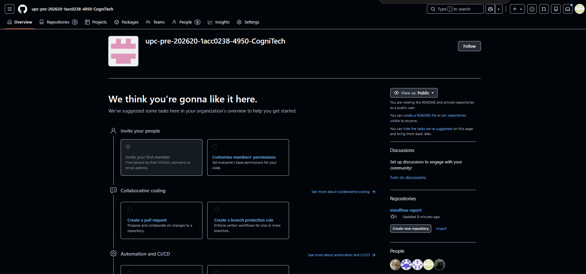

*Figura 1. Creación y organización del repositorio del Project Report en GitHub.*

*(Ver Figura 2.)*

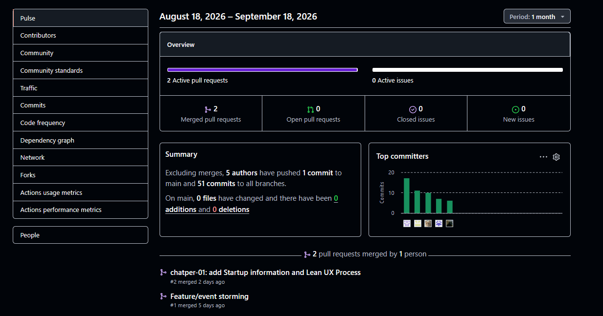

*Figura 2. Historial de commits del equipo durante la primera entrega (AV1).*

</div>

---

**Segunda Entrega (TB1)**

Para la segunda entrega, el trabajo colaborativo del equipo se amplió del único repositorio del Project Report a los cuatro repositorios que conforman la solución completa de MindFlow:

- Informe: [`mindflow-report`](https://github.com/upc-pre-202620-1acc0238-4950-CogniTech/mindflow-report)
- Backend: [`mindflow-backend`](https://github.com/upc-pre-202620-1acc0238-4950-CogniTech/mindflow-backend), documentación interactiva en [Swagger](https://powerful-wholeness-production.up.railway.app/swagger)
- Mobile Application (Android nativo): [`mindflow-frontend`](https://github.com/upc-pre-202620-1acc0238-4950-CogniTech/mindflow-frontend)
- Landing Page: [`mindflow-landingPage`](https://github.com/upc-pre-202620-1acc0238-4950-CogniTech/mindflow-landingPage), desplegado en [GitHub Pages](https://upc-pre-202620-1acc0238-4950-cognitech.github.io/mindflow-landingPage/)
- Diseño: [Figma — AppMoviles](https://www.figma.com/design/oL5qBZ6aVIPJBJTRZJ23jH/AppMoviles?t=WGZWtJXygKBervV6-1)

El desarrollo del trabajo incluyó la elaboración completa de los Capítulos I al IV del informe —Lean UX Process y segmentos objetivo, análisis competitivo y entrevistas de descubrimiento, Domain-Driven Design estratégico y táctico de los 8 Bounded Contexts, arquitectura de software en C4 Model, Style Guide e Information Architecture, wireframes y mock-ups del Landing Page y la Mobile Application, y la evidencia del Sprint 1 junto con las primeras entrevistas de validación—, en paralelo a la implementación del backend sobre esos mismos 8 Bounded Contexts, el desarrollo de la Mobile Application nativa en Android y la construcción y despliegue del Landing Page.

En los cuatro repositorios se mantuvo el mismo flujo de trabajo GitFlow adoptado desde la primera entrega (ramas `feature/*` sobre `develop`, integradas mediante Pull Requests), lo que permitió registrar los avances realizados y mantener evidencia continua de la participación grupal en esta segunda entrega (Figuras 3 a 6).

<div align="center">

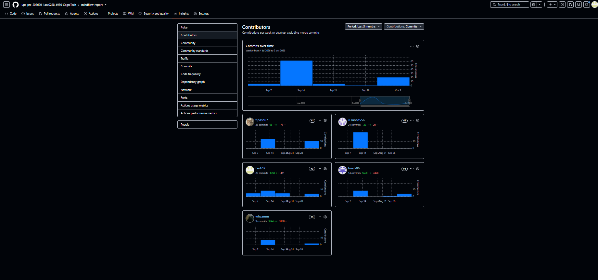

*Figura 3. Historial de colaboración del repositorio `mindflow-report` durante la segunda entrega (TB1).*

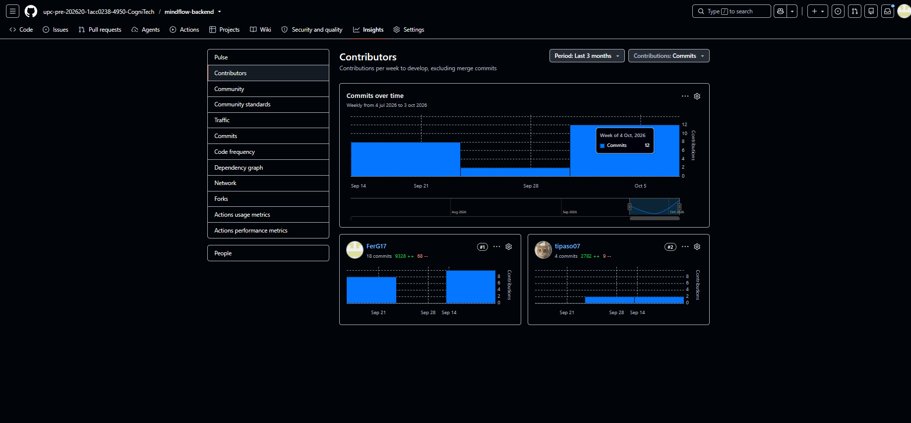

*Figura 4. Historial de colaboración del repositorio `mindflow-backend` durante la segunda entrega (TB1).*

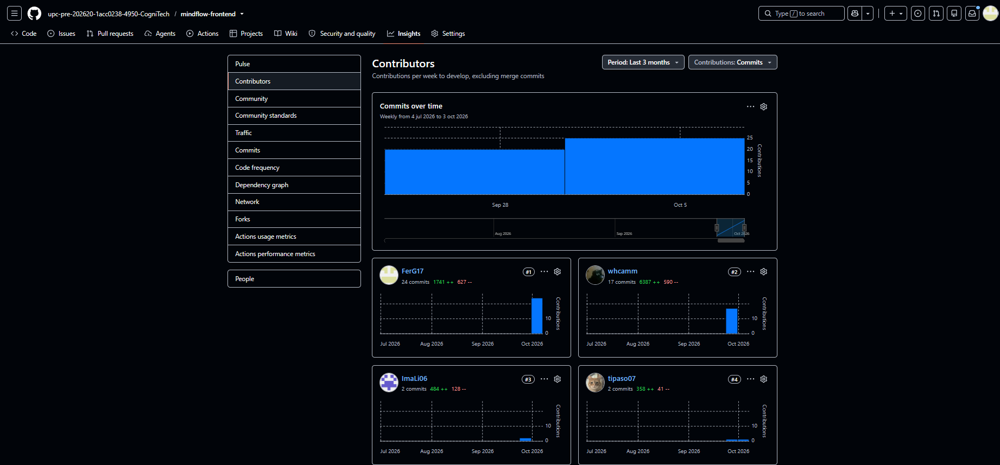

*Figura 5. Historial de colaboración del repositorio `mindflow-frontend` durante la segunda entrega (TB1).*

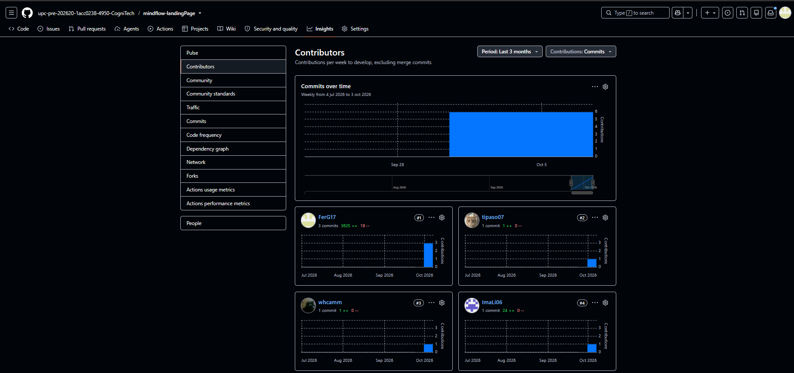

*Figura 6. Historial de colaboración del repositorio `mindflow-landingPage` durante la segunda entrega (TB1).*

</div>

---

<div style="page-break-before: always;"></div>

# Contenido

## Tabla de Contenidos

- [Registro de Versiones del Informe](#registro-de-versiones-del-informe)
- [Project Report Collaboration Insights](#project-report-collaboration-insights)
- [Contenido](#contenido)
  - [Tabla de Contenidos](#tabla-de-contenidos)
- [Student Outcome](#student-outcome)
- [Objetivos SMART](#objetivos-smart)
- [Capítulo I: Presentación](#capítulo-i-presentación)
  - [1.1. Startup Profile](#11-startup-profile)
    - [1.1.1. Descripción de la Startup](#111-descripción-de-la-startup)
    - [1.1.2. Perfiles de integrantes del equipo](#112-perfiles-de-integrantes-del-equipo)
  - [1.2. Solution Profile](#12-solution-profile)
    - [1.2.1. Antecedentes y problemática](#121-antecedentes-y-problemática)
    - [1.2.2. Lean UX Process](#122-lean-ux-process)
      - [1.2.2.1. Lean UX Problem Statements](#1221-lean-ux-problem-statements)
      - [1.2.2.2. Lean UX Assumptions](#1222-lean-ux-assumptions)
      - [1.2.2.3. Lean UX Hypothesis Statements](#1223-lean-ux-hypothesis-statements)
      - [1.2.2.4. Lean UX Canvas](#1224-lean-ux-canvas)
  - [1.3. Segmentos objetivo](#13-segmentos-objetivo)
- [Capítulo II: Requirements Development and Software Solution Design](#capítulo-ii-requirements-development-and-software-solution-design)
  - [2.1. Competidores](#21-competidores)
    - [2.1.1. Análisis competitivo](#211-análisis-competitivo)
    - [2.1.2. Estrategias y tácticas frente a competidores](#212-estrategias-y-tácticas-frente-a-competidores)
  - [2.2. Entrevistas](#22-entrevistas)
    - [2.2.1. Diseño de entrevistas](#221-diseño-de-entrevistas)
    - [2.2.2. Registro de entrevistas](#222-registro-de-entrevistas)
    - [2.2.3. Análisis de entrevistas](#223-análisis-de-entrevistas)
  - [2.3. Needfinding](#23-needfinding)
    - [2.3.1. User Personas](#231-user-personas)
    - [2.3.2. User Task Matrix](#232-user-task-matrix)
    - [2.3.3. User Journey Mapping](#233-user-journey-mapping)
    - [2.3.4. Empathy Mapping](#234-empathy-mapping)
    - [2.3.5. Big Picture EventStorming](#235-big-picture-eventstorming)
    - [2.3.6. Ubiquitous Language](#236-ubiquitous-language)
  - [2.4. Requirements Specification](#24-requirements-specification)
    - [2.4.1. User Stories](#241-user-stories)
    - [2.4.2. Impact Mapping](#242-impact-mapping)
    - [2.4.3. Product Backlog](#243-product-backlog)
  - [2.5. Strategic-Level Domain-Driven Design](#25-strategic-level-domain-driven-design)
    - [2.5.1. EventStorming](#251-eventstorming)
      - [2.5.1.1. Candidate Context Discovery](#2511-candidate-context-discovery)
      - [2.5.1.2. Domain Message Flows Modeling](#2512-domain-message-flows-modeling)
      - [2.5.1.3. Bounded Context Canvases](#2513-bounded-context-canvases)
    - [2.5.2. Context Mapping](#252-context-mapping)
    - [2.5.3. Software Architecture](#253-software-architecture)
      - [2.5.3.1. Software Architecture Context Level Diagrams](#2531-software-architecture-context-level-diagrams)
      - [2.5.3.2. Software Architecture Container Level Diagrams](#2532-software-architecture-container-level-diagrams)
      - [2.5.3.3. Software Architecture Deployment Diagrams](#2533-software-architecture-deployment-diagrams)
  - [2.6. Tactical-Level Domain-Driven Design](#26-tactical-level-domain-driven-design)
    - [2.6.1. Bounded Context: IAM](#261-bounded-context-iam)
      - [2.6.1.1. Domain Layer](#2611-domain-layer)
      - [2.6.1.2. Interface Layer](#2612-interface-layer)
      - [2.6.1.3. Application Layer](#2613-application-layer)
      - [2.6.1.4. Infrastructure Layer](#2614-infrastructure-layer)
      - [2.6.1.5. Bounded Context Software Architecture Component Level Diagrams](#2615-bounded-context-software-architecture-component-level-diagrams)
      - [2.6.1.6. Bounded Context Software Architecture Code Level Diagrams](#2616-bounded-context-software-architecture-code-level-diagrams)
        - [2.6.1.6.1. Bounded Context Domain Layer Class Diagrams](#26161-bounded-context-domain-layer-class-diagrams)
        - [2.6.1.6.2. Bounded Context Database Design Diagram](#26162-bounded-context-database-design-diagram)
    - [2.6.2. Bounded Context: Journal](#262-bounded-context-journal)
      - [2.6.2.1. Domain Layer](#2621-domain-layer)
      - [2.6.2.2. Interface Layer](#2622-interface-layer)
      - [2.6.2.3. Application Layer](#2623-application-layer)
      - [2.6.2.4. Infrastructure Layer](#2624-infrastructure-layer)
      - [2.6.2.5. Bounded Context Software Architecture Component Level Diagrams](#2625-bounded-context-software-architecture-component-level-diagrams)
      - [2.6.2.6. Bounded Context Software Architecture Code Level Diagrams](#2626-bounded-context-software-architecture-code-level-diagrams)
        - [2.6.2.6.1. Bounded Context Domain Layer Class Diagrams](#26261-bounded-context-domain-layer-class-diagrams)
        - [2.6.2.6.2. Bounded Context Database Design Diagram](#26262-bounded-context-database-design-diagram)
    - [2.6.3. Bounded Context: AI Assistant](#263-bounded-context-ai-assistant)
      - [2.6.3.1. Domain Layer](#2631-domain-layer)
      - [2.6.3.2. Interface Layer](#2632-interface-layer)
      - [2.6.3.3. Application Layer](#2633-application-layer)
      - [2.6.3.4. Infrastructure Layer](#2634-infrastructure-layer)
      - [2.6.3.5. Bounded Context Software Architecture Component Level Diagrams](#2635-bounded-context-software-architecture-component-level-diagrams)
      - [2.6.3.6. Bounded Context Software Architecture Code Level Diagrams](#2636-bounded-context-software-architecture-code-level-diagrams)
        - [2.6.3.6.1. Bounded Context Domain Layer Class Diagrams](#26361-bounded-context-domain-layer-class-diagrams)
        - [2.6.3.6.2. Bounded Context Database Design Diagram](#26362-bounded-context-database-design-diagram)
    - [2.6.4. Bounded Context: Habits & Wellness](#264-bounded-context-habits--wellness)
      - [2.6.4.1. Domain Layer](#2641-domain-layer)
      - [2.6.4.2. Interface Layer](#2642-interface-layer)
      - [2.6.4.3. Application Layer](#2643-application-layer)
      - [2.6.4.4. Infrastructure Layer](#2644-infrastructure-layer)
      - [2.6.4.5. Bounded Context Software Architecture Component Level Diagrams](#2645-bounded-context-software-architecture-component-level-diagrams)
      - [2.6.4.6. Bounded Context Software Architecture Code Level Diagrams](#2646-bounded-context-software-architecture-code-level-diagrams)
        - [2.6.4.6.1. Bounded Context Domain Layer Class Diagrams](#26461-bounded-context-domain-layer-class-diagrams)
        - [2.6.4.6.2. Bounded Context Database Design Diagram](#26462-bounded-context-database-design-diagram)
    - [2.6.5. Bounded Context: Analytics & Reporting](#265-bounded-context-analytics--reporting)
      - [2.6.5.1. Domain Layer](#2651-domain-layer)
      - [2.6.5.2. Interface Layer](#2652-interface-layer)
      - [2.6.5.3. Application Layer](#2653-application-layer)
      - [2.6.5.4. Infrastructure Layer](#2654-infrastructure-layer)
      - [2.6.5.5. Bounded Context Software Architecture Component Level Diagrams](#2655-bounded-context-software-architecture-component-level-diagrams)
      - [2.6.5.6. Bounded Context Software Architecture Code Level Diagrams](#2656-bounded-context-software-architecture-code-level-diagrams)
        - [2.6.5.6.1. Bounded Context Domain Layer Class Diagrams](#26561-bounded-context-domain-layer-class-diagrams)
        - [2.6.5.6.2. Bounded Context Database Design Diagram](#26562-bounded-context-database-design-diagram)
    - [2.6.6. Bounded Context: Notifications](#266-bounded-context-notifications)
      - [2.6.6.1. Domain Layer](#2661-domain-layer)
      - [2.6.6.2. Interface Layer](#2662-interface-layer)
      - [2.6.6.3. Application Layer](#2663-application-layer)
      - [2.6.6.4. Infrastructure Layer](#2664-infrastructure-layer)
      - [2.6.6.5. Bounded Context Software Architecture Component Level Diagrams](#2665-bounded-context-software-architecture-component-level-diagrams)
      - [2.6.6.6. Bounded Context Software Architecture Code Level Diagrams](#2666-bounded-context-software-architecture-code-level-diagrams)
        - [2.6.6.6.1. Bounded Context Domain Layer Class Diagrams](#26661-bounded-context-domain-layer-class-diagrams)
        - [2.6.6.6.2. Bounded Context Database Design Diagram](#26662-bounded-context-database-design-diagram)
    - [2.6.7. Bounded Context: Subscriptions](#267-bounded-context-subscriptions)
      - [2.6.7.1. Domain Layer](#2671-domain-layer)
      - [2.6.7.2. Interface Layer](#2672-interface-layer)
      - [2.6.7.3. Application Layer](#2673-application-layer)
      - [2.6.7.4. Infrastructure Layer](#2674-infrastructure-layer)
      - [2.6.7.5. Bounded Context Software Architecture Component Level Diagrams](#2675-bounded-context-software-architecture-component-level-diagrams)
      - [2.6.7.6. Bounded Context Software Architecture Code Level Diagrams](#2676-bounded-context-software-architecture-code-level-diagrams)
        - [2.6.7.6.1. Bounded Context Domain Layer Class Diagrams](#26761-bounded-context-domain-layer-class-diagrams)
        - [2.6.7.6.2. Bounded Context Database Design Diagram](#26762-bounded-context-database-design-diagram)
    - [2.6.8. Bounded Context: Support](#268-bounded-context-support)
      - [2.6.8.1. Domain Layer](#2681-domain-layer)
      - [2.6.8.2. Interface Layer](#2682-interface-layer)
      - [2.6.8.3. Application Layer](#2683-application-layer)
      - [2.6.8.4. Infrastructure Layer](#2684-infrastructure-layer)
      - [2.6.8.5. Bounded Context Software Architecture Component Level Diagrams](#2685-bounded-context-software-architecture-component-level-diagrams)
      - [2.6.8.6. Bounded Context Software Architecture Code Level Diagrams](#2686-bounded-context-software-architecture-code-level-diagrams)
        - [2.6.8.6.1. Bounded Context Domain Layer Class Diagrams](#26861-bounded-context-domain-layer-class-diagrams)
        - [2.6.8.6.2. Bounded Context Database Design Diagram](#26862-bounded-context-database-design-diagram)
- [Capítulo III: Solution UI/UX Design](#capítulo-iii-solution-uiux-design)
  - [3.1. Product design](#31-product-design)
    - [3.1.1. Style Guidelines](#311-style-guidelines)
      - [3.1.1.1. General Style Guidelines](#3111-general-style-guidelines)
    - [3.1.2. Information Architecture](#312-information-architecture)
      - [3.1.2.1. Organization Systems](#3121-organization-systems)
      - [3.1.2.2. Labelling Systems](#3122-labelling-systems)
      - [3.1.2.3. SEO Tags and Meta Tags](#3123-seo-tags-and-meta-tags)
      - [3.1.2.4. Searching Systems](#3124-searching-systems)
      - [3.1.2.5. Navigation Systems](#3125-navigation-systems)
    - [3.1.3. Landing Page UI Design](#313-landing-page-ui-design)
      - [3.1.3.1. Landing Page Wireframe](#3131-landing-page-wireframe)
      - [3.1.3.2. Landing Page Mock-up](#3132-landing-page-mock-up)
    - [3.1.4. Mobile Applications UX/UI Design](#314-mobile-applications-uxui-design)
      - [3.1.4.1. Mobile Applications Wireframes](#3141-mobile-applications-wireframes)
      - [3.1.4.2. Mobile Applications Wireflow Diagrams](#3142-mobile-applications-wireflow-diagrams)
      - [3.1.4.3. Mobile Applications Mock-ups](#3143-mobile-applications-mock-ups)
      - [3.1.4.4. Mobile Applications User Flow Diagrams](#3144-mobile-applications-user-flow-diagrams)
      - [3.1.4.5. Mobile Applications Prototyping](#3145-mobile-applications-prototyping)
- [Capítulo IV: Product Implementation & Validation](#capítulo-iv-product-implementation--validation)
  - [4.1. Software Configuration Management](#41-software-configuration-management)
    - [4.1.1. Software Development Environment Configuration](#411-software-development-environment-configuration)
    - [4.1.2. Source Code Management](#412-source-code-management)
    - [4.1.3. Source Code Style Guide & Conventions](#413-source-code-style-guide--conventions)
    - [4.1.4. Software Deployment Configuration](#414-software-deployment-configuration)
  - [4.2. Landing Page & Mobile Application Implementation](#42-landing-page--mobile-application-implementation)
    - [4.2.1. Sprint 1](#421-sprint-1)
      - [4.2.1.1. Sprint Planning 1](#4211-sprint-planning-1)
      - [4.2.1.2. Aspect Leaders and Collaborators](#4212-aspect-leaders-and-collaborators)
      - [4.2.1.3. Sprint Backlog 1](#4213-sprint-backlog-1)
      - [4.2.1.4. Development Evidence for Sprint Review](#4214-development-evidence-for-sprint-review)
      - [4.2.1.5. Testing Suite Evidence for Sprint Review](#4215-testing-suite-evidence-for-sprint-review)
      - [4.2.1.6. Execution Evidence for Sprint Review](#4216-execution-evidence-for-sprint-review)
      - [4.2.1.7. Services Documentation Evidence for Sprint Review](#4217-services-documentation-evidence-for-sprint-review)
      - [4.2.1.8. Software Deployment Evidence for Sprint Review](#4218-software-deployment-evidence-for-sprint-review)
      - [4.2.1.9. Team Collaboration Insights during Sprint](#4219-team-collaboration-insights-during-sprint)
  - [4.3. Validation Interviews](#43-validation-interviews)
    - [4.3.1. Diseño de Entrevistas](#431-diseño-de-entrevistas)
    - [4.3.2. Registro de Entrevistas](#432-registro-de-entrevistas)
    - [4.3.3. Evaluaciones según heurísticas](#433-evaluaciones-según-heurísticas)
- [Conclusiones](#conclusiones)
  - [Conclusiones y recomendaciones](#conclusiones-y-recomendaciones)
<!--
  - [Video App Validation](#video-app-validation)
  - [Video About the product](#video-about-the-product)
  - [Video About the team](#video-about-the-team) 
- [Glosario](#glosario)-->
- [Bibliografía](#bibliografía)
<!--
- [Anexos](#anexos)
-->

---

<div style="page-break-before: always;"></div>

# Student Outcome

El curso contribuye al cumplimiento del Student Outcome ABET:

**ABET – EAC - Student Outcome 7**

**Criterio:** *La capacidad de adquirir y aplicar nuevos conocimientos según sea necesario, utilizando estrategias de aprendizaje apropiadas.*

En el siguiente cuadro se describe las acciones realizadas y enunciados de conclusiones por parte del grupo, que permiten sustentar el haber alcanzado el logro del ABET – EAC - Student Outcome 7.


<table>
  <tr>
    <th>Criterio específico</th>
    <th>Acciones realizadas</th>
    <th>Conclusiones</th>
  </tr>
  <tr>
    <td><b>Actualiza conceptos y conocimientos necesarios para su desarrollo profesional y en especial para su proyecto en soluciones de software.</b></td>
    <td>
      <b>Cabrera Sotelo, Camila Celeste</b><br>
      <u>AV1</u><br>
      Investigó y aplicó técnicas de Strategic-Level Domain-Driven Design mediante la elaboración de Domain Message Flows, Bounded Context Canvases y Context Mapping para MindFlow. Además, participó en el análisis competitivo y en la documentación de entrevistas, fortaleciendo la relación entre las necesidades de los usuarios y las decisiones de diseño de la solución.
      <br><br>
      <u>TB1</u><br>
      Actualizó y aplicó sus conocimientos en desarrollo de software mediante la implementación de los Bounded Contexts Habits & Wellness, Analytics & Reporting y Notifications. Asimismo, fortaleció sus competencias en diseño y desarrollo de aplicaciones móviles mediante la elaboración de Mobile Application Mock-ups y el desarrollo del frontend. Complementó estas actividades con una Validation Interview para el segmento 1, relacionando las necesidades identificadas en los usuarios con las funcionalidades del producto.
      <br><br>
      <b>Diaz de la Cruz, Sebastian Gabriel</b><br>
      <u>AV1</u><br>
      Participó en la actualización y aplicación de conocimientos relacionados con análisis de requerimientos y arquitectura de software mediante la elaboración y organización de User Stories, Product Backlog, Impact Mapping y diagramas C4 a nivel de Context y Container. Asimismo, trabajó con técnicas de Needfinding como Empathy Mapping y Ubiquitous Language, integrando estos conocimientos en la documentación y diseño de MindFlow.
      <br><br>
      <u>TB1</u><br>
      Amplió y aplicó sus conocimientos en arquitectura backend, integración de servicios externos y despliegue de aplicaciones mediante el desarrollo de cuatro Bounded Contexts, la implementación de Stripe y la autenticación con cuentas de Google. Además, fortaleció sus competencias en infraestructura cloud al desplegar el backend en Railway, utilizando MySQL 8 y Upstash Redis.
      <br><br>
      <b>Güere Calero, Fernando Julio</b><br>
      <u>AV1</u><br>
      Investigó y aplicó por primera vez las técnicas de Big Picture EventStorming y EventStorming estratégico para modelar el dominio de negocio de MindFlow, adquiriendo conocimientos nuevos de Domain-Driven Design y aplicándolos en la identificación de los Bounded Contexts candidatos del proyecto.
      <br><br>
      <u>TB1</u><br>
      Investigó y aplicó por primera vez principios de diseño de sistemas (Design Systems) y arquitectura de información para dispositivos móviles, definiendo la tipografía, paleta de colores y guías dimensionales de MindFlow, además de estructurar los esquemas de organización, etiquetado y navegación de la Mobile Application y el Landing Page.
      <br><br>
      <b>Jáuregui Cerna, Jean Franco</b><br>
      <u>AV1</u><br>
      Investigó y aplicó nuevos enfoques de arquitectura de software al trasladar los hallazgos metodológicos del EventStorming hacia diagramas arquitectónicos y modelos de base de datos. Esta actualización de conocimientos técnicos le permitió estructurar el modelado del dominio de MindFlow, estableciendo una base sólida para su futura implementación como solución web escalable.
      <br><br>
      <u>TB1</u><br>
      Actualizó y aplicó sus conocimientos en diseño UX/UI y desarrollo frontend mediante la elaboración de mockups y la implementación de tres Bounded Contexts del producto. Asimismo, fortaleció sus competencias en diseño de sistemas mediante el desarrollo del Design System en código, complementando estas actividades con una Validation Interview para relacionar los requerimientos de los usuarios con las interfaces implementadas.
      <br><br>
      <b>Limache Coronel, Imanol Fabrizio</b><br>
      <u>AV1</u><br>
      Ya contaba con base previa en Domain-Driven Design y en el C4 Model, pero en este proyecto actualizó ese conocimiento al aplicarlo a un caso real con varios bounded contexts interdependientes (IAM, Journal, AI Assistant y Habits & Wellness) y al elaborar por primera vez un Deployment Diagram sobre infraestructura cloud concreta (Railway, con servicios de API, MySQL y Redis), integrando patrones de Application Layer distintos entre sí (Command Service unificado, CQRS, servicios planos) según las necesidades específicas de cada contexto.
      <br><br>
      <u>TB1</u><br>
      Amplió y aplicó sus conocimientos en desarrollo de interfaces, integración de inteligencia artificial y documentación técnica mediante la implementación del frontend del chat con IA y la elaboración de la documentación de servicios. Asimismo, fortaleció sus competencias en diseño centrado en el usuario mediante la construcción de User Flows y la realización de una entrevista, complementando su participación con evidencias de despliegue y Collaboration Insights.
    </td>
    <td>
      <u>AV1</u><br>
      El equipo actualizó sus conocimientos en Domain-Driven Design, análisis de requerimientos y arquitectura de software mediante la aplicación práctica de EventStorming, Candidate Context Discovery, Context Mapping, modelado C4 y técnicas centradas en el usuario, fortaleciendo su capacidad de diseñar y documentar soluciones de software de forma estructurada.
      <br><br>
      <u>TB1</u><br>
      El equipo actualizó sus conocimientos en diseño de producto y planificación ágil, aplicando Style Guidelines, Information Architecture y Sprint Planning para estructurar la construcción del Landing Page y las Mobile Applications sobre los 8 bounded contexts definidos en el Capítulo II.
    </td>
  </tr>
  <tr>
    <td><b>Reconoce la necesidad del aprendizaje permanente para el desempeño profesional y el desarrollo de proyectos en soluciones de software.</b></td>
    <td>
      <b>Cabrera Sotelo, Camila Celeste</b><br>
      <u>AV1</u><br>
      Reconoció la necesidad de continuar aprendiendo de forma autónoma al investigar nuevas técnicas de modelado de dominio, relaciones entre bounded contexts y análisis de usuarios, aplicando estos conocimientos directamente en la documentación y diseño de MindFlow.
      <br><br>
      <u>TB1</u><br>
      Reconoció la importancia del aprendizaje continuo al desarrollar funcionalidades correspondientes a tres Bounded Contexts y participar en el diseño e implementación de interfaces móviles. La elaboración de mockups y la realización de una Validation Interview evidenciaron la necesidad de continuar fortaleciendo sus conocimientos en desarrollo frontend, diseño centrado en el usuario y validación de soluciones de software.
      <br><br>
      <b>Diaz de la Cruz, Sebastian Gabriel</b><br>
      <u>AV1</u><br>
      Reconoció la importancia del aprendizaje continuo al investigar y aplicar de manera autónoma técnicas de priorización de requerimientos, modelado C4 y análisis centrado en el usuario. Este proceso le permitió adaptar nuevos conocimientos a las necesidades del proyecto y fortalecer su comprensión sobre la relación entre requerimientos, experiencia de usuario y arquitectura de software.
      <br><br>
      <u>TB1</u><br>
      Reconoció la necesidad de actualizar constantemente sus conocimientos técnicos al implementar servicios externos de pagos y autenticación, así como al desplegar el backend en infraestructura cloud. La integración de Stripe, Google Login, Railway, MySQL 8 y Upstash Redis evidenció la importancia del aprendizaje autónomo para comprender nuevas tecnologías, resolver problemas de integración y garantizar el funcionamiento de los servicios del producto.
      <br><br>
      <b>Güere Calero, Fernando Julio</b><br>
      <u>AV1</u><br>
      Reconoció la necesidad de seguir aprendiendo de forma autónoma al investigar por cuenta propia las técnicas start-with-value, start-with-simple y look-for-pivotal-events para Candidate Context Discovery, aplicándolas sin haber recibido instrucción previa detallada en clase, como parte de su compromiso con el aprendizaje continuo.
      <br><br>
      <u>TB1</u><br>
      Reconoció la necesidad de aprender de forma autónoma criterios de accesibilidad táctil y guías de estilo específicas para aplicaciones móviles (Android e iOS), un ámbito no cubierto en clase, aplicándolos directamente en la planificación del Sprint 1 y en la definición de la matriz de liderazgo del equipo.
      <br><br>
      <b>Jáuregui Cerna, Jean Franco</b><br>
      <u>AV1</u><br>
      Reconoció la necesidad de expandir sus competencias en el diseño de software investigando de forma autónoma la construcción y aplicación del Lenguaje Ubicuo (Ubiquitous Language) dentro de Domain-Driven Design, aplicando este autoaprendizaje para asegurar que la arquitectura técnica y los esquemas de datos reflejen fielmente las reglas de negocio del proyecto MindFlow.
      <br><br>
      <u>TB1</u><br>
      Reconoció la importancia del aprendizaje permanente al desarrollar tres Bounded Contexts del frontend y trasladar los diseños visuales a componentes funcionales. La implementación del Design System en código y la realización de una Validation Interview evidenciaron la necesidad de continuar aprendiendo buenas prácticas de desarrollo frontend, reutilización de componentes y diseño de interfaces consistentes con las necesidades de los usuarios.
      <br><br>
      <b>Limache Coronel, Imanol Fabrizio</b><br>
      <u>AV1</u><br>
      Tuvo que investigar por cuenta propia detalles no cubiertos antes, como el despliegue de un backend .NET en contenedores Docker sobre Railway, junto con sus servicios de MySQL y Redis, y las particularidades de integrar un proveedor de IA generativa (Gemini) como dependencia transversal entre varios bounded contexts, reconociendo que ese conocimiento previo necesita actualizarse constantemente frente a cada proyecto y stack tecnológico concreto.
      <br><br>
      <u>TB1</u><br>
      Reconoció la necesidad de mantener un aprendizaje continuo al trabajar en el desarrollo del frontend de un chat con inteligencia artificial y en la documentación de servicios del sistema. Asimismo, la elaboración de User Flows, Collaboration Insights y evidencias de despliegue evidenció la importancia de seguir fortaleciendo sus conocimientos en integración tecnológica, diseño de experiencia de usuario y documentación de soluciones de software.
    </td>
    <td>
      <u>AV1</u><br>
      El equipo reconoció que el aprendizaje permanente es indispensable para adaptar metodologías de Domain-Driven Design, análisis de requerimientos y arquitectura de software a un proyecto real, investigando de forma autónoma nuevas técnicas y aplicándolas directamente en la evolución de la solución MindFlow.
      <br><br>
      <u>TB1</u><br>
      El equipo reconoció la necesidad de aprendizaje continuo al enfrentar por primera vez decisiones de diseño de producto y coordinación de un Sprint real, investigando de forma autónoma buenas prácticas de UX/UI y gestión ágil para aplicarlas en la construcción de MindFlow.
    </td>
  </tr>
</table>

---

<div style="page-break-before: always;"></div>

# Objetivos SMART

Cada miembro del equipo formula un plan que incluye al menos dos objetivos SMART, centrados en su desarrollo profesional una vez finalizada su carrera.

### Cabrera Sotelo, Camila Celeste

1. Obtener, antes de diciembre de 2027, una certificación o curso especializado en arquitectura de software, Domain-Driven Design o desarrollo web, dedicando al menos 4 horas semanales de estudio durante seis meses para fortalecer mis competencias técnicas.

2. Participar, durante los primeros dos años después de egresar, en al menos dos proyectos de software donde pueda aplicar desarrollo web, diseño de interfaces, análisis de requerimientos y trabajo colaborativo, fortaleciendo tanto mis habilidades técnicas como mis habilidades blandas.

### Sebastián Gabriel Díaz De la Cruz

1. Obtener, antes de diciembre de 2027, una certificación o curso especializado en desarrollo de aplicaciones, arquitectura de software o tecnologías web, dedicando al menos 4 horas semanales de estudio durante seis meses para fortalecer mis competencias técnicas en el desarrollo de soluciones de software.

2. Participar, durante los primeros dos años después de egresar, en al menos dos proyectos reales de desarrollo de software orientados a empresas, aplicando tecnologías como C++, C#, JavaScript o Python en soluciones web, sistemas de gestión o herramientas para optimizar procesos empresariales.

### Güere Calero, Fernando Julio

1. Obtener, antes de diciembre de 2027, una certificación en arquitectura de software y Domain-Driven Design, dedicando al menos 5 horas semanales de estudio autónomo durante el próximo año, para fortalecer las competencias técnicas aplicadas en este curso.

2. Participar, durante el primer año tras egresar (2029), como desarrollador en al menos dos proyectos reales que apliquen microservicios o arquitecturas basadas en bounded contexts, consolidando mi especialización profesional en diseño de soluciones de software escalables.

### Jáuregui Cerna, Jean Franco

1. Completar, antes de finalizar el año 2027, la especialización en Desarrollo de Aplicaciones Empresariales con Java en Cibertec, cumpliendo con los entregables de cada módulo práctico, para ampliar el stack tecnológico y dominar la creación de sistemas backend corporativos robustos.
2. Desarrollar y desplegar, antes de culminar el octavo ciclo universitario (2027), una aplicación web full-stack orientada a la gestión de servicios, utilizando Angular, Node.js y contenedores Docker, para afianzar mi experiencia práctica en la arquitectura y puesta en producción de soluciones tecnológicas escalables.

### Limache Coronel, Imanol Fabrizio

1. Obtener, antes de diciembre de 2027, una certificación especializada en algoritmos y estructuras de datos avanzadas (por ejemplo, en plataformas como Coursera o edX), dedicando al menos 5 horas semanales de práctica y estudio autónomo durante el próximo año, para fortalecer mis competencias en resolución de problemas complejos y programación de alto rendimiento.
2. Dominar la optimización de rendimiento y desarrollo de bajo nivel en C++ mediante el estudio de arquitectura de computadores e implementación de estructuras de datos avanzadas.

---

<div style="page-break-before: always;"></div>

# Capítulo I: Presentación

## 1.1. Startup Profile

### 1.1.1. Descripción de la Startup

CogniTech es una startup tecnológica emergente enfocada en la intersección entre la salud mental y la inteligencia artificial. Nuestro propósito es democratizar el acceso a herramientas de bienestar emocional a través de soluciones de software innovadoras, escalables y centradas en el usuario (Tabla 2).

**Tabla 2. Startup Profile — Descripción de la Startup.**

| Atributo | Declaración Estratégica |
| :--- | :--- |
| **Misión** | Empoderar a las personas en la gestión de su bienestar emocional mediante el desarrollo de aplicaciones inteligentes, accesibles y éticas que faciliten la construcción de hábitos saludables y el autoconocimiento. |
| **Visión** | Ser la *startup* líder en la región en la creación de ecosistemas digitales de salud mental, transformando la manera en que la tecnología asiste al ser humano en su desarrollo personal y equilibrio emocional. |

### 1.1.2. Perfiles de integrantes del equipo

<table>
<tr>
<td rowspan="4" align="center">

</td>
<td><b>Nombre:</b> Camila Celeste Cabrera Sotelo</td>
</tr>
<tr>
<td><b>Código:</b> u202412462</td>
</tr>
<tr>
<td>
<div align="Justify">
<b>Descripción:</b><br/>
Soy <b>Camila Celeste Cabrera Sotelo</b>, tengo 19 años y estudio la carrera de Ingeniería de Software en la UPC. Tengo interés en el desarrollo de páginas web, el diseño de interfaces y la creación de soluciones digitales orientadas a brindar una buena experiencia al usuario.
<br/><br/>
Dentro del equipo, participo activamente en el desarrollo y documentación de los proyectos, aportando ideas y colaborando en la organización de las actividades. Me caracterizo por trabajar de manera responsable y colaborativa, buscando fortalecer continuamente mis habilidades blandas, especialmente la comunicación, organización, adaptabilidad y trabajo en equipo.
</div>
</td>
</tr>
<tr>
</tr>
</table>

<table>
<tr>
<td rowspan="4" align="center">

</td>
<td><b>Nombre:</b> Sebastián Gabriel Díaz De la Cruz</td>
</tr>
<tr>
<td><b>Código:</b> u202410421</td>
</tr>
<tr>
<td>
<div align="Justify">
<b>Descripción:</b><br/>
Soy <b>Sebastián Gabriel Díaz De la Cruz</b>, tengo 19 años y estudio la carrera de Ingeniería de Software en la UPC. Cuento con conocimientos de programación en C++, C#, JavaScript y Python, y tengo especial interés en el desarrollo de soluciones tecnológicas, aplicaciones web y sistemas orientados a resolver necesidades reales de las empresas.
<br/><br/>
Me interesa especialmente desarrollar tecnología que permita optimizar procesos empresariales, incluyendo soluciones para la gestión de almacenes, control de operaciones y organización de información. Dentro del equipo, participo en actividades de análisis, desarrollo y documentación, aportando tanto en los aspectos técnicos como en la organización y planteamiento de soluciones para el proyecto.
</div>
</td>
</tr>
<tr>
</tr>
</table>

<table>
<tr>
<td rowspan="4" align="center">

</td>
<td><b>Nombre:</b> Fernando Julio Güere Calero</td>
</tr>
<tr>
<td><b>Código:</b> u202413169</td>
</tr>
<tr>
<td>
<div align="Justify">
<b>Descripción:</b><br/>
Soy <b>Fernando Julio Güere Calero</b>, tengo 19 años y estudio la carrera de Ingeniería de Software en la UPC, estoy cursando el 5to ciclo de la carrera. Cuento con los conocimientos para programar en C++, Python y gestión de base de datos SQL. Además, tengo conocimiento para el desarrollo de páginas web usando HTML, CSS y JavaScript. Siempre estoy interesado en expandir mis conocimientos con otros lenguajes de programación para fortalecer mis competencias técnicas y enfrentar retos en la industria.
<br/><br/>
Dentro del equipo, cumplo con las actividades de documentación y programación en un nivel intermedio. También quisiera destacar que soy responsable con las distintas tareas establecidas.
</div>
</td>
</tr>
<tr>
</tr>
</table>

<table>
<tr>
<td rowspan="4" align="center">

</td>
<td><b>Nombre:</b> Jean Franco Jáuregui Cerna</td>
</tr>
<tr>
<td><b>Código:</b> U202410024</td>
</tr>
<tr>
<td>
<div align="Justify">
<b>Descripción:</b><br/>
Soy <b>Jean Franco Jáuregui Cerna</b> y estudio la carrera de Ingeniería de Software en la UPC, donde me encuentro cursando el 5to ciclo. Cuento con sólidos conocimientos en el desarrollo de aplicaciones web utilizando Angular, Vue.js, Node.js y Python, así como en el modelado y gestión de bases de datos con MySQL y MongoDB. Además, tengo experiencia configurando despliegues y entornos de desarrollo utilizando Docker, Google Cloud Platform y Azure. Siempre busco aplicar buenas prácticas de arquitectura de software y expandir mis capacidades técnicas en proyectos de la industria.
<br/><br/>
Dentro del equipo, aporto directamente en el desarrollo full-stack, el diseño de la base de datos y la estructuración del proyecto. Destaco por ser una persona proactiva, enfocada en la resolución analítica de problemas y muy responsable con los plazos y objetivos establecidos.
</div>
</td>
</tr>
<tr>
</tr>
</table>

<table>
  <tr>
    <td rowspan="4" align="center">
      
    </td>
    <td><b>Nombre:</b> Imanol Fabrizio Limache Coronel</td>
  </tr>
  <tr>
    <td><b>Código:</b> u202410382</td>
  </tr>
  <tr>
    <td>
    <div align="Justify">
      <b>Descripción:</b><br/>
      Soy Imanol Fabrizio Limache Coronel, tengo 19 años y me encuentro en el 6to ciclo de la carrera de Ingeniería de Software. Tengo conociemientos en c++ y desarrollo web. Siempre estoy dispuesto a aprender nuevas cosas.
      </div>
    </td>
  </tr>

  <tr>
  </tr>
</table>

## 1.2. Solution Profile

### 1.2.1. Antecedentes y problemática

En la actualidad, la salud mental representa uno de los desafíos más críticos para la población joven e interconectada. Las presiones académicas, el entorno laboral competitivo y la constante sobreestimulación digital actúan como detonantes principales del estrés crónico, la ansiedad y el agotamiento (*burnout*). A pesar de la creciente conciencia sobre la importancia del bienestar emocional, el acceso a servicios de atención psicológica tradicionales sigue siendo limitado debido a barreras económicas, falta de tiempo y estigma social.

Si bien existen soluciones de software en el mercado orientadas al bienestar, la mayoría se limitan a ser registros estáticos o listas de tareas básicas que carecen de retroalimentación activa, resultando en altas tasas de abandono. Frente a este escenario, se propone el desarrollo de **MindFlow**, una plataforma inteligente que integra análisis de sentimiento mediante inteligencia artificial para ofrecer apoyo emocional proactivo y seguimiento de hábitos.

Para delimitar y comprender a profundidad el alcance de esta problemática, se emplea el marco de análisis **5W2H**:

* **Who (Quién):** Estudiantes universitarios (18-25 años) y profesionales jóvenes (26-35 años) que enfrentan altos niveles de exigencia académica o laboral, y que son nativos digitales en busca de herramientas de autogestión emocional.
* **What (Qué):** Alta prevalencia de estrés, ansiedad y *burnout*, sumado a la incapacidad de mantener rutinas de bienestar sostenibles y a la alta tasa de abandono de las aplicaciones de salud mental convencionales por su falta de personalización e interactividad.
* **Where (Dónde):** En entornos académicos (universidades, institutos) y espacios laborales (oficinas, esquemas de teletrabajo) a nivel nacional en Perú y la región latinoamericana, donde el ritmo de vida acelerado dificulta la desconexión mental.
* **When (Cuándo):** De manera constante, pero con picos de intensidad durante periodos de evaluaciones universitarias, cierres de proyectos laborales, o momentos de crisis personal donde no se dispone de asistencia psicológica inmediata.
* **Why (Por qué):** Debido a los altos costos económicos de la terapia tradicional, la falta de tiempo para agendar sesiones físicas, el estigma social que aún rodea a la vulnerabilidad emocional, y la carencia de herramientas digitales que ofrezcan empatía y retroalimentación clínica validada en tiempo real.
* **How (Cómo):** El problema se manifiesta a través del agotamiento cognitivo, alteraciones del sueño y baja productividad. Actualmente, los usuarios intentan mitigarlo mediante diarios en papel o aplicaciones genéricas que fallan al no analizar el estado del usuario. Para resolver esto de forma efectiva, la integración de intervenciones digitales impulsadas por Inteligencia Artificial resulta fundamental; según la Organización Mundial de la Salud (OMS), las herramientas de salud digital basadas en algoritmos tienen el potencial de superar barreras históricas de acceso y ofrecer un monitoreo continuo que empodera al paciente en su autocuidado (OMS, 2021, *Global strategy on digital health 2020-2025*).
* **How much (Cuánto):** El costo y el impacto de esta problemática son cuantificables y alarmantes. A nivel global, la depresión y la ansiedad generan la pérdida de 12,000 millones de días de trabajo cada año, costando a la economía mundial cerca de 1 billón de dólares anuales en pérdida de productividad (OMS, 2022, *World mental health report*). En el contexto peruano, el Ministerio de Salud (MINSA) reportó que solo en el año 2023 se atendieron más de 1.3 millones de casos relacionados a trastornos de salud mental, destacando que la ansiedad y la depresión son las principales causas de pérdida de años de vida saludables en la población joven (MINSA, 2023, *Boletín Epidemiológico del Perú*).

### 1.2.2. Lean UX Process

#### 1.2.2.1. Lean UX Problem Statements

El estado actual del mercado de aplicaciones de salud mental y *habit tracking* revela una deficiencia crítica en la interactividad. Las soluciones existentes obligan a los usuarios a realizar el esfuerzo cognitivo de registrar sus emociones en aislamiento, ofreciendo únicamente métricas pasivas sin proporcionar contención ni guía en tiempo real.
A raíz de esta problemática, planteamos los siguiente problem statement:
* **Problem Statement 1 (Enfoque de contención emocional):**
  Hemos observado que los estudiantes universitarios y jóvenes profesionales intentan gestionar su estrés mediante diarios digitales o físicos, pero abandonan estas prácticas rápidamente debido a la falta de retroalimentación inmediata, lo que resulta en frustración y en la persistencia de episodios de ansiedad no tratados. *¿Cómo podríamos proporcionarles una herramienta que procese sus registros emocionales y les ofrezca una respuesta empática y accionable en tiempo real, de modo que perciban un apoyo constante y mejoren su autorregulación?*

* **Problem Statement 2 (Enfoque de adherencia a hábitos):**
  Hemos observado que las aplicaciones tradicionales de seguimiento de hábitos exigen una alta disciplina inicial que los usuarios con altos niveles de estrés (burnout) no logran sostener. *¿Cómo podríamos integrar el análisis del estado de ánimo con el seguimiento de rutinas, de manera que la plataforma ajuste dinámicamente sus recomendaciones diarias para maximizar la retención y la construcción de hábitos a largo plazo?*

#### 1.2.2.2. Lean UX Assumptions

Para fundamentar nuestra experimentación y mitigar riesgos en el desarrollo, hemos completado el **Assumptions Worksheet**, desglosando nuestras suposiciones estratégicas en cuatro dimensiones clave:

**1. Business Outcomes (Resultados de Negocio esperados):**
* Alcanzar una tasa de retención semanal superior al 40% de los usuarios activos durante el primer trimestre de lanzamiento.
* Lograr una tasa de conversión del 5% de usuarios del plan gratuito (*Freemium*) al plan de pago mensual (*Premium*) basado en reportes avanzados.
* Reducir los costos de adquisición de clientes (CAC) apalancándose en la viralidad orgánica dentro de comunidades universitarias y redes profesionales.

**2. User Outcomes (Resultados esperados para el Usuario):**
* **Contención inmediata:** Reducción de la carga mental y el estrés agudo gracias a la validación empática recibida justo en el momento de registrar una emoción negativa.
* **Consistencia:** Mayor adherencia a rutinas de bienestar mediante recomendaciones que se adaptan dinámicamente a la capacidad de energía diaria del usuario, evitando la frustración.
* **Autodescubrimiento:** Empoderamiento del usuario al identificar patrones de comportamiento y detonadores de ansiedad a través de análisis de datos históricos.

**3. Features (Características del Producto a validar):**
* **AI Mood Journal:** Diario interactivo impulsado por Procesamiento de Lenguaje Natural (NLP) que analiza el sentimiento del texto y devuelve respuestas empáticas en tiempo real.
* **Dynamic Habit Tracker:** Gestor de hábitos inteligente que ajusta la dificultad o cantidad de tareas sugeridas basándose en el estado de ánimo detectado por la IA.
* **Smart Interventions:** Sugerencia automatizada de micro-ejercicios (ej. técnica de respiración 4-7-8 o pausas activas) cuando se detectan picos de estrés.
* **Wellness Analytics Dashboard:** Panel de tendencias emocionales con capacidad de exportar reportes clínicos en PDF (Funcionalidad Premium) para ser compartidos con terapeutas.

**4. Business & User Assumptions (Supuestos Críticos):**
* **Supuesto de Valor (Negocio):** Creemos que la ventaja competitiva de MindFlow radica en la analítica de sentimientos, y que los usuarios pagarán por acceder a su historial de datos estructurado.
* **Supuesto de Adopción (Usuario):** Creemos que los jóvenes profesionales y estudiantes preferirán tipear en su móvil antes de dormir, en lugar de usar un cuaderno físico.
* **Supuesto de Confianza (Usuario):** Asumimos que los usuarios están dispuestos a compartir información vulnerable con un motor de IA, siempre y cuando se garantice la encriptación de extremo a extremo y el sistema sea transparente respecto a que no reemplaza a un profesional médico clínico.

#### 1.2.2.3. Lean UX Hypothesis Statements

Para validar nuestros supuestos, planteamos las siguientes hipótesis de diseño, formuladas con métricas de éxito cuantificables bajo la estructura estándar:

* **Hipótesis 1 (Feedback IA y Retención):**
  **Creemos que** implementar un motor de IA que genere respuestas empáticas inmediatas tras cada entrada del diario emocional aumentará significativamente el compromiso continuo del usuario.
  **Sabremos que** tuvimos éxito
  **Cuando veamos** que la tasa de retención semanal supera el 40% y el promedio de uso es mayor a 3 sesiones por semana durante el primer mes de lanzamiento.

* **Hipótesis 2 (Recomendaciones Dinámicas y Estrés):**
  **Creemos que** sugerir micro-ejercicios (como pausas activas o respiración guiada) basados en el análisis de sentimiento del usuario proporcionará herramientas efectivas de mitigación del estrés.
  **Sabremos que** estamos en lo correcto
  **Cuando veamos** que al menos el 50% de los usuarios que reciben una alerta de "alto estrés" hacen clic en la recomendación y la califican positivamente (4 o 5 estrellas de utilidad).

* **Hipótesis 3 (Generación de Ingresos):**
  **Creemos que** ofrecer la exportación de "Reportes de Tendencia Emocional" avanzados como una función de pago validará nuestro modelo de monetización Freemium.
  **Sabremos que** nuestra estrategia de negocio funciona
  **Cuando veamos** una tasa de conversión del 5% de usuarios gratuitos a usuarios *premium* dentro del primer trimestre de operación.

#### 1.2.2.4. Lean UX Canvas

El Lean UX Canvas resume en una sola vista el proceso Lean UX de MindFlow. Integra el problema de negocio y los problem statements (1.2.2.1), los resultados de negocio y de usuario del Assumptions Worksheet (1.2.2.2), los segmentos objetivo (1.3) y las hipótesis planteadas (1.2.2.3). Las ocho cajas siguen el orden propuesto por Jeff Gothelf: primero se define el problema, los resultados esperados y los usuarios, luego las soluciones y las hipótesis que las conectan, y finalmente lo más importante que el equipo necesita aprender y el experimento mínimo para lograrlo.

*(Ver Figura 7.)*

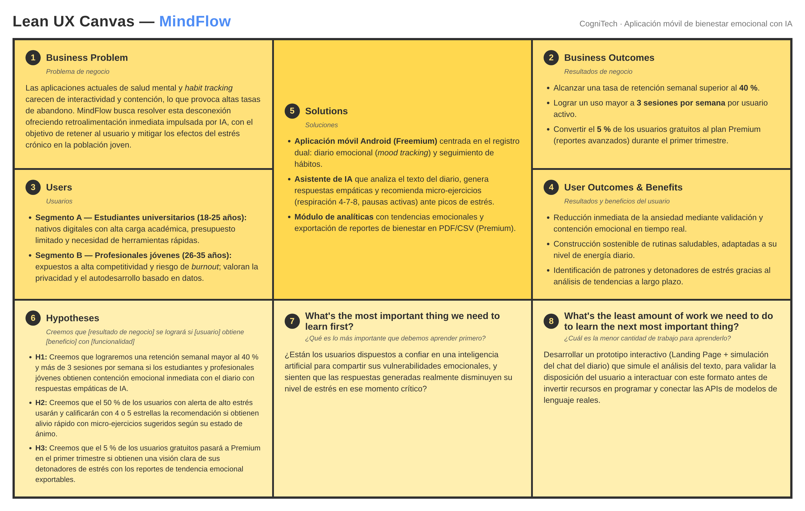

*Figura 7. Lean UX Canvas de MindFlow.*

## 1.3. Segmentos objetivo

La identificación de los segmentos objetivo para **MindFlow** se basa en la intersección entre la alta exposición a entornos de estrés crónico y la alta competencia digital. Hemos definido dos segmentos principales que presentan perfiles de necesidad diferenciados, pero que convergen en la búsqueda de soluciones de salud mental accesibles y tecnológicas.

#### 1.3.1. Segmento A: Estudiantes Universitarios (Tech-Native Scholars)
Este segmento comprende jóvenes entre los 18 y 25 años que cursan estudios de pregrado en entornos de alta exigencia académica (universidades e institutos técnicos).

* **Perfil Psicográfico:** Individuos con una alta carga cognitiva diaria, sometidos a periodos críticos de evaluación. Valoran la inmediatez y la gratificación instantánea. Suelen priorizar herramientas gratuitas o de bajo costo debido a su presupuesto limitado.
* **Necesidades Críticas:** Contención rápida durante crisis de ansiedad por exámenes, gestión de la procrastinación y una herramienta que no se sienta como una "tarea extra" en su día a día.
* **Puntos de Dolor:** Sentimiento de aislamiento académico, falta de recursos para costear terapia privada y dificultad para mantener hábitos saludables (sueño, alimentación) bajo presión.

#### 1.3.2. Segmento B: Profesionales Jóvenes (High-Performance Achievers)
Este segmento abarca adultos entre los 26 y 35 años que se encuentran en las primeras etapas de consolidación de su carrera profesional o en roles de mando medio.

* **Perfil Psicográfico:** Personas altamente competitivas que enfrentan el fenómeno del *burnout* laboral. Buscan la optimización del tiempo y valoran los datos (analítica) para medir su progreso personal. Tienen mayor disposición al pago si perciben una mejora directa en su productividad y bienestar.
* **Necesidades Críticas:** Herramientas de desconexión efectiva, monitoreo de la salud mental como preventivo del agotamiento laboral y reportes estructurados que les permitan entender sus detonadores de estrés.
* **Puntos de Dolor:** Desequilibrio entre la vida laboral y personal, estigma en el entorno corporativo sobre la salud mental y falta de tiempo para asistir a sesiones presenciales de psicología.

---

<div style="page-break-before: always;"></div>

# Capítulo II: Requirements Development and Software Solution Design

## 2.1. Competidores

En el contexto actual del mercado digital de bienestar, existen diversas aplicaciones que abordan la gestión emocional y el desarrollo de hábitos desde distintos enfoques. A continuación, se presentan los principales competidores de MindFlow, considerando su propuesta de valor y alcance funcional:

- Daylio: Aplicación enfocada en el registro diario del estado de ánimo mediante interfaces simples y estadísticas visuales. Su principal fortaleza radica en su facilidad de uso, aunque carece de retroalimentación inteligente o análisis profundo.

- Reflectly: Plataforma de journaling digital que utiliza inteligencia artificial básica para guiar reflexiones personales. Destaca por su experiencia de usuario, pero su nivel de personalización es limitado.

- Habitica: Aplicación de seguimiento de hábitos con un enfoque gamificado que incentiva la constancia mediante recompensas. Sin embargo, no considera el estado emocional del usuario en sus recomendaciones.

Estas soluciones representan enfoques parciales del problema, lo que evidencia una oportunidad para MindFlow de integrar análisis emocional, personalización dinámica y acompañamiento en tiempo real.

### 2.1.1. Análisis competitivo

La Tabla 3 compara a MindFlow frente a las soluciones existentes en el mercado.

**Tabla 3. Análisis competitivo (Competitive Analysis Landscape).**

<table border="1" cellspacing="0" cellpadding="5">
  <tr>
    <th colspan="7">Competitive Analysis Landscape</th>
  </tr>

  <tr>
    <td colspan="2" rowspan="2"><b>¿Por qué llevar a cabo este análisis?</b></td>
    <td colspan="5">
      Identificar las fortalezas, debilidades y oportunidades de las aplicaciones actuales de bienestar digital, con el fin de comprender el posicionamiento de MindFlow dentro del mercado.
    </td>
  </tr>
  <tr>
    <td colspan="5">
      Comparar funcionalidades, estrategias y propuestas de valor para validar el uso de inteligencia artificial como elemento diferenciador en la gestión emocional y de hábitos.
    </td>
  </tr>

   <tr>
    <td colspan="3"></td>
    <td align="center">
      <b>MindFlow</b><br>
      
    </td>
    <td align="center">
      <b>Daylio</b><br>
      
    </td>
    <td align="center">
      <b>Reflectly</b><br>
      
    </td>
    <td align="center">
      <b>Habitica</b><br>
      
    </td>
  </tr>

  <tr>
    <td rowspan="2"><b>Perfil</b></td>
    <td colspan="2">Overview</td>
    <td>Plataforma de salud mental con IA que integra diario emocional, análisis de sentimiento y hábitos dinámicos.</td>
    <td>Aplicación de registro de emociones con estadísticas simples.</td>
    <td>Diario digital guiado con inteligencia artificial básica.</td>
    <td>Aplicación de hábitos basada en gamificación.</td>
  </tr>

  <tr>
    <td colspan="2">Ventaja competitiva ¿Qué valor ofrece a los clientes?</td>
    <td>Personalización en tiempo real y acompañamiento emocional inteligente basado en IA.</td>
    <td>Facilidad de uso y rapidez en el registro de emociones.</td>
    <td>Experiencia de usuario atractiva enfocada en la reflexión personal.</td>
    <td>Motivación mediante recompensas y mecánicas de juego.</td>
  </tr>

  <tr>
    <td rowspan="2"><b>Perfil de Marketing</b></td>
    <td colspan="2">Mercado objetivo</td>
    <td>Jóvenes (18–35) con estrés académico o laboral.</td>
    <td>Público general.</td>
    <td>Usuarios interesados en journaling y bienestar.</td>
    <td>Personas orientadas a productividad.</td>
  </tr>

  <tr>
    <td colspan="2">Estrategias de marketing</td>
    <td>Modelo freemium, contenido educativo y crecimiento en redes sociales.</td>
    <td>Posicionamiento como app simple y accesible.</td>
    <td>Enfoque en diseño emocional y experiencia visual.</td>
    <td>Gamificación y comunidad activa.</td>
  </tr>

  <tr>
    <td rowspan="3"><b>Perfil de Producto</b></td>
    <td colspan="2">Productos & Servicios</td>
    <td>Diario emocional IA, hábitos adaptativos, intervenciones inteligentes.</td>
    <td>Registro de estado de ánimo.</td>
    <td>Diario guiado.</td>
    <td>Seguimiento de hábitos.</td>
  </tr>

  <tr>
    <td colspan="2">Precios & Costos</td>
    <td>Freemium + funciones premium.</td>
    <td>Freemium.</td>
    <td>Suscripción premium.</td>
    <td>Freemium con compras opcionales.</td>
  </tr>

  <tr>
    <td colspan="2">Canales de distribución (Web y/o Móvil)</td>
    <td>Web y aplicación móvil.</td>
    <td>Aplicación móvil.</td>
    <td>Aplicación móvil.</td>
    <td>Web y aplicación móvil.</td>
  </tr>

  <tr>
    <td rowspan="5"><b>Análisis SWOT</b></td>
  </tr>

  <tr>
    <td colspan="2">Fortalezas</td>
    <td>IA emocional, personalización dinámica, enfoque integral.</td>
    <td>Simplicidad y rapidez.</td>
    <td>Diseño atractivo.</td>
    <td>Gamificación efectiva.</td>
  </tr>

  <tr>
    <td colspan="2">Debilidades</td>
    <td>Dependencia tecnológica, necesidad de generar confianza.</td>
    <td>Sin inteligencia ni personalización.</td>
    <td>IA limitada.</td>
    <td>No aborda salud emocional.</td>
  </tr>

  <tr>
    <td colspan="2">Oportunidades</td>
    <td>Crecimiento del mercado de salud mental digital.</td>
    <td>Usuarios nuevos.</td>
    <td>Expansión del journaling.</td>
    <td>Crecimiento del mercado de productividad.</td>
  </tr>

  <tr>
    <td colspan="2">Amenazas</td>
    <td>Competidores consolidados y preocupaciones por privacidad.</td>
    <td>Apps más avanzadas.</td>
    <td>Competencia con mayor innovación.</td>
    <td>Integración de funciones en apps más completas.</td>
  </tr>

</table>

### 2.1.2. Estrategias y tácticas frente a competidores

A partir del análisis competitivo y del análisis SWOT realizado, se definen estrategias y tácticas preliminares que permitirán a MindFlow afrontar las fortalezas de sus competidores, aprovechar sus debilidades y capitalizar las oportunidades del entorno, mitigando a su vez las amenazas del mercado.

#### Estrategias

- **Estrategia de diferenciación frente a fortalezas de competidores:**  
  Mientras aplicaciones como Daylio destacan por su simplicidad y Habitica por su gamificación, MindFlow propone una diferenciación basada en inteligencia artificial, integrando análisis emocional y personalización dinámica, lo cual permite ofrecer una experiencia más profunda y significativa.

- **Estrategia de aprovechamiento de debilidades del mercado:**  
  Se identificó que los competidores carecen de retroalimentación en tiempo real y adaptación al estado emocional. MindFlow capitaliza esta debilidad mediante un sistema que responde activamente al usuario, incrementando la retención.

- **Estrategia de explotación de oportunidades:**  
  El crecimiento del mercado de salud mental digital y la aceptación de soluciones basadas en IA representan una oportunidad clave. MindFlow se posiciona como una solución innovadora alineada con estas tendencias.

- **Estrategia de mitigación de amenazas:**  
  Frente a la presencia de competidores consolidados, se prioriza la innovación continua, la experiencia de usuario y la generación de confianza mediante políticas de privacidad y transparencia en el uso de datos.

#### Tácticas

- **Frente a fortalezas de competidores:**
  - Diseñar una interfaz simple e intuitiva similar a Daylio, pero con mayor valor agregado.
  - Incorporar elementos motivacionales (inspirados en gamificación) sin perder el enfoque emocional.

- **Frente a debilidades de competidores:**
  - Implementar retroalimentación empática en tiempo real mediante IA.
  - Desarrollar un sistema de hábitos adaptativos basado en el estado emocional del usuario.

- **Frente a oportunidades del entorno:**
  - Crear contenido educativo sobre salud mental en redes sociales.
  - Promover el uso de la app en comunidades universitarias y profesionales jóvenes.

- **Frente a amenazas del mercado:**
  - Garantizar la seguridad y privacidad de los datos mediante encriptación.
  - Diferenciar la propuesta mediante innovación constante en funcionalidades.
  - Generar confianza comunicando claramente que la app no reemplaza terapia profesional.

#### Enfoque estratégico

MindFlow adopta una estrategia de diferenciación centrada en la innovación tecnológica y la experiencia del usuario. A diferencia de los competidores que abordan el problema de manera fragmentada, la plataforma integra múltiples funcionalidades en un sistema adaptativo, lo que le permite posicionarse como una solución más completa, inteligente y alineada con las necesidades actuales del usuario.

## 2.2. Entrevistas

### 2.2.1. Diseño de entrevistas

Se han diseñado dos bloques de preguntas dirigidos a los principales segmentos objetivo: estudiantes universitarios y profesionales jóvenes. Las preguntas han sido estructuradas para recopilar información cualitativa relevante en torno a aspectos demográficos, hábitos digitales, gestión del estrés y percepción sobre el uso de herramientas tecnológicas para el bienestar emocional.

Asimismo, se incluyen preguntas complementarias orientadas a la construcción de arquetipos de usuario (User Personas), considerando variables demográficas, psicográficas y de comportamiento digital.

#### A. Entrevistas a Segmento 1: Estudiantes Universitarios (18–25 años)

**Objetivo:** Comprender cómo los estudiantes gestionan su estrés académico, qué herramientas utilizan actualmente y cuáles son sus principales dificultades para mantener hábitos de bienestar.

**Preguntas principales:**

- ¿Podrías contarnos un poco sobre ti? (edad, carrera, ciclo, ciudad, etc.)
- ¿Cómo describirías tu nivel de estrés durante el ciclo académico?
- ¿En qué momentos sueles sentir más ansiedad o presión?
- ¿Qué haces actualmente para manejar el estrés o la ansiedad?
- ¿Has utilizado alguna aplicación para registrar tus emociones o hábitos?
- ¿Qué dificultades tienes para mantener hábitos saludables?
- ¿Qué tan cómodo(a) te sientes usando apps para tu bienestar?
- ¿Con qué dispositivos accedes más a aplicaciones? (móvil, laptop, etc.)
- ¿Qué aplicaciones usas con mayor frecuencia en tu día a día?
- ¿Qué redes sociales utilizas más?
- ¿Cuáles son tus principales objetivos personales o académicos?
- ¿Qué situaciones te generan mayor frustración actualmente?
- ¿Cómo describirías tu personalidad? (organizado, impulsivo, etc.)
- ¿Sueles seguir recomendaciones de influencers o contenido sobre bienestar?

#### B. Entrevistas a Segmento 2: Profesionales Jóvenes (26–35 años)

**Objetivo:** Identificar los retos relacionados con el estrés laboral, la gestión del tiempo y la adopción de herramientas digitales para el bienestar personal.

**Preguntas principales:**

- ¿Podrías contarnos un poco sobre ti? (edad, profesión, tipo de trabajo, etc.)
- ¿Cómo describirías tu nivel de estrés laboral?
- ¿Qué situaciones te generan mayor agotamiento?
- ¿Qué haces actualmente para reducir el estrés?
- ¿Has utilizado apps de productividad o bienestar?
- ¿Qué dificultades tienes para equilibrar trabajo y vida personal?
- ¿Qué dispositivos utilizas con mayor frecuencia?
- ¿Qué herramientas digitales usas para organizar tu día?
- ¿Qué canales digitales utilizas con mayor frecuencia?
- ¿Cuáles son tus principales objetivos profesionales y personales?
- ¿Qué factores te generan mayor frustración en tu rutina?
- ¿Qué valoras más en una aplicación digital?
- ¿Qué te generaría confianza o desconfianza al usar una app de salud mental?

### 2.2.2. Registro de entrevistas

A continuación se registran las seis entrevistas de descubrimiento realizadas: tres al Segmento 1 (Tablas 4 a 6) y tres al Segmento 2 (Tablas 7 a 9).

#### Segmento 1: Estudiantes Universitarios

##### Entrevista 1

**Tabla 4. Segmento 1: Estudiantes Universitarios — Entrevista 1.**

| Campo | Detalle |
|------|--------|
| Segmento Objetivo | Estudiantes universitarios (18–25 años) |
| Fecha Entrevista | 18/04/2026 |
| Entrevistador | Sebastián Díaz |
| Entrevistado | Jiss Zerpa |
| Edad | 18 años |
| Distrito | La Molina |
| Link del Video | [Ver video](https://upcedupe-my.sharepoint.com/:v:/g/personal/u202410421_upc_edu_pe/IQC6LCtoZRnfR4iKU3dIHCeYATI4FuIHWP1zmVrAm3H4_R8?nav=eyJyZWZlcnJhbEluZm8iOnsicmVmZXJyYWxBcHAiOiJPbmVEcml2ZUZvckJ1c2luZXNzIiwicmVmZXJyYWxBcHBQbGF0Zm9ybSI6IldlYiIsInJlZmVycmFsTW9kZSI6InZpZXciLCJyZWZlcnJhbFZpZXciOiJNeUZpbGVzTGlua0NvcHkifX0&e=jFGNLe) |
| Minuto de Inicio | 0:00 |
| Duración | 2:47 |
| Resumen | Jiss, estudiante de Ingeniería Petroquímica, presenta un nivel de estrés de 7/10 con picos de 9 en exámenes. Su comportamiento refleja evitación del estrés mediante distracciones como TikTok y videojuegos. Reconoce que estas actividades le generan alivio momentáneo, pero posteriormente incrementan su ansiedad. Ha probado apps, pero las abandona rápidamente por requerir esfuerzo adicional. Insight principal: comportamiento de evitación frente al estrés. Hallazgos clave: alta procrastinación, baja tolerancia al esfuerzo y falta de estructura. Citas relevantes: “Me distraigo… pero después me estreso más.”, “No usaría una app si tengo que escribir mucho.” Conclusión: requiere soluciones simples, automáticas y de mínima interacción. |

##### Entrevista 2

**Tabla 5. Segmento 1: Estudiantes Universitarios — Entrevista 2.**

| Campo | Detalle |
|------|--------|
| Segmento Objetivo | Estudiantes universitarios (18–25 años) |
| Fecha Entrevista | 19/04/2026 |
| Entrevistador | Sebastián Díaz |
| Entrevistado | Lucero |
| Edad | 19 años |
| Distrito | La Molina |
| Link del Video | [Ver video](https://upcedupe-my.sharepoint.com/:v:/g/personal/u202410421_upc_edu_pe/IQAp-_6iUOSJS4FRQuTW-F-9AdcZK5XV42aVZmzgo0PuIAw?nav=eyJyZWZlcnJhbEluZm8iOnsicmVmZXJyYWxBcHAiOiJPbmVEcml2ZUZvckJ1c2luZXNzIiwicmVmZXJyYWxBcHBQbGF0Zm9ybSI6IldlYiIsInJlZmVycmFsTW9kZSI6InZpZXciLCJyZWZlcnJhbFZpZXciOiJNeUZpbGVzTGlua0NvcHkifX0&e=HwtMjV) |
| Minuto de Inicio | 0:00 |
| Duración | 2:41 |
| Resumen | Lucero, estudiante de Psicología, presenta un nivel de estrés de 6/10 con picos de 8. Tiene alta autoconciencia emocional y utiliza journaling, pero percibe que las herramientas actuales no generan cambios reales. Insight principal: perfil reflexivo con insatisfacción en el impacto de las soluciones actuales. Hallazgos clave: uso de journaling sin resultados, necesidad de análisis profundo y rechazo a la repetición. Citas relevantes: “Escribir me ayuda a entenderme, pero no cambia cómo me siento.”, “Las apps se vuelven repetitivas.” Conclusión: necesita soluciones que aporten análisis significativo y evolución emocional. |

##### Entrevista 3

**Tabla 6. Segmento 1: Estudiantes Universitarios — Entrevista 3.**

| Campo | Detalle |
|------|--------|
| Segmento Objetivo | Estudiantes universitarios (18–25 años) |
| Fecha Entrevista | 20/04/2026 |
| Entrevistador | Sebastián Díaz |
| Entrevistado | Jimena |
| Edad | 19 años |
| Distrito | San Isidro |
| Link del Video | [Ver video](https://upcedupe-my.sharepoint.com/:v:/g/personal/u202410421_upc_edu_pe/IQDiIjKmBwlYSY162dNCHfq1AcmQjaPB0B48xM6UgMCISww?nav=eyJyZWZlcnJhbEluZm8iOnsicmVmZXJyYWxBcHAiOiJPbmVEcml2ZUZvckJ1c2luZXNzIiwicmVmZXJyYWxBcHBQbGF0Zm9ybSI6IldlYiIsInJlZmVycmFsTW9kZSI6InZpZXciLCJyZWZlcnJhbFZpZXciOiJNeUZpbGVzTGlua0NvcHkifX0&e=ciHjIU) |
| Minuto de Inicio | 0:00 |
| Duración | 2:48 |
| Resumen | Jimena, estudiante de Ingeniería de Software, presenta un nivel de estrés de 6/10 con picos de 8–9. Experimenta frustración en tareas académicas que deriva en bloqueo cognitivo y procrastinación. Ha utilizado múltiples apps, pero las abandona por falta de valor inmediato. Insight principal: patrón frustración → bloqueo → evasión. Hallazgos clave: bloqueo cognitivo, uso de distracción como escape y abandono rápido de apps. Citas relevantes: “Me bloqueo… y termino dejando todo.”, “Las apps solo te hacen escribir, pero no te ayudan.” Conclusión: requiere intervenciones en tiempo real que ayuden en momentos críticos. |

#### Segmento 2: Profesionales Jóvenes

##### Entrevista 4

**Tabla 7. Segmento 2: Profesionales Jóvenes — Entrevista 4.**

| Campo | Detalle |
|------|--------|
| Segmento Objetivo | Profesionales jóvenes (26–35 años) |
| Fecha Entrevista | 18/04/2026 |
| Entrevistador | Sebastián Díaz |
| Entrevistado | Alexandra Montenegro |
| Edad | 26 años |
| Distrito | Barranco |
| Link del Video | [Ver video](https://upcedupe-my.sharepoint.com/:v:/g/personal/u202410421_upc_edu_pe/IQBLlsZ3G-OZSLcOUS5eF6rQARMpWE6b_f3IIphyY7o3vlI?nav=eyJyZWZlcnJhbEluZm8iOnsicmVmZXJyYWxBcHAiOiJPbmVEcml2ZUZvckJ1c2luZXNzIiwicmVmZXJyYWxBcHBQbGF0Zm9ybSI6IldlYiIsInJlZmVycmFsTW9kZSI6InZpZXciLCJyZWZlcnJhbFZpZXciOiJNeUZpbGVzTGlua0NvcHkifX0&e=p0isA8) |
| Minuto de Inicio | 0:00 |
| Duración | 3:15 |
| Resumen | Alexandra, profesional en Recursos Humanos, presenta un nivel de estrés de 8/10 con picos de 9. Su principal limitación es la falta de energía tras la jornada laboral, lo que impide sostener hábitos. Insight principal: limitación de tiempo y energía. Hallazgos clave: dificultad para mantener rutinas, percepción de apps como costo de tiempo y preferencia por soluciones inmediatas. Citas relevantes: “Llego cansada del trabajo… no tengo energía para seguir una rutina.”, “Las apps me quitaban tiempo o no me daban algo útil en el momento.” Conclusión: requiere soluciones rápidas, de bajo esfuerzo y con valor inmediato. |

##### Entrevista 5

**Tabla 8. Segmento 2: Profesionales Jóvenes — Entrevista 5.**

| Campo | Detalle |
|------|--------|
| Segmento Objetivo | Profesionales jóvenes (26–35 años) |
| Fecha Entrevista | 19/04/2026 |
| Entrevistador | Sebastián Díaz |
| Entrevistado | Luciana Poma |
| Edad | 27 años |
| Distrito | Chorrillos |
| Link del Video | [Ver video](https://upcedupe-my.sharepoint.com/:v:/g/personal/u202410421_upc_edu_pe/IQAXQKz8cFuBRYmMRiluA61vAYFJfoUS8D6IibXF6VSNjnE?nav=eyJyZWZlcnJhbEluZm8iOnsicmVmZXJyYWxBcHAiOiJPbmVEcml2ZUZvckJ1c2luZXNzIiwicmVmZXJyYWxBcHBQbGF0Zm9ybSI6IldlYiIsInJlZmVycmFsTW9kZSI6InZpZXciLCJyZWZlcnJhbFZpZXciOiJNeUZpbGVzTGlua0NvcHkifX0&e=qxkwbB) |
| Minuto de Inicio | 0:00 |
| Duración | 3:06 |
| Resumen | Luciana, profesional de marketing digital, presenta un nivel de estrés de 8/10 con picos de 9. Usa apps frecuentemente, pero abandona aquellas que no se adaptan a su ritmo. Insight principal: necesidad de personalización dinámica. Hallazgos clave: frustración con apps rígidas, alta presión por resultados y relación entre bienestar y productividad. Citas relevantes: “Las apps no se adaptan a tu ritmo real.”, “Si no se adapta a mí, la dejo.” Conclusión: el producto debe ofrecer adaptación en tiempo real. |

##### Entrevista 6

**Tabla 9. Segmento 2: Profesionales Jóvenes — Entrevista 6.**

| Campo | Detalle |
|------|--------|
| Segmento Objetivo | Profesionales jóvenes (26–35 años) |
| Fecha Entrevista | 21/04/2026 |
| Entrevistador | Sebastián Díaz |
| Entrevistado | Nordie Sanabria |
| Edad | 29 años |
| Distrito | La Molina |
| Link del Video | [Ver video](https://upcedupe-my.sharepoint.com/:v:/g/personal/u202410421_upc_edu_pe/IQAu709K0qBWQZsvqeI53bCHAdB9HmsozDqHD-ua8jw6HjU?nav=eyJyZWZlcnJhbEluZm8iOnsicmVmZXJyYWxBcHAiOiJPbmVEcml2ZUZvckJ1c2luZXNzIiwicmVmZXJyYWxBcHBQbGF0Zm9ybSI6IldlYiIsInJlZmVycmFsTW9kZSI6InZpZXciLCJyZWZlcnJhbFZpZXciOiJNeUZpbGVzTGlua0NvcHkifX0&e=rM0yrn) |
| Minuto de Inicio | 0:00 |
| Duración | 2:52 |
| Resumen | Nordie, coordinadora de marketing, presenta un nivel de estrés constante de 9/10, cercano al burnout. Ha probado múltiples apps sin éxito. Insight principal: rechazo a cualquier esfuerzo adicional. Hallazgos clave: estrés constante, rechazo a interacción compleja y necesidad de automatización total. Citas relevantes: “Siento que estoy siempre en alerta.”, “Cuando ya estás agotada, no quieres hacer más cosas.”, “Necesito algo que me dé soluciones sin tener que pensar mucho.” Conclusión: requiere una solución altamente automatizada, predictiva y sin fricción. |

### 2.2.3. Análisis de entrevistas

A partir de las entrevistas realizadas a los dos segmentos objetivo, se identificaron patrones de comportamiento, necesidades y frustraciones diferenciadas. Este análisis permite validar los supuestos planteados y orientar el diseño de la solución.

### Segmento 1: Estudiantes Universitarios (18–25 años)

**Entrevistados:** Jiss, Lucero, Jimena

#### Nivel de estrés y comportamiento

- Nivel promedio: 6–7/10
- Picos en evaluaciones: 8–9/10

El estrés en este segmento es situacional, asociado principalmente a exámenes, carga académica y dificultad en cursos.

#### Patrones de comportamiento

1. **Procrastinación como respuesta al estrés**
   - Uso de redes sociales como mecanismo de escape
   - Incremento del estrés posterior por acumulación de tareas

   > “Me distraigo… pero después me estreso más.” (Jiss)  
   > “Me bloqueo… y termino dejando todo.” (Jimena)

2. **Baja adherencia a hábitos**
   - Intentos de organización que no se sostienen en el tiempo
   - Uso de apps limitado a corto plazo

   > “He probado apps… pero las dejo rápido.” (Jimena)

3. **Rechazo a esfuerzo adicional**
   - Baja disposición a escribir o registrar emociones
   - Percepción de apps como una tarea extra

   > “No usaría una app si tengo que escribir mucho.” (Jiss)

4. **Búsqueda de guía**
   - Necesidad de orientación clara ante situaciones de estrés

   > “Que me diga qué hacer en ese momento.” (Jiss)

#### Frustraciones principales

- Aplicaciones centradas solo en registro
- Falta de retroalimentación útil
- Experiencias repetitivas

> “Era como hablar sola.” (Jimena)  
> “Siempre era lo mismo.” (Lucero)

#### Necesidades clave

- Interacción simple y rápida
- Bajo esfuerzo cognitivo
- Recomendaciones claras
- Apoyo en momentos críticos

#### Insight del segmento

Los estudiantes requieren una herramienta que intervenga en momentos de bloqueo emocional, ofreciendo guía inmediata sin aumentar la carga cognitiva.

### Segmento 2: Profesionales Jóvenes (26–35 años)

**Entrevistados:** Alexandra, Luciana, Nordie

#### Nivel de estrés y comportamiento

- Nivel promedio: 8/10
- Picos: 9/10
- Presencia de estrés constante en algunos casos

El estrés es continuo y está vinculado a presión laboral, responsabilidad y cumplimiento de objetivos.

#### Patrones de comportamiento

1. **Fatiga mental**
   - Reducción de energía al final del día
   - Dificultad para sostener hábitos

   > “No tengo energía para seguir una rutina.” (Alexandra)

2. **Rechazo a pérdida de tiempo**
   - Evaluación constante del valor de las aplicaciones
   - Abandono rápido si no generan impacto

   > “Las apps me quitaban tiempo.” (Alexandra)

3. **Necesidad de personalización**
   - Contextos variables que requieren adaptación

   > “Si no se adapta a mí, la dejo.” (Luciana)

4. **Orientación a resultados**
   - Búsqueda de soluciones prácticas y eficientes

   > “Necesito soluciones prácticas.” (Alexandra)

5. **Burnout y automatización**
   - Rechazo a cualquier esfuerzo adicional en estados de agotamiento

   > “Cuando ya estás agotada, no quieres hacer más cosas.” (Nordie)  
   > “Necesito algo que me dé soluciones sin tener que pensar mucho.” (Nordie)

#### Frustraciones principales

- Aplicaciones genéricas
- Falta de personalización
- Falta de resultados inmediatos

> “Las apps no se adaptan a tu ritmo.” (Luciana)  
> “Son muy genéricas.” (Nordie)

#### Necesidades clave

- Personalización en tiempo real
- Interacción de bajo esfuerzo
- Recomendaciones prácticas
- Valor inmediato

#### Insight del segmento

Los profesionales requieren soluciones que optimicen su bienestar sin demandar tiempo ni esfuerzo adicional, integrándose de forma eficiente en su rutina.

### Comparación entre segmentos

La comparación entre ambos segmentos se resume en la Tabla 10.

**Tabla 10. Entrevistas — Comparación entre segmentos.**

| Factor | Estudiantes | Profesionales |
|--------|------------|--------------|
| Tipo de estrés | Situacional | Crónico |
| Nivel promedio | 6–7 | 8–9 |
| Problema principal | Procrastinación | Fatiga mental |
| Barrera | Falta de disciplina | Falta de tiempo |
| Rechazo | Esfuerzo cognitivo | Pérdida de tiempo |
| Necesidad clave | Guía | Eficiencia |

### Insight estratégico general

Ambos segmentos coinciden en que las soluciones actuales fallan por ser pasivas, genéricas y demandar demasiado esfuerzo. Esto evidencia la oportunidad de desarrollar una plataforma que proporcione respuestas en tiempo real, minimice el esfuerzo del usuario y ofrezca recomendaciones personalizadas con impacto inmediato.

## 2.3. Needfinding

En esta sección se presentan los artefactos resultantes del proceso de análisis de la información recolectada a través de entrevistas. El objetivo del needfinding es transformar los hallazgos cualitativos en representaciones estructuradas que permitan comprender profundamente a los usuarios, sus necesidades, comportamientos y puntos de dolor.

A partir de los insights obtenidos, se desarrollan los siguientes artefactos:

- User Personas  
- User Task Matrix  
- User Journey Mapping  
- Empathy Mapping  
- Big Picture EventStorming  
- Ubiquitous Language  

Estos elementos permiten al equipo alinear la comprensión del problema, identificar oportunidades de diseño y establecer una base sólida para la definición de requerimientos del sistema.

El proceso de needfinding evidencia que los usuarios no solo buscan registrar su estado emocional, sino recibir apoyo activo, personalizado y en tiempo real, lo cual guía directamente la propuesta de valor de la solución MindFlow.

### 2.3.1. User Personas
#### Segmento Estudiantes Universitarios:
*(Ver Figura 8.)*

  

*Figura 8. User Personas — Segmento Estudiantes Universitarios.*
  
#### Segmento Profesionales jóvenes:
*(Ver Figura 9.)*

  

*Figura 9. User Personas — Segmento Profesionales jóvenes.*

### 2.3.2. User Task Matrix

En esta sección se presenta la matriz de tareas de usuario (User Task Matrix), construida a partir de los User Personas definidos: **Jimena** (estudiante universitaria) y **Nordie** (profesional joven).  

La matriz identifica las tareas que ambos segmentos realizan para gestionar su bienestar emocional y productividad en su día a día, independientemente de la existencia de una solución tecnológica (Tabla 11).  

Cada tarea se evalúa en función de:  
- **Frecuencia:** Número aproximado de veces que realiza la tarea (diaria/semanal)  
- **Importancia:** Nivel de relevancia para el usuario (Alta, Media, Baja)  

---

#### User Task Matrix

**Tabla 11. Needfinding — User Task Matrix.**

| Tareas del Usuario | Jimena (Frecuencia) | Jimena (Importancia) | Nordie (Frecuencia) | Nordie (Importancia) |
|------------------|---------------------|----------------------|---------------------|----------------------|
| Identificar que está estresado o abrumado | 2–3 veces al día | Alta | 3–5 veces al día | Alta |
| Intentar continuar con sus responsabilidades a pesar del estrés | Diario | Alta | Diario | Alta |
| Buscar distracciones (redes sociales, entretenimiento) | 2–4 veces al día | Media | 1–2 veces al día | Baja |
| Tomar pausas para despejarse | 1–2 veces al día | Alta | 1–2 veces al día | Alta |
| Intentar organizar tareas o responsabilidades | 3–4 veces por semana | Alta | Diario | Alta |
| Reflexionar sobre cómo se siente | 1–2 veces por semana | Media | 1 vez por semana | Media |
| Buscar soluciones rápidas para reducir el estrés | 1–2 veces al día | Alta | 2–3 veces al día | Alta |
| Intentar mantener hábitos de bienestar (ejercicio, descanso) | 2–3 veces por semana | Alta | 1–2 veces por semana | Alta |
| Usar herramientas digitales para organizarse o mejorar su bienestar | 3–4 veces por semana | Media | 2–3 veces por semana | Alta |
| Abandonar herramientas o rutinas por falta de resultados | 1 vez por semana | Alta | 1 vez por semana | Alta |

---

### Análisis de la matriz

Se observa que las tareas con mayor frecuencia e importancia en ambos segmentos están relacionadas con la **gestión inmediata del estrés**, especialmente:

- Identificación del estrés varias veces al día  
- Continuación de responsabilidades bajo presión  
- Búsqueda de soluciones rápidas para aliviar el malestar  

Esto confirma que el problema ocurre en **micro-momentos diarios**, no como eventos aislados.

---

### Coincidencias entre segmentos

- Ambos identifican el estrés múltiples veces al día  
- Buscan soluciones rápidas de forma recurrente  
- Presentan abandono semanal de herramientas que no aportan valor  
- Mantienen baja frecuencia en hábitos de bienestar  

---

### Diferencias clave

- **Jimena (Estudiante):**
  - Mayor frecuencia en distracciones (hasta 4 veces al día)  
  - Menor consistencia en organización (no diaria)  

- **Nordie (Profesional):**
  - Mayor constancia en organización (diaria)  
  - Menor uso de distracciones, pero mayor carga mental constante  

---

### Conclusión

Los datos evidencian que el problema ocurre varias veces al día, lo que requiere una solución capaz de responder en tiempo real. Además, la alta tasa de abandono semanal confirma que los usuarios priorizan herramientas que generen valor inmediato, sin requerir esfuerzo adicional.

### 2.3.3. User Journey Mapping

#### Segmento Estudiantes Universitarios:
*(Ver Figura 10.)*

  

*Figura 10. User Journey Mapping — Segmento Estudiantes Universitarios.*
  
#### Segmento Profesionales jóvenes:
*(Ver Figura 11.)*

  

*Figura 11. User Journey Mapping — Segmento Profesionales jóvenes.*

### 2.3.4. Empathy Mapping

#### Segmento Estudiantes Universitarios

<div align="center">

*(Ver Figura 12.)*


*Figura 12. Empathy Mapping del segmento de estudiantes universitarios.*

</div>

#### Segmento Profesionales Jóvenes

<div align="center">

*(Ver Figura 13.)*


*Figura 13. Empathy Mapping del segmento de profesionales jóvenes.*

</div>

### 2.3.5. Big Picture EventStorming

El equipo realizó una sesión colaborativa de Big Picture EventStorming (aproximadamente 1.5 horas, usando Miro) para construir un entendimiento compartido y de alto nivel del dominio de negocio de MindFlow, antes de tomar cualquier decisión de diseño. El objetivo fue identificar los eventos de negocio significativos a lo largo de todo el panorama del negocio —registro, diario emocional, seguimiento de hábitos, el asistente de IA, reportes, suscripciones y soporte al cliente— sin discutir todavía componentes de software ni Bounded Contexts.

**Paso 1 — Generación de Domain Events**

Cada integrante del equipo escribió de forma independiente los eventos de dominio que identificó en el negocio de MindFlow, en tiempo pasado, sin discutir todavía orden ni relaciones. Este brainstorming sin orden reveló 19 eventos que abarcan todo el producto, desde la creación de la cuenta hasta la cancelación de la suscripción (Figura 14).

<div align="center">

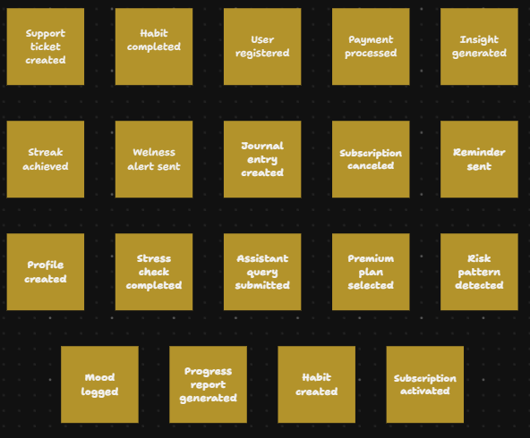
*Figura 14. Domain Events generados de forma independiente por el equipo.*

</div>

**Paso 2 — Ordenamiento cronológico de los Domain Events**

Luego, el equipo organizó esos mismos eventos a lo largo de una sola línea de tiempo, desde el inicio de la relación del usuario con MindFlow (registro) pasando por el uso continuo (diario, hábitos, reportes) hasta eventos comerciales y de soporte (suscripción, tickets) (Figura 15).

<div align="center">

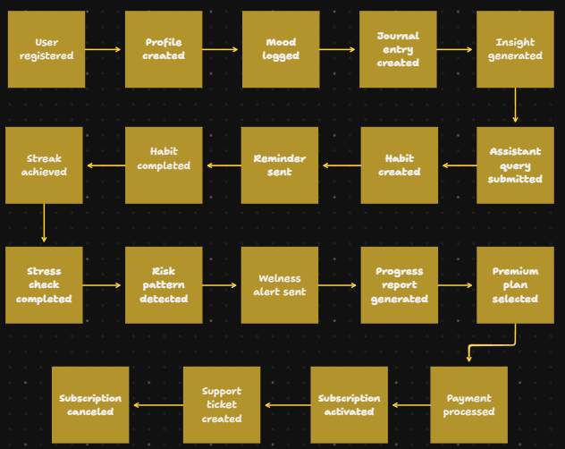
*Figura 15. Domain Events ordenados cronológicamente en el timeline de negocio.*

</div>

**Paso 3 — Agregar Actors y External Systems**

Finalmente, el equipo identificó quién dispara cada evento y qué sistemas externos reales están involucrados en el negocio: el **User** impulsa la mayoría de los eventos directamente, mientras que el **AI Engine**, el **Notification Service** y el **Payment Gateway** aparecen como los sistemas externos de los que ya depende el negocio de MindFlow (Figura 16).

<div align="center">

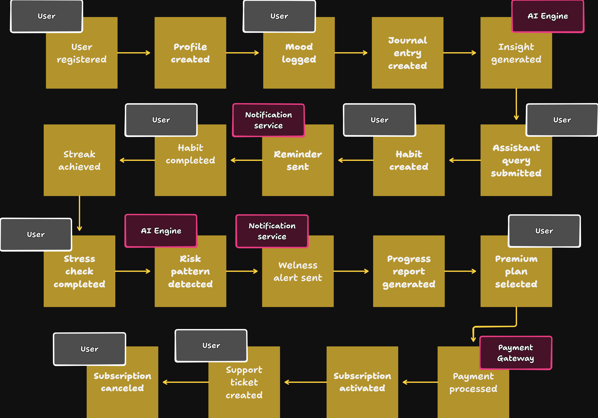
*Figura 16. Actors y External Systems agregados al timeline de eventos.*

</div>

Este ejercicio confirmó que el negocio de MindFlow abarca áreas de responsabilidad claramente distinguibles —identidad, journaling, insights asistidos por IA, hábitos y bienestar, reportes, notificaciones, facturación y soporte— lo cual se convirtió en el punto de partida para la sesión de EventStorming más detallada descrita en la sección 2.5.1.

### 2.3.6. Ubiquitous Language

El Lenguaje Ubicuo de MindFlow constituye el idioma común utilizado por los integrantes del equipo para eliminar la ambigüedad entre los requerimientos de salud mental y la implementación técnica. Estos términos han sido extraídos directamente del Event Storming, asegurando que cada concepto del negocio tenga una representación única y coherente en el código fuente y la base de datos (Tabla 12).

**Tabla 12. Needfinding — Ubiquitous Language.**

| Término | Definición de Dominio | Relación Técnica |
|:-------:|:---------------------:|:----------------:|
| Journal Entry | Registro de texto libre donde el usuario expresa sus pensamientos y sentimientos. | Objeto persistente en DB (Colección). |
| NLP Engine | Servicio encargado de procesar el lenguaje natural para extraer emociones. | Sistema Externo (API). |
| Sentiment Label | Etiqueta (Positivo/Negativo) asignada a una entrada tras el análisis. | Atributo de la clase JournalEntry. |
| Habit Tracker | Módulo para la gestión y seguimiento de objetivos de autocuidado. | Agregado que gestiona la disciplina. |
| Workload Adjustment | Modificación automática de la carga de tareas basada en el estado de estrés detectado. | Política de negocio (Business Rule). |
| Burnout Level | Indicador de agotamiento detectado por la persistencia de ánimos negativos. | Variable de análisis para intervenciones. |

## 2.4. Requirements Specification

### 2.4.1. User Stories

Las siguientes **User Stories** definen los requerimientos funcionales y técnicos de MindFlow. Se encuentran agrupadas en cinco **Epics**, de acuerdo con las principales capacidades del producto.

Para mejorar la gestión del **Product Backlog**, cada User Story incluye un atributo de **Priority**:

- **High:** funcionalidad esencial para el MVP, el valor principal del negocio, la seguridad o la operación crítica del sistema.
- **Medium:** funcionalidad importante que mejora la experiencia del usuario, pero no es indispensable para la primera versión utilizable.
- **Low:** funcionalidad complementaria que puede implementarse después de las capacidades principales.

Adicionalmente, se incluye una **Spike Story (SP01)** para reducir la incertidumbre técnica relacionada con la integración de servicios de Inteligencia Artificial para el análisis emocional (Tabla 13).

**Tabla 13. Requirements Specification — User Stories.**

| Epic ID | Epic Name | Descripción |
|---|---|---|
| E1 | Identidad, Privacidad y Plataforma Principal | Gestión de seguridad, autenticación de usuarios, privacidad y configuración fundamental de la plataforma. |
| E2 | Inteligencia Emocional Impulsada por IA | Implementación de capacidades de IA para análisis de sentimientos, procesamiento del diario emocional y retroalimentación empática. |
| E3 | Bienestar Inteligente e Ingeniería de Hábitos | Gestión de hábitos, rutinas de bienestar, intervenciones frente al estrés y recomendaciones adaptativas. |
| E4 | Analítica, Monetización y Escalabilidad | Visualización de datos, reportes, monetización, soporte y capacidades técnicas orientadas a la escalabilidad. |
| E5 | Landing Page y Adquisición de Usuarios | Sitio informativo orientado a comunicar la propuesta de valor de MindFlow y atraer potenciales usuarios. |

El detalle de cada User Story, con su criterio de aceptación, prioridad y Epic asociado, se presenta en la Tabla 14.

**Tabla 14. Requirements Specification — User Stories (2).**

| Epic / Story ID | Título | Descripción | Acceptance Criteria | Priority | Epic relacionado |
|---|---|---|---|---|---|
| US01 | Registro con OAuth (Google) | Como nuevo usuario, quiero registrarme utilizando mi cuenta de Google, para acceder rápidamente a la plataforma. | Dado que el usuario se encuentra en la pantalla de registro, cuando selecciona "Continuar con Google", entonces el sistema crea correctamente la cuenta vinculada. | High | E1 |
| US02 | Inicio de sesión tradicional | Como usuario, quiero iniciar sesión con correo electrónico y contraseña, para disponer de una alternativa de acceso manual. | Dado que el usuario tiene una cuenta activa, cuando ingresa credenciales válidas, entonces obtiene acceso a la aplicación. | High | E1 |
| US03 | Recuperación de cuenta | Como usuario, quiero restablecer mi contraseña mediante un enlace enviado por correo electrónico, para recuperar el acceso a mi cuenta si la olvido. | Dado que el usuario solicita el restablecimiento de contraseña, cuando recibe el correo y actualiza su contraseña, entonces puede iniciar sesión nuevamente. | Medium | E1 |
| US04 | Bloqueo mediante PIN | Como usuario, quiero configurar un PIN de seguridad, para proteger mi información privada frente a accesos físicos no autorizados. | Dado que la aplicación se encuentra abierta, cuando el bloqueo mediante PIN está activo, entonces el sistema solicita el código antes de mostrar contenido protegido. | Medium | E1 |
| US05 | Perfil de usuario | Como usuario, quiero editar mis datos personales, para que MindFlow pueda personalizar mi experiencia. | Dado que el usuario se encuentra en la configuración de su perfil, cuando actualiza sus datos, entonces los cambios quedan almacenados y se reflejan en la aplicación. | Medium | E1 |
| US06 | Modo oscuro | Como usuario, quiero activar el modo oscuro, para reducir la fatiga visual durante el uso nocturno. | Dado que el usuario modifica la configuración del tema, cuando activa el modo oscuro, entonces la interfaz adopta dicho tema. | Low | E1 |
| US07 | Eliminación de cuenta | Como usuario, quiero eliminar mi cuenta y mis registros personales, para mantener control sobre mi información. | Dado que el usuario solicita eliminar su cuenta, cuando confirma la operación, entonces el sistema elimina o anonimiza permanentemente la información asociada de acuerdo con la política de privacidad definida. | High | E1 |
| US08 (T) | Encriptación AES-256 | Como arquitecto, quiero que la información sensible del diario se almacene cifrada, para proteger la confidencialidad de los datos del usuario. | Dado que se almacena contenido sensible del diario, cuando este es persistido en la base de datos, entonces debe encontrarse cifrado. | High | E1 |
| US09 (T) | Pipeline CI/CD | Como desarrollador, quiero contar con un flujo automatizado de integración y despliegue, para realizar entregas de manera consistente y eficiente. | Dado que se integran cambios de código en la rama configurada, cuando las validaciones automatizadas finalizan correctamente, entonces puede ejecutarse el proceso de despliegue. | Medium | E1 |
| US10 (T) | Seguridad de API mediante JWT | Como desarrollador, quiero autenticar las solicitudes protegidas mediante JWT, para evitar accesos no autorizados a los servicios del backend. | Dado que un usuario autenticado solicita un recurso protegido, cuando la solicitud contiene un token válido, entonces la API procesa la petición. | High | E1 |
| US11 | Entrada de diario | Como usuario, quiero escribir entradas en mi diario, para registrar mis pensamientos, sentimientos y experiencias emocionales. | Dado que el usuario abre el editor del diario, cuando escribe y guarda una entrada, entonces el sistema la almacena asociada al usuario y a la fecha correspondiente. | High | E2 |
| US12 | Análisis de sentimientos | Como usuario, quiero que MindFlow analice el tono emocional de mi entrada de diario, para comprender mejor mi estado emocional actual. | Dado que el usuario guarda una entrada de diario, cuando se ejecuta el análisis de sentimientos, entonces el sistema proporciona una clasificación emocional asociada a la entrada. | High | E2 |
| US13 | Retroalimentación empática mediante IA | Como usuario, quiero recibir retroalimentación empática después de registrar mis emociones, para obtener orientación y acompañamiento inmediato. | Dado que se ha identificado un estado emocional, cuando la IA procesa la entrada del diario, entonces MindFlow muestra una respuesta empática apropiada. | High | E2 |
| US14 | Etiquetas contextuales | Como usuario, quiero categorizar mis entradas mediante etiquetas, para identificar situaciones o áreas relacionadas con mi estado emocional. | Dado que el usuario está editando o visualizando una entrada, cuando asigna una etiqueta, entonces la asociación queda almacenada y puede utilizarse para filtrado o análisis. | Medium | E2 |
| US15 | Adjuntos multimedia | Como usuario, quiero adjuntar contenido multimedia a mis entradas de diario, para enriquecer mis registros emocionales. | Dado que el usuario está gestionando una entrada, cuando carga un archivo multimedia soportado, entonces el archivo queda asociado a la entrada correspondiente. | Medium | E2 |
| US16 | Búsqueda por palabras clave | Como usuario, quiero buscar entradas anteriores mediante palabras clave, para localizar rápidamente experiencias específicas. | Dado que el usuario ingresa un término de búsqueda, cuando ejecuta la búsqueda, entonces el sistema devuelve las entradas relacionadas con el contenido coincidente. | Medium | E2 |
| US17 | Calendario de estado de ánimo | Como usuario, quiero visualizar mis registros emocionales a lo largo del tiempo, para identificar patrones en mi estado de ánimo. | Dado que el usuario abre el calendario emocional, cuando existe información para una fecha determinada, entonces se representa el estado emocional correspondiente. | Medium | E2 |
| US18 | Resumen semanal mediante IA | Como usuario, quiero recibir un resumen semanal de mi actividad emocional, para reflexionar sobre los cambios en mi bienestar. | Dado que existe suficiente información emocional registrada, cuando se genera el resumen semanal, entonces MindFlow presenta un resumen de los principales patrones identificados. | Medium | E2 |
| US19 (T) | Integración con API de LLM | Como desarrollador, quiero integrar un servicio basado en LLM, para que MindFlow pueda generar respuestas contextuales y empáticas. | Dado que el backend solicita una respuesta generada mediante IA, cuando el servicio externo responde correctamente, entonces el sistema procesa y devuelve el resultado estructurado. | High | E2 |
| US20 (T) | Registro de interacciones de IA | Como desarrollador, quiero registrar métricas relevantes de las interacciones con IA, para monitorear el funcionamiento y comportamiento de esta funcionalidad. | Dado que una solicitud de IA es procesada, cuando la operación finaliza, entonces se registran las métricas técnicas relevantes sin exponer contenido sensible del diario. | Medium | E2 |
| SP01 | Investigación de viabilidad de integración de IA | Como equipo de desarrollo, queremos investigar y validar alternativas para integrar análisis de sentimientos y retroalimentación empática mediante IA, para seleccionar una solución adecuada antes de completar la implementación. | Dado que MindFlow requiere análisis emocional asistido por IA, cuando finalice la Spike, entonces el equipo deberá documentar las alternativas evaluadas, restricciones técnicas, consideraciones de privacidad, costos estimados y una prueba de concepto de la alternativa seleccionada. | High | E2 |
| US21 | Creación de hábitos | Como usuario, quiero crear hábitos personalizados de bienestar, para construir una rutina constante de autocuidado. | Dado que el usuario se encuentra en la sección de hábitos, cuando completa la información requerida y guarda el hábito, entonces este es agregado a su lista de hábitos activos. | High | E3 |
| US22 | Registro de cumplimiento de hábitos | Como usuario, quiero marcar mis hábitos como completados, para monitorear mi progreso diario. | Dado que existe un hábito activo, cuando el usuario lo marca como completado, entonces su estado y progreso quedan actualizados. | High | E3 |
| US23 | Ajuste basado en nivel de estrés | Como usuario que experimenta un nivel elevado de estrés, quiero que MindFlow adapte sus recomendaciones de bienestar según mi estado emocional, para evitar sentirme sobrecargado. | Dado que el sistema identifica un nivel elevado de estrés, cuando genera recomendaciones de bienestar, entonces MindFlow sugiere actividades apropiadas para la condición actual del usuario. | High | E3 |
| US24 | Guía de respiración 4-7-8 | Como usuario, quiero acceder a un ejercicio guiado de respiración, para utilizar una técnica rápida de relajación durante momentos de estrés. | Dado que el usuario selecciona el ejercicio de respiración, cuando inicia la actividad, entonces la aplicación lo guía durante la secuencia correspondiente. | Medium | E3 |
| US25 | Micro-meditaciones | Como usuario, quiero acceder a ejercicios cortos de meditación, para incorporar actividades breves de bienestar dentro de mi rutina. | Dado que existen ejercicios disponibles, cuando el usuario selecciona uno, entonces la aplicación proporciona la actividad guiada correspondiente. | Medium | E3 |
| US26 | Feedback sobre recomendaciones | Como usuario, quiero calificar las recomendaciones de la IA, para que MindFlow registre cuáles me resultan útiles. | Dado que el usuario recibe una recomendación, cuando envía su valoración, entonces el sistema registra el feedback asociado a dicha recomendación. | Medium | E3 |
| US27 | Alerta de hidratación | Como usuario, quiero recibir recordatorios para beber agua, para mantener hábitos saludables durante mi rutina diaria. | Dado que los recordatorios de hidratación están habilitados, cuando se cumple la condición configurada, entonces el usuario recibe una notificación. | Low | E3 |
| US28 | Racha de hábitos | Como usuario, quiero visualizar mis rachas de hábitos, para mantenerme motivado mediante el seguimiento de mi constancia. | Dado que el usuario ha completado hábitos durante varios días, cuando consulta su progreso, entonces la aplicación muestra la racha correspondiente. | Medium | E3 |
| US29 (T) | Indexación de base de datos | Como desarrollador, quiero indexar adecuadamente la información consultada con frecuencia, para mantener tiempos de respuesta eficientes. | Dado que se ejecuta una consulta sobre información indexada, cuando la base de datos procesa la solicitud, entonces el rendimiento se mantiene dentro de los requerimientos no funcionales definidos. | Medium | E3 |
| US30 (T) | Sincronización de datos offline | Como usuario de la aplicación móvil, quiero registrar información del diario sin conexión y sincronizarla posteriormente, para que una conexión intermitente a Internet no me impida registrar mis pensamientos. | Dado que el dispositivo no tiene conexión a Internet, cuando el usuario crea o actualiza información soportada del diario, entonces la aplicación almacena los cambios localmente y los sincroniza cuando se restablece la conectividad. | High | E3 |
| US31 | Dashboard de analítica | Como usuario, quiero visualizar analíticas de mi actividad emocional, para comprender cómo evoluciona mi bienestar a lo largo del tiempo. | Dado que existe suficiente información emocional, cuando el usuario abre la sección de analítica, entonces la aplicación muestra las métricas y visualizaciones disponibles. | High | E4 |
| US32 | Nube de palabras | Como usuario, quiero visualizar términos recurrentes de mi actividad en el diario, para identificar temas frecuentes o posibles detonantes de estrés. | Dado que existe suficiente información en el diario, cuando se genera el análisis correspondiente, entonces el sistema muestra los términos recurrentes según su frecuencia. | Medium | E4 |
| US33 | Planes Premium | Como usuario, quiero comparar los planes disponibles, para determinar si las funcionalidades Premium me resultan útiles. | Dado que el usuario accede a la sección de suscripciones, cuando se cargan los planes, entonces el sistema muestra sus principales características y diferencias. | Medium | E4 |
| US34 | Pago seguro | Como usuario, quiero realizar el pago de mi suscripción mediante un proveedor seguro, para activar las funcionalidades Premium de manera confiable. | Dado que el usuario selecciona un plan de pago, cuando el proceso externo de pago se confirma correctamente, entonces la suscripción correspondiente queda activada. | Medium | E4 |
| US35 | Exportación en PDF | Como usuario Premium, quiero exportar un reporte estructurado en PDF, para guardar o compartir un resumen legible de mi información emocional. | Dado que el usuario tiene acceso a la funcionalidad de exportación, cuando solicita el formato PDF, entonces el sistema genera el reporte descargable correspondiente. | Medium | E4 |
| US36 | Exportación en CSV | Como usuario Premium, quiero exportar mi información en formato CSV, para analizar los datos mediante herramientas externas. | Dado que el usuario tiene acceso a la exportación de datos, cuando selecciona CSV, entonces el sistema genera un archivo descargable con la información disponible para exportación. | Low | E4 |
| US37 | Soporte técnico | Como usuario, quiero crear una solicitud de soporte, para reportar problemas técnicos o solicitar asistencia. | Dado que el usuario envía una solicitud válida, cuando esta es registrada, entonces el sistema crea el ticket de soporte correspondiente. | Medium | E4 |
| US38 (T) | Pruebas automatizadas | Como desarrollador, quiero disponer de pruebas automatizadas para los flujos críticos, para detectar regresiones antes de liberar cambios. | Dado que un flujo crítico cuenta con pruebas automatizadas, cuando se ejecuta la suite de pruebas, entonces los errores son reportados antes de liberar el cambio afectado. | High | E4 |
| US39 (T) | Diseño responsive | Como desarrollador, quiero que la Landing Page y las interfaces compatibles se adapten a diferentes tamaños de pantalla, para que puedan utilizarse correctamente desde distintos dispositivos. | Dado que cambia el tamaño de pantalla soportado, cuando se renderiza la interfaz, entonces el contenido permanece utilizable y visualmente consistente. | Medium | E4 |
| US40 (T) | Rate Limiting | Como administrador, quiero aplicar límites a las solicitudes realizadas a la API, para proteger el backend frente a un uso excesivo o abusivo. | Dado que un cliente supera el límite configurado de solicitudes, cuando realiza nuevas peticiones durante el periodo restringido, entonces la API las rechaza o limita temporalmente según la política establecida. | Medium | E4 |
| US41 | Navegación principal de la Landing Page | Como visitante, quiero contar con un menú de navegación claro, para acceder rápidamente a las secciones más importantes de la Landing Page. | Dado que el visitante se encuentra en la Landing Page, cuando selecciona una opción del menú, entonces la interfaz lo dirige hacia la sección correspondiente. | High | E5 |
| US42 | CTA principal | Como visitante, quiero visualizar un CTA principal claramente identificable, para comenzar rápidamente a utilizar MindFlow. | Dado que el visitante visualiza la sección Hero, cuando selecciona el CTA principal, entonces es dirigido al flujo correspondiente de registro o acceso a la aplicación. | High | E5 |
| US43 | Grid de funcionalidades | Como visitante, quiero visualizar las principales funcionalidades de MindFlow, para comprender rápidamente las capacidades que ofrece el producto. | Dado que el visitante llega a la sección de funcionalidades, cuando esta se muestra, entonces las principales capacidades se presentan mediante tarjetas y descripciones claramente identificables. | High | E5 |
| US44 | Vista previa de la interfaz | Como visitante, quiero visualizar ejemplos de la aplicación, para comprender cómo funciona MindFlow antes de registrarme. | Dado que el visitante llega a la sección de vista previa del producto, cuando esta se muestra, entonces se presentan interfaces representativas de MindFlow. | Medium | E5 |
| US45 | CTA de conversión | Como visitante, quiero visualizar un CTA adicional al final de la Landing Page, para comenzar a utilizar MindFlow después de conocer sus beneficios. | Dado que el visitante llega a la sección final de conversión, cuando selecciona el CTA, entonces es dirigido al flujo correspondiente de registro o acceso a la aplicación. | High | E5 |
| US46 | Navegación del footer | Como visitante, quiero acceder a enlaces legales e informativos desde el footer, para consultar información relevante sobre MindFlow. | Dado que el visitante llega al footer, cuando selecciona uno de los enlaces disponibles, entonces se muestra la información correspondiente. | Medium | E5 |
| US47 | Enlaces a redes sociales | Como visitante, quiero acceder a los perfiles oficiales de MindFlow en redes sociales, para visitar sus canales externos de comunicación. | Dado que se muestran los enlaces a redes sociales, cuando el visitante selecciona uno, entonces se abre el perfil externo correspondiente. | Low | E5 |
| US48 | Vista previa de tendencias emocionales | Como visitante, quiero visualizar un ejemplo de las tendencias emocionales, para comprender el tipo de análisis que MindFlow puede proporcionar. | Dado que el visitante llega a la sección de vista previa de analítica, cuando esta se muestra, entonces se presenta una visualización representativa de tendencias emocionales. | Medium | E5 |
| US49 | Detalle de beneficios de funcionalidades | Como visitante, quiero conocer el beneficio asociado a cada funcionalidad principal de MindFlow, para identificar cómo el producto puede contribuir a mi bienestar. | Dado que el visitante explora la sección de funcionalidades, cuando revisa una funcionalidad, entonces la interfaz presenta una explicación breve del beneficio que proporciona. | Medium | E5 |
| US50 | Vista previa de Insight de IA | Como visitante, quiero visualizar un ejemplo de una entrada de diario y su Insight generado por IA, para comprender cómo funciona la retroalimentación emocional de MindFlow. | Dado que el visitante visualiza la demostración del producto, cuando se presenta el ejemplo de Insight, entonces la interfaz muestra una entrada representativa y su correspondiente respuesta generada mediante IA. | High | E5 |

### 2.4.2. Impact Mapping

<div align="center">

*(Ver Figura 17.)*

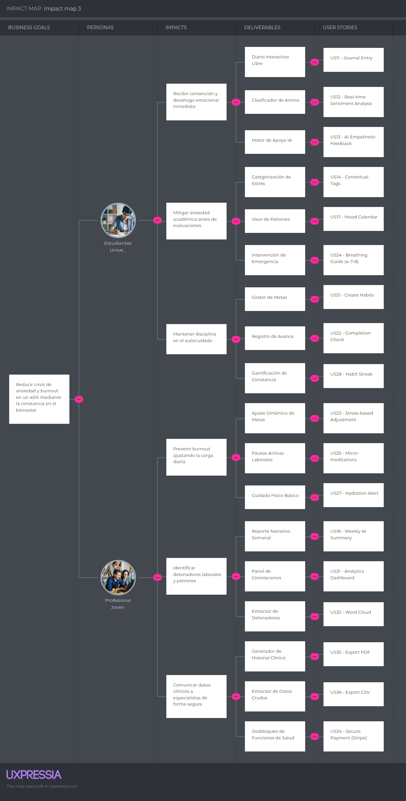

*Figura 17. Impact Mapping de MindFlow.*

</div>

### 2.4.3. Product Backlog

El **Product Backlog** de MindFlow organiza las User Stories según el valor que aportan al usuario, las dependencias funcionales y técnicas, y la necesidad de validar progresivamente la propuesta de valor del producto.

A diferencia de una organización basada únicamente en el identificador de cada User Story, el presente backlog prioriza primero las funcionalidades que permiten comunicar y validar el producto, seguidas por las capacidades centrales de diario emocional, Inteligencia Artificial, gestión de hábitos y analítica.

Las User Stories correspondientes a la **Landing Page** se ubican en las primeras posiciones debido a que forman parte del alcance inicial del producto y permiten comunicar la propuesta de valor de MindFlow desde el primer Sprint.

La columna **Priority** representa la importancia relativa de cada elemento dentro del producto, mientras que los **Story Points** representan una estimación relativa del esfuerzo necesario para su implementación (Tabla 15).

**Tabla 15. Requirements Specification — Product Backlog.**

| # Orden | User Story ID | Título | Descripción | Priority | Story Points |
|---|---|---|---|---|---|
| 1 | US41 | Navegación principal de la Landing Page | Como visitante, quiero contar con un menú de navegación claro, para acceder rápidamente a las secciones más importantes de la Landing Page. | High | 2 |
| 2 | US42 | CTA principal | Como visitante, quiero visualizar un CTA principal claramente identificable, para comenzar rápidamente a utilizar MindFlow. | High | 2 |
| 3 | US43 | Grid de funcionalidades | Como visitante, quiero visualizar las principales funcionalidades de MindFlow, para comprender rápidamente las capacidades que ofrece el producto. | High | 3 |
| 4 | US50 | Vista previa de Insight de IA | Como visitante, quiero visualizar un ejemplo de una entrada de diario y su Insight generado por IA, para comprender cómo funciona la retroalimentación emocional de MindFlow. | High | 3 |
| 5 | US44 | Vista previa de la interfaz | Como visitante, quiero visualizar ejemplos de la aplicación, para comprender cómo funciona MindFlow antes de registrarme. | Medium | 3 |
| 6 | US48 | Vista previa de tendencias emocionales | Como visitante, quiero visualizar un ejemplo de las tendencias emocionales, para comprender el tipo de análisis que MindFlow puede proporcionar. | Medium | 3 |
| 7 | US49 | Detalle de beneficios de funcionalidades | Como visitante, quiero conocer el beneficio asociado a cada funcionalidad principal de MindFlow, para identificar cómo el producto puede contribuir a mi bienestar. | Medium | 3 |
| 8 | US45 | CTA de conversión | Como visitante, quiero visualizar un CTA adicional al final de la Landing Page, para comenzar a utilizar MindFlow después de conocer sus beneficios. | High | 2 |
| 9 | US46 | Navegación del footer | Como visitante, quiero acceder a enlaces legales e informativos desde el footer, para consultar información relevante sobre MindFlow. | Medium | 1 |
| 10 | US47 | Enlaces a redes sociales | Como visitante, quiero acceder a los perfiles oficiales de MindFlow en redes sociales, para visitar sus canales externos de comunicación. | Low | 1 |
| 11 | SP01 | Investigación de viabilidad de integración de IA | Como equipo de desarrollo, queremos investigar y validar alternativas para integrar análisis de sentimientos y retroalimentación empática mediante IA, para seleccionar una solución adecuada antes de completar la implementación. | High | 5 |
| 12 | US11 | Entrada de diario | Como usuario, quiero escribir entradas en mi diario, para registrar mis pensamientos, sentimientos y experiencias emocionales. | High | 3 |
| 13 | US12 | Análisis de sentimientos | Como usuario, quiero que MindFlow analice el tono emocional de mi entrada de diario, para comprender mejor mi estado emocional actual. | High | 5 |
| 14 | US13 | Retroalimentación empática mediante IA | Como usuario, quiero recibir retroalimentación empática después de registrar mis emociones, para obtener orientación y acompañamiento inmediato. | High | 5 |
| 15 | US19 (T) | Integración con API de LLM | Como desarrollador, quiero integrar un servicio basado en LLM, para que MindFlow pueda generar respuestas contextuales y empáticas. | High | 8 |
| 16 | US21 | Creación de hábitos | Como usuario, quiero crear hábitos personalizados de bienestar, para construir una rutina constante de autocuidado. | High | 3 |
| 17 | US22 | Registro de cumplimiento de hábitos | Como usuario, quiero marcar mis hábitos como completados, para monitorear mi progreso diario. | High | 2 |
| 18 | US23 | Ajuste basado en nivel de estrés | Como usuario que experimenta un nivel elevado de estrés, quiero que MindFlow adapte sus recomendaciones de bienestar según mi estado emocional, para evitar sentirme sobrecargado. | High | 8 |
| 19 | US31 | Dashboard de analítica | Como usuario, quiero visualizar analíticas de mi actividad emocional, para comprender cómo evoluciona mi bienestar a lo largo del tiempo. | High | 5 |
| 20 | US01 | Registro con OAuth (Google) | Como nuevo usuario, quiero registrarme utilizando mi cuenta de Google, para acceder rápidamente a la plataforma. | High | 3 |
| 21 | US02 | Inicio de sesión tradicional | Como usuario, quiero iniciar sesión con correo electrónico y contraseña, para disponer de una alternativa de acceso manual. | High | 3 |
| 22 | US10 (T) | Seguridad de API mediante JWT | Como desarrollador, quiero autenticar las solicitudes protegidas mediante JWT, para evitar accesos no autorizados a los servicios del backend. | High | 3 |
| 23 | US08 (T) | Encriptación AES-256 | Como arquitecto, quiero que la información sensible del diario se almacene cifrada, para proteger la confidencialidad de los datos del usuario. | High | 8 |
| 24 | US07 | Eliminación de cuenta | Como usuario, quiero eliminar mi cuenta y mis registros personales, para mantener control sobre mi información. | High | 3 |
| 25 | US30 (T) | Sincronización de datos offline | Como usuario de la aplicación móvil, quiero registrar información del diario sin conexión y sincronizarla posteriormente, para que una conexión intermitente a Internet no me impida registrar mis pensamientos. | High | 8 |
| 26 | US38 (T) | Pruebas automatizadas | Como desarrollador, quiero disponer de pruebas automatizadas para los flujos críticos, para detectar regresiones antes de liberar cambios. | High | 5 |
| 27 | US03 | Recuperación de cuenta | Como usuario, quiero restablecer mi contraseña mediante un enlace enviado por correo electrónico, para recuperar el acceso a mi cuenta si la olvido. | Medium | 3 |
| 28 | US04 | Bloqueo mediante PIN | Como usuario, quiero configurar un PIN de seguridad, para proteger mi información privada frente a accesos físicos no autorizados. | Medium | 2 |
| 29 | US05 | Perfil de usuario | Como usuario, quiero editar mis datos personales, para que MindFlow pueda personalizar mi experiencia. | Medium | 2 |
| 30 | US14 | Etiquetas contextuales | Como usuario, quiero categorizar mis entradas mediante etiquetas, para identificar situaciones o áreas relacionadas con mi estado emocional. | Medium | 2 |
| 31 | US15 | Adjuntos multimedia | Como usuario, quiero adjuntar contenido multimedia a mis entradas de diario, para enriquecer mis registros emocionales. | Medium | 5 |
| 32 | US16 | Búsqueda por palabras clave | Como usuario, quiero buscar entradas anteriores mediante palabras clave, para localizar rápidamente experiencias específicas. | Medium | 3 |
| 33 | US17 | Calendario de estado de ánimo | Como usuario, quiero visualizar mis registros emocionales a lo largo del tiempo, para identificar patrones en mi estado de ánimo. | Medium | 5 |
| 34 | US18 | Resumen semanal mediante IA | Como usuario, quiero recibir un resumen semanal de mi actividad emocional, para reflexionar sobre los cambios en mi bienestar. | Medium | 5 |
| 35 | US20 (T) | Registro de interacciones de IA | Como desarrollador, quiero registrar métricas relevantes de las interacciones con IA, para monitorear el funcionamiento y comportamiento de esta funcionalidad. | Medium | 2 |
| 36 | US24 | Guía de respiración 4-7-8 | Como usuario, quiero acceder a un ejercicio guiado de respiración, para utilizar una técnica rápida de relajación durante momentos de estrés. | Medium | 5 |
| 37 | US25 | Micro-meditaciones | Como usuario, quiero acceder a ejercicios cortos de meditación, para incorporar actividades breves de bienestar dentro de mi rutina. | Medium | 3 |
| 38 | US26 | Feedback sobre recomendaciones | Como usuario, quiero calificar las recomendaciones de la IA, para que MindFlow registre cuáles me resultan útiles. | Medium | 2 |
| 39 | US28 | Racha de hábitos | Como usuario, quiero visualizar mis rachas de hábitos, para mantenerme motivado mediante el seguimiento de mi constancia. | Medium | 3 |
| 40 | US32 | Nube de palabras | Como usuario, quiero visualizar términos recurrentes de mi actividad en el diario, para identificar temas frecuentes o posibles detonantes de estrés. | Medium | 5 |
| 41 | US33 | Planes Premium | Como usuario, quiero comparar los planes disponibles, para determinar si las funcionalidades Premium me resultan útiles. | Medium | 2 |
| 42 | US34 | Pago seguro | Como usuario, quiero realizar el pago de mi suscripción mediante un proveedor seguro, para activar las funcionalidades Premium de manera confiable. | Medium | 8 |
| 43 | US35 | Exportación en PDF | Como usuario Premium, quiero exportar un reporte estructurado en PDF, para guardar o compartir un resumen legible de mi información emocional. | Medium | 5 |
| 44 | US37 | Soporte técnico | Como usuario, quiero crear una solicitud de soporte, para reportar problemas técnicos o solicitar asistencia. | Medium | 3 |
| 45 | US39 (T) | Diseño responsive | Como desarrollador, quiero que la Landing Page y las interfaces compatibles se adapten a diferentes tamaños de pantalla, para que puedan utilizarse correctamente desde distintos dispositivos. | Medium | 5 |
| 46 | US40 (T) | Rate Limiting | Como administrador, quiero aplicar límites a las solicitudes realizadas a la API, para proteger el backend frente a un uso excesivo o abusivo. | Medium | 3 |
| 47 | US29 (T) | Indexación de base de datos | Como desarrollador, quiero indexar adecuadamente la información consultada con frecuencia, para mantener tiempos de respuesta eficientes. | Medium | 3 |
| 48 | US09 (T) | Pipeline CI/CD | Como desarrollador, quiero contar con un flujo automatizado de integración y despliegue, para realizar entregas de manera consistente y eficiente. | Medium | 5 |
| 49 | US06 | Modo oscuro | Como usuario, quiero activar el modo oscuro, para reducir la fatiga visual durante el uso nocturno. | Low | 2 |
| 50 | US27 | Alerta de hidratación | Como usuario, quiero recibir recordatorios para beber agua, para mantener hábitos saludables durante mi rutina diaria. | Low | 2 |
| 51 | US36 | Exportación en CSV | Como usuario Premium, quiero exportar mi información en formato CSV, para analizar los datos mediante herramientas externas. | Low | 3 |

## 2.5. Strategic-Level Domain-Driven Design

### 2.5.1. EventStorming

Partiendo del Big Picture explorado en la sección 2.3.5, el equipo realizó una segunda sesión de EventStorming, más enfocada (aproximadamente 2 horas, usando Miro), para alcanzar el nivel de detalle necesario y poder descomponer MindFlow en Bounded Contexts. A diferencia del Big Picture, esta sesión avanzó deliberadamente hacia un pensamiento más cercano al nivel de diseño, introduciendo Commands, Policies y Actors/Agents para cada evento.

**Paso 1 — Events**

El equipo retomó la lista de eventos del Big Picture y la amplió con eventos más granulares por cada área funcional, llegando a 25 eventos de dominio en total —expresados todavía en puro lenguaje de negocio, en tiempo pasado (Figura 18).

<div align="center">

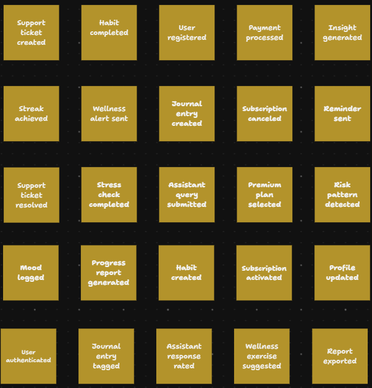
*Figura 18. Domain Events ampliados con mayor nivel de detalle por área funcional.*

</div>

**Paso 2 — Commands & Policies**

Para cada evento, el equipo identificó qué lo dispara. La mayoría de los eventos son resultado directo de un **Command** —una acción deliberada realizada por un actor (ej. *Write journal entry* → *Journal entry created*). Sin embargo, 7 de los 25 eventos son reacciones automáticas a un evento anterior, en vez de un comando deliberado, y se modelaron como **Policies** ("Cada vez que... entonces..."): *Insight generated*, *Reminder sent*, *Streak achieved*, *Wellness exercise suggested*, *Risk pattern detected*, *Wellness alert sent*, y *Subscription activated*. Tratar estos casos como policies en vez de inventar comandos artificiales mantiene el modelo fiel a cómo realmente se comporta la automatización de MindFlow (Figura 19).

<div align="center">

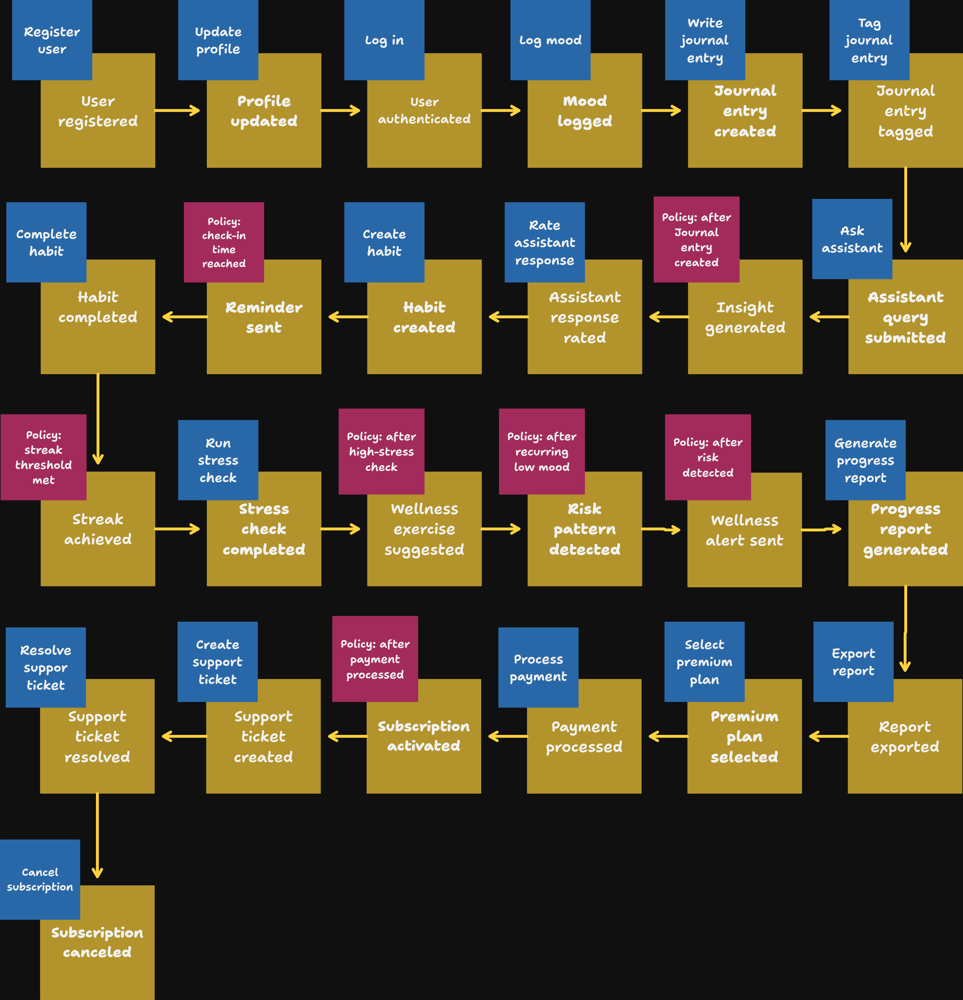
*Figura 19. Commands y Policies identificados para cada Domain Event.*

</div>

**Paso 3 — Actors / Agents**

El equipo identificó luego quién —o qué— emite cada comando o ejecuta cada policy: el **User** para la mayoría de las acciones directas, el **AI Engine** para la generación de insights, evaluación de riesgo y sugerencias de bienestar, el **System** para policies programadas o basadas en umbrales, el **Payment Gateway** para la confirmación de pagos, y un **Support Agent** para la resolución de tickets. Este paso comenzó a revelar costuras naturales en el dominio —grupos de eventos consistentemente impulsados por el mismo tipo de actor y que operan sobre los mismos datos subyacentes (Figura 20).

<div align="center">

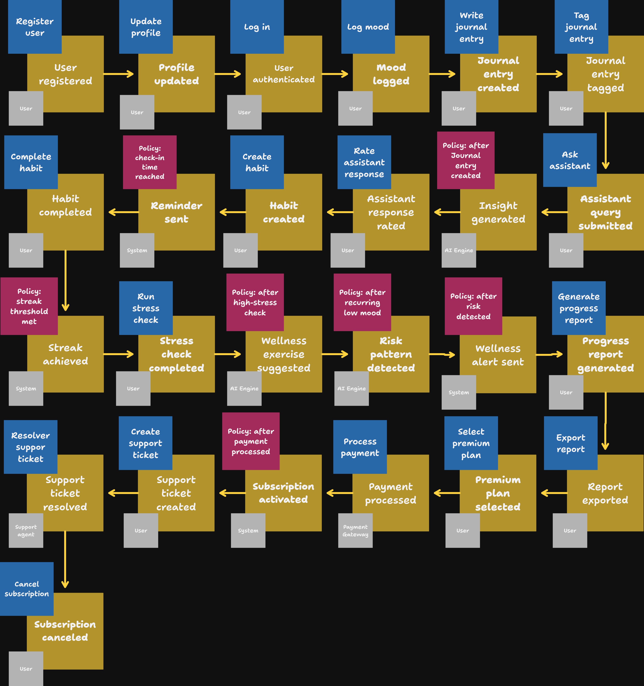
*Figura 20. Actors y Agents identificados para cada Command y Policy.*

</div>

**Paso 4 — Agrupación en Bounded Contexts**

Finalmente, el equipo reagrupó físicamente las mismas notas —ya no siguiendo la línea de tiempo, sino agrupando eventos, commands, policies y actors que comparten fuerte cohesión y un lenguaje de negocio común. Esto produjo 8 clústeres candidatos: **IAM**, **Journal**, **AI Assistant**, **Habits & Wellness**, **Notifications**, **Analytics & Reporting**, **Subscriptions**, y **Support**. Varias policies cruzan visiblemente entre clústeres (por ejemplo, la policy detrás de *Insight generated* depende de un evento que vive dentro de *Journal*, pero la reacción en sí pertenece a *AI Assistant*) —una señal temprana de las relaciones entre contextos que se formalizarán después en la sección 2.5.2 Context Mapping (Figura 21).

<div align="center">

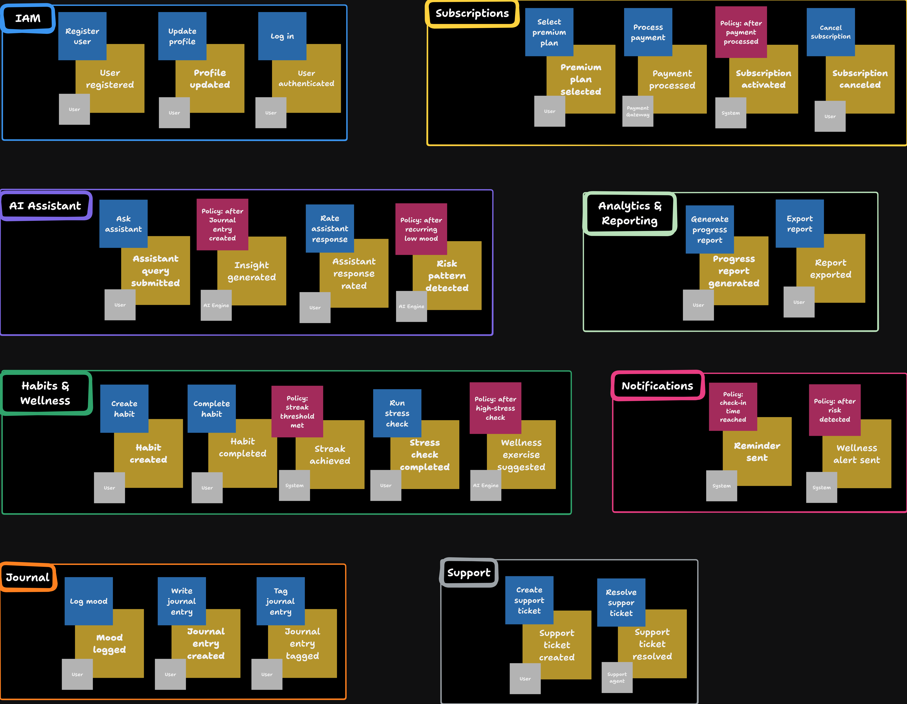
*Figura 21. Reagrupación final de eventos, commands, policies y actors en los 8 Bounded Contexts candidatos.*

</div>

#### 2.5.1.1. Candidate Context Discovery

Partiendo de la sesión de EventStorming documentada en 2.5.1, el equipo realizó una sesión dedicada de Candidate Context Discovery (aproximadamente 1.5 horas, usando Miro) para formalizar los límites naturales dentro del dominio de MindFlow, comparando el estado del tablero antes del reagrupamiento (Paso 3) contra el estado después del reagrupamiento (Paso 4) (Figura 22).

<div align="center">


*Figura 22. Estado del tablero antes del reagrupamiento (Actors/Agents identificados, aún sobre la línea de tiempo).*


*Figura 23. Estado del tablero después del reagrupamiento en los 8 Bounded Contexts candidatos.*

</div>

La técnica principal aplicada fue **look-for-pivotal-events**: el equipo recorrió la línea de tiempo producida en el Paso 3 y marcó cada evento que representara un cambio significativo de responsabilidad o capacidad de negocio —un punto donde "empieza a pasar algo distinto." Estos eventos pivote se convirtieron en las costuras a lo largo de las cuales se reagrupó el tablero en el Paso 4 (Figura 23).

Se identificaron los siguientes eventos pivote como marcadores de límite:

- **User registered / User authenticated** → marca el inicio de toda relación con el usuario; todo lo que sigue depende de una identidad conocida. Esto ancla el contexto **IAM**, confirmado de forma independiente mediante **start-with-value**, ya que la identidad y el acceso están en la base de toda otra capacidad que ofrece MindFlow.
- **Journal entry created** → marca el cambio de "gestionar una cuenta" a "expresar un estado emocional", una capacidad core distinta con su propio lenguaje (mood, tags, entries). Esto ancla el contexto **Journal**.
- **Assistant query submitted / Insight generated** → marca el cambio de datos crudos de journaling hacia una interpretación generada por IA —una responsabilidad distinta (procesamiento de lenguaje natural, sugerencias contextuales) de simplemente almacenar lo que el usuario escribió. Esto ancla el contexto **AI Assistant**.
- **Habit created** → marca una vía paralela de compromiso del usuario, independiente del journaling: cambio de comportamiento proactivo en vez de expresión reflexiva. Esto ancla **Habits & Wellness**, que también absorbe la capacidad de chequeo de estrés y sugerencias de bienestar, ya que ambas operan sobre el mismo agregado (la rutina de bienestar continua del usuario).
- **Progress report generated** → marca el cambio de "producir datos" (entradas de diario, hábitos completados) a "interpretar datos de forma agregada", una responsabilidad de reporting/analytics distinta de cualquier contexto fuente individual. Esto ancla **Analytics & Reporting**.
- **Premium plan selected / Payment processed** → marca el cambio hacia una relación comercial, gobernada por reglas de facturación ajenas al lenguaje del dominio de bienestar. Esto ancla **Subscriptions**.
- **Support ticket created** → marca el cambio hacia una relación de servicio al cliente, con su propio ciclo de vida (abierto → resuelto) desacoplado del resto del producto. Esto ancla **Support**.
- **Reminder sent / Wellness alert sent** → estos dos eventos no pertenecen a un único contexto upstream; son disparados por policies que se originan en lugares distintos (un horario, un patrón de riesgo) pero comparten la misma responsabilidad —llegar al usuario fuera de la app. Esto ancla **Notifications** como contexto de soporte transversal.

Complementando esto con un pase rápido de **start-with-value** se confirmó que Journal y Habits & Wellness son los contextos que entregan más directamente la propuesta de valor central de MindFlow (autoconciencia emocional y cambio de comportamiento), mientras que IAM, Notifications, Subscriptions y Support se identificaron consistentemente como contextos de soporte/genéricos (Tabla 16).

**Tabla 16. Candidate Bounded Contexts.**

| # | Bounded Context | Evento(s) pivote | Capacidad core |
|---|---|---|---|
| 1 | IAM | User registered, User authenticated | Identidad, autenticación, perfil |
| 2 | Journal | Journal entry created | Diario emocional, seguimiento de ánimo |
| 3 | AI Assistant | Assistant query submitted, Insight generated | IA conversacional, insights generados, feedback de respuestas |
| 4 | Habits & Wellness | Habit created, Stress check completed | Seguimiento de hábitos, chequeos de estrés, sugerencias de bienestar |
| 5 | Analytics & Reporting | Progress report generated | KPIs, tendencias, exportaciones |
| 6 | Notifications | Reminder sent, Wellness alert sent | Notificaciones push, recordatorios, alertas |
| 7 | Subscriptions | Premium plan selected, Payment processed | Facturación, planes premium |
| 8 | Support | Support ticket created | Tickets de soporte al cliente |

#### 2.5.1.2. Domain Message Flows Modeling

El **Domain Message Flows Modeling** representa cómo circulan los mensajes de dominio entre los **Bounded Contexts** de MindFlow en cada escenario de uso: qué actor inicia la interacción, qué contexto asume la responsabilidad, qué mensaje se produce y qué reacciones provoca en otros contextos o en sistemas externos.

A partir de los eventos y límites identificados en el **EventStorming** y en el **Candidate Context Discovery**, se modelaron diez escenarios, uno por diagrama y en el orden en que el usuario los recorre:

| N.º | Escenario | Bounded Contexts que participan | Sistemas externos |
|---|---|---|---|
| 01 | Registro y autenticación de usuario | IAM | Google Identity |
| 02 | Registro emocional y diario | Journal | Cloudinary Media Storage |
| 03 | Generación de Insight con IA | Journal, AI Assistant | Google Gemini API |
| 04 | Gestión de hábitos y recordatorios | Habits & Wellness, Notifications | — |
| 05 | Detección de estrés y bienestar | Habits & Wellness, Journal, AI Assistant, Notifications | — |
| 06 | Generación y exportación de reportes | Analytics & Reporting, Journal | — |
| 07 | Suscripción Premium | Subscriptions | Stripe |
| 08 | Gestión de soporte | Support, Notifications | — |
| 09 | Seguridad de la cuenta (IAM extendido) | IAM, Journal, Habits & Wellness, AI Assistant | SMTP Email Service |
| 10 | Dashboard emocional (consulta) | Analytics & Reporting, Journal, Habits & Wellness | — |

*Tabla 16.1. Escenarios modelados en los Domain Message Flows.*

Todos los diagramas usan la misma notación, incluida como leyenda al pie de cada uno, y un único idioma (inglés) para los nombres de mensajes, de modo que coincidan con el lenguaje ubicuo del EventStorming y de los Bounded Context Canvases:

- **Actor / Client (gris, bordes redondeados):** persona o aplicación que inicia la interacción.
- **Bounded Context (gris, barras laterales):** contexto que atiende el mensaje.
- **External System (azul oscuro):** sistema ajeno a MindFlow; se dibuja siempre como un elemento separado del contexto que lo consume.
- **Command (azul):** intención de cambiar el estado.
- **Query (verde):** pedido de información que no cambia el estado.
- **Event (amarillo):** hecho de dominio ya ocurrido.
- **Policy (rosado):** reacción automática ante un evento ("cada vez que… entonces…").
- **Read Model (verde, borde doble):** información preparada para mostrarse al usuario.
- **Borde punteado:** mensaje definido en el modelo de dominio que aún no está implementado en la versión actual del producto.

Cada fila numerada dentro de un diagrama es un paso del escenario y se lee de izquierda a derecha.

**Escenario 01 — Registro y autenticación de usuario**

El usuario se registra o inicia sesión desde la **MindFlow Mobile App** y **IAM** responde con los eventos `User registered` y `User authenticated`. Cuando el usuario elige entrar con Google, IAM consulta a **Google Identity** únicamente para validar la cuenta (`Validate Google ID token`); la identidad que circula por MindFlow sigue siendo la que emite IAM. La actualización del perfil produce `Profile updated` (Figura 24.1).

<div align="center">

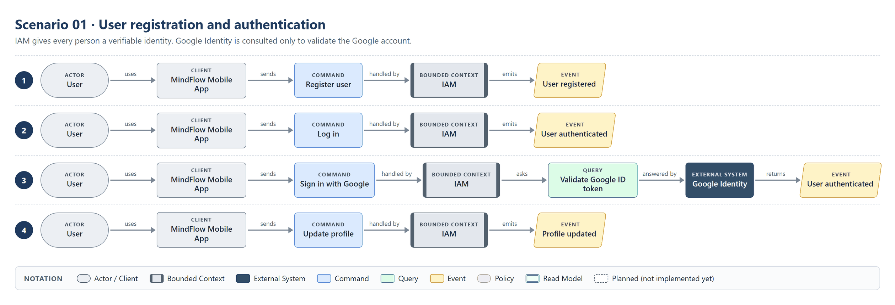

*Figura 24.1. Domain Message Flow del Escenario 01: registro y autenticación de usuario.*

</div>

**Escenario 02 — Registro emocional y diario**

**Journal** atiende los Commands `Log mood`, `Write journal entry` y `Tag journal entry`, que producen `Mood logged`, `Journal entry created` y `Journal entry tagged`. Se incorporan dos Commands que no figuraban en la versión anterior: `Attach media`, que delega el almacenamiento del archivo en **Cloudinary Media Storage**, y `Sync offline entries`, con el que la aplicación envía las entradas escritas sin conexión (Figura 24.2).

<div align="center">

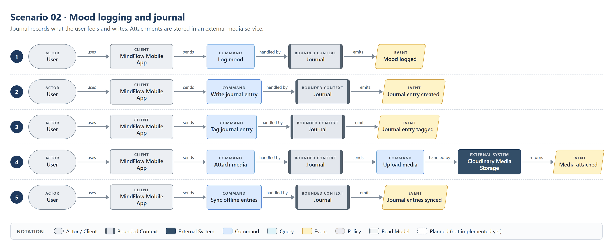

*Figura 24.2. Domain Message Flow del Escenario 02: registro emocional y diario.*

</div>

**Escenario 03 — Generación de Insight con IA**

El evento `Journal entry created` activa la Policy `after Journal entry created`, que envía el Command `Generate insight` a **AI Assistant**. Este contexto es el único que se comunica con **Google Gemini API** y devuelve el evento `Insight generated`. El usuario también puede escribirle directamente al asistente (`Submit assistant query` → `Assistant query submitted`) y valorar la respuesta recibida (`Rate assistant response` → `Assistant response rated`) (Figura 24.3).

<div align="center">

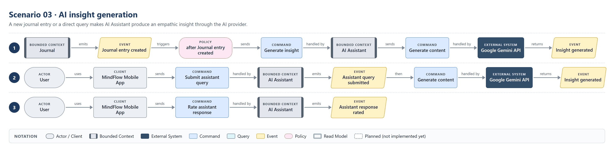

*Figura 24.3. Domain Message Flow del Escenario 03: generación de Insight con IA.*

</div>

**Escenario 04 — Gestión de hábitos y recordatorios**

**Habits & Wellness** atiende `Create habit` y `Complete habit`. Cada cumplimiento produce `Habit completed` y, cuando se cumple la Policy `streak threshold met`, el evento `Streak achieved`. El recordatorio programado (`check-in time reached` → `Send reminder` → `Reminder sent`) pertenece al modelo de dominio y lo entrega **Notifications**; se muestra con borde punteado porque aún no está implementado (Figura 24.4).

<div align="center">

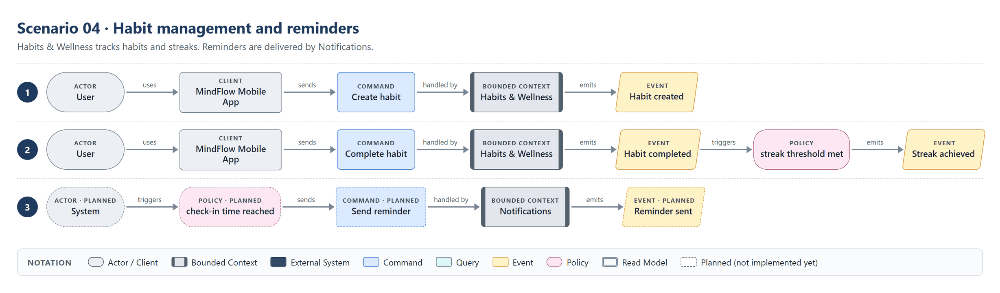

*Figura 24.4. Domain Message Flow del Escenario 04: gestión de hábitos y recordatorios.*

</div>

**Escenario 05 — Detección de estrés y bienestar**

Al ejecutar `Run stress check`, **Habits & Wellness** consulta a **Journal** el ánimo reciente del usuario (`Get recent moods`) y produce `Stress check completed`. Si el nivel es alto, la Policy `after high-stress check` pide a **AI Assistant** una recomendación (`Suggest wellness exercise` → `Wellness exercise suggested`). El tercer paso modela la detección de un patrón de riesgo ante ánimo bajo recurrente y la alerta que **Notifications** envía al usuario; es parte del modelo de dominio y está pendiente de implementación (Figura 24.5).

<div align="center">

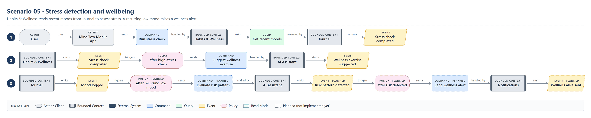

*Figura 24.5. Domain Message Flow del Escenario 05: detección de estrés y bienestar.*

</div>

**Escenario 06 — Generación y exportación de reportes**

**Analytics & Reporting** atiende `Generate progress report`, para lo cual consulta las entradas del usuario a **Journal**, y produce `Progress report generated`. Luego el usuario puede ejecutar `Export report`, que produce `Report exported` (Figura 24.6).

<div align="center">

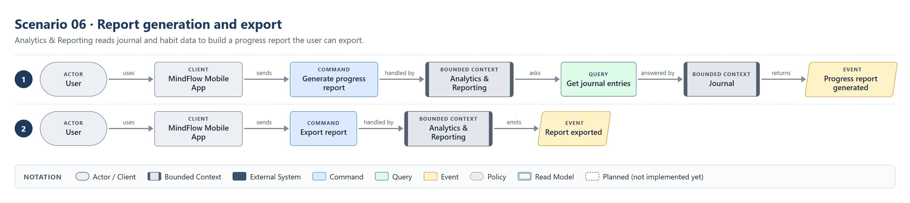

*Figura 24.6. Domain Message Flow del Escenario 06: generación y exportación de reportes.*

</div>

**Escenario 07 — Suscripción Premium**

El usuario ejecuta `Select premium plan` y **Subscriptions** produce `Premium plan selected`. El cobro se delega en **Stripe** (`Process payment`), que devuelve `Payment processed`; solo entonces la Policy `after payment processed` ejecuta `Activate subscription` y se produce `Subscription activated`. La cancelación (`Cancel subscription` → `Subscription canceled`) forma parte del modelo y está pendiente de implementación (Figura 24.7).

<div align="center">

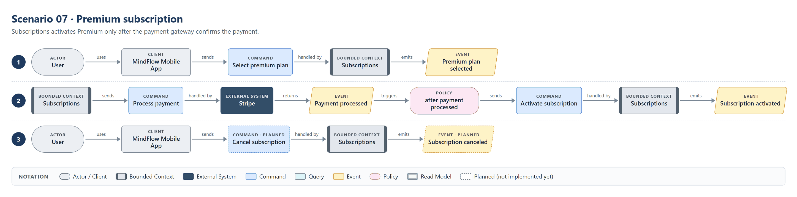

*Figura 24.7. Domain Message Flow del Escenario 07: suscripción Premium.*

</div>

**Escenario 08 — Gestión de soporte**

El usuario ejecuta `Create support ticket` y **Support** produce `Support ticket created`. Tanto la creación como cada respuesta del **Support Agent** (`Reply to ticket` → `Support ticket replied`) activan una Policy que pide a **Notifications** avisar al dueño del ticket (`Send notification` → `Notification sent`). El agente cierra el caso con `Resolve support ticket`, que produce `Support ticket resolved` (Figura 24.8).

<div align="center">

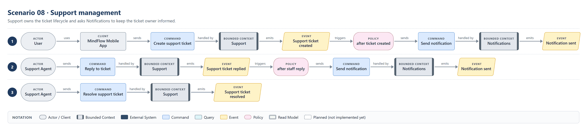

*Figura 24.8. Domain Message Flow del Escenario 08: gestión de soporte.*

</div>

**Escenario 09 — Seguridad de la cuenta (IAM extendido)**

Este escenario amplía IAM con las capacidades de protección de la cuenta. La recuperación de contraseña (`Request password reset` → `Password reset requested`) envía el enlace mediante el **SMTP Email Service** y se completa con `Reset password`. El bloqueo de la aplicación se modela con `Set PIN` y `Verify PIN`. Finalmente, `Delete account` produce `Account deleted`, evento que activa la Policy `after account deleted` para que **Journal**, **Habits & Wellness** y **AI Assistant** eliminen los datos del usuario (Figura 24.9).

<div align="center">

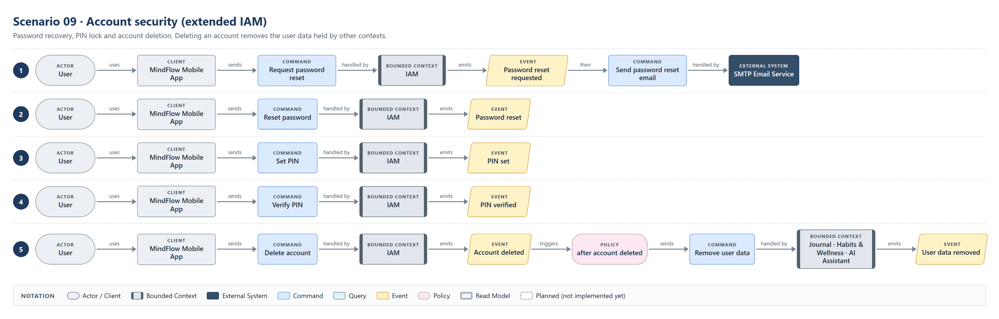

*Figura 24.9. Domain Message Flow del Escenario 09: seguridad de la cuenta (IAM extendido).*

</div>

**Escenario 10 — Dashboard emocional (consulta)**

A diferencia de los anteriores, este escenario no cambia el estado del sistema. La Query `Get emotional dashboard` es atendida por **Analytics & Reporting**, que consulta a **Journal** (`Get journal entries`) y a **Habits & Wellness** (`Get habits and completions`) y compone el Read Model `Emotional dashboard` que la aplicación muestra al usuario (Figura 24.10).

<div align="center">

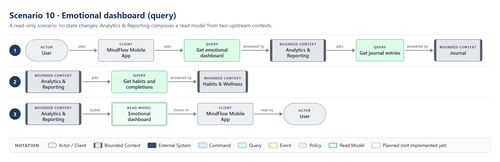

*Figura 24.10. Domain Message Flow del Escenario 10: dashboard emocional (consulta).*

</div>

En conjunto, los flujos muestran que cada Bounded Context conserva su responsabilidad y que la colaboración entre ellos ocurre siempre mediante mensajes de dominio explícitos; los sistemas externos solo son alcanzados por el contexto dueño de esa integración.

#### 2.5.1.3. Bounded Context Canvases

Los **Bounded Context Canvases** documentan de manera estructurada el propósito, las responsabilidades, el lenguaje, las reglas de negocio y la comunicación de cada uno de los ocho Bounded Contexts de MindFlow: **IAM**, **Journal**, **AI Assistant**, **Habits & Wellness**, **Analytics & Reporting**, **Notifications**, **Subscriptions** y **Support**.

Cada canvas sigue la plantilla del **Bounded Context Canvas de DDD Crew (v5)** y contiene las mismas secciones:

- **Name y Purpose:** nombre del contexto y la razón de negocio por la que existe.
- **Strategic Classification:** tipo de subdominio (Core, Supporting o Generic), rol en el modelo de negocio y nivel de evolución.
- **Domain Roles:** el papel que el contexto cumple dentro del sistema.
- **Inbound Communication y Outbound Communication:** colaboradores con los que intercambia mensajes, el tipo de relación con cada uno y los mensajes clasificados como Command (C), Query (Q) o Event (E).
- **Ubiquitous Language:** términos propios del contexto con su definición.
- **Business Decisions:** reglas de negocio que el contexto hace cumplir.
- **Assumptions, Verification Metrics y Open Questions:** supuestos sobre los que se diseñó, métricas para verificar que el contexto cumple su propósito y preguntas aún no resueltas por el equipo.

Los mensajes con borde punteado están definidos en el modelo de dominio pero todavía no forman parte de la versión implementada.

### IAM

**IAM (Identity and Access Management)** da a cada persona una identidad verificable y protege el acceso a su información. Es un contexto de soporte del que dependen todos los demás, y el único que se comunica con Google Identity y con el servicio de correo (Figura 27).

<div align="center">

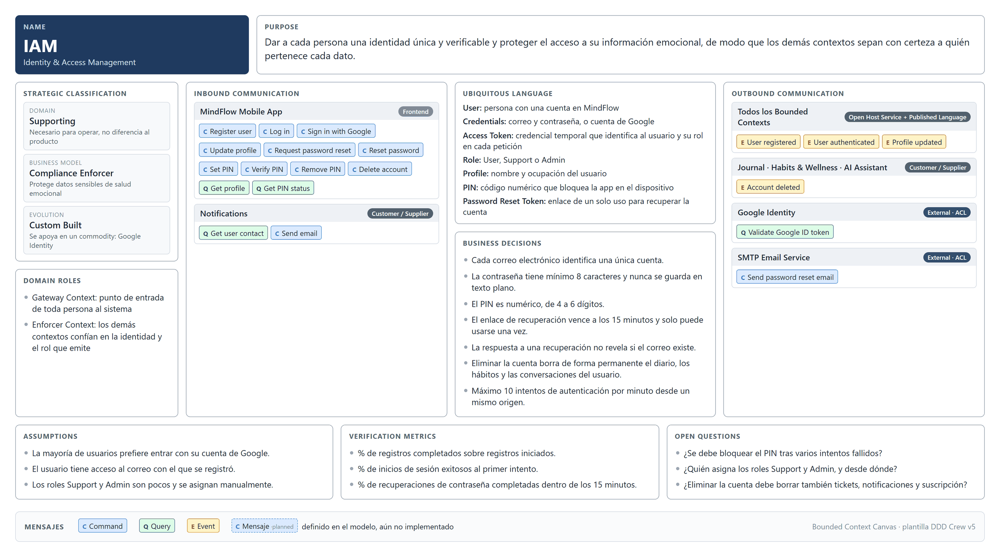

*Figura 27. Bounded Context Canvas correspondiente a IAM.*

</div>

### Journal

**Journal** administra el diario emocional: entradas, estado de ánimo, etiquetas y adjuntos. Es un contexto core porque origina el dato emocional que alimenta al resto del producto (Figura 28).

<div align="center">

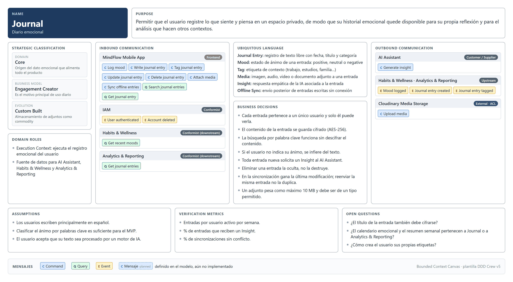

*Figura 28. Bounded Context Canvas correspondiente a Journal.*

</div>

### AI Assistant

**AI Assistant** convierte lo que el usuario escribe en acompañamiento empático e insights, y aísla al resto de MindFlow del proveedor de IA. Es el principal diferenciador del producto (Figura 29).

<div align="center">

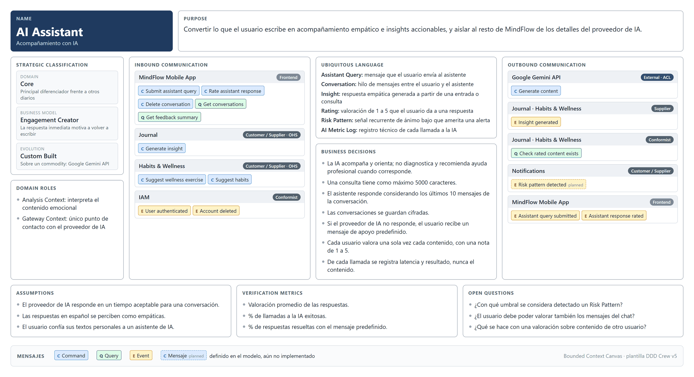

*Figura 29. Bounded Context Canvas correspondiente a AI Assistant.*

</div>

### Habits & Wellness

**Habits & Wellness** administra los hábitos, sus cumplimientos y rachas, los chequeos de estrés y los ejercicios de bienestar, y aplica la regla que ajusta la carga de hábitos según el nivel de estrés (Figura 30).

<div align="center">

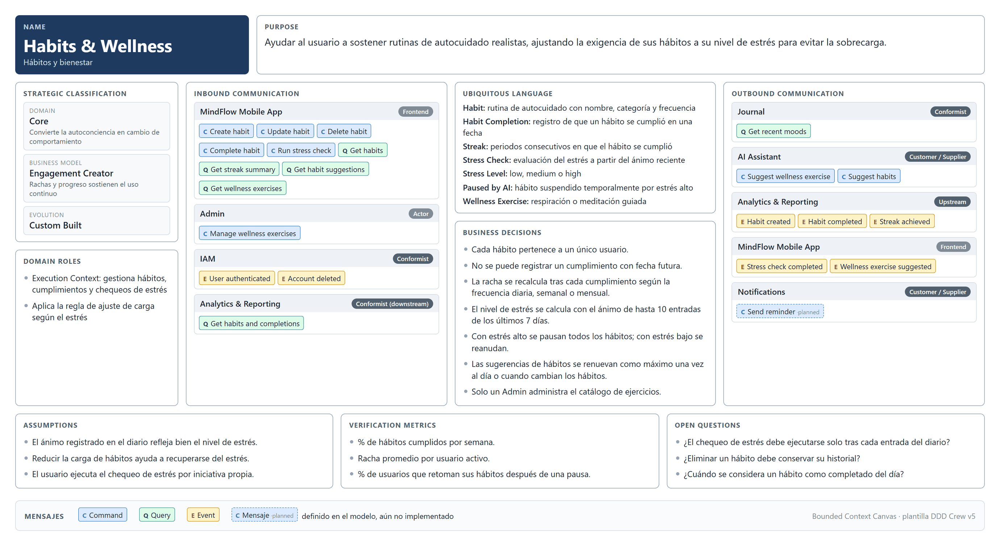

*Figura 30. Bounded Context Canvas correspondiente a Habits & Wellness.*

</div>

### Analytics & Reporting

**Analytics & Reporting** transforma los registros de Journal y de Habits & Wellness en indicadores y reportes. Solo lee información: nunca modifica los datos de los contextos de origen (Figura 31).

<div align="center">

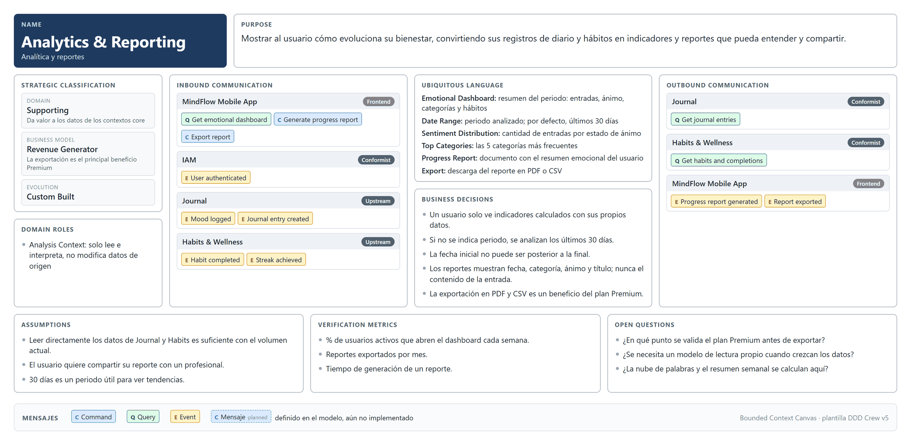

*Figura 31. Bounded Context Canvas correspondiente a Analytics & Reporting.*

</div>

### Notifications

**Notifications** entrega al usuario los avisos que otros contextos solicitan. Es un contexto transversal: no decide cuándo notificar, solo se encarga de que el aviso llegue (Figura 32).

<div align="center">

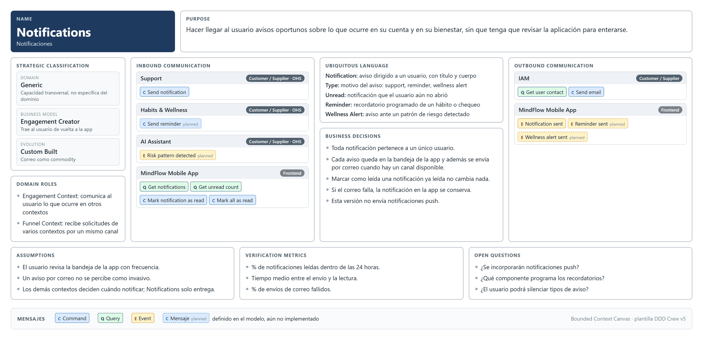

*Figura 32. Bounded Context Canvas correspondiente a Notifications.*

</div>

### Subscriptions

**Subscriptions** administra el plan de cada usuario y el paso a Premium. Es el único contexto que se comunica con la pasarela de pago y mantiene las reglas comerciales separadas del dominio de bienestar (Figura 33).

<div align="center">

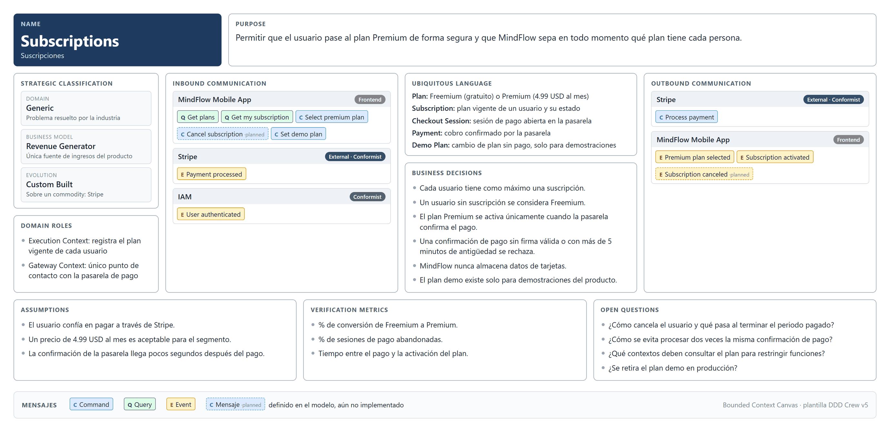

*Figura 33. Bounded Context Canvas correspondiente a Subscriptions.*

</div>

### Support

**Support** gestiona las solicitudes de ayuda mediante tickets, desde su creación hasta su resolución por el equipo de soporte, y mantiene informado al usuario a través de Notifications (Figura 34).

<div align="center">

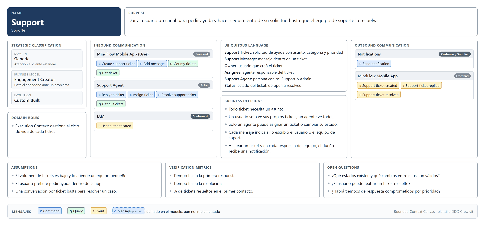

*Figura 34. Bounded Context Canvas correspondiente a Support.*

</div>

En conjunto, los canvases establecen límites claros entre las responsabilidades del dominio de MindFlow y dejan explícito, para cada contexto, qué mensajes recibe, cuáles emite y con qué tipo de relación colabora con los demás.

### 2.5.2. Context Mapping

El **Context Mapping** representa las relaciones entre los **Bounded Contexts** de MindFlow y con los sistemas externos: cuál actúa como **Upstream (U)**, cuál como **Downstream (D)** y qué patrón de integración se aplica en cada caso.

Para mantener la legibilidad, el mapa se dividió en tres vistas pequeñas, cada una centrada en un grupo de relaciones. Las tres comparten la misma leyenda y utilizan los patrones del catálogo de **DDD Crew**:

| Patrón | Sigla | Uso en MindFlow |
|---|---|---|
| Open Host Service | OHS | El contexto upstream ofrece una interfaz estable que varios contextos consumen. |
| Published Language | PL | El upstream publica un formato común y documentado que los demás adoptan. |
| Customer / Supplier | C/S | El downstream es cliente del upstream y sus necesidades influyen en lo que este ofrece. |
| Conformist | CF | El downstream adopta el modelo del upstream tal cual, sin traducirlo. |
| Anti-Corruption Layer | ACL | El downstream traduce el modelo de un sistema externo para que no contamine el suyo. |

*Tabla 16.2. Patrones de Context Mapping utilizados.*

**Decisiones de diseño.** Tres decisiones explican la forma del mapa. (1) La identidad no se modela como un **Shared Kernel** entre contextos, porque obligaría a coordinar cada cambio del modelo de usuario con los ocho contextos; en su lugar, IAM la publica y los demás la adoptan. (2) Ningún contexto consume directamente al proveedor de IA: AI Assistant concentra esa relación, de modo que un cambio de proveedor afecta a un solo contexto. (3) Analytics & Reporting lee los datos de los contextos de origen en lugar de mantener una copia propia alimentada por eventos, porque el volumen actual no lo justifica; la alternativa queda registrada como pregunta abierta en su canvas.

**Context Map 1 — Identidad y acceso**

**IAM** es **Upstream** de todos los demás contextos. Publica la identidad autenticada (identificador del usuario y rol) como **Open Host Service** con **Published Language**, y los siete contextos restantes la adoptan sin traducirla, por lo que su relación es **Conformist**. **Notifications** es además cliente de IAM (**Customer / Supplier**), porque le solicita el contacto del usuario y el envío de correos. Hacia afuera, IAM protege su modelo con un **Anti-Corruption Layer** frente a **Google Identity** y frente al **SMTP Email Service** (Figura 35.1).

<div align="center">

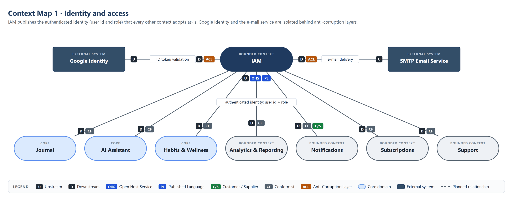

*Figura 35.1. Context Map 1: identidad y acceso.*

</div>

**Context Map 2 — Dominio core de bienestar**

**AI Assistant** actúa como **Upstream** y expone sus capacidades como **Open Host Service**; **Journal** y **Habits & Wellness** son sus clientes (**Customer / Supplier**): el primero le pide un insight por cada entrada y el segundo, sugerencias de hábitos y ejercicios de bienestar. A su vez, **Journal** es **Upstream** de **Habits & Wellness**, que lee el ánimo reciente para calcular el nivel de estrés, y tanto **Journal** como **Habits & Wellness** son **Upstream** de **Analytics & Reporting**; en los tres casos el downstream lee el modelo del upstream tal cual (**Conformist**). Adicionalmente, AI Assistant consulta a Journal y a Habits & Wellness para comprobar que existe el contenido que el usuario valora. Los sistemas externos quedan aislados mediante **Anti-Corruption Layer**: **Google Gemini API** detrás de AI Assistant y **Cloudinary Media Storage** detrás de Journal (Figura 35.2).

<div align="center">

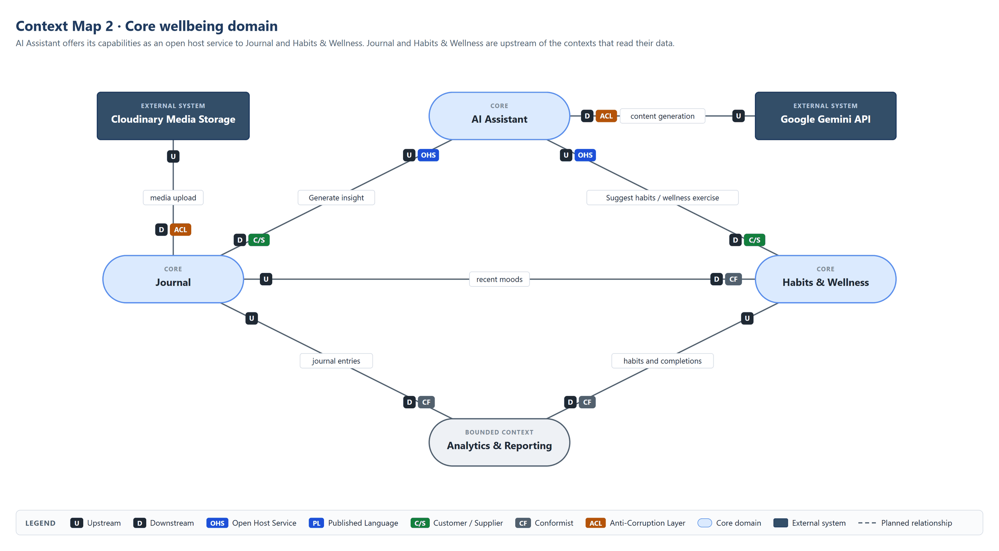

*Figura 35.2. Context Map 2: dominio core de bienestar.*

</div>

**Context Map 3 — Engagement, servicio y monetización**

**Notifications** ofrece el envío de avisos como **Open Host Service**. **Support** es su cliente (**Customer / Supplier**) y lo utiliza al crear un ticket y en cada respuesta del equipo. Las relaciones con **Habits & Wellness** (recordatorios) y con **AI Assistant** (alertas de bienestar) siguen el mismo patrón y se dibujan con línea punteada porque están definidas en el modelo pero aún no implementadas. **Subscriptions** no depende de ningún otro contexto del dominio, salvo de la identidad de IAM, y adopta el modelo de **Stripe** como **Conformist** (Figura 35.3).

<div align="center">

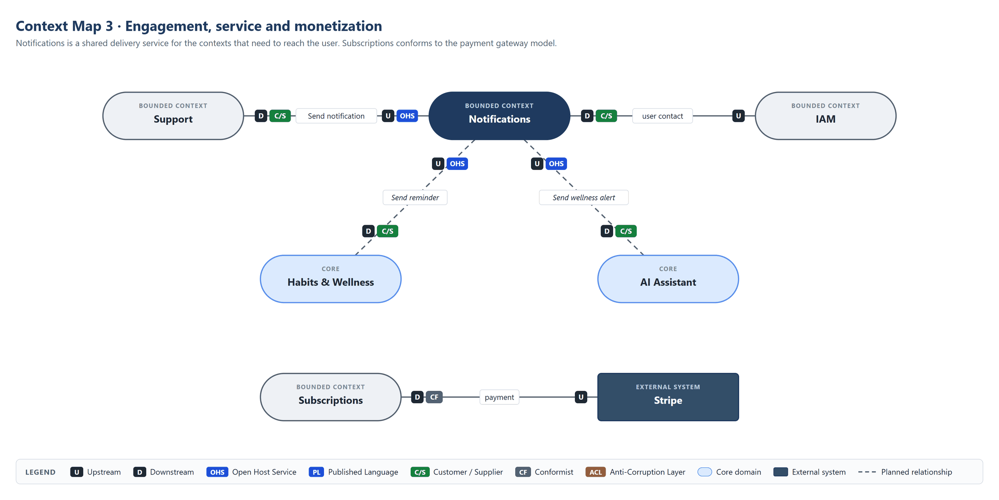

*Figura 35.3. Context Map 3: engagement, servicio y monetización.*

</div>

### Relaciones entre Bounded Contexts

La siguiente tabla resume todas las relaciones representadas en los tres mapas.

| Upstream (U) | Downstream (D) | Patrón | Qué se intercambia |
|---|---|---|---|
| IAM | Journal, AI Assistant, Habits & Wellness, Analytics & Reporting, Subscriptions, Support | OHS + PL → Conformist | Identidad autenticada: identificador del usuario y rol |
| IAM | Notifications | OHS + PL → Conformist; Customer / Supplier | Identidad, contacto del usuario y envío de correo |
| IAM | Journal, Habits & Wellness, AI Assistant | Customer / Supplier | Evento `Account deleted` para eliminar los datos del usuario |
| AI Assistant | Journal | OHS → Customer / Supplier | `Generate insight` → `Insight generated` |
| AI Assistant | Habits & Wellness | OHS → Customer / Supplier | `Suggest habits`, `Suggest wellness exercise` |
| Journal | Habits & Wellness | Conformist | Ánimo reciente del usuario (`Get recent moods`) |
| Journal | Analytics & Reporting | Conformist | Entradas del diario (`Get journal entries`) |
| Habits & Wellness | Analytics & Reporting | Conformist | Hábitos y cumplimientos (`Get habits and completions`) |
| Journal, Habits & Wellness | AI Assistant | Conformist | Existencia del contenido valorado por el usuario |
| Notifications | Support | OHS → Customer / Supplier | `Send notification` → `Notification sent` |
| Notifications | Habits & Wellness | OHS → Customer / Supplier (planificado) | `Send reminder` → `Reminder sent` |
| Notifications | AI Assistant | OHS → Customer / Supplier (planificado) | `Risk pattern detected` → `Wellness alert sent` |
| Google Identity | IAM | Anti-Corruption Layer | Validación de la cuenta de Google |
| SMTP Email Service | IAM | Anti-Corruption Layer | Entrega de correos |
| Google Gemini API | AI Assistant | Anti-Corruption Layer | Generación de contenido |
| Cloudinary Media Storage | Journal | Anti-Corruption Layer | Almacenamiento de adjuntos |
| Stripe | Subscriptions | Conformist | Sesión de pago y confirmación del cobro |

*Tabla 16.3. Relaciones entre los Bounded Contexts de MindFlow y con sistemas externos.*

En conjunto, el Context Mapping muestra que **IAM** es el proveedor transversal de identidad; que **Journal** y **Habits & Wellness** generan la información de dominio que consumen **AI Assistant** y **Analytics & Reporting**; que **AI Assistant** y **Notifications** funcionan como servicios compartidos por varios contextos; y que toda integración con un sistema externo tiene un único contexto dueño.

### 2.5.3. Software Architecture

#### 2.5.3.1. Software Architecture Context Level Diagrams

El **Software Architecture Context Level Diagram** representa a MindFlow como un único sistema y muestra su interacción con los usuarios y los servicios externos necesarios para su funcionamiento.

En este nivel del modelo C4 no se detallan los componentes internos de MindFlow, sino únicamente los actores y sistemas externos con los que se relaciona (Figura 36).

<div align="center">


*Figura 36. Software Architecture Context Level Diagram de MindFlow.*

</div>

**Explicación del diagrama**

El diagrama de contexto muestra a **MindFlow** como un único sistema rodeado por sus usuarios y por los sistemas externos con los que interactúa. Los usuarios son tres: el **usuario de MindFlow** (estudiante universitario o profesional joven que escribe su diario, registra hábitos y conversa con el asistente de IA), el **visitante de la Landing Page** (que conoce el producto y el plan Premium) y el **personal de Support o Admin** (que responde tickets y mantiene el catálogo de ejercicios de bienestar a través de la API).

Los sistemas externos son cinco y están integrados:

- **Google Gemini API**: respuestas empáticas, respuestas del chat, consejos de estrés y sugerencias de hábitos.
- **Stripe**: página de pago y notificaciones de cobro de las suscripciones Premium.
- **Google Identity**: inicio de sesión con Google.
- **Cloudinary**: archivos adjuntos del diario.
- **Servicio de correo SMTP**: recuperación de contraseña y avisos.

**Firebase Cloud Messaging** aparece en gris y con línea punteada porque las notificaciones push están planificadas pero todavía no se implementaron: hoy las notificaciones son internas de la aplicación y se consultan por la API.

Este diagrama permite visualizar el límite del sistema MindFlow y las principales dependencias externas que colaboran con la solución.

#### 2.5.3.2. Software Architecture Container Level Diagrams

El **Software Architecture Container Level Diagram** representa la estructura interna de MindFlow a nivel de contenedores, mostrando las principales aplicaciones, servicios y mecanismos de persistencia que componen la solución.

A diferencia del Context Level Diagram, en este nivel del modelo C4 se detalla cómo MindFlow se divide internamente y cómo sus contenedores se comunican entre sí y con los servicios externos (Figura 37).

<div align="center">


*Figura 37. Software Architecture Container Level Diagram de MindFlow.*

</div>

**Explicación del diagrama**

MindFlow se compone de seis contenedores. El usuario interactúa con la **aplicación móvil Android** (Kotlin y Jetpack Compose), que guarda una copia local de su perfil, diario y hábitos en una **base de datos SQLite** del dispositivo y se comunica con la **Web Services API** mediante HTTPS/JSON con autenticación JWT. La API (ASP.NET Core sobre .NET 10 y Entity Framework Core) expone los ocho bounded contexts, persiste en **MySQL 8** y usa **Redis** únicamente para guardar durante dos minutos la lista de hábitos de cada usuario. La **Landing Page** (HTML, CSS y JavaScript) es un sitio estático independiente.

La aplicación móvil obtiene el token de Google con Credential Manager y abre la página de pago de Stripe en una Chrome Custom Tab; la API valida el token de Google, crea las sesiones de pago y recibe los webhooks firmados de Stripe.

La Web Services API también mantiene integraciones con diferentes servicios externos:

- **Google Gemini API**: generación de respuestas, insights emocionales y sugerencias mediante Inteligencia Artificial.
- **Google Identity**: validación del token de inicio de sesión con Google.
- **Stripe**: creación de sesiones de pago y recepción de webhooks de suscripciones Premium.
- **Cloudinary**: almacenamiento y recuperación de archivos multimedia asociados a las entradas del diario.
- **Email Provider**: envío de correos transaccionales mediante SMTP.

**Firebase Cloud Messaging** no forma parte de este diagrama: las notificaciones push están planificadas pero aún no implementadas.

Este nivel del modelo C4 permite comprender cómo se distribuyen las responsabilidades principales de la solución y cómo los contenedores internos de MindFlow colaboran para ofrecer las funcionalidades del sistema.

<div align="center">

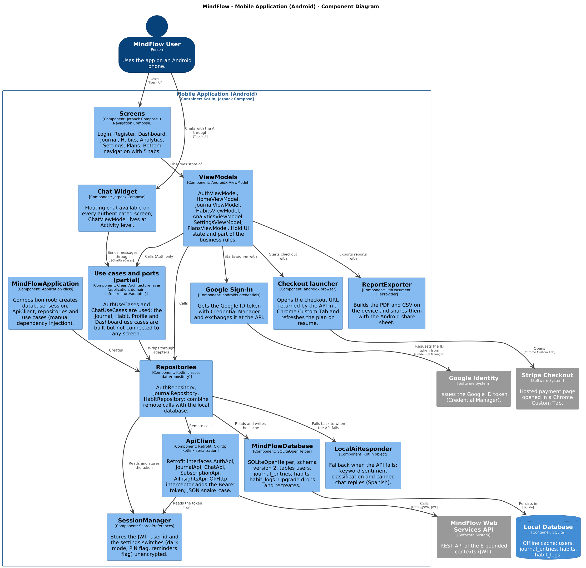

*Figura 37.1. Component Diagram de la aplicación móvil Android.*

</div>

La aplicación sigue un patrón MVVM: las pantallas de Compose observan a los ViewModels, que usan repositorios que combinan las llamadas a la API (Retrofit/OkHttp) con la base local. Existe además una capa de casos de uso (Clean Architecture) de la que hoy solo se usan los de autenticación y chat. Cuando la API falla, el diario, el chat y las sugerencias de hábitos recurren a respuestas locales; los reportes PDF/CSV y la analítica se calculan en el dispositivo.

<div align="center">

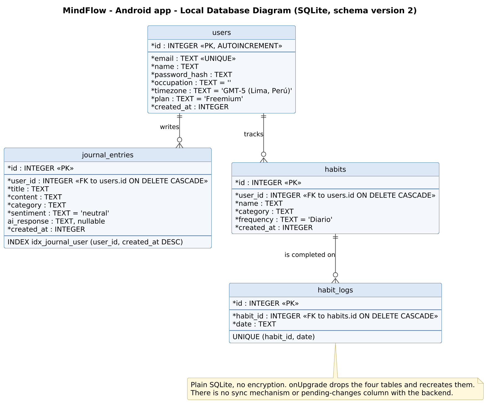

*Figura 37.2. Database Diagram de la base local SQLite de la aplicación Android.*

</div>

La base local (versión 2) tiene cuatro tablas: `users`, `journal_entries`, `habits` y `habit_logs`, con borrado en cascada desde el usuario y un índice único `(habit_id, date)`.

#### 2.5.3.3. Software Architecture Deployment Diagrams

Se elaboró el Deployment Diagram siguiendo el C4 Model, con el objetivo de representar la distribución física de la solución MindFlow: los nodos de hardware e infraestructura sobre los que se despliega cada contenedor de software, así como las relaciones y dependencias entre ellos (Figura 38).

<div align="center">

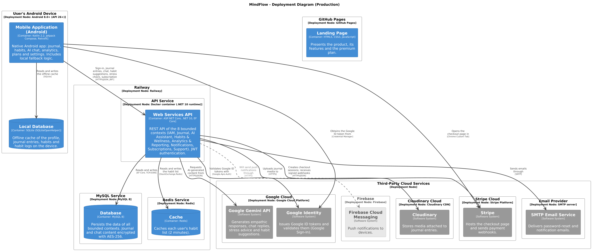
*Figura 38. Deployment Diagram (C4 Model) de la solución MindFlow en producción.*

</div>

**Explicación del diagrama**

La aplicación Android se ejecuta en el dispositivo del usuario (Android 8.0 o superior) junto con su base SQLite local. La Landing Page se publica en **GitHub Pages**. El backend se despliega en **Railway** como un único proyecto con tres servicios:

- **Web Services API**: servicio que construye y ejecuta el contenedor Docker de la API (ASP.NET Core / .NET 10) a partir del `Dockerfile` del repositorio de GitHub.
- **MySQL**: servicio de base de datos relacional (MySQL 8) donde se persisten usuarios, entradas de diario, hábitos, conversaciones de chat, suscripciones y tickets de soporte.
- **Redis**: usado únicamente por la Web Services API para la caché de dos minutos de la lista de hábitos.

Los servicios de terceros (agrupados como Third-Party Cloud Services) son consumidos solo por la API, salvo Google Identity y Stripe, con los que también interactúa directamente la aplicación móvil:

- **Google Cloud**: aloja **Google Gemini API** (generación de insights de IA, respuestas del chat, análisis de sentimiento y sugerencias de hábitos) y **Google Identity** (validación del token de Google Sign-In).
- **Stripe Cloud**: procesa los pagos de las suscripciones premium y envía webhooks de confirmación; la aplicación móvil abre su página de pago en una Chrome Custom Tab.
- **Cloudinary Cloud**: almacena y sirve los archivos multimedia adjuntos a las entradas del diario.
- **Email Provider**: servidor SMTP utilizado para el envío de correos transaccionales (recuperación de contraseña, notificaciones de Support).

Se muestra en gris y punteado el nodo de **Firebase** (push), aún no implementado.

## 2.6. Tactical-Level Domain-Driven Design

<!-- Se agrega una sub-sección "2.6.x. Bounded Context: <Nombre>" por cada bounded context identificado en 2.5, una vez completado el Strategic-Level DDD. -->

Además de las tablas por capa, el Domain Layer de cada bounded context que tiene un agregado con reglas de negocio propias incluye su **Aggregate Design Canvas**. El canvas recorre nueve secciones: nombre, descripción, transiciones de estado, invariantes que el agregado garantiza, políticas correctivas para lo que queda fuera de su límite de consistencia, comandos que maneja, eventos que genera, throughput (probabilidad de conflictos de concurrencia) y tamaño (cuántos cambios acumula en su vida). Los eventos listados son los eventos de dominio identificados en el EventStorming (sección 2.5.1): en el Sprint 1 el backend no los publica como `IEvent`, sino que sus efectos se ejecutan de forma síncrona en el Application Layer. Analytics & Reporting y Notifications no tienen canvas: el primero no tiene un agregado propio (solo lee datos de otros contextos) y el segundo solo registra notificaciones, sin reglas que proteger.

### 2.6.1. Bounded Context: IAM

El bounded context **IAM (Identity & Access Management)** es responsable de la identidad, autenticación y perfil de los usuarios de MindFlow. Ancla el evento *User registered / User authenticated*, y es consumido por el resto de bounded contexts, ya que toda operación sobre Journal, Habits & Wellness, AI Assistant, Analytics, Subscriptions, Notifications y Support requiere un usuario autenticado.

#### 2.6.1.1. Domain Layer

El Domain Layer concentra el agregado raíz `User`, la entidad `PasswordResetToken` y la abstracción `IUserRepository`, que encapsulan las reglas de negocio de identidad (hashing de contraseña y PIN, promoción a administrador, vínculo con Google) independientemente de cómo se exponen o se persisten (Tabla 17).

**Tabla 17. Bounded Context: IAM — Domain Layer.**

| Clase | Tipo | Propósito | Atributos | Métodos | Relaciones |
|---|---|---|---|---|---|
| `User` | Aggregate Root (implementa `IAuditableEntity`) | Representa la identidad de un usuario de MindFlow y encapsula las reglas de negocio sobre su contraseña, PIN de seguridad y rol. | `Id: int`, `Email: string`, `Name: string?`, `Occupation: string?`, `GoogleId: string?`, `PasswordHash: string` (privado), `PinHash: string?` (privado), `Role: string`, `CreatedAt: DateTimeOffset?`, `UpdatedAt: DateTimeOffset?`, `AdminRole`/`SupportRole`/`DefaultRole: const string` | `User(email, password)`, `User(email, googleId, name)`, `PromoteToAdmin()`, `PromoteToSupport()`, `LinkGoogle(googleId)`, `UpdatePasswordHash(password)`, `UpdateProfile(name, occupation)`, `SetPin(pin)`, `VerifyPin(pin): bool`, `RemovePin()`, propiedades calculadas `IsAdmin`, `HasPin` | Es el agregado que `IUserRepository` persiste; `PasswordResetToken` referencia su `Id` (relación lógica, sin FK físico) |
| `PasswordResetToken` | Entity | Representa un token de un solo uso, con expiración, para el flujo de recuperación de contraseña. Solo se persiste el hash del token; el valor crudo viaja únicamente en el correo enviado al usuario. | `Id: int`, `UserId: int`, `Token: string` (hash SHA-256), `ExpiresAt: DateTime`, `Used: bool` | *(entidad anémica, sin comportamiento propio — el ciclo de vida lo gestiona `UserCommandService`)* | Referencia lógica a `User` por `UserId` (0..* a 1, sin constraint físico en BD) |
| `IUserRepository` | Repository Interface (extiende `IBaseRepository<User>`) | Abstrae el acceso a datos de `User` para que el Domain/Application Layer no dependa de la tecnología de persistencia. | — | `FindByEmailAsync(email): Task<User?>`, `FindByGoogleIdAsync(googleId): Task<User?>`, `ExistsByEmailAsync(email): Task<bool>` + heredados de `IBaseRepository<User>` (`AddAsync`, `FindByIdAsync`, `Update`, `Remove`, `ListAsync`) | Implementada por `UserRepository` (Infrastructure Layer); consumida por `UserCommandService` (Application Layer) |

El Aggregate Design Canvas de `User` resume sus reglas de identidad y cómo se coordina con el resto de contextos al eliminar una cuenta (Tabla 18).

**Tabla 18. Bounded Context: IAM — Aggregate Design Canvas de `User`.**

| Sección | Contenido |
|---|---|
| **1. Name** | `User` |
| **2. Description** | Representa la identidad de una persona en MindFlow: sus credenciales (hash de contraseña y de PIN), su rol, su vínculo con Google y su perfil. Se decidió dejar `PasswordResetToken` fuera del agregado, como entidad propia gestionada por `UserCommandService`, para que la expiración y el uso único del token no obliguen a cargar y bloquear al usuario. La eliminación de cuenta tampoco vive en el agregado: la orquesta el Application Layer porque afecta datos de otros bounded contexts. |
| **3. State Transitions** | *Registrado* (email y contraseña, o Google) → *Vinculado a Google* (`LinkGoogle`, cuando un usuario existente inicia sesión con Google)<br>*Sin PIN* ⇄ *Con PIN* (`SetPin` / `RemovePin`)<br>Rol *User* → *Support* / *Admin* (`PromoteToSupport` / `PromoteToAdmin`)<br>Cualquier estado → *Eliminado* (`DeleteAccountCommand`, borrado físico) |
| **4. Enforced Invariants** | El email es único (índice único y verificación con `ExistsByEmailAsync`) y tiene formato válido.<br>La contraseña tiene al menos 8 caracteres.<br>La contraseña y el PIN nunca se guardan en texto plano, solo como hash BCrypt.<br>El PIN es numérico y tiene entre 4 y 6 dígitos.<br>`GoogleId` es único.<br>`Role` solo puede ser `User`, `Support` o `Admin`. |
| **5. Corrective Policies** | Al eliminar una cuenta se borran, dentro de una misma transacción, las entradas de diario (con sus etiquetas y adjuntos), hábitos y logs, conversaciones, calificaciones de IA, sugerencias cacheadas, tokens y etiquetas del usuario.<br>Al pedir un nuevo token de recuperación se eliminan los tokens anteriores no usados; cada token expira a los 15 minutos y se marca como usado al restablecer la contraseña.<br>Si alguien inicia sesión con Google usando un email ya registrado, se vincula esa cuenta en lugar de crear un usuario duplicado. |
| **6. Handled Commands** | `SignUpCommand`, `SignInCommand`, `GoogleAuthCommand`, `UpdateProfileCommand`, `ForgotPasswordCommand`, `ResetPasswordCommand`, `SetPinCommand`, `VerifyPinCommand`, `RemovePinCommand`, `DeleteAccountCommand` |
| **7. Created Events** | *User registered*, *User authenticated*, *Google account linked*, *Profile updated*, *Password reset requested*, *Password reset*, *PIN set*, *PIN removed*, *Account deleted* |
| **8. Throughput** | Bajo. Cada instancia solo la modifica su propio dueño, a lo sumo desde un par de dispositivos, y las escrituras son esporádicas (registro, cambios de perfil o PIN); iniciar sesión no modifica el agregado. La probabilidad de conflictos de concurrencia es prácticamente nula. |
| **9. Size** | Pequeño. No contiene colecciones, y en toda su vida acumula unas decenas de cambios como máximo (registro, vínculo con Google, actualizaciones de perfil, cambios de PIN y de contraseña). |

#### 2.6.1.2. Interface Layer

El Interface Layer expone las capacidades de IAM como una API REST, y traduce entre el contrato HTTP (Resources) y los Commands del Application Layer (Tabla 19).

**Tabla 19. Bounded Context: IAM — Interface Layer.**

| Clase | Tipo | Propósito | Atributos / Métodos | Relaciones |
|---|---|---|---|---|
| `UsersController` | REST Controller (`api/v1/users`) | Expone los endpoints de registro, autenticación (email/password y Google), recuperación de contraseña, perfil y gestión de PIN. | Endpoints: `POST /sign-up`, `POST /sign-in`, `POST /google-auth`, `POST /forgot-password`, `POST /reset-password`, `GET /profile`, `PUT /profile`, `DELETE /`, `POST /pin`, `POST /pin/verify`, `DELETE /pin`, `GET /pin/status` | Depende de `IUserCommandService`; usa los *Assemblers* para transformar Resources ↔ Commands/Entities |
| `SignUpResource`, `SignInResource`, `GoogleAuthResource`, `ForgotPasswordResource`, `ResetPasswordResource`, `UpdateProfileResource`, `SetPinResource`, `VerifyPinResource` | Request DTOs (records) | Representan el cuerpo (`body`) de cada petición HTTP entrante, desacoplado de los Commands del dominio. | Atributos según el endpoint (p. ej. `SignUpResource(Email, Password, Name?)`) | Transformados a Commands por los Assemblers o instanciados directamente en el Controller |
| `UserResource`, `AuthenticatedUserResource` | Response DTOs (records) | Representan la forma pública de un `User` en las respuestas HTTP; `AuthenticatedUserResource` añade el JWT emitido. | `UserResource(Id, Email, Name?, Occupation?)`, `AuthenticatedUserResource(Id, Email, Token)` | Construidos a partir de `User` mediante `UserResourceFromEntityAssembler` |
| `SignUpCommandFromResourceAssembler` | Assembler (static) | Convierte un `SignUpResource` en un `SignUpCommand`. | `ToCommandFromResource(resource): SignUpCommand` | Traduce Interface Layer → Application Layer |
| `UserResourceFromEntityAssembler` | Assembler (static) | Convierte un `User` (Domain) en un `UserResource` (Interface). | `ToResourceFromEntity(entity): UserResource` | Traduce Domain Layer → Interface Layer |

#### 2.6.1.3. Application Layer

El Application Layer orquesta los flujos de negocio de IAM a través de Commands y del servicio `UserCommandService`, que actúa como Command Handler unificado para todos los casos de uso de identidad (Tabla 20).

**Tabla 20. Bounded Context: IAM — Application Layer.**

| Clase | Tipo | Propósito | Atributos / Métodos | Relaciones |
|---|---|---|---|---|
| `SignUpCommand`, `SignInCommand`, `UpdateProfileCommand`, `DeleteAccountCommand`, `GoogleAuthCommand`, `ForgotPasswordCommand`, `ResetPasswordCommand`, `SetPinCommand`, `VerifyPinCommand`, `RemovePinCommand` | Commands (records) | Encapsulan la intención y los datos necesarios para cada caso de uso de IAM (registro, login, actualización de perfil, eliminación de cuenta, login con Google, recuperación/reset de contraseña, gestión de PIN). | P. ej. `SignUpCommand(Email, Password, Name?)`, `SignInCommand(Email, Password)`, `SetPinCommand(UserId, Pin)` | Producidos por el Interface Layer (directamente o vía Assembler); consumidos por `IUserCommandService` |
| `IUserCommandService` | Application Service Interface | Define el contrato de todos los casos de uso de IAM como métodos `Handle(...)` sobrecargados por tipo de Command. | Un `Handle(TCommand)` por cada Command, más `HasPinAsync(userId)` y `GetProfileAsync(userId)` | Implementada por `UserCommandService`; consumida por `UsersController` |
| `UserCommandService` | Application Service (Command Handler) | Implementa `IUserCommandService`: valida entradas (formato de email, longitud de contraseña/PIN), aplica reglas de negocio sobre `User`, coordina `IUserRepository`, `ITokenService`, `IEmailService`, `IGoogleAuthService` y el `IUnitOfWork`. En `DeleteAccountCommand` además orquesta, dentro de una transacción, el borrado físico de los datos del usuario en Journal (entradas, etiquetas propias y adjuntos), Habits & Wellness (hábitos y logs), AI Assistant (conversaciones, mensajes y calificaciones de IA), sus sugerencias de hábitos cacheadas y sus tokens de recuperación, antes de borrar al propio `User`. **No toca** Notifications, Subscriptions ni Support: esas filas quedan huérfanas, sin FK real hacia `users`. | Un método `Handle` por cada Command (ver tabla de Commands) | Depende de `IUserRepository`, `IUnitOfWork`, `ITokenService`, `IEmailService`, `IGoogleAuthService`, `AppDbContext` (acceso directo para el borrado en cascada multi-contexto) |
| `ITokenService` | Service Port | Abstrae la generación de tokens de acceso. | `GenerateToken(user: User): string` | Implementada por `TokenService` (Infrastructure) |
| `IEmailService` | Service Port | Abstrae el envío de correos transaccionales. | `SendPasswordResetAsync(toEmail, resetToken): Task` | Implementada por `EmailService` (Infrastructure) |
| `IGoogleAuthService` | Service Port | Abstrae la validación de credenciales de Google Sign-In. | `ValidateAsync(credential): Task<GoogleUserInfo?>` | Implementada por `GoogleAuthService` (Infrastructure); retorna el record `GoogleUserInfo(GoogleId, Email, Name?)` |
| `SignUpError`, `SignInError` | Error Enums | Códigos de error tipados para las respuestas `Result<T>.Failure(...)` de sign-up y sign-in/reset. | `SignUpError`: `EmailAlreadyInUse`, `InvalidEmailFormat`, `UnexpectedError`. `SignInError`: `InvalidCredentials`, `UnexpectedError` | Usados por `UserCommandService` al construir resultados fallidos |

#### 2.6.1.4. Infrastructure Layer

El Infrastructure Layer contiene las implementaciones concretas de los puertos definidos en Domain/Application Layer: persistencia con EF Core, emisión de JWT, envío de correo por SMTP, y validación de credenciales de Google (Tabla 21).

**Tabla 21. Bounded Context: IAM — Infrastructure Layer.**

| Clase | Tipo | Propósito | Atributos / Métodos | Relaciones |
|---|---|---|---|---|
| `UserRepository` | Repository (EF Core) | Implementa `IUserRepository` sobre `AppDbContext`, extendiendo `BaseRepository<User>` para el CRUD genérico. | `FindByEmailAsync(email)`, `FindByGoogleIdAsync(googleId)`, `ExistsByEmailAsync(email)` | Implementa `IUserRepository`; hereda de `BaseRepository<User>`; opera sobre la tabla `users` vía `AppDbContext` |
| `TokenService` | Infrastructure Service | Implementa `ITokenService` generando un JWT firmado con HMAC-SHA256, con claims `user_id`, `email` y `role`, expiración de 7 días. | `GenerateToken(user): string` | Implementa `ITokenService`; lee `TokenSettings:Secret`, `Jwt:Issuer`, `Jwt:Audience` de configuración |
| `EmailService` | Infrastructure Service | Implementa `IEmailService` enviando el correo de recuperación de contraseña vía SMTP (`System.Net.Mail`), con el enlace hacia `FrontendUrl` configurado. | `SendPasswordResetAsync(toEmail, resetToken): Task` | Implementa `IEmailService`; depende del servicio externo **SMTP Email Service** |
| `GoogleAuthService` | Infrastructure Service | Implementa `IGoogleAuthService` validando el `credential` (ID token) recibido contra la librería oficial `Google.Apis.Auth`, verificando el `Audience` contra `Google:ClientId`. | `ValidateAsync(credential): Task<GoogleUserInfo?>` | Implementa `IGoogleAuthService`; depende del servicio externo **Google OAuth** |

El JWT emitido no tiene mecanismo de renovación (no hay *refresh token*): al expirar a los 7 días, el usuario debe iniciar sesión nuevamente. `VerifyPin` tampoco bloquea la cuenta tras una serie de intentos fallidos; la única protección contra fuerza bruta es de rate limiting, en dos niveles: una política específica de 10 peticiones por minuto por IP (`[EnableRateLimiting("auth")]`) sobre `sign-up`, `sign-in`, `google-auth`, `forgot-password`, `reset-password` y `pin/verify`, y un límite global de 100 peticiones por minuto (por usuario o por IP) para el resto de la API.

---

#### 2.6.1.5. Bounded Context Software Architecture Component Level Diagrams

<div align="center">

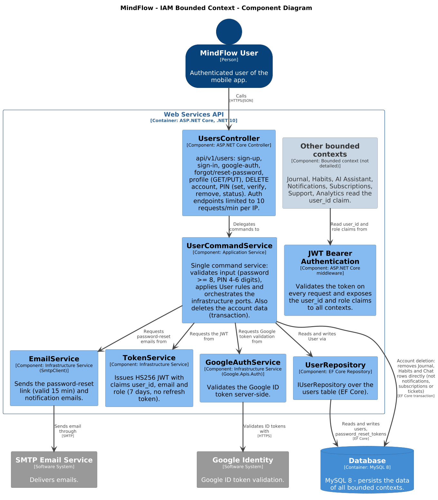
*Figura 39. Component Diagram (C4 Model) del bounded context IAM dentro del container Web Services API.*

</div>

El diagrama descompone el container **Web Services API** en los componentes que implementan IAM: un middleware de autenticación JWT valida el token en cada petición antes de llegar a `UsersController`, que delega en `UserCommandService`, y este a su vez coordina `UserRepository` (persistencia), `TokenService` (emisión de JWT), `EmailService` (correo de recuperación vía SMTP) y `GoogleAuthService` (validación de credenciales contra Google OAuth). Cada componente de infraestructura encapsula la comunicación con su dependencia externa correspondiente, de modo que `UserCommandService` permanece desacoplado de los detalles técnicos (hashing JWT, protocolo SMTP, SDK de Google). Al eliminar una cuenta, `UserCommandService` también escribe directamente sobre las tablas de Journal, Habits & Wellness y AI Assistant para borrar en cascada sus datos, cruzando el límite del bounded context (Figura 39).

#### 2.6.1.6. Bounded Context Software Architecture Code Level Diagrams

##### 2.6.1.6.1. Bounded Context Domain Layer Class Diagrams

<div align="center">

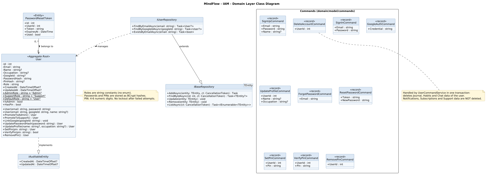
*Figura 40. Class Diagram (UML) del Domain Layer del bounded context IAM.*

</div>

El diagrama muestra el agregado `User` (que implementa `IAuditableEntity`), la entidad `PasswordResetToken` y la interfaz `IUserRepository` (que extiende `IBaseRepository`) (Figura 40).

##### 2.6.1.6.2. Bounded Context Database Design Diagram

<div align="center">

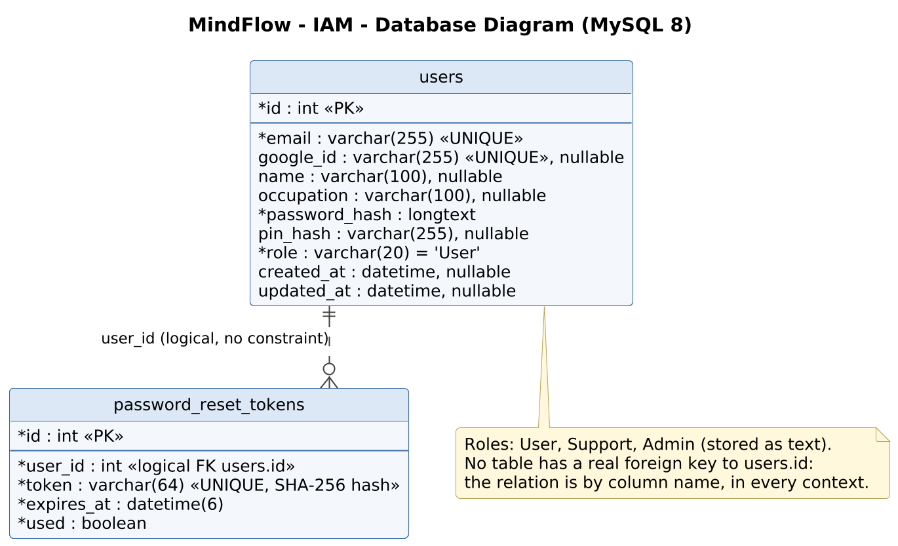

*Figura 41. Database Diagram del bounded context IAM.*

</div>

El bounded context IAM persiste en dos tablas: `users` (con índices únicos sobre `email` y `google_id`) y `password_reset_tokens` (con índice único sobre `token` y un índice simple sobre `user_id`) (Figura 41).

---

### 2.6.2. Bounded Context: Journal

El bounded context **Journal** es responsable del diario emocional: creación, edición, borrado (soft-delete), etiquetado, adjuntos multimedia y búsqueda de entradas. Ancla el evento pivote *Journal entry created* identificado en el EventStorming (sección 2.5.1.1), y es uno de los dos contexts core que entregan directamente la propuesta de valor de MindFlow (autoconciencia emocional), junto con Habits & Wellness.

A diferencia de IAM, Journal **no define un repository interface propio**: los Command Handlers usan directamente `IBaseRepository<TEntity>` (abstracción genérica del Shared Kernel) para `JournalEntry`, `EntryTag` y `Media`, mientras que los Query Handlers acceden directamente a `AppDbContext` para construir lecturas optimizadas con `Include`/joins — un patrón CQRS explícito: comandos vía repository + Unit of Work, queries de solo lectura sin pasar por el repository. Tampoco existe una capa de Resources/Assemblers como en IAM: el `JournalController` consume los DTOs del Application Layer directamente como contrato de entrada/salida.

#### 2.6.2.1. Domain Layer

El Domain Layer concentra el agregado raíz `JournalEntry`, las entidades `Tag`, `EntryTag`, `Media` y `JournalSearchToken`, y el servicio de dominio `JournalSearchTokenizer` que normaliza el texto para la búsqueda cifrada (Tabla 22).

**Tabla 22. Bounded Context: Journal — Domain Layer.**

| Clase | Tipo | Propósito | Atributos | Métodos | Relaciones |
|---|---|---|---|---|---|
| `JournalEntry` | Aggregate Root (implementa `IAuditableEntity`) | Representa una entrada del diario emocional del usuario, con soporte de sincronización offline-first y soft-delete. `Content` se persiste **cifrado en reposo** (AES, `EncryptedStringConverter`) y la entidad tiene un query filter global (`DeletedAt == null`). | `Id: int`, `UserId: int`, `ClientId: string?` (correlación offline-first), `Date: DateOnly`, `Title: string`, `Content: string`, `Sentiment: string`, `Category: string`, `HasPreview: bool`, `AiResponse: string?`, `CreatedAt/UpdatedAt/DeletedAt: DateTimeOffset?` | *(entidad anémica — el comportamiento vive en los Command Handlers)* | Raíz del agregado: `1` a `0..*` con `EntryTag` (colección `EntryTags`) y con `Media` (colección `Media`); referenciada por `JournalSearchToken` (FK enforced, sin navegación inversa) |
| `Tag` | Entity | Representa una etiqueta que el usuario puede asociar a sus entradas. `UserId` nulo indica una etiqueta global/del sistema. | `Id: int`, `UserId: int?`, `Name: string` | *(anémica)* | `1` a `0..*` con `EntryTag` (colección `EntryTags`) |
| `EntryTag` | Entity (tabla de asociación) | Representa la asociación many-to-many entre `JournalEntry` y `Tag`. | `Id: int`, `EntryId: int`, `TagId: int` | *(anémica)* | `0..*` a `1` con `JournalEntry` (navegación `Entry`, FK enforced, cascade) y con `Tag` (navegación `Tag`, FK enforced, cascade); único por `(EntryId, TagId)` |
| `Media` | Entity (implementa `IAuditableEntity`) | Representa un archivo multimedia (imagen, audio, video, documento) adjunto a una entrada. | `Id: int`, `EntryId: int`, `Type: string`, `Url: string`, `CreatedAt/UpdatedAt: DateTimeOffset?` | *(anémica)* | `0..*` a `1` con `JournalEntry` (navegación `Entry`, FK enforced, cascade) |
| `JournalSearchToken` | Entity | Representa el hash HMAC de una palabra normalizada extraída de una entrada, usado como índice de búsqueda ciego: el `WHERE` corre sobre el hash, así las entradas que no calzan nunca se desencriptan. | `Id: int`, `EntryId: int`, `UserId: int`, `TokenHash: string` | *(anémica)* | `0..*` a `1` con `JournalEntry` (navegación `Entry`, FK enforced, cascade — sin colección inversa en `JournalEntry`) |
| `JournalError` | Domain Error Enum | Códigos de error de dominio para resultados fallidos. | — | `JournalEntryNotFound`, `EntryTagNotFound` | Usado por los Handlers al construir `Result.Failure(...)` |
| `JournalSearchTokenizer` | Domain Service (estático) | Normaliza texto libre en un conjunto de palabras indexables: minúsculas, sin tildes, separadas por límites no alfanuméricos, deduplicadas. Se usa idénticamente al indexar una entrada y al parsear una query de búsqueda, para que ambos lados hasheen igual. | — | `{static} Tokenize(text: string?): IReadOnlySet<string>` | Consumida por `JournalSearchIndexer` (Infrastructure) y por `GetJournalEntriesHandler` (Application) |

El Aggregate Design Canvas de `JournalEntry` documenta su ciclo de vida, que incluye la sincronización offline-first de la aplicación móvil (Tabla 23).

**Tabla 23. Bounded Context: Journal — Aggregate Design Canvas de `JournalEntry`.**

| Sección | Contenido |
|---|---|
| **1. Name** | `JournalEntry` |
| **2. Description** | Representa una entrada del diario emocional con su contenido cifrado, su sentimiento, la respuesta empática generada por IA, sus etiquetas (`EntryTag`) y sus adjuntos (`Media`). Se decidió dejar `Tag` fuera del agregado porque una etiqueta se comparte entre muchas entradas y puede ser global; `JournalSearchToken` también queda fuera porque es un índice derivado del contenido que se puede regenerar. Como tradeoff, la entidad es anémica: sus reglas viven en los Command Handlers. |
| **3. State Transitions** | *Creada offline* (solo en el cliente) → *Sincronizada* (`SyncJournalEntriesCommand`)<br>*Creada* → *Editada* (`UpdateJournalEntryCommand` o sincronización)<br>*Creada / Editada* → *Eliminada* (soft delete con `DeletedAt`)<br>*Eliminada* → *Restaurada* (una edición offline más reciente que el borrado la recupera durante la sincronización) |
| **4. Enforced Invariants** | Cada entrada pertenece a un único usuario.<br>`(UserId, ClientId)` es único, lo que hace idempotente la sincronización.<br>`Sentiment` es `positive`, `negative` o `neutral`; si llega vacío o como `auto`, se detecta a partir del texto.<br>`HasPreview` es verdadero solo si el contenido supera los 200 caracteres.<br>`Content` siempre se guarda cifrado con AES.<br>Una etiqueta no se repite en la misma entrada (`(EntryId, TagId)` único).<br>Una entrada eliminada no aparece en las consultas (query filter global). |
| **5. Corrective Policies** | Los conflictos de la sincronización se resuelven con *last-write-wins*: si `UpdatedAt` en el servidor es igual o más reciente que la edición del cliente, se conserva la versión del servidor (`conflict_kept_server`).<br>Después de cada cambio se invoca `IAnalyticsCacheInvalidator` y se reindexan los tokens de búsqueda; la implementación actual de ese puerto no hace nada (Analytics no tiene caché ni tablas propias que invalidar).<br>`JournalSearchBackfillService` reindexa en segundo plano las entradas que no tengan tokens.<br>Si Gemini no responde, la entrada se guarda igual con `AiResponse` vacío. |
| **6. Handled Commands** | `CreateJournalEntryCommand`, `UpdateJournalEntryCommand`, `DeleteJournalEntryCommand`, `SyncJournalEntriesCommand`, `CreateEntryTagCommand`, `DeleteEntryTagCommand`, `CreateMediaCommand` |
| **7. Created Events** | *Journal entry created* (evento pivote), *Empathic response generated*, *Journal entry updated*, *Journal entry deleted*, *Journal entry restored*, *Journal entries synced*, *Tag added to entry*, *Tag removed from entry*, *Media attached* |
| **8. Throughput** | Bajo. Solo el dueño escribe en sus entradas, normalmente entre una y tres veces al día. El único conflicto realista es la misma entrada editada offline en el móvil y en línea desde otro cliente, que la política de *last-write-wins* resuelve. |
| **9. Size** | Pequeño. Cada entrada recibe pocas ediciones, la mayoría en los días posteriores a su creación, y unas cuantas etiquetas y adjuntos. Lo que crece con el tiempo es la cantidad de entradas por usuario (alrededor de 365 al año con uso diario), no el tamaño de cada agregado. |

#### 2.6.2.2. Interface Layer

El Interface Layer expone las trece operaciones REST de Journal a través de `JournalController`, que resuelve el usuario autenticado desde el JWT y valida la propiedad de cada recurso antes de delegar en el Application Layer (Tabla 24).

**Tabla 24. Bounded Context: Journal — Interface Layer.**

| Clase | Tipo | Propósito | Endpoints / Métodos | Relaciones |
|---|---|---|---|---|
| `JournalController` | REST Controller (`/journal`) | Expone las 13 operaciones REST de Journal: entradas, tags, entry-tags y media (incluyendo upload de archivos). Resuelve el `user_id` del JWT y valida ownership antes de delegar en el Application Layer. | `GET/POST /entries`, `GET/PUT/DELETE /entries/{id}`, `POST /entries/sync`, `GET /tags`, `GET/POST /entry-tags`, `DELETE /entry-tags/{id}`, `GET/POST /media`, `POST /media/upload` | Depende de `IMediator` (Cortex.Mediator) para despachar Commands/Queries, de `IFileStorageService` para subir archivos, y de `AppDbContext` (acceso puntual en `DeleteEntryTag` para resolver el `EntryId` antes de validar ownership) |

#### 2.6.2.3. Application Layer

El Application Layer implementa un patrón CQRS explícito con Commands y Queries despachados vía `IMediator`: los Command Handlers escriben a través de `IBaseRepository` y disparan el reindexado de búsqueda y la invalidación de caché de Analytics, mientras que los Query Handlers leen directamente de `AppDbContext` (Tabla 25).

**Tabla 25. Bounded Context: Journal — Application Layer.**

| Clase | Tipo | Propósito | Atributos / Métodos | Relaciones |
|---|---|---|---|---|
| `CreateJournalEntryCommand`, `UpdateJournalEntryCommand`, `DeleteJournalEntryCommand`, `CreateEntryTagCommand`, `DeleteEntryTagCommand`, `CreateMediaCommand`, `SyncJournalEntriesCommand` | Commands | Encapsulan la intención de cada caso de uso de escritura de Journal. `SyncJournalEntriesCommand` agrupa una lista de `SyncJournalEntryItemRequest` para reconciliar ediciones offline. | P. ej. `CreateJournalEntryCommand{UserId, Date, Title, Content, Sentiment, Category}` | Despachadas por `JournalController` vía `IMediator.SendAsync` |
| `GetJournalEntriesQuery`, `GetJournalEntryByIdQuery`, `GetTagsQuery`, `GetEntryTagsQuery`, `GetMediaQuery` | Queries | Encapsulan cada caso de uso de lectura, con soporte de filtros (`_sort`, `_order`, `_limit`, `q` para búsqueda en `GetJournalEntriesQuery`). | P. ej. `GetJournalEntriesQuery{UserId, Sort?, Order?, Limit?, Q?}` | Despachadas por `JournalController` vía `IMediator.QueryAsync` |
| `CreateJournalEntryHandler`, `UpdateJournalEntryHandler`, `DeleteJournalEntryHandler`, `CreateEntryTagHandler`, `DeleteEntryTagHandler`, `CreateMediaHandler`, `SyncJournalEntriesHandler` | Command Handlers (`ICommandHandler<TCommand, Result<T>>`) | Implementan las reglas de negocio de escritura: detección automática de sentimiento (si no se especifica o es `"auto"`, analiza palabras clave positivas/negativas), soft-delete, y en `SyncJournalEntriesHandler`, reconciliación *last-write-wins* de un lote de ediciones offline contra el estado del servidor (ver `US54`). | Un método `Handle` por Command | Dependen de `IBaseRepository<TEntity>` + `IUnitOfWork` (persistencia), `IAnalyticsCacheInvalidator` (**dependencia cruzada hacia el bounded context Analytics & Reporting**, declarada tras cada cambio; su implementación es un stub que no hace nada, ya que Analytics no tiene caché que invalidar) y `IJournalSearchIndexer` (reindexado tras crear/actualizar) |
| `GetJournalEntriesHandler`, `GetJournalEntryByIdHandler`, `GetTagsHandler`, `GetEntryTagsHandler`, `GetMediaHandler` | Query Handlers (`IQueryHandler<TQuery, Result<T>>`) | Implementan las lecturas optimizadas directamente sobre `AppDbContext` (con `AsNoTracking()`, `Include` para tags/media, filtros y orden). `GetJournalEntriesHandler` además resuelve la búsqueda por texto (`q`) tokenizando la query con `JournalSearchTokenizer` y comparando hashes vía `ISearchTokenHasher` contra `JournalSearchToken`, sin desencriptar entradas que no calzan. | Un método `Handle` por Query | Dependen de `AppDbContext` directamente (sin pasar por `IBaseRepository`) y, en el caso de `GetJournalEntriesHandler`, de `ISearchTokenHasher` |
| `JournalEntryDto`, `TagDto`, `EntryTagDto`, `MediaDto` | Response DTOs | Representan la forma pública de cada entidad para las respuestas de la API. | P. ej. `JournalEntryDto{Id, UserId, Date, Title, Content, Sentiment, Category, HasPreview, AiResponse, Tags, Media, CreatedAt, UpdatedAt, DeletedAt}` | Construidos por los Handlers a partir de las entidades de dominio |
| `CreateJournalEntryRequest`, `UpdateJournalEntryRequest` | Request DTOs | Representan el cuerpo de las peticiones HTTP de creación/actualización, consumidos directamente por `JournalController` (sin Assembler intermedio). | `CreateJournalEntryRequest{UserId, Date, Title, Content, Sentiment, Category}`, `UpdateJournalEntryRequest{Title, Content, Sentiment, Category}` | El Controller los transforma manualmente en el Command correspondiente |
| `SyncJournalEntryItemRequest`, `SyncJournalEntryResultDto` | Sync DTOs | Representan, respectivamente, una entrada editada offline enviada en un lote de sincronización, y el resultado de reconciliarla (`created`/`updated`/`deleted`/`conflict_kept_server`). | `SyncJournalEntryItemRequest{ClientId, Date, Title, Content, Sentiment, Category, ClientUpdatedAt, Deleted}`, `SyncJournalEntryResultDto{ClientId, Action, Entry?}` | Usados por `SyncJournalEntriesCommand`/`SyncJournalEntriesHandler` |
| `IFileStorageService` | Service Port | Abstrae el almacenamiento de archivos multimedia, desacoplando al Controller de la tecnología de almacenamiento concreta. | `SaveAsync(file: IFormFile, userId: int): Task<(string Url, string Type)>` | Implementada por `CloudinaryFileStorageService` y `LocalFileStorageService` (Infrastructure) |
| `IJournalSearchIndexer` | Service Port | Abstrae la (re)indexación de una entrada en tokens de búsqueda. | `IndexAsync(entry: JournalEntry, ct): Task` | Implementada por `JournalSearchIndexer` (Infrastructure); invocada por los Command Handlers tras crear/actualizar |
| `ISearchTokenHasher` | Service Port | Abstrae el hashing determinístico de un token de búsqueda. | `Hash(token: string): string` | Implementada por `SearchTokenHasher` (Infrastructure); consumida por `GetJournalEntriesHandler` y `JournalSearchIndexer` |

#### 2.6.2.4. Infrastructure Layer

El Infrastructure Layer implementa el almacenamiento de archivos multimedia, el hashing determinístico de los tokens de búsqueda y el job en segundo plano `JournalSearchBackfillService`, que reindexa las entradas creadas antes de existir la búsqueda (Tabla 26).

**Tabla 26. Bounded Context: Journal — Infrastructure Layer.**

| Clase | Tipo | Propósito | Atributos / Métodos | Relaciones |
|---|---|---|---|---|
| `CloudinaryFileStorageService` | Infrastructure Service | Implementa `IFileStorageService` subiendo el archivo a Cloudinary (imagen/video/raw según extensión), validando extensiones permitidas (`.jpg`, `.png`, `.mp3`, `.mp4`, `.pdf`, etc.). Es la única implementación activa: los adjuntos del diario van siempre a Cloudinary. | `SaveAsync(file, userId): Task<(Url, Type)>` | Implementa `IFileStorageService`; depende del servicio externo **Cloudinary** |
| `LocalFileStorageService` | Infrastructure Service | Implementa `IFileStorageService` guardando el archivo en `wwwroot/uploads/{userId}/` del servidor. Existe en el código como alternativa a Cloudinary, pero **no está registrada** en la inyección de dependencias: hoy no se usa. | `SaveAsync(file, userId): Task<(Url, Type)>` | Implementa `IFileStorageService`; depende de `IWebHostEnvironment` e `IHttpContextAccessor` |
| `SearchTokenHasher` | Infrastructure Service | Implementa `ISearchTokenHasher` con HMAC-SHA256 keyed hashing (clave de 256 bits en Base64), evitando que un atacante con acceso a la BD recupere palabras comunes vía diccionario precomputado. | `Hash(token): string`, `{static} GenerateKey(): string` | Implementa `ISearchTokenHasher` |
| `JournalSearchIndexer` | Infrastructure Service | Implementa `IJournalSearchIndexer`: borra los tokens previos de la entrada, tokeniza título+contenido con `JournalSearchTokenizer` y guarda los nuevos `JournalSearchToken` vía `AppDbContext`. | `IndexAsync(entry, ct): Task` | Implementa `IJournalSearchIndexer`; depende de `AppDbContext` y `ISearchTokenHasher` |
| `JournalSearchBackfillService` | Background Service (`BackgroundService`) | Job de arranque, idempotente y no bloqueante, que indexa retroactivamente las entradas creadas antes de que existiera la búsqueda (US53), sin demorar el health check de despliegue. | `ExecuteAsync(stoppingToken): Task` (override) | Depende de `AppDbContext` e `IJournalSearchIndexer`, resueltos vía `IServiceScopeFactory` |

---

#### 2.6.2.5. Bounded Context Software Architecture Component Level Diagrams

<div align="center">

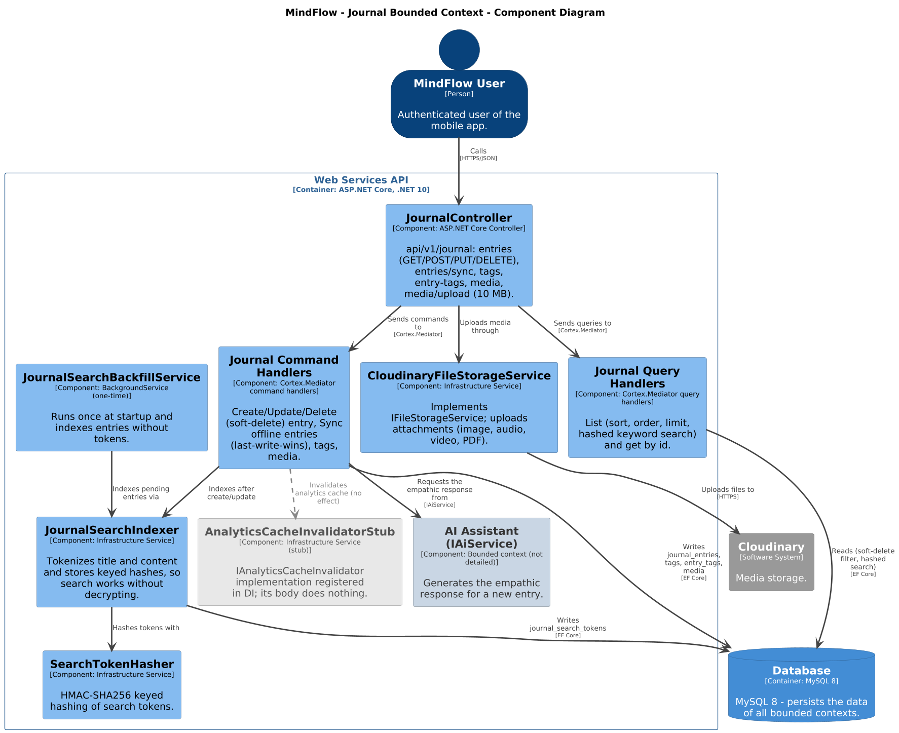
*Figura 42. Component Diagram (C4 Model) del bounded context Journal dentro del container Web Services API.*

</div>

El diagrama refleja la separación CQRS: `JournalController` despacha hacia dos grupos de componentes vía `IMediator` — los **Journal Command Handlers** (escritura, vía `IBaseRepository<T>` + Unit of Work) y los **Journal Query Handlers** (lectura, directo contra la base de datos con joins). Los Command Handlers disparan además el reindexado de búsqueda (`JournalSearchIndexer`), llaman a `GeminiService` (AI Assistant) para generar la respuesta empática de cada entrada, y declaran una invalidación de caché de Analytics que hoy es un stub sin efecto. La subida de archivos pasa por `FileStorageService` hacia Cloudinary; la alternativa local existe en el código pero no está registrada (Figura 42).

#### 2.6.2.6. Bounded Context Software Architecture Code Level Diagrams

##### 2.6.2.6.1. Bounded Context Domain Layer Class Diagrams

<div align="center">

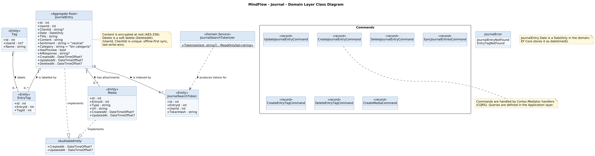
*Figura 43. Class Diagram (UML) del Domain Layer del bounded context Journal.*

</div>

`JournalEntry` es el agregado raíz, con colecciones navegables hacia `EntryTag` y `Media` (ambas con Foreign Key enforced y `DeleteBehavior.Cascade`). `EntryTag` es la tabla de asociación many-to-many hacia `Tag`. `JournalSearchToken` referencia a `JournalEntry` con FK enforced pero **sin colección inversa navegable** desde el agregado (se consulta directamente vía `AppDbContext.Set<JournalSearchToken>()`). `JournalSearchTokenizer` es un Domain Service estático sin estado (Figura 43).

##### 2.6.2.6.2. Bounded Context Database Design Diagram

<div align="center">

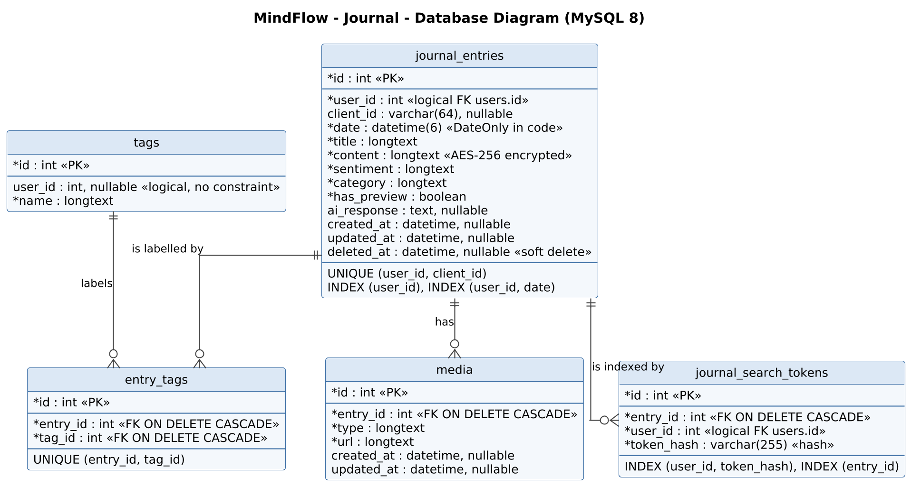
*Figura 44. Database Diagram del bounded context Journal.*

</div>

Las tablas `entry_tags`, `media` y `journal_search_tokens` tienen **Foreign Key física enforced** hacia `journal_entries.id`, todas con `ON DELETE CASCADE`. `entry_tags` además tiene FK enforced hacia `tags.id` y un índice único compuesto `(entry_id, tag_id)` que impide duplicar la misma etiqueta en la misma entrada. La columna `tags.user_id` **no tiene Foreign Key declarada** hacia `users.id` (relación lógica, nullable — permite tags globales del sistema cuando es `NULL`). `journal_entries.content` se almacena cifrado en reposo (AES) a nivel de aplicación, transparente para el esquema de base de datos (Figura 44).

---

### 2.6.3. Bounded Context: AI Assistant

El bounded context **AI Assistant** agrupa las capacidades de inteligencia artificial de MindFlow: el chat conversacional (módulo `Chat`), la integración con el proveedor de IA (módulo `AiIntegration`) y la valoración de usuarios sobre contenido generado por IA (módulo `AiFeedback`). Ancla los eventos pivote *Assistant query submitted* e *Insight generated* identificados en el EventStorming (sección 2.5.1.1), y es uno de los contexts core que constituyen el diferenciador tecnológico de MindFlow frente a la competencia.

A diferencia de IAM (Command Service unificado) y de Journal (CQRS con Cortex.Mediator), AI Assistant usa un **tercer patrón de Application Layer**: Application Services planos (`ChatService`, `AiFeedbackService`) inyectados directamente en el Controller, sin Commands, Queries ni Mediator — el método del servicio se invoca de forma síncrona y directa. Tampoco hay repository interfaces ni Domain Services propios: toda la persistencia se resuelve con `AppDbContext` inyectado directamente en los Application Services (que, en la práctica, funcionan como su propia capa de Infrastructure).

Se identificaron además dos dependencias cruzadas reales hacia otros bounded contexts: `AiFeedbackService` consulta directamente `JournalEntries` y el agregado `Habit` (Journal y Habits & Wellness) para validar que el contenido calificado existe; y `IAiService`/`GeminiService` es consumido no solo por `ChatService`, sino también por Analytics & Reporting (resúmenes semanales) y Habits & Wellness (consejos de estrés, sugerencias de hábitos) — es, en la práctica, un servicio compartido transversal más que un componente exclusivo de este bounded context.

#### 2.6.3.1. Domain Layer

El Domain Layer concentra el agregado raíz `Conversation` con sus `ChatMessage`, la entidad `AiFeedbackRating` para calificar contenido generado por IA, y `AiMetricLog`, que registra la telemetría de cada llamada al proveedor de IA (Tabla 27).

**Tabla 27. Bounded Context: AI Assistant — Domain Layer.**

| Clase | Tipo | Propósito | Atributos | Métodos | Relaciones |
|---|---|---|---|---|---|
| `Conversation` | Aggregate Root (implementa `IAuditableEntity`) | Representa una conversación de chat entre el usuario y el asistente de IA. | `Id: int`, `UserId: int`, `Title: string` (autogenerado de los primeros 50 caracteres del primer mensaje), `Category: string` (default `"Personal"`), `CreatedAt/UpdatedAt: DateTimeOffset?` | *(anémica)* | Raíz del agregado: `1` a `0..*` con `ChatMessage` (colección `Messages`) |
| `ChatMessage` | Entity (implementa `IAuditableEntity`) | Representa un mensaje individual dentro de una conversación, sea del usuario o del asistente. | `Id: int`, `ConversationId: int`, `Role: string` (`"user"` / `"assistant"`), `Content: string`, `CreatedAt/UpdatedAt: DateTimeOffset?` | *(anémica)* | `0..*` a `1` con `Conversation` (navegación `Conversation`, FK enforced, cascade) |
| `AiFeedbackRating` | Entity (implementa `IAuditableEntity`) | Representa la calificación (1-5) que un usuario da a una pieza de contenido generado por IA (insight de journal o sugerencia de hábito). | `Id: int`, `UserId: int`, `ContentId: int`, `ContentType: string` (`"journal"` / `"habit"`), `Rating: int`, `Comment: string?`, `CreatedAt/UpdatedAt: DateTimeOffset?` | *(anémica)* | Única por `(UserId, ContentId, ContentType)`; `ContentId` referencia lógicamente (sin FK) a `JournalEntry` o `Habit` según `ContentType` |
| `AiMetricLog` | Entity | Registra telemetría operacional de cada llamada al proveedor de IA (latencia, éxito, longitudes de prompt/respuesta, error). **No está asociada a un usuario** — es un log de sistema, no de dominio de negocio. | `Id: int`, `Operation: string`, `LatencyMs: int`, `Success: bool`, `PromptLength: int`, `ResponseLength: int`, `ErrorMessage: string?`, `CreatedAt: DateTimeOffset` (default `UtcNow`, no nullable) | *(anémica)* | Escrita exclusivamente por `GeminiService` tras cada llamada a Gemini |

El Aggregate Design Canvas de `Conversation` muestra cómo el agregado mantiene un intercambio coherente entre el usuario y el asistente aun cuando el proveedor de IA falla (Tabla 28).

**Tabla 28. Bounded Context: AI Assistant — Aggregate Design Canvas de `Conversation`.**

| Sección | Contenido |
|---|---|
| **1. Name** | `Conversation` |
| **2. Description** | Representa una conversación entre el usuario y el asistente de IA, junto con sus mensajes (`ChatMessage`). El título se genera a partir de los primeros 50 caracteres del primer mensaje. Se decidió mantener todos los mensajes dentro del agregado, pero enviar a Gemini solo los últimos 10 como contexto, para controlar el costo y la latencia de cada llamada. `AiFeedbackRating` y `AiMetricLog` quedan fuera porque califican o miden contenido de IA de varios orígenes, no solo del chat. |
| **3. State Transitions** | *Creada* (con el primer mensaje del usuario y la respuesta del asistente) → *Activa* (mensajes alternados entre usuario y asistente) → *Eliminada* (borrado físico, junto con sus mensajes) |
| **4. Enforced Invariants** | Cada conversación pertenece a un único usuario, y solo él puede leerla, escribir en ella o eliminarla (toda consulta filtra por `UserId`).<br>`Role` de cada mensaje es `user` o `assistant`.<br>Cada mensaje del usuario recibe exactamente una respuesta del asistente.<br>El título tiene como máximo 50 caracteres (más `...` si se recorta), y `Category` es `Personal` si no se indica otra. |
| **5. Corrective Policies** | El mensaje del usuario se guarda antes de llamar a Gemini, para que no se pierda si la llamada falla.<br>Si Gemini no responde o devuelve un texto vacío, se guarda un mensaje de respaldo, de modo que la conversación siempre conserva el par usuario–asistente.<br>`GeminiService` registra cada llamada fallida en `AiMetricLog` para poder monitorearla. |
| **6. Handled Commands** | *Create conversation* (`CreateConversationAsync`), *Send message* (`SendMessageAsync`), *Delete conversation* (`DeleteConversationAsync`). En este contexto no son clases Command, sino métodos de `ChatService`. |
| **7. Created Events** | *Conversation started*, *Assistant query submitted* (evento pivote), *Assistant response generated*, *Fallback response returned*, *Conversation deleted* |
| **8. Throughput** | Bajo. Solo escribe el dueño, en ráfagas de pocos segundos durante una sesión de chat. Como cada mensaje se agrega al final sin modificar los anteriores, los conflictos de concurrencia son muy poco probables. |
| **9. Size** | Medio. Cada intercambio agrega dos mensajes y no hay un límite de mensajes por conversación: una conversación típica tiene unas decenas de mensajes, pero una sesión larga puede llegar a cientos. Por eso solo se cargan los mensajes completos al abrir una conversación, y el listado muestra solo un resumen. |

#### 2.6.3.2. Interface Layer

El Interface Layer expone el chat y la valoración de respuestas mediante `ChatController` y `AiFeedbackController`, que validan la longitud del mensaje y el contenido de la calificación antes de delegar en el Application Layer (Tabla 29).

**Tabla 29. Bounded Context: AI Assistant — Interface Layer.**

| Clase | Tipo | Propósito | Endpoints / Métodos | Relaciones |
|---|---|---|---|---|
| `ChatController` | REST Controller (`/chat`) | Expone la creación de conversaciones, envío de mensajes, listado y borrado. Valida longitud del contenido (máx. 5000 caracteres) antes de delegar. | `POST/GET /conversations`, `DELETE /conversations/{id}`, `POST /conversations/{id}/messages`, `GET /conversations/{id}/messages` | Depende de `IChatService` |
| `AiFeedbackController` | REST Controller (`/api/v1/ai-feedback`) | Expone el registro de calificaciones sobre contenido de IA y su resumen agregado. | `POST /`, `GET /`, `GET /summary` | Depende de `IAiFeedbackService` |
| `CreateConversationRequest`, `SendMessageRequest` | Request DTOs (records) | Cuerpo de las peticiones de creación de conversación y envío de mensaje. | `CreateConversationRequest(Content, Category?)`, `SendMessageRequest(Content)` | Consumidos directamente por `ChatController` |
| `SubmitRatingRequest` | Request DTO (record) | Cuerpo de la petición para registrar una calificación. Definido directamente en el archivo del Controller. | `SubmitRatingRequest(ContentId, ContentType, Rating, Comment?)` | Consumido directamente por `AiFeedbackController` |

#### 2.6.3.3. Application Layer

El Application Layer usa Application Services planos en lugar de Commands/Queries: `ChatService` orquesta la conversación con el asistente, `AiFeedbackService` gestiona las calificaciones, e `IAiService` abstrae al proveedor de IA generativa, consumido también por Journal (respuesta empática) y por Habits & Wellness (consejo de estrés y sugerencias de hábitos) (Tabla 30).

**Tabla 30. Bounded Context: AI Assistant — Application Layer.**

| Clase | Tipo | Propósito | Atributos / Métodos | Relaciones |
|---|---|---|---|---|
| `IChatService` | Application Service Interface | Contrato de los casos de uso de chat. | `CreateConversationAsync`, `GetUserConversationsAsync`, `DeleteConversationAsync`, `SendMessageAsync`, `GetConversationMessagesAsync` | Implementada por `ChatService` (Infrastructure); consumida por `ChatController` |
| `IAiFeedbackService` | Application Service Interface | Contrato de los casos de uso de calificación de contenido de IA. | `SubmitRatingAsync(userId, contentId, contentType, rating, comment)`, `GetUserRatingsAsync(userId)`, `GetSummaryAsync(userId)` | Implementada por `AiFeedbackService` (Infrastructure); consumida por `AiFeedbackController` |
| `IAiService` | Service Port | Abstrae el proveedor de IA generativa. De sus 5 métodos, `GenerateWeeklySummaryAsync` está **implementado pero sin ningún flujo que lo invoque** (`NO CONECTADO`). | `GenerateEmpathicResponseAsync`, `GenerateWeeklySummaryAsync`, `GenerateStressAdviceAsync`, `GenerateHabitSuggestionsAsync`, `GenerateChatResponseAsync` | Implementada por `GeminiService` (Infrastructure); consumida por `ChatService` (este BC), por Journal (respuesta empática) y por Habits & Wellness (consejo de estrés y sugerencias) |
| `ChatMessageDto`, `ConversationDto`, `ConversationDetailDto`, `SendMessageResponseDto` | Response DTOs | Representan la forma pública de mensajes y conversaciones en las respuestas de la API. | P. ej. `ConversationDetailDto{Id, Title, Category, CreatedAt, Messages}` | Construidos por `ChatService` a partir de las entidades de dominio |
| `AiFeedbackSummaryDto` | Response DTO (record) | Representa el resumen agregado de calificaciones de un usuario. | `AiFeedbackSummaryDto(TotalRatings, AverageRating, Distribution)` | Construido por `AiFeedbackService` |

#### 2.6.3.4. Infrastructure Layer

El Infrastructure Layer implementa `ChatService` y `AiFeedbackService` directamente sobre `AppDbContext`, y `GeminiService`, que construye los prompts por caso de uso y llama a la API de Google Gemini, registrando cada llamada en `AiMetricLog` (Tabla 31).

**Tabla 31. Bounded Context: AI Assistant — Infrastructure Layer.**

| Clase | Tipo | Propósito | Atributos / Métodos | Relaciones |
|---|---|---|---|---|
| `ChatService` | Application/Infrastructure Service | Implementa `IChatService`: crea la conversación y el primer mensaje, invoca `IAiService` para la respuesta del asistente (con fallback de texto fijo si falla), persiste todo vía `AppDbContext` + `IUnitOfWork`, y mantiene una ventana de los últimos 10 mensajes (`MaxHistoryMessages`) como historial de contexto para el modelo. | `CreateConversationAsync`, `GetUserConversationsAsync`, `DeleteConversationAsync`, `SendMessageAsync`, `GetConversationMessagesAsync` | Implementa `IChatService`; depende de `AppDbContext`, `IUnitOfWork`, `IAiService` |
| `AiFeedbackService` | Application/Infrastructure Service | Implementa `IAiFeedbackService`: valida `ContentType` (`journal`/`habit`) y rango de `Rating` (1-5), verifica que el contenido referenciado exista consultando directamente `JournalEntries` o `Habit` **(dependencia cruzada hacia Journal y Habits & Wellness)**, y hace upsert de la calificación (única por usuario+contenido). | `SubmitRatingAsync`, `GetUserRatingsAsync`, `GetSummaryAsync` | Implementa `IAiFeedbackService`; depende de `AppDbContext`, `IUnitOfWork` |
| `GeminiService` | Infrastructure Service | Implementa `IAiService` construyendo prompts específicos por caso de uso (respuesta empática, resumen semanal, consejo de estrés, sugerencias de hábitos, respuesta de chat) y llamando a la API REST de Google Gemini vía `IHttpClientFactory`. Registra un `AiMetricLog` por cada llamada (éxito/fallo, latencia, longitudes), incluso ante error o timeout. | `GenerateEmpathicResponseAsync`, `GenerateWeeklySummaryAsync`, `GenerateStressAdviceAsync`, `GenerateHabitSuggestionsAsync`, `GenerateChatResponseAsync` | Implementa `IAiService`; depende del servicio externo **Google Gemini API** y de `AppDbContext` (para `AiMetricLog`) |

---

#### 2.6.3.5. Bounded Context Software Architecture Component Level Diagrams

<div align="center">

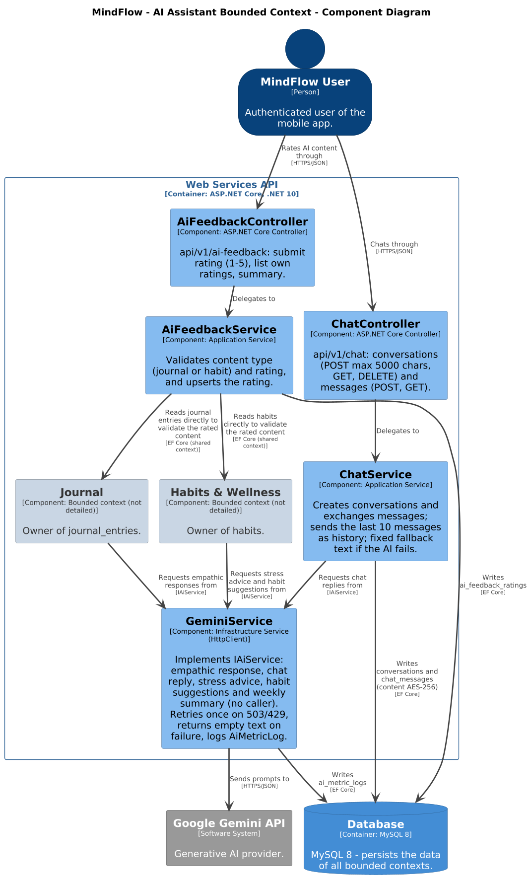
*Figura 45. Component Diagram (C4 Model) del bounded context AI Assistant dentro del container Web Services API.*

</div>

El diagrama muestra `ChatController` y `AiFeedbackController` delegando directamente en sus respectivos Application Services (sin Mediator). `GeminiService` aparece como un componente central consumido no solo por `ChatService`, sino también desde Journal y desde Habits & Wellness, reflejando su rol de servicio transversal de IA; la relación con ambos es en los dos sentidos, ya que `AiFeedbackService` también cruza el límite del bounded context para validar, leyendo directamente sus tablas, que el contenido calificado existe en Journal o en Habits & Wellness (Figura 45).

#### 2.6.3.6. Bounded Context Software Architecture Code Level Diagrams

##### 2.6.3.6.1. Bounded Context Domain Layer Class Diagrams

<div align="center">

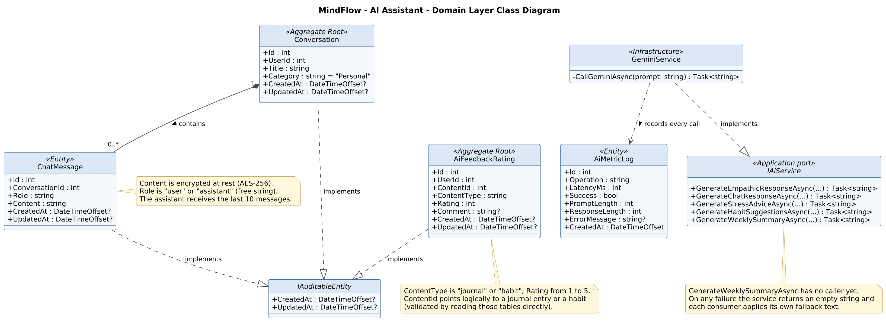
*Figura 46. Class Diagram (UML) del Domain Layer del bounded context AI Assistant.*

</div>

`Conversation` es el agregado raíz del módulo Chat, con una colección navegable de `ChatMessage` (FK enforced, cascade). `AiFeedbackRating` y `AiMetricLog` son entidades independientes, sin relaciones de asociación declaradas hacia el resto del modelo — sus referencias a contenido de otros bounded contexts (`ContentId`, y en `AiFeedbackRating` implícitamente `UserId`) son lógicas, no navegables (Figura 46).

##### 2.6.3.6.2. Bounded Context Database Design Diagram

<div align="center">

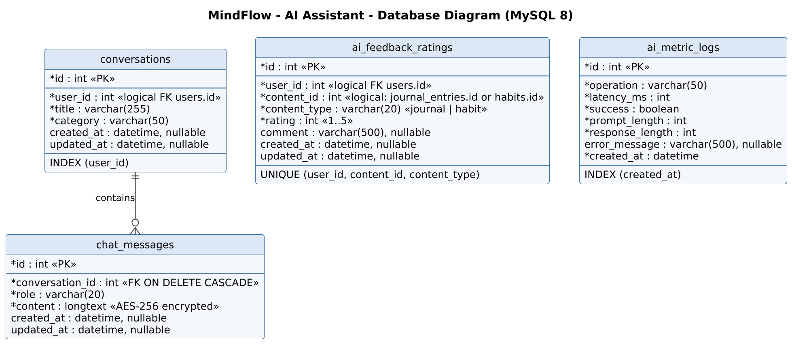
*Figura 47. Database Diagram del bounded context AI Assistant.*

</div>

`chat_messages` tiene **Foreign Key física enforced** hacia `conversations.id` con `ON DELETE CASCADE`. `conversations`, `ai_feedback_ratings` y `ai_metric_logs` **no tienen ninguna Foreign Key declarada** hacia `users.id` (relación lógica vía columna `user_id`) — y `ai_metric_logs` ni siquiera tiene columna `user_id`, al ser un log de sistema. `ai_feedback_ratings` tiene un índice único compuesto `(user_id, content_id, content_type)` que garantiza una sola calificación por usuario y contenido (Figura 47).

---

### 2.6.4. Bounded Context: Habits & Wellness

El bounded context **Habits & Wellness** agrupa el seguimiento de hábitos (módulo `habits`), la evaluación automática de estrés y ajuste de rutinas (módulo `WellnessEngine`) y el catálogo de contenido de bienestar — ejercicios de respiración y meditación (módulo `WellnessContent`). Ancla los eventos pivote *Habit created* y *Stress check completed* identificados en el EventStorming (sección 2.5.1.1), y es, junto con Journal, uno de los dos contexts core que entregan directamente la propuesta de valor de MindFlow.

Es el bounded context más heterogéneo de los cuatro cubiertos en este informe: sus tres módulos usan **tres patrones de Application Layer distintos**, cada uno igual a uno ya visto en otro bounded context — `habits` usa Command/Query Services dedicados con repository interfaces propios (similar a IAM), `WellnessContent` usa Cortex.Mediator con Commands/Queries/Handlers (idéntico a Journal), y `WellnessEngine` no tiene modelo de dominio propio en absoluto: es un único Application Service (`WellnessService`) que orquesta el agregado `Habit` y lee `JournalEntry` (Journal) directamente. Se identificaron tres dependencias cruzadas reales: `HabitsController` e `IWellnessService` consumen `IAiService` (AI Assistant) para sugerencias de hábitos y consejos de estrés respectivamente, y ambos leen `JournalEntries` (Journal) directamente vía `AppDbContext` para estimar el nivel de estrés reciente del usuario.

También destaca un patrón de **consistencia perezosa** (*lazy consistency*): `HabitQueryService` recalcula el streak y revierte el estado `Completed` a `Pending` si corresponde **en el momento de la consulta** (no mediante un job programado), comparando la fecha/semana/mes actual contra los `HabitCompletionLog` existentes.

#### 2.6.4.1. Domain Layer

**Tabla 32. Bounded Context: Habits & Wellness — Domain Layer.**

| Clase | Tipo | Propósito | Atributos | Métodos | Relaciones |
|---|---|---|---|---|---|
| `Habit` | Aggregate Root (implementa `IAuditableEntity`) | Representa un hábito que el usuario quiere construir, con su racha (streak), estado y si fue pausado automáticamente por IA. Aunque la entidad tiene una columna `DeletedAt` propia (no viene de `IAuditableEntity`, que solo define `CreatedAt`/`UpdatedAt`), `DeleteHabitCommand` no la usa: un hábito eliminado se **borra físicamente** de la tabla, no queda marcado como borrado. | `Id: int`, `UserId: int`, `Name: string`, `Category: string`, `Frequency: HabitFrequency`, `Streak: int`, `Status: HabitStatus`, `PausedByAi: bool`, `CreatedAt/UpdatedAt/DeletedAt` | `MarkCompleted()`, `MarkPending()`, `SetStreak(streak)`, `PauseByAi()`, `Resume()`, `UpdateDetails(...)`, `UpdateFull(...)` | Raíz del agregado: `1` a `0..*` con `HabitCompletionLog` (colección `CompletionLogs`, sin navegación inversa) |
| `HabitCompletionLog` | Entity | Representa el registro de que un hábito fue completado en una fecha específica. Duplica `HabitName`/`Category` del hábito al momento del registro (denormalización histórica). | `Id: int`, `HabitId: int`, `HabitName: string`, `Category: string`, `Date: DateTime`, `Completed: bool`, `CompletedAt: DateTime?`, `CreatedAt: DateTimeOffset` | `UpdateDetails(habitName, category, completed, completedAt)` | `0..*` a `1` con `Habit` (FK enforced, cascade, **sin propiedad de navegación** — solo `HabitId`) |
| `CachedHabitSuggestion` | Entity (anémica) | Cachea en base de datos (no en memoria) las últimas sugerencias de hábitos generadas por IA para un usuario, válidas por 24 horas. | `Id: int`, `UserId: int`, `SuggestionsJson: string`, `GeneratedAt: DateTimeOffset` | *(anémica)* | Única por `UserId` |
| `HabitFrequency` | Value Object (enum) | Frecuencia esperada del hábito. | — | `Daily`, `Weekly`, `Monthly` | Usado por `Habit` y por el cálculo de streak |
| `HabitStatus` | Value Object (enum) | Estado actual del hábito. | — | `Pending`, `Completed`, `PausedByAi` | Usado por `Habit` |
| `HabitsError` | Domain Error Enum | Códigos de error de dominio para `habits` y `habit-logs`. | — | `HabitNotFound`, `HabitCreationFailed`, `HabitUpdateFailed`, `HabitDeletionFailed`, `HabitLogNotFound`, `HabitLogCreationFailed`, `HabitLogUpdateFailed`, `HabitLogDeletionFailed`, `InvalidHabitFrequency`, `InvalidHabitStatus`, `InvalidHabitCategory`, `UserIdMismatch` | Usado por los Command Services y mapeado a status HTTP por `HabitsActionResultAssembler` |
| `IHabitRepository` | Repository Interface (extiende `IBaseRepository<Habit>`) | Abstrae el acceso a datos de `Habit`. | — | `FindByUserIdAsync(userId)`, `FindByIdAndUserIdAsync(id, userId)` + heredados | Implementada por `HabitRepository` (Infrastructure) |
| `IHabitCompletionLogRepository` | Repository Interface (extiende `IBaseRepository<HabitCompletionLog>`) | Abstrae el acceso a datos de `HabitCompletionLog`. | — | `FindByHabitIdAsync(habitId)`, `FindByUserIdAsync(userId)` + heredados | Implementada por `HabitCompletionLogRepository` (Infrastructure) |
| `WellnessExercise` | Entity (implementa `IAuditableEntity`) | Representa un ejercicio de bienestar (respiración o meditación) editable sin necesidad de release del cliente. Campos de respiración (`InhaleSeconds`, `HoldSeconds`, etc.) y de meditación (`AudioUrl`) son mutuamente excluyentes según `Type`. | `Id: int`, `Type: string` (`"breathing"`/`"meditation"`), `Name/Description: string`, `DurationSeconds: int`, `InhaleSeconds/HoldSeconds/ExhaleSeconds/HoldAfterExhaleSeconds/Cycles: int?`, `AudioUrl: string?`, `IsActive: bool`, `SortOrder: int`, `CreatedAt/UpdatedAt` | *(anémica)* | Sin relaciones hacia otras entidades |
| `WellnessContentError` | Domain Error Enum | Códigos de error para el catálogo de ejercicios. | — | `ExerciseNotFound`, `InvalidType` | Usado por los Handlers de `WellnessContent` |

**Nota:** `WellnessEngine` no define entidades ni Value Objects propios — opera exclusivamente sobre `Habit` (mismo bounded context) y `JournalEntry` (Journal, dependencia cruzada) (Tabla 32).

El Aggregate Design Canvas de `Habit` explica cómo se mantiene la racha y quién puede pausar un hábito, incluido el ajuste automático por nivel de estrés (Tabla 33).

**Tabla 33. Bounded Context: Habits & Wellness — Aggregate Design Canvas de `Habit`.**

| Sección | Contenido |
|---|---|
| **1. Name** | `Habit` |
| **2. Description** | Representa un hábito que el usuario quiere construir, con su frecuencia, su racha (`Streak`), su estado y si fue pausado por IA, además de sus registros de cumplimiento (`HabitCompletionLog`). Como tradeoff, los registros se crean y editan con su propio repositorio y servicio (`HabitLogCommandService`) en lugar de pasar por la raíz; la racha se recalcula justo después, en una segunda escritura. Esto mantiene simples las escrituras de logs, a cambio de que la racha sea consistente un instante después y no en la misma transacción. |
| **3. State Transitions** | *Pending* → *Completed* (`MarkCompleted`)<br>*Completed* → *Pending* (`MarkPending`, cuando empieza un nuevo día, semana o mes sin registro)<br>*Pending / Completed* → *PausedByAi* (`PauseByAi`, cuando el chequeo de estrés da un nivel alto)<br>*PausedByAi* → *Pending* (`Resume`, cuando el estrés vuelve a un nivel bajo)<br>Cualquier estado → *Eliminado* (`DeleteHabitCommand`, borrado físico) |
| **4. Enforced Invariants** | `Frequency` es `Daily`, `Weekly` o `Monthly`.<br>Solo el dueño del hábito puede editarlo o eliminarlo (`UserIdMismatch`).<br>No se pueden registrar cumplimientos con fecha futura.<br>`Streak` es igual a la cantidad de periodos consecutivos con un registro completado, contando desde el periodo actual o el anterior.<br>`PausedByAi` es verdadero si y solo si `Status` es `PausedByAi`. |
| **5. Corrective Policies** | Después de crear, editar o eliminar un registro, `RecalculateStreakAsync` recalcula la racha del hábito.<br>`HabitQueryService` aplica consistencia perezosa: al consultar, recalcula la racha y devuelve el hábito a *Pending* si el periodo actual no tiene registro.<br>`WellnessService` pausa los hábitos activos cuando el chequeo de estrés da un nivel alto y reanuda los pausados cuando da un nivel bajo. |
| **6. Handled Commands** | `CreateHabitCommand`, `UpdateHabitCommand`, `DeleteHabitCommand`, `CreateHabitLogCommand`, `UpdateHabitLogCommand`, `DeleteHabitLogCommand`, más *Run stress check* (`RunStressCheckAsync`), que pausa o reanuda hábitos |
| **7. Created Events** | *Habit created* (evento pivote), *Habit updated*, *Habit deleted*, *Habit completed*, *Habit log updated*, *Habit log deleted*, *Streak recalculated*, *Stress check completed* (evento pivote), *Habit paused by AI*, *Habit resumed* |
| **8. Throughput** | Bajo. Solo el dueño registra cumplimientos, normalmente una vez por periodo y por hábito. El conflicto posible son dos registros casi simultáneos que recalculan la racha a la vez; como la racha se calcula siempre desde todos los registros, el último cálculo deja el valor correcto. |
| **9. Size** | Medio. El hábito acumula un registro por periodo cumplido: hasta unos 365 al año si es diario, 52 si es semanal y 12 si es mensual. Por eso los registros se consultan por su propio repositorio y no se cargan junto con el hábito. |

#### 2.6.4.2. Interface Layer

El Interface Layer expone hábitos, registros de cumplimiento, el chequeo de estrés y el catálogo de ejercicios de bienestar mediante `HabitsController`, `HabitLogsController`, `WellnessController` y `WellnessExercisesController` —este último con administración restringida a roles de IAM— (Tabla 34).

**Tabla 34. Bounded Context: Habits & Wellness — Interface Layer.**

| Clase | Tipo | Propósito | Endpoints / Métodos | Relaciones |
|---|---|---|---|---|
| `HabitsController` | REST Controller (`/habits`) | CRUD de hábitos, resumen de rachas y sugerencias de IA (con caché en BD de 24h y fallback local si Gemini falla). | `GET/POST /`, `GET/PUT/DELETE /{id}`, `GET /streak-summary`, `POST /suggestions` | Depende de `IHabitCommandService`, `IHabitQueryService`, `IAiService` (AI Assistant), `AppDbContext`, `ICacheService` |
| `HabitLogsController` | REST Controller (`/habit-logs`) | CRUD de registros de cumplimiento de hábitos, validando ownership del hábito padre en cada operación. | `GET/POST /`, `GET/PUT/DELETE /{id}` | Depende de `IHabitLogCommandService`, `IHabitLogQueryService`, `IHabitRepository`, `ICacheService` |
| `WellnessController` | REST Controller (`/wellness`) | Expone el chequeo de estrés semanal. | `POST /stress-check` | Depende de `IWellnessService` |
| `WellnessExercisesController` | REST Controller (`/wellness/exercises`) | Catálogo de ejercicios, con el listado activo público para cualquier usuario autenticado y el resto restringido a administradores (`Authorize(Roles = User.AdminRole)`, **referencia cruzada a IAM**). | `GET /` (catálogo activo, cualquier usuario autenticado), `GET /all` (admin), `GET /{id}` (admin), `POST /` (admin), `PUT /{id}` (admin), `DELETE /{id}` (admin) | Depende de `IMediator` |
| `CreateHabitResource`, `UpdateHabitResource`, `HabitResource`, `CreateHabitLogResource`, `UpdateHabitLogResource`, `HabitLogResource` | Request/Response DTOs (records, JSON `snake_case`) | Contrato HTTP de hábitos y logs, desacoplado de los Commands. | P. ej. `HabitResource(Id, UserId, Name, Category, Frequency, Streak, Status, PausedByAi, ...)` | Transformados por los Assemblers |
| `CreateHabitCommandFromResourceAssembler`, `UpdateHabitCommandFromResourceAssembler`, `HabitResourceFromEntityAssembler`, `CreateHabitLogCommandFromResourceAssembler`, `UpdateHabitLogCommandFromResourceAssembler`, `HabitLogResourceFromEntityAssembler` | Assemblers (static) | Traducen Resource ↔ Command ↔ Entity, incluyendo el parseo de `Frequency`/`Status` desde string. | `ToCommandFromResource(...)`, `ToResourceFromEntity(...)` | Traducen Interface Layer ↔ Application/Domain Layer |
| `HabitsActionResultAssembler` | Assembler (static, genérico) | Traduce un `Result<T>`/`Result` en un `IActionResult`, mapeando el nombre del error de dominio a status HTTP (`"NotFound"` → 404, `"Mismatch"` → 403, resto → 400) vía `ProblemDetailsFactory`. | `ToActionResultFromCreateResult`, `ToActionResultFromDeleteResult`, `ToActionResultFromGetResult`, `ToActionResultFromGetAllResult` | Usado por `HabitsController` y `HabitLogsController` |

#### 2.6.4.3. Application Layer

El Application Layer combina Application Services para hábitos, logs y el chequeo de estrés —`WellnessService` lee entradas del diario para calcular el nivel de estrés y pausar o reanudar hábitos— con Commands/Queries vía Mediator para el catálogo de ejercicios de bienestar (Tabla 35).

**Tabla 35. Bounded Context: Habits & Wellness — Application Layer.**

| Clase | Tipo | Propósito | Atributos / Métodos | Relaciones |
|---|---|---|---|---|
| `CreateHabitCommand`, `UpdateHabitCommand`, `DeleteHabitCommand`, `CreateHabitLogCommand`, `UpdateHabitLogCommand`, `DeleteHabitLogCommand` | Commands (records) | Encapsulan la intención de cada caso de uso de escritura. | P. ej. `CreateHabitCommand(UserId, Name, Category, Frequency)` | Producidos por los Assemblers; consumidos por los Command Services |
| `GetHabitByIdQuery`, `GetAllHabitsByUserIdQuery`, `GetHabitLogByIdQuery`, `GetAllHabitLogsQuery` | Queries (records) | Encapsulan cada caso de uso de lectura. | P. ej. `GetAllHabitsByUserIdQuery(UserId)` | Consumidos por los Query Services |
| `IHabitCommandService` / `HabitCommandService` | Application Service | Contrato e implementación de creación/actualización/borrado de hábitos, validando ownership (`UserIdMismatch`). | Un `Handle` por Command | Depende de `IHabitRepository`, `IUnitOfWork` |
| `IHabitLogCommandService` / `HabitLogCommandService` | Application Service | Contrato e implementación de creación/actualización/borrado de logs. Tras cada cambio, **recalcula y persiste el streak** del hábito padre con un algoritmo específico por frecuencia (Daily/Weekly/Monthly, comparando contra "hoy" o "ayer"/semana o mes previos). | Un `Handle` por Command; `{static} ComputeStreak(dates, frequency)`, `ComputeDailyStreak`, `ComputeWeeklyStreak`, `ComputeMonthlyStreak` | Depende de `IHabitCompletionLogRepository`, `IHabitRepository`, `IUnitOfWork`; `ComputeStreak` es reutilizado por `HabitQueryService` |
| `IHabitQueryService` / `HabitQueryService` | Application Service | Contrato e implementación de lectura de hábitos. Recalcula el streak y **revierte `Completed` a `Pending`** en el momento de la consulta si no hay un log para el período vigente (día/semana/mes actual) — consistencia perezosa, sin job programado. | `Handle(GetHabitByIdQuery)`, `Handle(GetAllHabitsByUserIdQuery)` | Depende de `IHabitRepository`, `IHabitCompletionLogRepository`; reutiliza `HabitLogCommandService.ComputeStreak` |
| `IHabitLogQueryService` / `HabitLogQueryService` | Application Service | Contrato e implementación de lectura de logs, con filtro opcional por hábito o por usuario. | `Handle(GetHabitLogByIdQuery)`, `Handle(GetAllHabitLogsQuery)` | Depende de `IHabitCompletionLogRepository` |
| `IWellnessService` / `WellnessService` | Application Service | Contrato e implementación del chequeo de estrés: lee hasta las últimas 10 entradas de journal de los últimos 7 días, promedia su sentimiento en un score 0-100 (**≥70 = bajo, 40-69 = medio, <40 = alto**), pausa (`PauseByAi`) todos los hábitos si el estrés es alto o los reanuda (`Resume`) si es bajo, y pide a `IAiService` solo la redacción del consejo empático (el nivel de estrés y la decisión de pausar/reanudar los calcula este servicio, no la IA; no existe una "detección de patrón de riesgo" separada). | `RunStressCheckAsync(userId)` | Depende de `AppDbContext` **(lee `JournalEntries` — dependencia cruzada hacia Journal)**, `IHabitRepository`, `IUnitOfWork`, `IAiService` (AI Assistant) |
| `StressCheckResultDto`, `HabitAdjustmentDto` | Response DTOs | Representan el resultado del chequeo de estrés y cada hábito pausado/reanudado. | `StressCheckResultDto{StressLevel, Score, AnalyzedEntries, PausedHabits, ResumedHabits, Advice}` | Construidos por `WellnessService` |
| `CreateWellnessExerciseCommand`, `UpdateWellnessExerciseCommand`, `DeleteWellnessExerciseCommand` | Commands | Encapsulan la intención de cada caso de uso de escritura del catálogo de ejercicios (solo administradores). | P. ej. `CreateWellnessExerciseCommand{Type, Name, Description, DurationSeconds, ...}` | Despachadas por `WellnessExercisesController` vía `IMediator.SendAsync` |
| `GetActiveWellnessExercisesQuery`, `GetAllWellnessExercisesQuery`, `GetWellnessExerciseByIdQuery` | Queries | Encapsulan cada caso de uso de lectura (catálogo público activo vs. catálogo completo para administración). | P. ej. `GetActiveWellnessExercisesQuery{Type?}` | Despachadas vía `IMediator.QueryAsync` |
| `CreateWellnessExerciseHandler`, `UpdateWellnessExerciseHandler`, `DeleteWellnessExerciseHandler`, `GetActiveWellnessExercisesHandler`, `GetAllWellnessExercisesHandler`, `GetWellnessExerciseByIdHandler` | Command/Query Handlers (Cortex.Mediator) | Implementan las reglas de negocio del catálogo de ejercicios, incluyendo la validación de `Type` (`"breathing"`/`"meditation"`), directo sobre `AppDbContext` (mismo patrón que Journal). | Un método `Handle` por Command/Query | Dependen de `AppDbContext` directamente |
| `WellnessExerciseDto` | Response DTO | Representa la forma pública de un `WellnessExercise`. | `WellnessExerciseDto{Id, Type, Name, Description, DurationSeconds, ...}` | Construido por los Handlers |

#### 2.6.4.4. Infrastructure Layer

**Tabla 36. Bounded Context: Habits & Wellness — Infrastructure Layer.**

| Clase | Tipo | Propósito | Atributos / Métodos | Relaciones |
|---|---|---|---|---|
| `HabitRepository` | Repository (EF Core) | Implementa `IHabitRepository` sobre `AppDbContext`, extendiendo `BaseRepository<Habit>`. | `FindByUserIdAsync(userId)`, `FindByIdAndUserIdAsync(id, userId)` | Implementa `IHabitRepository`; hereda de `BaseRepository<Habit>` |
| `HabitCompletionLogRepository` | Repository (EF Core) | Implementa `IHabitCompletionLogRepository` sobre `AppDbContext`, extendiendo `BaseRepository<HabitCompletionLog>`. `FindByUserIdAsync` resuelve primero los `HabitId` del usuario y luego filtra los logs por esos IDs (no hay FK directa `UserId` en la tabla de logs). | `FindByHabitIdAsync(habitId)`, `FindByUserIdAsync(userId)` | Implementa `IHabitCompletionLogRepository`; hereda de `BaseRepository<HabitCompletionLog>` |

**Nota:** `WellnessEngine` y `WellnessContent` no tienen clases de Infrastructure propias — `WellnessService` y los Handlers de `WellnessContent` acceden a `AppDbContext` directamente desde el Application Layer, sin una capa de Repository intermedia (Tabla 36).

---

#### 2.6.4.5. Bounded Context Software Architecture Component Level Diagrams

<div align="center">

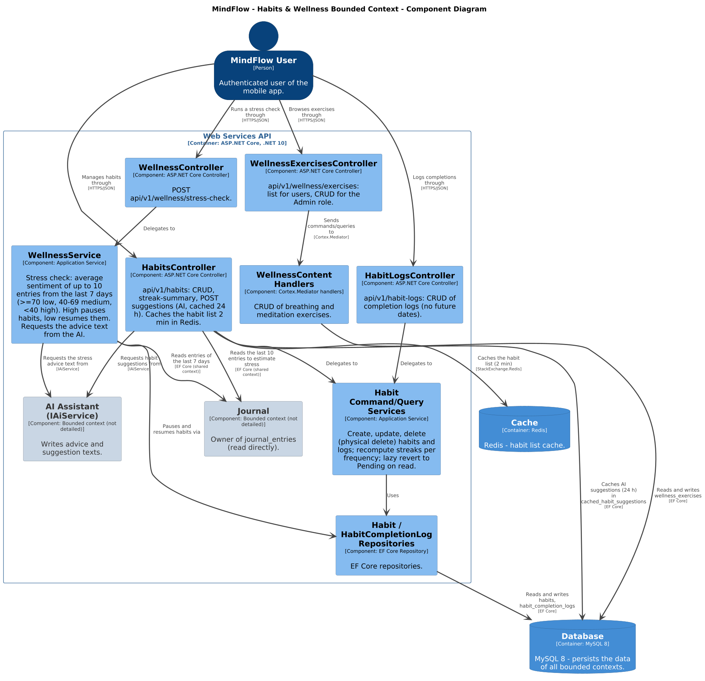
*Figura 48. Component Diagram (C4 Model) del bounded context Habits & Wellness dentro del container Web Services API.*

</div>

El diagrama muestra los tres módulos como grupos de componentes diferenciados: `HabitsController`/`HabitLogsController` delegando en sus Command/Query Services (con `IHabitRepository`/`IHabitCompletionLogRepository` de por medio), `WellnessController` delegando en `WellnessService` (que cruza hacia Journal y hacia `GeminiService`), y `WellnessExercisesController` delegando en sus Handlers vía Mediator. Se muestran explícitamente las tres dependencias cruzadas: hacia AI Assistant (sugerencias y consejos) y hacia Journal (lectura de entradas para estimar estrés) (Figura 48).

#### 2.6.4.6. Bounded Context Software Architecture Code Level Diagrams

##### 2.6.4.6.1. Bounded Context Domain Layer Class Diagrams

<div align="center">

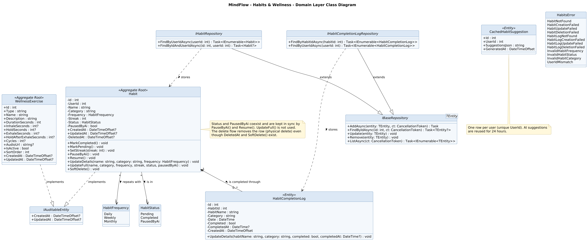
*Figura 49. Class Diagram (UML) del Domain Layer del bounded context Habits & Wellness.*

</div>

`Habit` es el agregado raíz con una colección de `HabitCompletionLog` sin navegación inversa (la FK existe en base de datos, pero el modelo de objetos solo navega en un sentido). `CachedHabitSuggestion` y `WellnessExercise` son entidades independientes sin relaciones declaradas. `IHabitRepository` e `IHabitCompletionLogRepository` extienden el repositorio genérico del Shared Kernel (Figura 49).

##### 2.6.4.6.2. Bounded Context Database Design Diagram

<div align="center">


*Figura 50. Database Diagram del bounded context Habits & Wellness.*

</div>

`habit_completion_logs` tiene **Foreign Key física enforced** hacia `habits.id` con `ON DELETE CASCADE`. `habits` y `cached_habit_suggestions` **no tienen Foreign Key declarada** hacia `users.id` (relación lógica). `cached_habit_suggestions` tiene índice único por `user_id` (una sola caché vigente por usuario). `wellness_exercises` no tiene relación con ninguna otra tabla de este bounded context — es un catálogo independiente (Figura 50).

---

### 2.6.5. Bounded Context: Analytics & Reporting

El bounded context **Analytics & Reporting** no tiene capas Domain, Application ni Infrastructure propias. Está formado por una sola clase, `AnalyticsController`, que lee directamente las entidades de Journal (`JournalEntry`) y de Habits & Wellness (`Habit`, `HabitCompletionLog`) y calcula todo en cada petición, sin caché ni tablas propias.

**Tabla 37. Bounded Context: Analytics & Reporting.**

| Clase | Tipo | Propósito | Detalle |
|---|---|---|---|
| `AnalyticsController` | REST Controller (`api/v1/analytics`) | Entregar el resumen del usuario y los reportes descargables. | `GET dashboard` (rango `from`/`to`; por defecto los últimos 30 días): cantidad de entradas, distribución por sentimiento, 5 categorías más frecuentes, hábitos activos y completados. `GET report.csv`: fecha, categoría, sentimiento y título de cada entrada. `GET report.pdf`: resumen y listado de entradas, generado con QuestPDF (A4). Requiere sesión; **no exige plan Premium**. |

No existen `AnalyticsCache`, `WordCloud`, handlers CQRS, caché Redis ni un `AnalyticsCacheInvalidator` que haga algo real. En Journal, el puerto `IAnalyticsCacheInvalidator` existe pero su implementación es un no-op (no hace nada); tampoco existen las tablas `analytics_caches` ni `word_clouds`.

---

#### 2.6.5.5. Bounded Context Software Architecture Component Level Diagrams

<div align="center">


*Figura 51. Component Diagram (C4 Model) del bounded context Analytics & Reporting dentro del container Web Services API.*

</div>

El diagrama muestra un único componente, `AnalyticsController`, que lee directamente las tablas de Journal y de Habits & Wellness (sin pasar por un repositorio ni por Cortex.Mediator) y usa la librería QuestPDF para generar el reporte en PDF. No hay invalidador de caché activo ni dependencia hacia AI Assistant (Figura 51).

#### 2.6.5.6. Bounded Context Software Architecture Code Level Diagrams

##### 2.6.5.6.1. Bounded Context Domain Layer Class Diagrams

<div align="center">


*Figura 52. Class Diagram (UML) del Domain Layer del bounded context Analytics & Reporting.*

</div>

El contexto no tiene Domain Layer propio: el diagrama muestra `AnalyticsController` y, en gris, las clases externas que lee directamente (`JournalEntry`, `Habit`, `HabitCompletionLog`) para construir el dashboard y los reportes (Figura 52).

##### 2.6.5.6.2. Bounded Context Database Design Diagram

<div align="center">


*Figura 53. Database Diagram del bounded context Analytics & Reporting.*

</div>

El bounded context Analytics & Reporting no tiene tablas propias: el dashboard, el CSV y el PDF se calculan en cada petición a partir de `journal_entries`, `habits` y `habit_completion_logs`, tablas que pertenecen a Journal y a Habits & Wellness. Las tablas `analytics_caches` y `word_clouds` no existen en la base de datos (Figura 53).

---

### 2.6.6. Bounded Context: Notifications

El bounded context **Notifications** es responsable únicamente de la bandeja interna de avisos del usuario. El equipo decidió mantenerlo deliberadamente simple: las operaciones de lectura (listar, contar no leídas, marcar como leídas) son consultas y escrituras directas sin reglas de negocio adicionales, por lo que **no se introdujeron Commands, Queries ni Resources/Assemblers** para ellas. La única regla de negocio real del bounded context —crear una notificación y, si hay SMTP configurado, intentar además un correo— se aisló detrás de un único puerto de dominio, `INotificationService`. Hoy solo el bounded context Support crea notificaciones (al abrir un ticket y al responder el equipo). No existen notificaciones push: **FCM, `DeviceToken` y cualquier job de recordatorio están planificados, no implementados.**

#### 2.6.6.1. Domain Layer

El Domain Layer concentra la única entidad del bounded context. No define un repository interface propio: al ser operaciones simples de consulta/escritura, el Interface Layer y la implementación del puerto de notificación acceden directamente a `AppDbContext`, sin una capa de repositorio intermedia (Tabla 38).

**Tabla 38. Bounded Context: Notifications — Domain Layer.**

| Clase | Tipo | Propósito | Atributos | Métodos | Relaciones |
|---|---|---|---|---|---|
| `Notification` | Aggregate Root (implementa `IAuditableEntity`) | Representa un aviso interno para un usuario. | `Id: int`, `UserId: int`, `Type: string` (hoy solo `support`), `Title: string`, `Body: string`, `ReadAt: DateTimeOffset?` (nulo = no leída), `CreatedAt/UpdatedAt: DateTimeOffset?` | *(entidad anémica — el ciclo de vida lo gestiona `NotificationsController` e `INotificationService`)* | `UserId` es una referencia lógica al agregado `User` del bounded context IAM (sin FK física) |

#### 2.6.6.2. Interface Layer

El Interface Layer expone la bandeja de notificaciones como un único controlador REST, que para las operaciones de consulta/escritura simple actúa también como su propio orquestador (sin pasar por un Application Service intermedio) (Tabla 39).

**Tabla 39. Bounded Context: Notifications — Interface Layer.**

| Clase | Tipo | Propósito | Endpoints / Métodos | Relaciones |
|---|---|---|---|---|
| `NotificationsController` | REST Controller (`api/v1/notifications`) | Expone el listado de notificaciones del usuario, el conteo de no leídas y marcarlas como leídas (una o todas). Resuelve el `user_id` del JWT y valida ownership antes de operar. | `GET /`, `GET /unread-count`, `POST /{id}/read`, `POST /read-all` | Depende directamente de `AppDbContext` (lecturas) e `IUnitOfWork` (persistencia de cambios); no despacha Commands ni Queries |

#### 2.6.6.3. Application Layer

El Application Layer de este bounded context se reduce, por diseño, a un único puerto y su implementación directa (ambos viven en `Application/`, sin una clase de Infrastructure separada): la lógica de negocio real de Notifications —crear una notificación y, si corresponde, su envío por correo— vive en `NotificationService`, detrás del puerto `INotificationService`, mientras que las operaciones de simple consulta/escritura del inbox quedan resueltas en el Interface Layer, tal como se explica en la introducción de esta sección (Tabla 40).

**Tabla 40. Bounded Context: Notifications — Application Layer.**

| Clase | Tipo | Propósito | Atributos / Métodos | Relaciones |
|---|---|---|---|---|
| `INotificationService` | Service Port | Abstrae la creación de una notificación para un usuario. | `CreateAsync(userId, type, title, body): Task` | Implementada por `NotificationService`; consumida hoy únicamente por el bounded context Support |
| `NotificationService` | Application Service | Implementa `INotificationService`: persiste la `Notification` vía `AppDbContext`/`IUnitOfWork` y, si el SMTP está configurado, intenta además enviar un correo. Si no está configurado, queda solo la notificación interna. | `CreateAsync(userId, type, title, body): Task` | Implementa `INotificationService`; depende de `AppDbContext` y, opcionalmente, del servicio externo **SMTP Email Service** |

#### 2.6.6.4. Infrastructure Layer

**Tabla 41. Bounded Context: Notifications — Infrastructure Layer.**

| Clase | Tipo | Observación |
|---|---|---|
| — | — | No existe una clase de Infrastructure propia: `NotificationService`, la implementación concreta de `INotificationService`, vive en `Application/Services/` (Tabla 40). |

---

#### 2.6.6.5. Bounded Context Software Architecture Component Level Diagrams

<div align="center">


*Figura 54. Component Diagram (C4 Model) del bounded context Notifications dentro del container Web Services API.*

</div>

El diagrama muestra `NotificationsController` accediendo directamente a la base de datos para las operaciones de bandeja, y `NotificationService` como el único componente que crea una `Notification`, consumido hoy solo desde Support. FCM, `DeviceToken` y el job de recordatorios aparecen en gris y punteado como planificados (Figura 54).

#### 2.6.6.6. Bounded Context Software Architecture Code Level Diagrams

##### 2.6.6.6.1. Bounded Context Domain Layer Class Diagrams

<div align="center">


*Figura 55. Class Diagram (UML) del Domain Layer del bounded context Notifications.*

</div>

El diagrama muestra la única entidad del bounded context, `Notification` (que implementa `IAuditableEntity`), y el puerto `INotificationService` que la crea. `DeviceToken` aparece en gris como clase planificada, sin contraparte real en el código (Figura 55).

##### 2.6.6.6.2. Bounded Context Database Design Diagram

<div align="center">


*Figura 56. Database Diagram del bounded context Notifications.*

</div>

El bounded context Notifications persiste en una única tabla, `notifications`, sin Foreign Key física hacia `users` (`user_id` es una referencia lógica al bounded context IAM). La tabla `device_tokens` no existe en la base de datos: aparece en gris como planificada (Figura 56).

---

### 2.6.7. Bounded Context: Subscriptions

El bounded context **Subscriptions** es responsable del plan de suscripción del usuario (freemium o Premium) y de toda su facturación: iniciar el pago, recibir la confirmación del proveedor, y el plan de demostración. El equipo decidió modelarlo de la forma más simple posible: un único agregado anémico y toda la lógica concentrada directamente en el controlador, sin un Application Service ni un puerto de dominio propio — a diferencia de Journal, aquí no hay un catálogo de casos de uso lo bastante grande como para justificar esa capa intermedia. **No existe cancelación de suscripción.**

#### 2.6.7.1. Domain Layer

El Domain Layer se reduce a un único agregado anémico, sin repository interface propio: al tener una única suscripción por usuario y operaciones acotadas, `SubscriptionsController` accede directamente a `AppDbContext`, sin una capa de repositorio intermedia (Tabla 42).

**Tabla 42. Bounded Context: Subscriptions — Domain Layer.**

| Clase | Tipo | Propósito | Atributos | Métodos | Relaciones |
|---|---|---|---|---|---|
| `Subscription` | Aggregate Root (implementa `IAuditableEntity`) | Representa el estado de facturación de un usuario. Se decidió modelar un único agregado plano —sin una entidad separada de "transacción de pago"— porque el estado que MindFlow necesita conocer (plan, estado, identificadores del proveedor de pagos) cabe en un solo registro; el historial detallado de cobros queda delegado por completo al proveedor externo. | `Id: int`, `UserId: int` (único), `Plan: string` (`freemium` por defecto, o `premium`), `Status: string`, `StripeCustomerId: string?`, `StripeSubscriptionId: string?`, `CurrentPeriodEnd: DateTimeOffset?`, `CreatedAt/UpdatedAt: DateTimeOffset?` | *(entidad anémica — no tiene `Cancel()` ni `MarkPastDue()`; toda la lógica vive en `SubscriptionsController`)* | `UserId` es una referencia lógica al agregado `User` del bounded context IAM (sin FK física); único registro por usuario |

El Aggregate Design Canvas de `Subscription` describe cómo cambia el plan del usuario y qué garantiza que solo un pago confirmado lo active (Tabla 43).

**Tabla 43. Bounded Context: Subscriptions — Aggregate Design Canvas de `Subscription`.**

| Sección | Contenido |
|---|---|
| **1. Name** | `Subscription` |
| **2. Description** | Representa el plan de un usuario (`freemium` o `premium`), su estado y los identificadores de cliente y suscripción en Stripe. Se decidió no guardar el historial de pagos: Stripe es la fuente de verdad de los cobros, y MindFlow solo conserva lo necesario para saber qué plan tiene el usuario. Un usuario sin registro se trata como *freemium*, así que el registro se crea recién cuando cambia de plan. |
| **3. State Transitions** | *Sin registro* (freemium implícito) → *freemium* o *premium* (`POST demo/plan/{plan}`, sin restricción de entorno)<br>*Sin registro* o *freemium* → *premium* (webhook `checkout.session.completed` de Stripe)<br>*premium* → *freemium* (`demo/plan/freemium`) |
| **4. Enforced Invariants** | Cada usuario tiene como máximo una suscripción (índice único sobre `UserId`).<br>`Plan` solo puede ser `freemium` o `premium`.<br>Solo un webhook con firma HMAC-SHA256 válida de Stripe, recibido dentro de un margen de 300 segundos, puede activar *premium* a partir de un pago. |
| **5. Corrective Policies** | El webhook es idempotente: si Stripe lo reenvía, vuelve a fijar *premium* sobre el mismo registro sin duplicarlo.<br>Si el usuario aún no tenía registro cuando llega el webhook, se crea en ese momento.<br>Si un usuario sin registro consulta su plan, se le devuelve *freemium* por defecto en lugar de un error.<br>No existe ninguna política de cancelación: una vez en *premium*, solo el endpoint de demostración puede volver a bajarlo a *freemium*. |
| **6. Handled Commands** | *Start checkout* (`POST checkout`), *Confirm payment* (`POST webhook`), *Change demo plan* (`POST demo/plan/{plan}`). En este contexto no son clases Command, sino acciones de `SubscriptionsController`. |
| **7. Created Events** | *Checkout session started*, *Payment confirmed* (evento externo de Stripe), *Subscription upgraded to premium*, *Plan changed* |
| **8. Throughput** | Muy bajo. Un usuario cambia de plan pocas veces en toda su vida. |
| **9. Size** | Muy pequeño. Es un único registro por usuario, sin colecciones, que cambia solo cuando el usuario cambia de plan. |

#### 2.6.7.2. Interface Layer

El Interface Layer expone los planes, la suscripción del usuario, el checkout, el webhook del proveedor de pagos y el plan de demostración como un único controlador REST, que contiene toda la lógica de negocio directamente (Tabla 44).

**Tabla 44. Bounded Context: Subscriptions — Interface Layer.**

| Clase | Tipo | Propósito | Endpoints / Métodos | Relaciones |
|---|---|---|---|---|
| `SubscriptionsController` | REST Controller (`api/v1/subscriptions`) | Expone los planes disponibles, la consulta del plan actual, el inicio de checkout, la recepción del webhook y el cambio de plan de demostración. Contiene toda la lógica: no delega en un Application Service. | `GET plans` (público; freemium 0 USD, premium 4.99 USD/mes), `GET me`, `POST checkout` (crea la sesión de Stripe Checkout), `POST webhook` (`[AllowAnonymous]`, firma HMAC-SHA256, tolerancia 300 s), `POST demo/plan/{plan}` (cambia de plan sin pagar; **sin restricción de entorno**, puede llamarse en producción) | Depende directamente de `AppDbContext` y de la API REST de Stripe vía `IHttpClientFactory` (cliente nombrado `"Stripe"`, sin SDK oficial); no usa Resources, Assemblers ni un puerto de Application Layer |

#### 2.6.7.3. Application Layer

**Tabla 45. Bounded Context: Subscriptions — Application Layer.**

| Clase | Tipo | Observación |
|---|---|---|
| — | — | No existe un Application Service ni un puerto (`ISubscriptionService`) propio para este bounded context: toda la lógica de facturación vive directamente en `SubscriptionsController` (Tabla 44). |

#### 2.6.7.4. Infrastructure Layer

**Tabla 46. Bounded Context: Subscriptions — Infrastructure Layer.**

| Clase | Tipo | Observación |
|---|---|---|
| — | — | No existe una clase de Infrastructure dedicada: `SubscriptionsController` llama directamente a la API REST de Stripe (vía `IHttpClientFactory`, sin SDK) y a `AppDbContext`, sin una capa de abstracción intermedia. La firma del webhook se valida a mano (HMAC-SHA256 sobre el header `Stripe-Signature`), sin ninguna librería de verificación de Stripe. |

---

#### 2.6.7.5. Bounded Context Software Architecture Component Level Diagrams

<div align="center">


*Figura 57. Component Diagram (C4 Model) del bounded context Subscriptions dentro del container Web Services API.*

</div>

El diagrama muestra el flujo bidireccional con el proveedor de pagos: `SubscriptionsController` recibe tanto las peticiones del usuario como el webhook entrante del proveedor, y es el único componente de lógica de negocio del bounded context — no hay Application Service ni Infrastructure Service separados. Ningún otro contexto consulta el plan del usuario hoy (Figura 57).

#### 2.6.7.6. Bounded Context Software Architecture Code Level Diagrams

##### 2.6.7.6.1. Bounded Context Domain Layer Class Diagrams

<div align="center">


*Figura 58. Class Diagram (UML) del Domain Layer del bounded context Subscriptions.*

</div>

El diagrama muestra el agregado anémico `Subscription` (que implementa `IAuditableEntity`), sin métodos de transición de estado propios, y `SubscriptionsController` como la única clase que lo modifica (Figura 58).

##### 2.6.7.6.2. Bounded Context Database Design Diagram

<div align="center">


*Figura 59. Database Diagram del bounded context Subscriptions.*

</div>

El bounded context Subscriptions persiste en una única tabla, `subscriptions`, sin Foreign Key física hacia `users` (`user_id` es una referencia lógica al bounded context IAM), con `current_period_end` como columna de vigencia del plan. El único índice real es el único sobre `user_id` (una suscripción por usuario); no existe índice sobre `stripe_customer_id`, columna que se guarda como dato derivado pero no se usa para buscar: el webhook localiza la suscripción únicamente por el `client_reference_id` de la sesión de checkout (Figura 59).

---

### 2.6.8. Bounded Context: Support

El bounded context **Support** es responsable de los tickets de soporte que un usuario levanta hacia el equipo de MindFlow: su creación, el hilo de mensajes con el staff, y la gestión (asignación y estado) por parte de los roles `Support` y `Admin`. El equipo decidió modelarlo con dos entidades —el ticket y sus mensajes— y concentrar toda la lógica directamente en el controlador, sin Application Service ni puerto de dominio propio, siguiendo el mismo criterio adoptado en Subscriptions.

#### 2.6.8.1. Domain Layer

El Domain Layer concentra las dos entidades del bounded context, sin repository interface propio: `SupportTicketsController` accede directamente a `AppDbContext`, sin una capa de repositorio intermedia (Tabla 47).

**Tabla 47. Bounded Context: Support — Domain Layer.**

| Clase | Tipo | Propósito | Atributos | Métodos | Relaciones |
|---|---|---|---|---|---|
| `SupportTicket` | Aggregate Root (implementa `IAuditableEntity`) | Representa un ticket de soporte levantado por un usuario. | `Id: int`, `OwnerId: int`, `AssigneeId: int?`, `Subject: string`, `Category: string` (por defecto `general`), `Priority: string` (por defecto `normal`), `Status: string` (por defecto `open`; texto libre, sin lista cerrada de valores), `CreatedAt/UpdatedAt: DateTimeOffset?` | *(entidad anémica; el ciclo de vida lo gestiona `SupportTicketsController`)* | `OwnerId`/`AssigneeId` son referencias lógicas al agregado `User` del bounded context IAM (sin FK física); colección de `SupportMessage` |
| `SupportMessage` | Entity (implementa `IAuditableEntity`) | Representa un mensaje del hilo de un ticket. | `Id: int`, `TicketId: int`, `AuthorId: int`, `IsStaff: bool`, `Body: string`, `CreatedAt/UpdatedAt: DateTimeOffset?` | *(anémica)* | FK física hacia `SupportTicket` con `ON DELETE CASCADE`: se borra junto con su ticket |

El Aggregate Design Canvas de `SupportTicket` describe la conversación entre el usuario y el equipo de soporte, y quién puede actuar sobre cada ticket (Tabla 48).

**Tabla 48. Bounded Context: Support — Aggregate Design Canvas de `SupportTicket`.**

| Sección | Contenido |
|---|---|
| **1. Name** | `SupportTicket` |
| **2. Description** | Representa una solicitud de soporte de un usuario, con su asunto, categoría, prioridad, estado (texto libre) y los mensajes intercambiados (`SupportMessage`). Los mensajes forman parte del agregado porque solo tienen sentido dentro de su ticket. Las notificaciones quedan fuera: el agregado solo pide a Notifications que las cree. |
| **3. State Transitions** | `Status` es texto libre, sin una lista cerrada de valores ni métodos de transición propios: el staff lo cambia directamente vía `PATCH {id}`.<br>*Sin asignar* → *Asignado* (el staff fija `AssigneeId` vía `PATCH {id}`) |
| **4. Enforced Invariants** | El asunto es obligatorio al crear un ticket; el mensaje inicial es opcional (si viene vacío, simplemente no se crea ningún `SupportMessage`). Un mensaje agregado después al hilo (`POST {id}/messages`) sí es obligatorio y no puede estar vacío.<br>Solo el dueño del ticket o el staff (roles `Support` y `Admin`) puede verlo y responderlo.<br>Solo el staff puede cambiar el estado o la asignación (`PATCH {id}`). |
| **5. Corrective Policies** | Al crear un ticket se notifica a su dueño.<br>Cada respuesta del staff genera una notificación para el dueño del ticket.<br>No se notifica al staff cuando el usuario responde.<br>No existe protección contra tickets duplicados ni correo de confirmación. |
| **6. Handled Commands** | *Create ticket* (`POST`), *Add message* (`POST {id}/messages`), *Update ticket* (`PATCH {id}`, asignación y estado). En este contexto no son clases Command, sino acciones de `SupportTicketsController`. |
| **7. Created Events** | *Support ticket created*, *Support message added*, *Ticket assigned*, *Ticket status changed* |
| **8. Throughput** | Bajo. Sobre un ticket actúan como máximo el usuario y uno o dos miembros del staff. Los mensajes se agregan al final sin modificar los anteriores, así que no compiten entre sí. |
| **9. Size** | Pequeño. Un ticket suele tener unas pocas decenas de mensajes y una vida corta, de días, hasta que se cierra. |

#### 2.6.8.2. Interface Layer

El Interface Layer expone la creación, consulta, respuesta y gestión de tickets como un único controlador REST, que contiene toda la lógica directamente (Tabla 49).

**Tabla 49. Bounded Context: Support — Interface Layer.**

| Clase | Tipo | Propósito | Endpoints / Métodos | Relaciones |
|---|---|---|---|---|
| `SupportTicketsController` | REST Controller (`api/v1/support/tickets`) | Expone la creación de un ticket, su listado y detalle, agregar un mensaje al hilo, y asignar/cambiar estado (restringido a roles `Support` o `Admin`). | `POST /`, `GET /`, `GET /{id}`, `POST /{id}/messages`, `PATCH /{id}` (asignar y cambiar estado; solo roles `Support` o `Admin`) | Depende directamente de `AppDbContext`; no usa Resources, Assemblers ni un puerto de Application Layer |

#### 2.6.8.3. Application Layer

**Tabla 50. Bounded Context: Support — Application Layer.**

| Clase | Tipo | Observación |
|---|---|---|
| — | — | No existe un Application Service ni un puerto (`ISupportService`) propio: toda la lógica vive directamente en `SupportTicketsController` (Tabla 49). |

#### 2.6.8.4. Infrastructure Layer

**Tabla 51. Bounded Context: Support — Infrastructure Layer.**

| Clase | Tipo | Observación |
|---|---|---|
| — | — | No existe una clase de Infrastructure dedicada: `SupportTicketsController` llama directamente a `AppDbContext` y a `INotificationService` (bounded context Notifications) para notificar al crear un ticket y al responder el staff. No hay `SupportService` ni envío de correo de confirmación. |

---

#### 2.6.8.5. Bounded Context Software Architecture Component Level Diagrams

<div align="center">


*Figura 60. Component Diagram (C4 Model) del bounded context Support dentro del container Web Services API.*

</div>

El diagrama muestra `SupportTicketsController` como único componente del bounded context: persiste el ticket y sus mensajes directamente sobre `AppDbContext`, y llama a `INotificationService` (Notifications) al crear un ticket y al responder el staff. No hay `SupportService` ni correo de confirmación (Figura 60).

#### 2.6.8.6. Bounded Context Software Architecture Code Level Diagrams

##### 2.6.8.6.1. Bounded Context Domain Layer Class Diagrams

<div align="center">


*Figura 61. Class Diagram (UML) del Domain Layer del bounded context Support.*

</div>

El diagrama muestra las dos entidades del bounded context, `SupportTicket` (que implementa `IAuditableEntity`) y `SupportMessage`, ambas anémicas y sin métodos de transición de estado propios (Figura 61).

##### 2.6.8.6.2. Bounded Context Database Design Diagram

<div align="center">


*Figura 62. Database Diagram del bounded context Support.*

</div>

El bounded context Support persiste en dos tablas: `support_tickets`, sin Foreign Key física hacia `users` (`owner_id`/`assignee_id` son referencias lógicas al bounded context IAM); y `support_messages`, con Foreign Key física `ON DELETE CASCADE` hacia `support_tickets.id` (Figura 62).

---

<div style="page-break-before: always;"></div>

# Capítulo III: Solution UI/UX Design

## 3.1. Product design

### 3.1.1. Style Guidelines

Link de Figma para la Mobile Application: [https://www.figma.com/design/oL5qBZ6aVIPJBJTRZJ23jH/AppMoviles](https://www.figma.com/design/oL5qBZ6aVIPJBJTRZJ23jH/AppMoviles?t=WGZWtJXygKBervV6-1)

#### 3.1.1.1. General Style Guidelines

En esta sección se definen las pautas de estilo generales que rigen la identidad visual de MindFlow, sobre las cuales se construyen tanto el Landing Page como las Mobile Applications. El objetivo es garantizar una experiencia visual coherente, calmada y confiable, alineada con el propósito de la plataforma: acompañar el bienestar emocional del usuario sin generar ruido visual ni sobrecarga cognitiva.

**Branding**

La identidad visual de MindFlow busca transmitir calma emocional, confianza tecnológica y cercanía humana. Se evita cualquier elemento que remita a urgencia, alarma o exceso de estímulo visual, priorizando en cambio formas suaves, espacios en blanco generosos y una paleta de colores fríos.

**Typography**

- **Primary Font:** Plus Jakarta Sans
- **Tipo:** Sans-serif humanista
- **Uso:** Títulos, subtítulos, botones e interfaz general

Se seleccionó por su alta legibilidad en pantallas pequeñas (crítico para el contexto móvil del proyecto), su trazo redondeado que transmite cercanía sin perder seriedad, y su amplia disponibilidad de pesos (Regular, Medium, SemiBold, Bold) que permite construir jerarquía tipográfica sin depender de una segunda familia tipográfica (Tabla 52).

**Tabla 52. Style Guidelines — General Style Guidelines.**

| Estilo | Peso | Uso |
|---|---|---|
| Heading 1 | Bold | Títulos de pantalla (p. ej. "Tu Diario") |
| Heading 2 | SemiBold | Encabezados de sección |
| Body | Regular | Texto de lectura general |
| Label | Medium | Etiquetas de formularios y botones |
| Caption | Regular | Metadatos (fecha, hora, estado) |

**Colors**

*Colores primarios* — representan calma emocional y confianza; se usan en botones principales, elementos interactivos y estados positivos (Tabla 53).

**Tabla 53. Style Guidelines — General Style Guidelines — Colores primarios.**

| Nombre | Hex | Uso |
|---|---|---|
| Calm Indigo | `#4C5FD5` | Acción principal, elementos activos, branding |
| Serene Teal | `#45C7A3` | Estados positivos, progreso, hábitos completados |

*Colores secundarios* — dan soporte y jerarquía visual sin competir con los primarios (Tabla 54).

**Tabla 54. Style Guidelines — General Style Guidelines — Colores secundarios.**

| Nombre | Hex | Uso |
|---|---|---|
| Warm Lavender | `#9B8CF2` | Elementos del módulo AI Assistant / Chat |
| Neutral Fog | `#F4F6FA` | Fondos de sección, tarjetas |
| Ink Gray | `#2B2D33` | Texto principal |

*Colores de estado* — reservados exclusivamente para retroalimentación funcional, no decorativa (Tabla 55).

**Tabla 55. Style Guidelines — General Style Guidelines — Colores de estado.**

| Nombre | Hex | Uso |
|---|---|---|
| Success Green | `#2FB380` | Confirmaciones, hábito registrado con éxito |
| Alert Amber | `#E0A73B` | Advertencias no críticas (p. ej. suscripción por vencer) |
| Error Red | `#E5484D` | Errores de validación, fallos de red |

*Colores de wireframe* — usados exclusivamente durante la etapa de baja fidelidad, para mantener el foco en estructura y no en estética final (Tabla 56).

**Tabla 56. Style Guidelines — General Style Guidelines — Colores de wireframe.**

| Nombre | Hex |
|---|---|
| Light Gray | `#E5E5E5` |
| Medium Gray | `#BDBDBD` |
| Dark Gray | `#828282` |
| White | `#FFFFFF` |

**Spacing**

Sistema de espaciado basado en múltiplos de 8px, consistente entre Landing Page y Mobile Applications:

- Unidad base: `8px`
- Padding interno de tarjetas: `16px`–`24px`
- Separación entre elementos de una lista: `12px`
- Márgenes laterales de pantalla: `16px`
- Separación entre secciones: `32px`

**Communication Tone**

El tono de comunicación de MindFlow se posiciona en cuatro dimensiones (Tabla 57).

**Tabla 57. Style Guidelines — General Style Guidelines — Communication Tone.**

| Dimensión | Posición de MindFlow |
|---|---|
| Divertido ↔ Serio | Cercano a *Serio*, sin ser frío: el tono reconoce la sensibilidad del contenido emocional que maneja el usuario |
| Formal ↔ Casual | Cercano a *Casual*: lenguaje cercano, en segunda persona, sin tecnicismos |
| Respetuoso ↔ Irreverente | Siempre *Respetuoso*: ningún mensaje del sistema minimiza o juzga el estado emocional del usuario |
| Entusiasta ↔ Sereno | Cercano a *Sereno*: se evita el uso de exclamaciones excesivas o lenguaje que presione al usuario a "sentirse mejor rápido" |

**Dimension Guidelines**

Al tratarse de un proyecto orientado a Mobile Applications, las dimensiones se definen priorizando accesibilidad táctil:

- Botones principales: altura `48px`–`56px` (óptimo para interacción táctil)
- Íconos: `24px`–`32px`
- Inputs de texto: altura `48px`–`56px`
- Bottom Navigation Bar: altura `56px`–`64px`
- Tarjetas de información: ancho completo con padding lateral de `16px`
- Área táctil mínima para cualquier elemento interactivo: `44px x 44px`, siguiendo las guías de accesibilidad táctil de Android e iOS

### 3.1.2. Information Architecture

En esta sección el equipo plantea las decisiones y el sustento que dirigen la manera en que se organiza el contenido en las experiencias del Landing Page y de las Mobile Applications de MindFlow, buscando que visitantes y usuarios se adapten con facilidad a la funcionalidad de cada producto y encuentren lo que necesitan sin esfuerzo.

#### 3.1.2.1. Organization Systems

MindFlow combina tres tipos de organización visual, aplicados según el contexto de cada pantalla:

- **Organización jerárquica:** utilizada en el Dashboard principal y en el Landing Page, donde se prioriza visualmente la información más relevante para el usuario (estado emocional del día, hábitos pendientes) mediante tamaño, contraste y posición.
- **Organización secuencial:** aplicada en flujos donde el usuario debe completar una serie de pasos, como el registro (Onboarding → Registro → Configuración de perfil) o la creación de una nueva entrada de diario (Selección de estado de ánimo → Redacción → Confirmación).
- **Organización matricial:** utilizada en la sección de Analíticas, donde se cruzan distintas variables (estado de ánimo, fecha, hábitos completados) dentro de una misma vista para facilitar la comparación y el análisis de patrones.

A nivel de categorización de contenido, se aplican los siguientes esquemas (Tabla 58):

**Tabla 58. Information Architecture — Organization Systems.**

| Esquema | Dónde se aplica |
|---|---|
| Cronológico | Historial de entradas del Diario, registro de notificaciones |
| Por tópicos | Separación de módulos: Diario, Hábitos, Analíticas, Asistente IA, Soporte |
| Según audiencia | Distinción entre funcionalidades del plan gratuito y del plan Premium (Subscriptions) |
| Alfabético | Listados extensos, como el historial de tickets de soporte |

#### 3.1.2.2. Labelling Systems

Las etiquetas de MindFlow se definieron priorizando claridad y el menor número de palabras posible, manteniendo consistencia entre el Landing Page, la Mobile Application y el propio lenguaje ubicuo definido en el Capítulo II (Tabla 59).

**Tabla 59. Information Architecture — Labelling Systems.**

| Etiqueta | Módulo asociado |
|---|---|
| Inicio | Dashboard |
| Diario | Journal |
| Hábitos | Habits & Wellness |
| Analíticas | Analytics & Reporting |
| Asistente | AI Assistant (Chat) |
| Notificaciones | Notifications |
| Premium | Subscriptions |
| Soporte | Support |
| Perfil | IAM |

Estas etiquetas se mantienen idénticas en todos los puntos de contacto (menú de navegación, notificaciones push, correos transaccionales), evitando sinónimos que puedan confundir al usuario respecto a qué sección del producto se le está mencionando.

#### 3.1.2.3. SEO Tags and Meta Tags

Para el **Landing Page**, se definen las siguientes meta tags principales (Tabla 60):

**Tabla 60. Information Architecture — SEO Tags and Meta Tags.**

| Tag | Valor |
|---|---|
| Title | MindFlow — Bienestar emocional con inteligencia artificial |
| Description | Registra tu estado de ánimo, construye hábitos saludables y recibe acompañamiento con IA. Descarga MindFlow. |
| Keywords | bienestar emocional, diario emocional, hábitos saludables, salud mental, IA |
| Author | CogniTech |
| Charset | UTF-8 |

Para las **Mobile Applications**, al distribuirse a través de una app store, se definen adicionalmente los elementos de ASO (App Store Optimization) (Tabla 61):

**Tabla 61. Information Architecture — SEO Tags and Meta Tags (2).**

| Elemento ASO | Valor |
|---|---|
| App Title | MindFlow: Diario y Bienestar |
| App Subtitle | Hábitos y bienestar emocional con IA |
| App Keywords | diario, ánimo, hábitos, bienestar, salud mental, IA |
| App Description | MindFlow te acompaña a registrar tu estado emocional, construir hábitos saludables y recibir feedback empático generado por IA, todo en un solo lugar. |

#### 3.1.2.4. Searching Systems

MindFlow incorpora mecanismos de búsqueda diferenciados por módulo, siempre acompañados de filtros que evitan que el usuario se sienta perdido entre el volumen de información generado por el uso continuo de la aplicación:

- **Diario:** búsqueda por palabra clave dentro del contenido de las entradas, con filtros por rango de fecha y por etiqueta emocional asociada.
- **Hábitos:** filtros por estado (activo, completado, pausado) y por frecuencia (diario, semanal).
- **Notificaciones:** filtros por tipo (recordatorio, confirmación, alerta de suscripción) y por estado de lectura.
- **Soporte:** búsqueda de tickets propios por asunto y filtro por estado (abierto, en progreso, cerrado).

Los resultados se presentan siempre en listas estructuradas que muestran los atributos más relevantes de cada registro, sin requerir que el usuario abra cada elemento para identificar si es el que busca.

#### 3.1.2.5. Navigation Systems

La navegación de MindFlow se apoya en un patrón nativo de **Bottom Navigation Bar**, consistente en todas las pantallas principales de la Mobile Application, que agrupa los módulos de mayor uso: Inicio, Diario, Hábitos, Analíticas y Asistente. El resto de módulos (Notificaciones, Premium, Soporte, Perfil) se accede mediante navegación contextual desde el ícono de perfil, evitando saturar la barra principal.

Dentro de cada módulo se incorporan elementos de navegación contextual (botones de retorno, accesos directos entre pantallas relacionadas, p. ej. de una entrada del Diario hacia el hábito que la originó) que permiten desplazarse sin perder el contexto de la tarea que el usuario está realizando.

En el **Landing Page**, la navegación se organiza mediante un menú superior fijo que dirige a los visitantes hacia las secciones principales del sitio (Producto, Beneficios, Planes, Footer con enlaces de contacto), permitiendo un recorrido lineal y ordenado de la propuesta de valor antes de la llamada a la acción final (descarga de la app).

### 3.1.3. Landing Page UI Design

#### 3.1.3.1. Landing Page Wireframe

Los wireframes representan la versión de baja fidelidad del Landing Page, enfocada en la jerarquía de contenido y la disposición de cada sección antes de aplicar el sistema de diseño. Se elaboraron en Figma sobre un frame de 1440 px de ancho para las dos páginas del sitio: la página de inicio (index) y la página Nosotros.

**Página de inicio (index)**

El recorrido de la página de inicio cubre el encabezado, la propuesta de valor, el problema que resuelve MindFlow, el funcionamiento del producto, las capturas de la aplicación, los beneficios, las analíticas, los planes y el pie de página (Figuras 63 a 66).

<div align="center">


*Figura 63. Landing Page Wireframe (index): encabezado, Hero y El problema.*


*Figura 64. Landing Page Wireframe (index): Cómo funciona, Capturas y Por qué MindFlow.*


*Figura 65. Landing Page Wireframe (index): Beneficios y Analíticas.*


*Figura 66. Landing Page Wireframe (index): Planes, llamada a la acción y pie de página.*

</div>

**Página Nosotros**

La página Nosotros presenta a CogniTech, su misión y visión, y la presentación de sus cinco integrantes (Figuras 67 y 68).

<div align="center">


*Figura 67. Landing Page Wireframe (Nosotros): encabezado, Misión, Visión y El equipo.*


*Figura 68. Landing Page Wireframe (Nosotros): tarjetas del equipo, llamada a la acción y pie de página.*

</div>


#### 3.1.3.2. Landing Page Mock-up

Los mock-ups representan la versión de alta fidelidad del Landing Page, aplicando la paleta, la tipografía y los componentes del sistema de diseño definido en la sección 3.1.1 sobre la estructura validada en los wireframes de la sección 3.1.3.1.

**Página de inicio (index)**

La versión de alta fidelidad conserva la misma estructura validada en el wireframe (Figuras 69 a 72).

<div align="center">


*Figura 69. Landing Page Mock-up (index): encabezado, Hero y El problema.*


*Figura 70. Landing Page Mock-up (index): Cómo funciona, Capturas y Por qué MindFlow.*


*Figura 71. Landing Page Mock-up (index): Beneficios y Analíticas.*


*Figura 72. Landing Page Mock-up (index): Planes, llamada a la acción y pie de página.*

</div>

**Página Nosotros**

La página Nosotros en alta fidelidad conserva la misma estructura validada en su wireframe (Figuras 73 y 74).

<div align="center">


*Figura 73. Landing Page Mock-up (Nosotros): encabezado, Misión, Visión y El equipo.*


*Figura 74. Landing Page Mock-up (Nosotros): tarjetas del equipo, llamada a la acción y pie de página.*

</div>

### 3.1.4. Mobile Applications UX/UI Design

#### 3.1.4.1. Mobile Applications Wireframes

Los wireframes representan la versión de baja fidelidad de las pantallas de la Mobile Application de MindFlow. Fueron elaborados en Figma sobre el mismo frame de 360 × 800 px que los mock-ups de la sección 3.1.4.3, sin color ni contenido de marca, para validar la jerarquía de información y la disposición de cada pantalla antes de aplicar el sistema de diseño. Se presentan en el mismo orden de recorrido que los mock-ups (Figuras 75 a 86).

<div align="center">


*Figura 75. Wireframe - Login.*


*Figura 76. Wireframe - Registro.*


*Figura 77. Wireframe - Inicio (Dashboard).*


*Figura 78. Wireframe - Diario (Historial emocional).*


*Figura 79. Wireframe - Hábitos: Mis Rutinas.*


*Figura 80. Wireframe - Hábitos: Sugerencias de IA.*


*Figura 81. Wireframe - Analíticas: Resumen.*


*Figura 82. Wireframe - Analíticas: Nube, tendencias y exportación.*


*Figura 83. Wireframe - Ajustes: Perfil.*


*Figura 84. Wireframe - Ajustes: Privacidad y experiencia.*


*Figura 85. Wireframe - Ajustes: Suscripción, soporte y cuenta.*


*Figura 86. Wireframe - Chat con MindFlow AI.*

</div>

#### 3.1.4.2. Mobile Applications Wireflow Diagrams

Un wireflow combina los wireframes de la sección 3.1.4.1 con el orden de navegación que sigue el usuario, mostrando en una sola fila las pantallas de baja fidelidad que recorre para cumplir un objetivo. A diferencia del diagrama de flujo abstracto de la sección 3.1.4.4 (que incluye decisiones del sistema y mensajes de error), el wireflow se queda solo en la secuencia de pantallas, en el mismo orden que cada User Flow.

**User Flow 1: Acceder a MindFlow (Figura 87).**

<p align="center">


*Figura 87. Wireflow — User Flow 1: Acceder a MindFlow (Login → Registro → Inicio).*
</p>

**User Flow 2: Registrar cómo me siento y recibir apoyo de la IA (Figura 88).**

<p align="center">


*Figura 88. Wireflow — User Flow 2: Registrar cómo me siento y recibir apoyo de la IA (Inicio → Chat con MindFlow AI).*
</p>

**User Flow 3: Revisar mi historial emocional (Figura 89).**

<p align="center">


*Figura 89. Wireflow — User Flow 3: Revisar mi historial emocional (Inicio → Diario).*
</p>

**User Flow 4: Gestionar mis hábitos según mi nivel de estrés (Figura 90).**

<p align="center">


*Figura 90. Wireflow — User Flow 4: Gestionar mis hábitos según mi nivel de estrés (Mis Rutinas → Sugerencias de IA).*
</p>

**User Flow 5: Revisar mis analíticas y exportar un reporte (Figura 91).**

<p align="center">


*Figura 91. Wireflow — User Flow 5: Revisar mis analíticas y exportar un reporte (Analíticas: Resumen → Analíticas: Nube, tendencias y exportación → Suscripción, al requerir Premium).*
</p>

**User Flow 6: Mejorar a MindFlow Premium (Figura 92).**

<p align="center">


*Figura 92. Wireflow — User Flow 6: Mejorar a MindFlow Premium (Suscripción, soporte y cuenta).*
</p>

**User Flow 7: Proteger mi privacidad y personalizar la aplicación (Figura 93).**

<p align="center">


*Figura 93. Wireflow — User Flow 7: Proteger mi privacidad y personalizar la aplicación (Perfil → Privacidad y experiencia).*
</p>

**User Flow 8: Pedir ayuda al soporte técnico (Figura 94).**

<p align="center">


*Figura 94. Wireflow — User Flow 8: Pedir ayuda al soporte técnico (Suscripción, soporte y cuenta).*
</p>

#### 3.1.4.3. Mobile Applications Mock-ups

Los mock-ups representan la versión de alta fidelidad de las pantallas de la Mobile Application de MindFlow. Fueron elaborados en Figma sobre un frame de 402 × 874 px y aplican la paleta, la tipografía y los componentes del archivo de diseño enlazado en la sección 3.1.1. Cada pantalla se presenta en el orden en que el usuario la recorre y se relaciona con las User Stories que cubre.

**Acceso a la aplicación**

**El usuario inicia sesión con su cuenta de Google o con su correo electrónico y contraseña; desde esta pantalla también puede recuperar su contraseña o ir al registro (US01, US02, US03) (Figura 95)**

<p align="center">


*Figura 95. Mockup - Login.*
</p>

**El usuario nuevo crea su cuenta con Google o completando su nombre, correo electrónico y contraseña, y acepta los Términos de Servicio y la Política de Privacidad (US01) (Figura 96)**

<p align="center">


*Figura 96. Mockup - Registro.*
</p>

**Registro emocional y navegación**

**El usuario entra al Dashboard, escribe cómo se siente, elige una etiqueta de contexto y guarda el registro; MindFlow AI le responde con retroalimentación empática y debajo aparecen sus conversaciones recientes (US11, US12, US13, US14) (Figura 97)**

<p align="center">


*Figura 97. Mockup - Home.*
</p>

**El usuario conversa con MindFlow AI desde la pantalla de Chat para profundizar en cómo se siente; la IA responde con preguntas de seguimiento y sugerencias de autocuidado dentro de un mismo hilo de conversación (US12, US13) (Figura 98)**

<p align="center">


*Figura 98. Mockup - Chat con MindFlow AI.*
</p>

**El usuario abre el menú lateral desde el ícono superior izquierdo para moverse entre Dashboard, Diario, Hábitos, Analíticas, Configuración y Planes (Figura 99)**

<p align="center">


*Figura 99. Mockup - Menú móvil.*
</p>

**Diario y hábitos**

**El usuario revisa su historial emocional: busca entradas por palabra clave, filtra por etiqueta, estado y fecha, y ve en el calendario el estado de ánimo de cada día según su color (US14, US16, US17) (Figura 100)**

<p align="center">


*Figura 100. Mockup - Diario.*
</p>

**El usuario consulta sus rutinas, ve el progreso del día y añade un nuevo hábito con su frecuencia; cuando MindFlow AI detecta un nivel alto de estrés, muestra un aviso y ajusta las tareas (US21, US22, US23) (Figura 101)**

<p align="center">


*Figura 101. Mockup - Hábitos.*
</p>

**Cuando MindFlow AI detecta un nivel de estrés elevado en los registros recientes, sugiere ajustes a la rutina de hábitos del usuario —pausar, reducir la frecuencia o reemplazar un hábito por uno más ligero— y el usuario decide si aplicarlos (US22, US23) (Figura 102)**

<p align="center">


*Figura 102. Mockup - Sugerencias de IA.*
</p>

**Analíticas**

**El usuario revisa su resumen semanal generado por IA, sus indicadores del mes, la fluctuación emocional de la última semana, la nube de palabras frecuentes y la tendencia de ánimo; al final puede exportar sus reportes en PDF o CSV (US18, US28, US31, US32, US35, US36) (Figura 103)**

<p align="center">


*Figura 103. Mockup - Analíticas.*
</p>

**Perfil y privacidad**

**El usuario edita sus datos personales, activa el bloqueo por PIN y cambia al modo oscuro desde Ajustes y Privacidad (US04, US05, US06) (Figura 104)**

<p align="center">


*Figura 104. Mockup - Configuración.*
</p>


**Planes y suscripción**

**El usuario compara el plan Freemium con MindFlow Premium, revisa qué funcionalidades incluye cada uno y puede actualizar a Premium con pago seguro (US33, US34) (Figura 105)**

<p align="center">


*Figura 105. Mockup - Planes.*
</p>

#### 3.1.4.4. Mobile Applications User Flow Diagrams

Los User Flows describen el recorrido que sigue cada User Persona dentro de la Mobile Application de MindFlow para cumplir un objetivo concreto. Se elaboró un User Flow por cada User goal, tomando como referencia a los dos User Personas definidos en la sección 2.3.1: **Jimena Luna** (estudiante universitaria, 19 años) y **Nordie Sanabria** (profesional de marketing, 29 años). Cada flujo se apoya en los mock-ups de la sección 3.1.4.3 y en las User Stories de la sección 2.4.1.

En cada diagrama se distinguen dos tipos de recorrido:

- **Happy path** (verde): la ruta esperada, en la que el usuario cumple su objetivo sin inconvenientes.
- **Unhappy paths** (rojo): rutas alternativas que aparecen cuando una validación falla, el servicio no responde o el usuario no cumple una condición previa (por ejemplo, no tener el plan Premium).

Las pantallas aparecen como rectángulos, las decisiones del sistema o del usuario como rombos y los mensajes que muestra la aplicación como nodos redondeados.

---

##### User Flow 1: Acceder a MindFlow

**User goal:** Como Jimena, quiero crear mi cuenta o iniciar sesión de forma rápida para empezar a registrar cómo me siento sin pasos innecesarios.

**User Persona:** Jimena Luna, aunque el flujo es el mismo para Nordie Sanabria. **User Stories:** US01, US02, US03 (Figura 106).

<p>


*Figura 106. User Flow 1: Acceder a MindFlow: Mockup - Login, Mockup - Registro, Mockup - Dashboard.*
</p>

*(Ver Figura 107.)*


*Figura 107. Diagrama de flujo (flowchart) — User Flow 1: Acceder a MindFlow.*

**Explicación del flujo:**

- **Happy path:** Jimena abre la aplicación y llega a la pantalla de Login. Si ya tiene cuenta, ingresa su correo y contraseña (o usa Google) y entra directamente al Dashboard. Si es nueva, pasa a Registro, completa sus datos, acepta los Términos de Servicio y la Política de Privacidad, y entra al Dashboard con la sesión ya iniciada.
- **Unhappy paths:**
  - Si el correo no tiene un formato válido o la contraseña tiene menos de 8 caracteres, el formulario muestra el error junto al campo y no se envía.
  - Si el servidor no puede crear la cuenta (por ejemplo, porque el correo ya está registrado), se muestra "No se pudo crear la cuenta" y el usuario vuelve al formulario.
  - Si las credenciales son incorrectas, se muestra "Correo o contraseña incorrectos". Desde ahí el usuario puede volver a intentarlo o pedir el enlace de recuperación de contraseña (US03).
  - Si no hay conexión, la aplicación lo indica y el usuario puede reintentar.

---

##### User Flow 2: Registrar cómo me siento y recibir apoyo de la IA

**User goal:** Como Jimena, quiero escribir cómo me siento en un momento de estrés académico y recibir una respuesta empática inmediata para sentirme acompañada y entender mejor mi estado.

**User Persona:** Jimena Luna. **User Stories:** US11, US12, US13, US14 (Figura 108).

<p>


*Figura 108. User Flow 2: Registrar cómo me siento y recibir apoyo de la IA: Mockup - Dashboard, Mockup - Diario.*
</p>

*(Ver Figura 109.)*


*Figura 109. Diagrama de flujo (flowchart) — User Flow 2: Registrar cómo me siento y recibir apoyo de la IA.*

**Explicación del flujo:**

- **Happy path:** Desde el Dashboard, Jimena escribe lo que siente, elige una etiqueta de contexto y guarda. MindFlow AI analiza el tono del texto (US12), responde con un mensaje empático (US13) y el registro aparece en la lista de conversaciones recientes. Desde ahí puede ir al Diario para ver su historial completo.
- **Unhappy paths:**
  - Mientras el campo de texto está vacío, el botón de guardar permanece deshabilitado, así que no se pueden crear registros en blanco.
  - Si el servicio de IA no responde, el registro igual se guarda y la aplicación muestra un mensaje de apoyo de respaldo. Así Jimena no pierde lo que escribió.
- **Condición:** el análisis de sentimiento de cada registro alimenta los User Flows 4 y 5 (ajuste de hábitos por estrés y analíticas).

---

##### User Flow 3: Revisar mi historial emocional

**User goal:** Como Nordie, quiero encontrar rápidamente registros anteriores y ver en un calendario cómo ha variado mi ánimo para identificar qué situaciones del trabajo me afectan más.

**User Persona:** Nordie Sanabria. **User Stories:** US14, US16, US17 (Figura 110).

<p>


*Figura 110. User Flow 3: Revisar mi historial emocional: Mockup - Menú, Mockup - Diario.*
</p>

*(Ver Figura 111.)*


*Figura 111. Diagrama de flujo (flowchart) — User Flow 3: Revisar mi historial emocional.*

**Explicación del flujo:**

- **Happy path:** Nordie entra al Diario desde la navegación principal. Para encontrar lo que busca puede escribir una palabra clave (US16), filtrar por etiqueta, estado o fecha (US14), o tocar un día del calendario, cuyo color indica el estado de ánimo de ese día (US17). La lista muestra los registros que coinciden.
- **Unhappy paths:**
  - Si todavía no tiene registros, la pantalla le indica que escriba el primero desde el Dashboard.
  - Si la búsqueda o los filtros no devuelven resultados, se muestra un mensaje y puede ajustar los criterios.
  - Los días futuros del calendario no se pueden seleccionar.

---

##### User Flow 4: Gestionar mis hábitos según mi nivel de estrés

**User goal:** Como Jimena, quiero crear y cumplir hábitos de bienestar que se adapten a mi nivel de estrés para no sentir que la aplicación es una tarea más en semana de exámenes.

**User Persona:** Jimena Luna. **User Stories:** US21, US22, US23, US28 (Figura 112).

<p>


*Figura 112. Mockup - Hábitos (2).*
</p>

*(Ver Figura 113.)*


*Figura 113. Diagrama de flujo (flowchart) — User Flow 4: Gestionar mis hábitos según mi nivel de estrés.*

**Explicación del flujo:**

- **Happy path:** Jimena entra a Hábitos y ve sus rutinas con el progreso del día. Puede marcar un hábito como completado, lo que actualiza su progreso y su racha (US22, US28). También puede crear un hábito nuevo con nombre, categoría y frecuencia, o agregar uno de los sugeridos (US21).
- **Ruta alternativa por estrés (US23):** si sus registros recientes tienen un tono negativo, MindFlow AI muestra un aviso, pausa los hábitos de alta exigencia cognitiva (categoría Estudios) y cambia las sugerencias por rutinas que reducen el estrés, como la respiración 4-7-8. No es un error: es la adaptación que necesita la persona para no sentirse sobrecargada.
- **Unhappy paths:** no se puede crear un hábito sin nombre, y los hábitos pausados por la IA no se pueden marcar como completados mientras dure la pausa.

---

##### User Flow 5: Revisar mis analíticas y exportar un reporte

**User goal:** Como Nordie, quiero ver cómo ha evolucionado mi bienestar y descargar un reporte para compartirlo con mi psicólogo, sin dedicarle tiempo extra.

**User Persona:** Nordie Sanabria. **User Stories:** US18, US31, US32, US35, US36 (Figura 114).

<p>


*Figura 114. User Flow 5: Revisar mis analíticas y exportar un reporte: Mockup - Analíticas, Mockup - Planes.*
</p>

*(Ver Figura 115.)*


*Figura 115. Diagrama de flujo (flowchart) — User Flow 5: Revisar mis analíticas y exportar un reporte.*

**Explicación del flujo:**

- **Happy path:** Nordie abre Analíticas y en una sola pantalla ve el resumen semanal generado por IA (US18), sus indicadores del mes, la fluctuación emocional, la nube de palabras (US32) y la tendencia de ánimo (US31). Al final pulsa Exportar PDF (US35) o Exportar CSV (US36), y la aplicación genera el archivo y abre la hoja para compartir de Android, desde donde puede enviarlo a su psicólogo.
- **Unhappy path:** si Nordie tiene el plan Freemium, al pulsar exportar aparece el diálogo "Función Premium". Desde ahí puede ir a Planes (User Flow 6) o cerrar el diálogo y seguir viendo sus analíticas.

---

##### User Flow 6: Mejorar a MindFlow Premium

**User goal:** Como Nordie, quiero comparar los planes y pagar Premium de forma segura para desbloquear la exportación de reportes y las analíticas avanzadas.

**User Persona:** Nordie Sanabria. **User Stories:** US33, US34 (Figura 116).

<p>


*Figura 116. Mockup - Planes (2).*
</p>

*(Ver Figura 117.)*


*Figura 117. Diagrama de flujo (flowchart) — User Flow 6: Mejorar a MindFlow Premium.*

**Explicación del flujo:**

- **Happy path:** Nordie entra a Planes desde Configuración o desde el diálogo del User Flow 5. Compara lo que incluye cada plan (US33), pulsa "Actualizar a Premium" y confirma. La aplicación abre Stripe Checkout (US34), donde completa el pago. Al regresar, la aplicación consulta al servidor la suscripción confirmada y muestra Premium como plan actual, con la exportación ya habilitada.
- **Unhappy paths:**
  - Si cancela el diálogo de confirmación o abandona el pago en Stripe, vuelve a Planes sin cambios en su plan.
  - Si no se puede crear la sesión de pago (por ejemplo, por falta de conexión), se muestra un mensaje de error y puede reintentar.
  - Si ya es Premium, el botón muestra "Tu Plan Actual" y no se puede pulsar.
- **Condición:** el plan solo cambia cuando el servidor confirma el pago. La aplicación nunca activa Premium por su cuenta.

---

##### User Flow 7: Proteger mi privacidad y personalizar la aplicación

**User goal:** Como Jimena, quiero proteger mis registros con un PIN y ajustar la aplicación a mi gusto para sentirme segura al escribir sobre temas personales.

**User Persona:** Jimena Luna. **User Stories:** US04, US05, US06, US07 (Figura 118).

<p>


*Figura 118. Mockup - Configuración (2).*
</p>

*(Ver Figura 119.)*


*Figura 119. Diagrama de flujo (flowchart) — User Flow 7: Proteger mi privacidad y personalizar la aplicación.*

**Explicación del flujo:**

- **Happy path:** desde Configuración, Jimena edita sus datos personales (US05), activa el bloqueo por PIN (US04) y el modo oscuro (US06). Con el PIN activo, cada vez que vuelve a abrir la aplicación se le pide el PIN antes de mostrar su información.
- **Unhappy paths:**
  - Si ingresa un PIN incorrecto, no accede y puede volver a intentarlo.
  - Eliminar la cuenta (US07) es una acción irreversible, por eso requiere confirmación. Si cancela, vuelve a Configuración sin cambios.

---

##### User Flow 8: Pedir ayuda al soporte técnico

**User goal:** Como Nordie, quiero resolver una duda o reportar un problema sin salir de la aplicación para no perder tiempo buscando cómo contactar al equipo.

**User Persona:** Nordie Sanabria. **User Stories:** US37 (Figura 120).

<p>


*Figura 120. Mockup - Configuración (3).*
</p>

*(Ver Figura 121.)*


*Figura 121. Diagrama de flujo (flowchart) — User Flow 8: Pedir ayuda al soporte técnico.*

**Explicación del flujo:**

- **Happy path:** Nordie entra a Configuración y, en la sección Soporte Técnico, primero revisa el Centro de Preguntas (FAQ). Si su duda no está ahí, genera un ticket de ayuda, describe el problema y lo envía. La aplicación le confirma que el ticket fue generado y que recibirá la respuesta por correo; además, el ticket queda registrado en su bandeja de notificaciones (US37).
- **Unhappy paths:**
  - No se puede enviar un ticket sin descripción.
  - Si el ticket no se registra (por ejemplo, por falta de conexión), se muestra un mensaje de error y puede reintentar.

#### 3.1.4.5. Mobile Applications Prototyping

A partir de los mock-ups de alta fidelidad de la sección 3.1.4.3 se armó un prototipo interactivo en Figma, conectando las pantallas en el mismo orden de navegación documentado en los User Flows de la sección 3.1.4.4: acceso a la aplicación (Login → Registro → Inicio) y el registro del historial emocional desde el Dashboard (Inicio → Diario). El prototipo se puede recorrer haciendo clic directamente sobre cada pantalla. En el video de navegación se demuestran y explican los principales flujos de interacción que cubre el prototipo (Figura 122).

**Prototipo interactivo:** [https://www.figma.com/proto/oL5qBZ6aVIPJBJTRZJ23jH/AppMoviles?node-id=38-527&starting-point-node-id=38%3A527](https://www.figma.com/proto/oL5qBZ6aVIPJBJTRZJ23jH/AppMoviles?node-id=38-527&starting-point-node-id=38%3A527)

**Video de navegación del prototipo:** [Ver video](https://upcedupe-my.sharepoint.com/:v:/g/personal/u202410382_upc_edu_pe/IQB_bo6Ydt2rQ4DPNFePnyJkAZSCSMRKqUM1FrNE3tzER00?e=FYoXbJ)


*Figura 122. Prototipo interactivo ejecutándose en Figma, tras navegar de Login a Registro.*

---

<div style="page-break-before: always;"></div>

# Capítulo IV: Product Implementation & Validation

## 4.1. Software Configuration Management

### 4.1.1. Software Development Environment Configuration

El equipo configuró el entorno de desarrollo de cada producto de MindFlow por separado, ya que cada uno usa un stack distinto: HTML, CSS y JavaScript estáticos para la Landing Page; ASP.NET Core sobre .NET para los Web Services; y Kotlin con Jetpack Compose para la Aplicación móvil Android. Las Tablas 65 a 67 resumen las herramientas y versiones reales de cada uno, leídas directamente de sus archivos de configuración: `assets/i18n/` e `index.html` en `mindflow-landingPage`; `MindFlow.Platform.csproj`, `Dockerfile` y `docker-compose.yml` en `mindflow-backend`; `app/build.gradle.kts` y `gradle/libs.versions.toml` en `mindflow-frontend`.

**Tabla 62. Software Development Environment Configuration — Landing Page.**

| Componente | Herramienta | Versión o detalle | Uso en el proyecto |
|---|---|---|---|
| Lenguaje de marcado | HTML5 | Sin paso de compilación | Estructura de `index.html` y `nosotros.html` |
| Estilos | CSS3 | `assets/styles.css` | Maquetado y diseño responsivo del sitio |
| Interactividad | JavaScript | `assets/script.js` | Comportamiento del sitio (menú, cambio de idioma, etc.) |
| Internacionalización | JSON propio | `assets/i18n/es.json`, `assets/i18n/en.json` | Textos del sitio en español e inglés |

**Tabla 63. Software Development Environment Configuration — Web Services.**

| Componente | Herramienta / Biblioteca | Versión o detalle | Uso en el proyecto |
|---|---|---|---|
| Framework | ASP.NET Core | `net10.0` (`MindFlow.Platform.csproj`) | API REST del backend |
| ORM | Entity Framework Core | `10.0.8` + `MySql.EntityFrameworkCore 10.0.7` | Acceso a datos sobre MySQL |
| Autenticación | `Microsoft.AspNetCore.Authentication.JwtBearer` + `System.IdentityModel.Tokens.Jwt` | `10.0.8` / `8.18.0` | Emisión y validación de JWT del bounded context IAM |
| Hash de contraseñas | `BCrypt.Net-Next` | `4.2.0` | Verificación de credenciales en el sign-in |
| Documentación de API | `Swashbuckle.AspNetCore` | `10.2.0` | Generación de la documentación Swagger (sección 4.2.1.7) |
| IA conversacional | Google Gemini (`AiSettings` en `appsettings.json`) | — | Respuestas del Asistente IA y detección de sentimiento del Diario |
| Pagos | Stripe (`HttpClient` nombrado `Stripe`, sin biblioteca oficial) | API REST | Checkout y webhooks de Suscripciones |
| Reportes PDF | `QuestPDF` | `2026.9.1` | Exportación de reportes de Analíticas |
| Caché | `Microsoft.Extensions.Caching.StackExchangeRedis` | `10.0.0` | Caché sobre Redis |
| Imágenes | `CloudinaryDotNet` | `1.29.2` | Almacenamiento de imágenes |
| Logging | `Serilog.AspNetCore` | `9.0.0` | Registro de eventos de la aplicación |
| Contenedores | Docker (`Dockerfile`, `docker-compose.yml`) | Imágenes base `mcr.microsoft.com/dotnet/*:10.0` | Build multi-stage y base de datos/caché local para desarrollo |
| Base de datos (local) | MySQL | `mysql:8.0` vía `docker-compose.yml` | Persistencia de los 8 bounded contexts en desarrollo |

**Tabla 64. Software Development Environment Configuration — Aplicación móvil.**

| Componente | Herramienta / Biblioteca | Versión o detalle | Uso en el proyecto |
|---|---|---|---|
| Lenguaje | Kotlin | `2.2.20` (`gradle/libs.versions.toml`) | Lenguaje principal de la app Android |
| UI | Jetpack Compose (Material 3) | BOM `2025.06.01` | Interfaz declarativa de todas las pantallas |
| Build system | Android Gradle Plugin | `8.13.0` | Compilación del proyecto |
| SDK de Android | `compileSdk`/`targetSdk` 36, `minSdk` 26 | `app/build.gradle.kts` | Rango de versiones de Android soportadas |
| Cliente HTTP | Retrofit + OkHttp | `2.11.0` / `4.12.0` | Consumo de la API del backend (`AuthApi` y demás) |
| Serialización | `kotlinx-serialization-json` | `1.7.3` | Serialización de los contratos JSON de la API |
| Autenticación con Google | `androidx-credentials` + `google-id` | `1.7.0-alpha03` / `1.1.1` | Google Sign-In mediante Credential Manager |
| Navegación | `androidx-navigation-compose` | `2.9.3` | Navegación entre pantallas |
| Persistencia local | SQLite (API nativa de Android) | — | Caché offline del perfil y datos de Diario/Hábitos |
| Pruebas | JUnit 4 | `4.13.2` | Unit tests de dominio y aplicación (sección 4.2.1.5) |

Como herramientas de gestión y diseño, el equipo usó Figma para el sistema de diseño y los artefactos de UI/UX del capítulo 3, Trello para el Sprint Backlog (Figura 124) y GitHub para alojar los cuatro repositorios del proyecto y gestionar los Pull Requests (sección 4.1.2).

### 4.1.2. Source Code Management

Los cuatro repositorios del proyecto siguen un flujo basado en GitFlow simplificado, aunque no de forma idéntica entre todos: `mindflow-backend` y `mindflow-landingPage` mantienen `main` como rama por defecto en GitHub con `develop` para integración, mientras que `mindflow-report` y `mindflow-frontend` usan `develop` como única rama por defecto — este último repositorio no tiene siquiera una rama `main`. Ninguno de los cuatro usa ramas `release/*` ni `hotfix/*`. El trabajo del Sprint 1 se realizó en ramas `feature/*` creadas a partir de `develop` e integradas mediante Pull Request, como lo muestran los commits de merge del historial (`Merge pull request #N from upc-pre-202620-1acc0238-4950-CogniTech/feature/...`): `feature/shared`, `feature/iam`, `feature/journal`, `feature/ai-assistant`, `feature/habits-wellness` y `feature/local-dev-setup` en el backend (ya eliminadas de GitHub tras su merge); `feature/backend-integration` y `feature/bottom-nav-i18n` en la app móvil; `feature/landing-page-redesign` en la Landing Page. En `mindflow-backend` llama la atención que `main` no se actualizó después del scaffold inicial del proyecto (commit `b144749`): todo el trabajo de los 8 bounded contexts, incluidas las últimas correcciones relacionadas con el despliegue (`2b2e25c`, `ce7707a`, `294a182`), vive solo en `develop`. En la Landing Page, en cambio, sí se integró `develop` en `main` mediante un Pull Request adicional (PR #3), que es la rama que publica GitHub Pages (sección 4.1.4).

La convención de mensajes de commit observada en el historial sigue, en general, Conventional Commits (`feat:`, `fix:`, `refactor:`, `build:`, `chore:`, `style:`, con *scope* opcional entre paréntesis), tal como indica la sección 4.1.3. En la práctica hay excepciones: varios commits tempranos de la app móvil (por ejemplo `feat: implementar pantallas de login y registro`, del 27/09/2026) usan el prefijo correcto pero la descripción en español, mientras que los commits posteriores a la refactorización a capas DDD (`05d549d refactor: add DDD foundation for frontend`) están íntegramente en inglés. El backend tiene además un par de commits sin prefijo de tipo (`de86103 Update database connection and secret keys`) o con un prefijo no estándar (`dda3d04 feature(ReadMe): Add information for MarkDown`, que usa `feature` en vez de `feat`).

Los analíticos de colaboración de GitHub (*Insights → Contributors*) de los tres repositorios de producto, con los commits por integrante en la rama `develop`, ya se presentan en la sección 4.2.1.9 "Team Collaboration Insights during Sprint" (Tabla 86, Figuras 136 a 138); no se repiten aquí. La Tabla 65 enumera los repositorios del proyecto con su URL, rama principal y propósito.

**Tabla 65. Source Code Management — Repositorios del proyecto.**

| Repositorio | URL | Rama principal | Ramas de trabajo | Propósito |
|---|---|---|---|---|
| `mindflow-report` | https://github.com/upc-pre-202620-1acc0238-4950-CogniTech/mindflow-report | `develop` | `feature/*` | Informe del proyecto (este documento) |
| `mindflow-backend` | https://github.com/upc-pre-202620-1acc0238-4950-CogniTech/mindflow-backend | `main` | `develop`, `feature/*` (`feature/iam`, `feature/journal`, `feature/ai-assistant`, `feature/habits-wellness`, `feature/local-dev-setup`, `feature/backend-hardening`, entre otras) | Web Services (ASP.NET Core) de los 8 bounded contexts |
| `mindflow-frontend` | https://github.com/upc-pre-202620-1acc0238-4950-CogniTech/mindflow-frontend | `develop` | `feature/backend-integration`, `feature/bottom-nav-i18n` | Mobile Application para Android |
| `mindflow-landingPage` | https://github.com/upc-pre-202620-1acc0238-4950-CogniTech/mindflow-landingPage | `main` | `develop`, `feature/landing-page-redesign` | Landing Page pública del proyecto |

### 4.1.3. Source Code Style Guide & Conventions

El equipo adopta guías de estilo oficiales y ampliamente utilizadas en la industria para cada lenguaje empleado en la solución, garantizando consistencia en todo el código fuente. En todos los casos, la nomenclatura de clases, métodos, variables, archivos y comentarios de código se redacta en inglés (Tabla 66).

**Tabla 66. Software Configuration Management — Source Code Style Guide & Conventions.**

| Lenguaje / Artefacto | Uso en el proyecto | Guía de estilo adoptada | Convenciones clave |
|---|---|---|---|
| **C# (.NET 10)** | Backend — Web Services API (ASP.NET Core) | [Microsoft C# Coding Conventions](https://learn.microsoft.com/en-us/dotnet/csharp/fundamentals/coding-style/coding-conventions) | `PascalCase` para clases, records, métodos y propiedades (`JournalEntry`, `UserCommandService`); `camelCase` para parámetros y variables locales; interfaces prefijadas con `I` (`IUserRepository`, `IAiService`); métodos asíncronos sufijados con `Async` (`FindByEmailAsync`); un tipo público por archivo; `namespace` a nivel de archivo (*file-scoped*) |
| **Kotlin** | Mobile Application (Android nativo) | [Kotlin Coding Conventions](https://kotlinlang.org/docs/coding-conventions.html) + [Android Kotlin Style Guide](https://developer.android.com/kotlin/style-guide) | `PascalCase` para clases e interfaces; `camelCase` para funciones y propiedades; `UPPER_SNAKE_CASE` para constantes (`companion object`); indentación de 4 espacios; uso explícito de modificadores de visibilidad; *trailing comma* en declaraciones multilínea |
| **HTML5** | Landing Page | [HTML Style Guide and Coding Conventions](https://www.w3schools.com/html/html5_syntax.asp) + [Google HTML/CSS Style Guide](https://google.github.io/styleguide/htmlcssguide.html) | Etiquetas y atributos en minúscula, comillas dobles, etiquetas semánticas (`<header>`, `<section>`, `<footer>`), indentación de 2 espacios |
| **CSS3** | Landing Page | [Google HTML/CSS Style Guide](https://google.github.io/styleguide/htmlcssguide.html) | Clases e IDs en `kebab-case` (`.hero-section`, `#cta-button`), metodología BEM para componentes reutilizables, *mobile-first* en media queries |
| **JavaScript** | Landing Page (interactividad) | [Google JavaScript Style Guide](https://google.github.io/styleguide/jsguide.html) | `camelCase` para variables y funciones, `PascalCase` para clases, `const`/`let` (nunca `var`), funciones puras cuando sea posible |
| **Gherkin (.feature)** | Especificaciones BDD para Acceptance Tests del backend | [Gherkin Conventions for Readable Specifications](https://specflow.org/gherkin/gherkin-conventions-for-readable-specifications/) | Un escenario = un comportamiento; redacción declarativa (qué, no cómo); estructura estricta `Given-When-Then`; nombres de archivo en `kebab-case` (`create-journal-entry.feature`) |

**Convenciones adicionales de contrato e infraestructura:**

- **Contratos JSON de la API** (requests/responses): `snake_case` (p. ej. `user_id`, `paused_by_ai`), consistente con lo ya definido en los Resources de Habits & Wellness (Capítulo 2.6.4).
- **Base de datos (MySQL)**: nombres de tablas y columnas en `snake_case` (`journal_entries`, `password_reset_tokens`, `entry_tags`), tal como se evidencia en los Database Diagrams de cada bounded context (Capítulo 2.6).
- **Ramas y commits**: siguiendo GitFlow y Conventional Commits (ver 4.1.2), los mensajes de commit se redactan en inglés y en tiempo presente (`feat: add journal entry encryption`).

Estas convenciones se aplican de manera uniforme en los 8 Bounded Contexts, asegurando que el modelo de dominio, la API y la base de datos compartan un mismo lenguaje técnico coherente con el Ubiquitous Language definido.

### 4.1.4. Software Deployment Configuration

**Web Services.** El backend se despliega en **Railway** a partir de la rama `develop` del repositorio [`mindflow-backend`](https://github.com/upc-pre-202620-1acc0238-4950-CogniTech/mindflow-backend), con Docker, una base de datos MySQL y una caché Redis también alojadas en Railway, y variables de entorno configuradas en el servicio (Figuras 132 a 135, Tabla 40, sección 4.2.1.8). La documentación interactiva de la API, generada con Swashbuckle, está disponible en [https://powerful-wholeness-production.up.railway.app/swagger](https://powerful-wholeness-production.up.railway.app/swagger).

**Landing Page.** La Landing Page se publica con **GitHub Pages** desde la rama `main` del repositorio [`mindflow-landingPage`](https://github.com/upc-pre-202620-1acc0238-4950-CogniTech/mindflow-landingPage), mediante el despliegue automático de GitHub (*pages-build-deployment*), que no requiere un workflow propio en `.github/workflows/` — el repositorio no tiene ninguno, ya que el sitio es estático (HTML, CSS y JavaScript sin paso de compilación). El último despliegue corresponde al merge del Pull Request #3, que integró `develop` en `main` (commit `39d0d90`, sección 4.1.2). La URL pública es [https://upc-pre-202620-1acc0238-4950-cognitech.github.io/mindflow-landingPage/](https://upc-pre-202620-1acc0238-4950-cognitech.github.io/mindflow-landingPage/) (Figura 123).


*Figura 123. Despliegue de la Landing Page en GitHub Pages.*

**Aplicación móvil Android.** En este Sprint la aplicación no tiene un proceso de publicación: el `buildType release` de `app/build.gradle.kts` no define un `signingConfig` propio (usa la firma de depuración por defecto), no se generó ningún APK distribuible y el repositorio no tiene configuración de Google Play Store. La app se ejecuta desde Android Studio, sobre emuladores y dispositivos Android físicos conectados al backend de Railway a través de `API_BASE_URL` (`app/build.gradle.kts`), tal como ya se describe en la sección 4.2.1.8. La publicación en una tienda de aplicaciones queda para un Sprint posterior. La Tabla 40 resume el despliegue de los tres productos.

**Tabla 67. Software Deployment Configuration — Resumen de despliegue por producto.**

| Producto | Plataforma | Origen del despliegue | URL o estado |
|---|---|---|---|
| Landing Page | GitHub Pages | `mindflow-landingPage`, rama `main` (merge de Pull Request desde `develop`) | https://upc-pre-202620-1acc0238-4950-cognitech.github.io/mindflow-landingPage/ |
| Web Services | Railway | `mindflow-backend`, rama `develop` (Docker, build desde GitHub) | https://powerful-wholeness-production.up.railway.app/swagger |
| Aplicación móvil | Android Studio (emulador / dispositivo físico) | `mindflow-frontend`, rama `develop` | Sin publicar; sin firma de release ni APK distribuible en este Sprint |

## 4.2. Landing Page & Mobile Application Implementation

### 4.2.1. Sprint 1

En este primer Sprint el equipo trabajó en paralelo el backend de los 8 bounded contexts y la Mobile Application para Android que se construye sobre esos mismos endpoints, además del sistema de diseño, el Landing Page y la configuración base del proyecto. Esto incluye:

- Backend funcional de IAM, Journal, AI Assistant, Habits & Wellness, Analytics & Reporting, Notifications, Subscriptions y Support, incluyendo la integración inicial con proveedores externos (Google Gemini para AI Assistant, Stripe en modo sandbox para Subscriptions).
- Mobile Application para Android construida sobre los endpoints reales de los 8 bounded contexts.
- Sistema de diseño (Style Guidelines) llevado a componentes reutilizables en Figma, sobre el cual se construyen los wireframes, wireflows, mock-ups y el prototipo final de la Mobile Application.
- Landing Page en wireframe y mock-up, lista para su implementación y despliegue.
- Configuración del entorno de desarrollo y del despliegue del proyecto.

#### 4.2.1.1. Sprint Planning 1

A continuación se presenta el resumen del Sprint Planning Meeting realizado para el Sprint 1 (Tabla 68).

**Tabla 68. Sprint 1 — Sprint Planning 1.**

| Sprint # | Sprint 1 |
|---|---|
| **Sprint Planning Background** | |
| Date | 2026-09-22 |
| Time | 07:00 PM |
| Location | Reunión virtual vía Google Meet |
| Prepared By | Güere Calero, Fernando Julio |
| Attendees | Cabrera Sotelo, Camila Celeste / Díaz De la Cruz, Sebastián Gabriel / Güere Calero, Fernando Julio / Jáuregui Cerna, Jean Franco / Limache Coronel, Imanol Fabrizio |
| Sprint 0 Review Summary | No aplica — es el primer Sprint de ejecución del proyecto; el trabajo previo (AV1) correspondió íntegramente a documentación de diseño (Strategic y Tactical-Level DDD), sin artefactos de código. |
| Sprint 0 Retrospective Summary | No aplica, por el mismo motivo anterior. |
| **Sprint Goal & User Stories** | |
| Sprint 1 Goal | Nuestro enfoque está en construir la Mobile Application completa para Android sobre el backend real de los 8 bounded contexts, además de publicar el Landing Page. Esto se validará una vez la app pueda recorrerse de punta a punta sobre datos reales — registro e inicio de sesión, entradas del Diario, seguimiento de Hábitos, feedback del Asistente IA, Analíticas, Notificaciones, gestión de Suscripción y creación de tickets de Soporte — y el Landing Page esté accesible públicamente. |
| Sprint 1 Velocity | 25 |
| Sum of Story Points | 20 |

#### 4.2.1.2. Aspect Leaders and Collaborators

En esta sección se detalla la matriz de liderazgo y colaboración (LACX) para el Sprint 1. Cada aspecto representa una fase crítica de la entrega, donde se designa un líder (**L**) responsable de la dirección del entregable y colaboradores (**C**) que apoyaron en su ejecución (Tabla 69).

**Tabla 69. Sprint 1 — Aspect Leaders and Collaborators.**

| Team Member (Last Name, First Name) | GitHub Username | Style Guidelines & Information Architecture | Backend — 8 Bounded Contexts | Landing Page (Wireframe y Mock-up) | Mobile Application (Android) — 8 Bounded Contexts | Configuración del Proyecto y Despliegue | Prototyping & Testing/Sprint Review Evidence |
|:---|:---|:---:|:---:|:---:|:---:|:---:|:---:|
| Güere Calero, Fernando Julio | FerG17 | **L** | **L** | C | C | C | C |
| Díaz De la Cruz, Sebastián Gabriel | tipaso07 | C | **L** | **L** | C | C | C |
| Jáuregui Cerna, Jean Franco | JFranco556 | C | C | C | **L** | **L** | C |
| Cabrera Sotelo, Camila Celeste | whcamm | C | C | C | **L** | **L** | C |
| Limache Coronel, Imanol Fabrizio | ImaLi06 | C | C | C | C | C | **L** |

El aspecto de Backend queda co-liderado por Güere Calero y Díaz De la Cruz, ya que ambos se repartieron los 8 bounded contexts entre sí (4 cada uno), trabajando como una sola unidad de entrega en lugar de dos backends independientes. De la misma forma, Mobile Application (Android) queda co-liderada por Jáuregui Cerna y Cabrera Sotelo, quienes se repartieron los 8 bounded contexts entre sí para construir la app como una sola entrega. Jáuregui Cerna y Cabrera Sotelo también co-lideran la Configuración del Proyecto y Despliegue, cada uno desde su parte (entorno de desarrollo y despliegue, respectivamente). Díaz De la Cruz lidera además el Landing Page, al ser quien elabora su Wireframe (3.1.3.1) y da inicio a esa pieza del entregable.

#### 4.2.1.3 Sprint Backlog 1


*Figura 124. SprintBacklog.*

Enlace de Trello: [https://trello.com/invite/b/6ac46338f50f7ae8cae3069c/ATTIc57045762f9cffcb3ed31790eae864e799787B74/mindflow-sprint-backlog-1](https://trello.com/invite/b/6ac46338f50f7ae8cae3069c/ATTIc57045762f9cffcb3ed31790eae864e799787B74/mindflow-sprint-backlog-1) (Figura 124)

#### 4.2.1.4. Development Evidence for Sprint Review

Durante el Sprint 1 (22/09/2026 – 09/10/2026) el equipo avanzó en paralelo los tres productos de MindFlow. En `mindflow-backend` se construyeron, uno por uno y mediante Pull Request, los 8 bounded contexts: Shared Kernel, IAM, Journal, AI Assistant y Habits & Wellness primero, y luego Notifications, Support, Subscriptions y Analytics en un único commit conjunto; sobre ellos se agregó el checkout de Stripe, los reportes en PDF con QuestPDF, las notificaciones por correo y, en la recta final, correcciones de estabilidad para el despliegue en Railway (healthcheck, migraciones en bases compartidas, documentación Swagger condicional).

En `mindflow-frontend` se implementó primero la base de la Mobile Application con persistencia 100% local en SQLite (tema, autenticación, Home, Diario, Hábitos, Analíticas, Configuración y Planes), y luego, en una segunda etapa, se conectó esa misma app al backend real: autenticación con Google, cliente Retrofit, IAM, Chat con Gemini, suscripciones con Stripe, internacionalización español/inglés y una barra de navegación inferior de 5 íconos que reemplazó al menú lateral original.

En `mindflow-landingPage` se construyó el sitio completo (página principal y "Nosotros") desde cero para el pivote del proyecto hacia la aplicación móvil, con una corrección posterior de la precisión de las biografías del equipo y del grid de integrantes. La Tabla 40 detalla los commits de implementación más representativos de los tres repositorios (hasta 12 por repositorio); el historial completo de cada uno está disponible en GitHub.

**Tabla 70. Development Evidence for Sprint Review — Commits de implementación por repositorio.**

| Repository | Branch | Commit Id | Commit Message | Commit Message Body | Committed on (Date) |
|---|---|---|---|---|---|
| upc-pre-202620-1acc0238-4950-CogniTech/mindflow-backend | feature/shared | 8246ba2 | feat(shared): port shared kernel (AppDbContext, BaseRepository, IAuditableEntity) | — | 24/09/2026 |
| upc-pre-202620-1acc0238-4950-CogniTech/mindflow-backend | feature/iam | 748340a | feat(iam): port IAM bounded context (auth, users, JWT) | — | 24/09/2026 |
| upc-pre-202620-1acc0238-4950-CogniTech/mindflow-backend | feature/journal | 7e10b95 | feat(journal): port Journal bounded context | — | 24/09/2026 |
| upc-pre-202620-1acc0238-4950-CogniTech/mindflow-backend | feature/ai-assistant | d8be277 | feat(ai-assistant): port AI Assistant bounded context (Chat + AiIntegration + AiFeedback) | — | 24/09/2026 |
| upc-pre-202620-1acc0238-4950-CogniTech/mindflow-backend | feature/habits-wellness | d1ce85a | feat(habits-wellness): port Habits & Wellness bounded context (habits + WellnessEngine + WellnessContent) | — | 24/09/2026 |
| upc-pre-202620-1acc0238-4950-CogniTech/mindflow-backend | feature/local-dev-setup | 4b17622 | feat: add health endpoint, initial EF migration, and local docker-compose setup | — | 24/09/2026 |
| upc-pre-202620-1acc0238-4950-CogniTech/mindflow-backend | develop | 35b637b | feat: add notifications, support, subscriptions and analytics contexts | Agrega Notifications, Support, Subscriptions y Analytics, y extiende IAM con el rol de Support. | 28/09/2026 |
| upc-pre-202620-1acc0238-4950-CogniTech/mindflow-backend | develop | cfd6ee0 | feat: add Stripe Checkout, PDF reports and email notifications | Agrega Stripe Checkout en modo prueba, un webhook firmado y reportes QuestPDF. | 28/09/2026 |
| upc-pre-202620-1acc0238-4950-CogniTech/mindflow-backend | feature/backend-hardening | 98b8b48 | fix(journal): detect sentiment by whole-word match, not raw substring | Evita que "mal"/"bien" se detecten dentro de palabras como "normal" o "animal". | 06/10/2026 |
| upc-pre-202620-1acc0238-4950-CogniTech/mindflow-backend | feature/backend-hardening | 23dfcbf | fix(ai): switch to gemini-3.8-flash after Google retired gemini-2.0-flash | — | 06/10/2026 |
| upc-pre-202620-1acc0238-4950-CogniTech/mindflow-backend | develop | 357627b | build: containerize API for Azure App Service | — | 08/10/2026 |
| upc-pre-202620-1acc0238-4950-CogniTech/mindflow-backend | develop | 2b2e25c | feat: allow Swagger documentation in configured environments | — | 08/10/2026 |
| upc-pre-202620-1acc0238-4950-CogniTech/mindflow-frontend | develop | 75f05d5 | chore: configurar proyecto Android con Kotlin y Jetpack Compose | — | 27/09/2026 |
| upc-pre-202620-1acc0238-4950-CogniTech/mindflow-frontend | develop | a9ffd3c | feat: agregar base de datos SQLite, sesión y repositorios | — | 27/09/2026 |
| upc-pre-202620-1acc0238-4950-CogniTech/mindflow-frontend | develop | a9d9836 | feat: implementar pantallas de login y registro | — | 27/09/2026 |
| upc-pre-202620-1acc0238-4950-CogniTech/mindflow-frontend | develop | 6f71fb5 | feat: implementar home con registro emocional y conversaciones recientes | — | 27/09/2026 |
| upc-pre-202620-1acc0238-4950-CogniTech/mindflow-frontend | develop | d71ece0 | feat: implementar diario con calendario emocional y filtros | — | 27/09/2026 |
| upc-pre-202620-1acc0238-4950-CogniTech/mindflow-frontend | develop | 07cd917 | feat: implementar hábitos con rutinas, sugerencias de IA e historial | — | 27/09/2026 |
| upc-pre-202620-1acc0238-4950-CogniTech/mindflow-frontend | develop | 9162bcc | feat: implementar analíticas y exportación de reportes PDF/CSV | — | 27/09/2026 |
| upc-pre-202620-1acc0238-4950-CogniTech/mindflow-frontend | develop | c0d9b2c | feat: implementar configuración y planes | — | 27/09/2026 |
| upc-pre-202620-1acc0238-4950-CogniTech/mindflow-frontend | develop | 05d549d | refactor: add DDD foundation for frontend | Introduce las capas domain, application, infrastructure y shared. | 28/09/2026 |
| upc-pre-202620-1acc0238-4950-CogniTech/mindflow-frontend | feature/backend-integration | ad21d0b | feat(network): add Retrofit API client, auth DTOs and AuthApi | — | 05/10/2026 |
| upc-pre-202620-1acc0238-4950-CogniTech/mindflow-frontend | feature/backend-integration | 4c422d8 | feat(auth): wire sign-up/sign-in to backend IAM, keep SQLite as local cache | — | 05/10/2026 |
| upc-pre-202620-1acc0238-4950-CogniTech/mindflow-frontend | develop | a83a7e5 | feat(chat): wire the floating chat widget to backend Gemini, not LocalAiResponder | Reemplaza el puerto AiResponder síncrono por un ChatResponder suspend. | 06/10/2026 |
| upc-pre-202620-1acc0238-4950-CogniTech/mindflow-landingPage | feature/landing-page-redesign | 5e6a3b7 | feat: build landing page from scratch for the mobile app pivot | — | 07/10/2026 |
| upc-pre-202620-1acc0238-4950-CogniTech/mindflow-landingPage | feature/landing-page-redesign | 3c4e3b6 | fix: team bio accuracy, 5-up team grid, nav/section mismatch | — | 07/10/2026 |

#### 4.2.1.5. Testing Suite Evidence for Sprint Review

En este Sprint, la suite de pruebas automatizadas se concentró en la Mobile Application. Se escribieron **unit tests** con **JUnit 4** para las reglas de negocio de la capa de dominio y para los casos de uso de la capa de aplicación. Estas pruebas validan la lógica que define el comportamiento de MindFlow frente al estrés del usuario y la conversación con MindFlow AI, sin depender de la interfaz ni de servicios externos.

**Repositorio:** [https://github.com/upc-pre-202620-1acc0238-4950-CogniTech/mindflow-frontend](https://github.com/upc-pre-202620-1acc0238-4950-CogniTech/mindflow-frontend) (rama `develop`)

**Ruta de las pruebas:** `app/src/test/java/com/cognitech/mindflow/`

**Ejecución:** `./gradlew testDebugUnitTest`

##### Relación de Unit Tests

**Tabla 71. Testing Suite Evidence for Sprint Review — Relación de Unit Tests.**

| Archivo de prueba | Clase probada | Test | Comportamiento validado | User Story |
|---|---|---|---|---|
| `domain/service/HabitPolicyTest.kt` | `HabitPolicy` (domain service) | `classifies habit from its name` | Un hábito se clasifica automáticamente en su categoría a partir del nombre. Por ejemplo, "Estudiar estadística" pertenece a la categoría Estudios. | US21 |
| `domain/service/HabitPolicyTest.kt` | `HabitPolicy` (domain service) | `counts consecutive days ending yesterday when today is pending` | La racha cuenta los días consecutivos cumplidos. Si el hábito de hoy aún está pendiente, la racha se calcula hasta ayer y no se reinicia. | US28 |
| `domain/service/HabitPolicyTest.kt` | `HabitPolicy` (domain service) | `detects stress after two negative recent entries` | Se detecta estrés alto cuando al menos dos de los tres registros más recientes del diario tienen sentimiento negativo. Esta condición activa la pausa de hábitos exigentes. | US23 |
| `application/ChatUseCasesTest.kt` | `ChatUseCases` (application service) | `replies as the assistant` | La respuesta al mensaje del usuario la entrega MindFlow AI y se identifica como mensaje del asistente, no del usuario. | US13 |
| `application/ChatUseCasesTest.kt` | `ChatUseCases` (application service) | `welcome message comes from the assistant` | El mensaje de bienvenida del chat se muestra como mensaje del asistente. | US13 |

En `ChatUseCasesTest` se reemplaza el puerto `ChatResponder` por una implementación de prueba. Así se valida el caso de uso de forma aislada, sin llamar al servicio de IA del backend (Tabla 71).

##### Resultado de la ejecución

La Tabla 39 resume el resultado de la ejecución de los unit tests.

**Tabla 72. Testing Suite Evidence for Sprint Review — Resultado de la ejecución.**

| Clase de prueba | Tests | Exitosos | Fallidos |
|---|---|---|---|
| `HabitPolicyTest` | 3 | 3 | 0 |
| `ChatUseCasesTest` | 2 | 2 | 0 |
| **Total** | **5** | **5** | **0** |

##### Commits relacionados con Testing

La Tabla 40 detalla los commits relacionados con las pruebas automatizadas.

**Tabla 73. Testing Suite Evidence for Sprint Review — Commits relacionados con Testing.**

| Repository | Branch | Commit Id | Commit Message | Commit Message Body | Committed on (Date) |
|---|---|---|---|---|---|
| upc-pre-202620-1acc0238-4950-CogniTech/mindflow-frontend | develop | 05d549d | refactor: add DDD foundation for frontend | Adds domain, application, infrastructure and shared layers. Introduces local persistence adapters, dependency composition, initial domain policies and fixes the Plans header. Incluye `HabitPolicyTest`. | 28/09/2026 |
| upc-pre-202620-1acc0238-4950-CogniTech/mindflow-frontend | develop | 7bbe3ca | refactor(chat): route AI chat through application and domain layers | — (agrega `ChatUseCasesTest`) | 02/10/2026 |
| upc-pre-202620-1acc0238-4950-CogniTech/mindflow-frontend | develop | a83a7e5 | feat(chat): wire the floating chat widget to backend Gemini, not LocalAiResponder | Replaces the sync-only AiResponder port with a suspend ChatResponder port and adds RemoteChatAdapter. Actualiza `ChatUseCasesTest` al nuevo puerto. | 06/10/2026 |

#### 4.2.1.6. Execution Evidence for Sprint Review

En el Sprint 1 el equipo construyó la Mobile Application de MindFlow para Android con **Kotlin y Jetpack Compose (Material 3)**, siguiendo los mock-ups de la sección 3.1.4.3 y el sistema de diseño definido en Figma (tipografía Inter, paleta de marca y componentes reutilizables). En paralelo se levantó el backend **MindFlow.Platform** (ASP.NET Core) con los 8 bounded contexts, documentado en la sección 4.2.1.7.

Logros principales del Sprint:

- **Ocho vistas implementadas** que cubren el recorrido completo del usuario: acceso, registro emocional, diario, hábitos, analíticas, configuración, planes y chat con la IA.
- **Integración con el backend real** en los flujos principales:
  - registro e inicio de sesión con JWT;
  - creación de entradas del diario con la respuesta empática generada por Google Gemini;
  - chat con MindFlow AI;
  - pago de la suscripción Premium mediante Stripe Checkout en modo prueba.
- **Persistencia local con SQLite**, que funciona como caché de los datos del usuario. Si la IA del backend no responde, la aplicación usa una respuesta local de respaldo para que el usuario no pierda su registro.
- **Arquitectura MVVM** (Composable + ViewModel por pantalla), con una capa de casos de uso (domain/application/infrastructure) aplicada de forma parcial: solo autenticación y chat están conectados a ella hoy; el resto de pantallas sigue usando los repositorios directamente.
- **Mejoras de usabilidad** posteriores a los mock-ups:
  - barra de navegación inferior de 5 íconos en lugar del menú lateral, para acceder con una mano a las secciones principales;
  - cambio de idioma español/inglés desde la aplicación;
  - modo oscuro inmediato;
  - opción de mostrar u ocultar la contraseña.

##### Vistas implementadas

**Tabla 74. Execution Evidence for Sprint Review — Vistas implementadas.**

| Vista | Funcionalidad implementada | User Stories | Conexión con el backend |
|---|---|---|---|
| Login | Inicio de sesión con correo y contraseña, opción de mostrar la contraseña, botón de Google y acceso al registro. | US02 | `POST /api/v1/users/sign-in`, `POST /api/v1/users/google-auth` |
| Registro | Creación de cuenta con nombre, correo y contraseña de mínimo 8 caracteres, y botón de Google. | US01 | `POST /api/v1/users/sign-up`, `POST /api/v1/users/google-auth` |
| Dashboard | Registro emocional con etiqueta de contexto, respuesta de MindFlow AI, conversaciones recientes, resumen semanal, intervenciones rápidas (respiración 4-7-8 y micro-meditación) y hábitos del día. | US11, US12, US13, US14, US24, US25 | `POST /api/v1/journal/entries` (respuesta generada con Gemini) |
| Diario | Historial emocional con búsqueda por palabra clave, filtros por etiqueta, estado y fecha, y calendario coloreado según el estado de ánimo. | US14, US16, US17 | Persistencia local (SQLite) |
| Hábitos | Rutinas con progreso diario, creación de hábitos, rachas, sugerencias de IA, historial y pausa automática de tareas exigentes cuando se detecta estrés alto. | US21, US22, US23, US28 | Persistencia local (SQLite); `POST /api/v1/habits/suggestions` y `POST /api/v1/wellness/stress-check` para las sugerencias de IA y el chequeo de estrés |
| Analíticas | Resumen semanal, métricas del mes, fluctuación emocional, nube de palabras, tendencia de ánimo y exportación de reportes en PDF y CSV para usuarios Premium. | US18, US31, US32, US35, US36 | Cálculo y exportación en el dispositivo |
| Configuración | Edición del perfil, modo oscuro, plan actual, Centro de Preguntas (FAQ), formulario de ticket de soporte y eliminación de cuenta. Incluye las opciones de bloqueo por PIN y recordatorios de hábitos, que por ahora guardan la preferencia del usuario. Recuperar contraseña muestra un aviso informativo; el bloqueo por PIN y los recordatorios guardan solo la preferencia; eliminar la cuenta borra solo los datos locales. | US05, US06, US07 | Persistencia local (SQLite) |
| Planes | Comparación de Freemium y Premium, y actualización a Premium con Stripe Checkout en modo prueba. El plan se vuelve a consultar al regresar a la aplicación. Volver a Freemium muestra un aviso; la cancelación en el backend aún no existe. | US33, US34 | `POST /api/v1/subscriptions/checkout`, `GET /api/v1/subscriptions/me` |
| Chat MindFlow AI | Botón flotante que abre una conversación con la IA desde cualquier pantalla. | US13 | `POST /api/v1/chat/conversations`, `POST /api/v1/chat/conversations/{id}/messages` |

Las vistas que hoy trabajan con persistencia local (Diario, Hábitos, Analíticas y Configuración) se conectarán a sus endpoints del backend en el siguiente Sprint. Esos endpoints ya están implementados y documentados en la sección 4.2.1.7. En ese mismo Sprint se completarán la pantalla de bloqueo por PIN (US04), los recordatorios de hábitos y el envío de tickets de soporte al backend (US37) (Tabla 74).

#### 4.2.1.7. Services Documentation Evidence for Sprint Review

Durante el Sprint 1 se documentaron con **OpenAPI (Swagger)** los Web Services de los 8 bounded contexts de MindFlow. La documentación se genera automáticamente desde los controladores del backend (ASP.NET Core con Swashbuckle) e incluye el esquema de seguridad **Bearer (JWT)**. Así, desde la misma interfaz de Swagger UI se puede iniciar sesión, pegar el token y probar los endpoints protegidos.

Logros del Sprint en documentación de Web Services:

- Todas las rutas quedaron unificadas bajo el prefijo `api/v1`. Las únicas excepciones son el endpoint de salud `/health` y la propia documentación.
- Se documentaron **69 endpoints** agrupados en 12 controladores (IAM, Journal, AI Assistant, Habits & Wellness, Analytics & Reporting, Notifications, Subscriptions y Support), además del endpoint `/health`.
- Los cuerpos de request y response usan nombres en `snake_case` (por ejemplo `user_id` o `ai_response`), la misma convención que consume la Mobile Application.
- Se configuró la autenticación Bearer en Swagger para poder probar los endpoints que requieren sesión iniciada.

**Repositorio de Web Services:** [https://github.com/upc-pre-202620-1acc0238-4950-CogniTech/mindflow-backend](https://github.com/upc-pre-202620-1acc0238-4950-CogniTech/mindflow-backend) (rama `develop`)

**Documentación desplegada (Railway):** [https://powerful-wholeness-production.up.railway.app/swagger](https://powerful-wholeness-production.up.railway.app/swagger)

**Documentación en entorno local:** `http://localhost:5166/swagger/index.html`, disponible al ejecutar el backend en el entorno `Development`.

**Convenciones de la tabla:**

- 🔒 indica que el endpoint requiere el header `Authorization: Bearer <token>`.
- 👤 indica que el endpoint requiere además el rol `Admin` o `Support`.
- Las respuestas de error siguen el formato `{ "error": "mensaje" }` o `{ "message": "mensaje" }` según el controlador.

##### IAM: usuarios y autenticación

**Tabla 75. Services Documentation Evidence for Sprint Review — IAM: usuarios y autenticación.**

| Verbo | Endpoint | Parámetros / Body | Response |
|---|---|---|---|
| POST | `/api/v1/users/sign-up` | Body: `email`, `password`, `name` (opcional) | `201` con el usuario creado (`id`, `email`, `name`, `occupation`). `400` si el correo ya existe o los datos no son válidos. |
| POST | `/api/v1/users/sign-in` | Body: `email`, `password` | `200` con `id`, `email` y `token` (JWT). `401` si las credenciales son incorrectas. |
| POST | `/api/v1/users/google-auth` | Body: `credential` (token de Google) | `200` con `id`, `email` y `token`. `401` si el token de Google no es válido. |
| POST | `/api/v1/users/forgot-password` | Body: `email` | `200` con un mensaje genérico. No revela si el correo existe. |
| POST | `/api/v1/users/reset-password` | Body: `token`, `new_password` | `200` "Contraseña actualizada correctamente.". `400` si el token es inválido o expiró. |
| GET 🔒 | `/api/v1/users/profile` | — | `200` con el perfil del usuario autenticado. |
| PUT 🔒 | `/api/v1/users/profile` | Body: `name`, `occupation` (ambos opcionales) | `200` con el perfil actualizado. |
| DELETE 🔒 | `/api/v1/users` | — | `204` al eliminar la cuenta del usuario autenticado. |
| POST 🔒 | `/api/v1/users/pin` | Body: `pin` | `200` "PIN configurado correctamente.". |
| POST 🔒 | `/api/v1/users/pin/verify` | Body: `pin` | `200` con `{ "valid": true }` o `{ "valid": false }`. |
| DELETE 🔒 | `/api/v1/users/pin` | — | `200` "PIN eliminado correctamente.". |
| GET 🔒 | `/api/v1/users/pin/status` | — | `200` con `{ "has_pin": true }` o `{ "has_pin": false }`. |

Ejemplo de inicio de sesión. El `token` devuelto es el que se usa en el botón **Authorize** de Swagger (Tabla 75):

```http
POST /api/v1/users/sign-in
Content-Type: application/json

{ "email": "jimena@mindflow.pe", "password": "MindFlow2026" }
```

```json
{ "id": 12, "email": "jimena@mindflow.pe", "token": "eyJhbGciOiJIUzI1NiIsInR5cCI6IkpXVCJ9..." }
```

##### Journal: diario emocional

**Tabla 76. Services Documentation Evidence for Sprint Review — Journal: diario emocional.**

| Verbo | Endpoint | Parámetros / Body | Response |
|---|---|---|---|
| GET 🔒 | `/api/v1/journal/entries` | Query: `_sort`, `_order` (`asc`/`desc`), `_limit`, `q` (búsqueda por palabra clave) | `200` con la lista de entradas del usuario. |
| GET 🔒 | `/api/v1/journal/entries/{id}` | Path: `id` | `200` con la entrada. `404` si no existe o pertenece a otro usuario. |
| POST 🔒 | `/api/v1/journal/entries` | Body: `date`, `title`, `content`, `sentiment`, `category` | `200` con la entrada creada, incluida la respuesta empática generada por IA (`ai_response`). |
| PUT 🔒 | `/api/v1/journal/entries/{id}` | Path: `id`. Body: `title`, `content`, `sentiment`, `category` | `200` con la entrada actualizada. `404` si no existe. |
| DELETE 🔒 | `/api/v1/journal/entries/{id}` | Path: `id` | `200` al eliminarla. `404` si no existe. |
| POST 🔒 | `/api/v1/journal/entries/sync` | Body: lista de entradas creadas sin conexión (`client_id`, `date`, `title`, `content`, `sentiment`, `category`, `client_updated_at`) | `200` con el resultado de la sincronización (US30). |
| GET 🔒 | `/api/v1/journal/tags` | — | `200` con las etiquetas disponibles. |
| GET 🔒 | `/api/v1/journal/entry-tags` | Query: `entryId` (opcional) | `200` con las etiquetas asignadas a las entradas. |
| POST 🔒 | `/api/v1/journal/entry-tags` | Body: `entry_id`, `tag_id` | `200` con la asignación creada. `404` si la entrada no existe. |
| DELETE 🔒 | `/api/v1/journal/entry-tags/{id}` | Path: `id` | `200` al quitar la etiqueta. |
| GET 🔒 | `/api/v1/journal/media` | Query: `entryId` (opcional) | `200` con los adjuntos multimedia. |
| POST 🔒 | `/api/v1/journal/media` | Body: datos del adjunto asociado a una entrada | `200` con el adjunto registrado. |
| POST 🔒 | `/api/v1/journal/media/upload` | `multipart/form-data`: `entryId`, `file` | `200` con el adjunto subido. `400` si no se envía archivo. |

Ejemplo de creación de una entrada. El backend analiza el texto y devuelve la respuesta empática de MindFlow AI (US11, US12, US13) (Tabla 76):

```http
POST /api/v1/journal/entries
Authorization: Bearer <token>
Content-Type: application/json

{
  "date": "2026-10-05",
  "title": "Semana de parciales",
  "content": "Me siento agotada, tengo tres exámenes esta semana y no avanzo.",
  "sentiment": "negative",
  "category": "Estudios"
}
```

```json
{
  "id": 48,
  "user_id": 12,
  "date": "2026-10-05",
  "title": "Semana de parciales",
  "content": "Me siento agotada, tengo tres exámenes esta semana y no avanzo.",
  "sentiment": "negative",
  "category": "Estudios",
  "has_preview": false,
  "ai_response": "Es normal sentirse así con tanta carga. Prueba dividir el estudio en bloques cortos y date pausas para respirar.",
  "tags": [],
  "media": [],
  "created_at": "2026-10-05T22:14:03+00:00",
  "updated_at": "2026-10-05T22:14:03+00:00"
}
```

##### AI Assistant: chat y valoración de respuestas

**Tabla 77. Services Documentation Evidence for Sprint Review — AI Assistant: chat y valoración de respuestas.**

| Verbo | Endpoint | Parámetros / Body | Response |
|---|---|---|---|
| POST 🔒 | `/api/v1/chat/conversations` | Body: `content`, `category` (opcional) | `201` con la conversación creada y sus mensajes (el del usuario y la respuesta de la IA). `400` si el mensaje está vacío o supera el máximo de caracteres. |
| GET 🔒 | `/api/v1/chat/conversations` | — | `200` con las conversaciones del usuario (`id`, `title`, `category`, `message_count`, `last_message`). |
| GET 🔒 | `/api/v1/chat/conversations/{id}/messages` | Path: `id` | `200` con la conversación y su historial de mensajes. `404` si no existe. |
| POST 🔒 | `/api/v1/chat/conversations/{id}/messages` | Path: `id`. Body: `content` | `201` con `user_message` y `ai_message`. `404` si la conversación no existe. |
| DELETE 🔒 | `/api/v1/chat/conversations/{id}` | Path: `id` | `200` "Conversación eliminada exitosamente.". `404` si no existe. |
| POST 🔒 | `/api/v1/ai-feedback` | Body: `content_id`, `content_type`, `rating`, `comment` (opcional) | `200` con la valoración registrada (US26). |
| GET 🔒 | `/api/v1/ai-feedback` | — | `200` con las valoraciones del usuario. |
| GET 🔒 | `/api/v1/ai-feedback/summary` | — | `200` con `total_ratings`, `average_rating` y `distribution`. |

Ejemplo de mensaje en una conversación existente (Tabla 77):

```json
{
  "user_message": { "id": 101, "role": "user", "content": "¿Qué hago si no puedo dormir antes de un examen?", "created_at": "2026-10-06T01:02:11+00:00" },
  "ai_message": { "id": 102, "role": "assistant", "content": "Intenta la respiración 4-7-8: inhala 4 segundos, sostén 7 y exhala 8...", "created_at": "2026-10-06T01:02:14+00:00" }
}
```

##### Habits & Wellness: hábitos, registros y bienestar

La Tabla 39 agrupa los endpoints de hábitos, registros de cumplimiento, chequeo de estrés y catálogo de ejercicios de bienestar.

**Tabla 78. Services Documentation Evidence for Sprint Review — Habits & Wellness: hábitos, registros y bienestar.**

| Verbo | Endpoint | Parámetros / Body | Response |
|---|---|---|---|
| GET 🔒 | `/api/v1/habits` | Query: `user_id` (opcional) | `200` con los hábitos (`id`, `name`, `category`, `frequency`, `streak`, `status`, `paused_by_ai`). |
| GET 🔒 | `/api/v1/habits/{id}` | Path: `id` | `200` con el hábito. `404` si no existe. |
| POST 🔒 | `/api/v1/habits` | Body: `name`, `category`, `frequency`, `user_id` | Hábito creado (US21). |
| PUT 🔒 | `/api/v1/habits/{id}` | Path: `id`. Body: `name`, `category`, `frequency` | Hábito actualizado. |
| DELETE 🔒 | `/api/v1/habits/{id}` | Path: `id` | Elimina el hábito. |
| GET 🔒 | `/api/v1/habits/streak-summary` | — | `200` con la racha de cada hábito, ordenada de mayor a menor (`habit_id`, `name`, `streak`, `status`) (US28). |
| POST 🔒 | `/api/v1/habits/suggestions` | — | `200` con `{ "suggestions": [...] }`: hasta 3 hábitos sugeridos por IA según el nivel de estrés. Si la IA no responde, devuelve sugerencias predefinidas. |
| GET 🔒 | `/api/v1/habit-logs` | Query: `user_id`, `habit_id` (opcionales) | `200` con los registros de cumplimiento. |
| GET 🔒 | `/api/v1/habit-logs/{id}` | Path: `id` | `200` con el registro. |
| POST 🔒 | `/api/v1/habit-logs` | Body: `habit_id`, `habit_name`, `category`, `date`, `completed`, `completed_at` | Registro de cumplimiento creado (US22). |
| PUT 🔒 | `/api/v1/habit-logs/{id}` | Path: `id`. Body: `habit_name`, `category`, `completed`, `completed_at` | Registro actualizado. |
| DELETE 🔒 | `/api/v1/habit-logs/{id}` | Path: `id` | Elimina el registro. |
| POST 🔒 | `/api/v1/wellness/stress-check` | — | `200` con `stress_level`, `score`, `analyzed_entries`, `paused_habits`, `resumed_habits` y `advice`. Pausa o reactiva hábitos según el estrés detectado (US23). |
| GET 🔒 | `/api/v1/wellness/exercises` | Query: `type` (opcional, por ejemplo `breathing`) | `200` con los ejercicios activos: respiración 4-7-8 y micro-meditaciones (US24, US25). |
| GET 🔒👤 | `/api/v1/wellness/exercises/all` | Query: `type` (opcional) | `200` con todos los ejercicios, incluidos los inactivos. |
| GET 🔒👤 | `/api/v1/wellness/exercises/{id}` | Path: `id` | `200` con el ejercicio. |
| POST 🔒👤 | `/api/v1/wellness/exercises` | Body: `type`, `name`, `description`, `duration_seconds`, `inhale_seconds`, `hold_seconds`, `exhale_seconds`, `hold_after_exhale_seconds`, `cycles`, `audio_url`, `is_active`, `sort_order` | Ejercicio creado. |
| PUT 🔒👤 | `/api/v1/wellness/exercises/{id}` | Path: `id`. Body: mismos campos que POST | Ejercicio actualizado. |
| DELETE 🔒👤 | `/api/v1/wellness/exercises/{id}` | Path: `id` | Elimina el ejercicio. |

##### Analytics & Reporting

**Tabla 79. Services Documentation Evidence for Sprint Review — Analytics & Reporting.**

| Verbo | Endpoint | Parámetros / Body | Response |
|---|---|---|---|
| GET 🔒 | `/api/v1/analytics/dashboard` | Query: `from`, `to` (fechas `YYYY-MM-DD`, opcionales; por defecto los últimos 30 días) | `200` con las métricas del periodo (US31). `400` si `from` es posterior a `to`. |
| GET 🔒 | `/api/v1/analytics/report.csv` | — | Archivo `mindflow-report.csv` con fecha, categoría, sentimiento y título de cada entrada (US36). |
| GET 🔒 | `/api/v1/analytics/report.pdf` | — | Archivo `mindflow-report.pdf` con el resumen emocional y el listado de entradas (US35). |

Ejemplo de respuesta del dashboard (Tabla 79):

```json
{
  "from": "2026-09-05",
  "to": "2026-10-05",
  "journal_entries": 18,
  "sentiments": { "positive": 7, "neutral": 6, "negative": 5 },
  "top_categories": [
    { "category": "Estudios", "count": 8 },
    { "category": "Personal", "count": 6 }
  ],
  "habit_completions": 24,
  "active_habits": 4
}
```

##### Notifications

La Tabla 38 agrupa los endpoints de notificaciones del usuario.

**Tabla 80. Services Documentation Evidence for Sprint Review — Notifications.**

| Verbo | Endpoint | Parámetros / Body | Response |
|---|---|---|---|
| GET 🔒 | `/api/v1/notifications` | — | `200` con las notificaciones del usuario, de la más reciente a la más antigua. |
| GET 🔒 | `/api/v1/notifications/unread-count` | — | `200` con `{ "count": 3 }`. |
| POST 🔒 | `/api/v1/notifications/{id}/read` | Path: `id` | `204` al marcarla como leída. `404` si no existe. |
| POST 🔒 | `/api/v1/notifications/read-all` | — | `204` al marcar todas como leídas. |

##### Subscriptions

**Tabla 81. Services Documentation Evidence for Sprint Review — Subscriptions.**

| Verbo | Endpoint | Parámetros / Body | Response |
|---|---|---|---|
| GET | `/api/v1/subscriptions/plans` | — (público) | `200` con el catálogo de planes: `freemium` (0 USD) y `premium` (4.99 USD/mes) (US33). |
| GET 🔒 | `/api/v1/subscriptions/me` | — | `200` con la suscripción del usuario (`plan`, `status`, `current_period_end`). Si no tiene una, devuelve `freemium`. |
| POST 🔒 | `/api/v1/subscriptions/checkout` | — | `200` con `checkout_url` y `session_id` de Stripe Checkout en modo prueba (US34). `503` si Stripe no está configurado, `502` si Stripe rechaza la solicitud. |
| POST | `/api/v1/subscriptions/webhook` | Header `Stripe-Signature`. Body: evento de Stripe | `200` al procesar `checkout.session.completed` y activar el plan Premium. `401` si la firma no es válida. Lo invoca Stripe, no la aplicación. |
| POST 🔒 | `/api/v1/subscriptions/demo/plan/{plan}` | Path: `plan` (`freemium` o `premium`) | `200` con la suscripción actualizada. Endpoint de demostración para cambiar de plan sin pasar por Stripe. |

Ejemplo de respuesta de checkout (Tabla 81):

```json
{
  "checkout_url": "https://checkout.stripe.com/c/pay/cs_test_a1B2c3...",
  "session_id": "cs_test_a1B2c3..."
}
```

##### Support

La Tabla 40 agrupa los endpoints de tickets de soporte.

**Tabla 82. Services Documentation Evidence for Sprint Review — Support.**

| Verbo | Endpoint | Parámetros / Body | Response |
|---|---|---|---|
| POST 🔒 | `/api/v1/support/tickets` | Body: `subject`, `category`, `message` (opcional), `priority` (por defecto `normal`) | `201` con el ticket creado. Además genera una notificación "Ticket creado" (US37). `400` si falta `subject`. |
| GET 🔒 | `/api/v1/support/tickets` | — | `200` con los tickets del usuario. El personal de soporte ve todos. |
| GET 🔒 | `/api/v1/support/tickets/{id}` | Path: `id` | `200` con el ticket y su hilo de mensajes. `404` si no existe o no le pertenece. |
| POST 🔒 | `/api/v1/support/tickets/{id}/messages` | Path: `id`. Body: `message` | `204` al agregar el mensaje. Si responde el personal de soporte, el usuario recibe una notificación. |
| PATCH 🔒👤 | `/api/v1/support/tickets/{id}` | Path: `id`. Body: `assignee_id`, `status` | `204` al asignar el ticket o cambiar su estado. |

##### Health check

La Tabla 38 documenta el endpoint de verificación de estado del servicio.

**Tabla 83. Services Documentation Evidence for Sprint Review — Health check.**

| Verbo | Endpoint | Parámetros / Body | Response |
|---|---|---|---|
| GET | `/health` | — | `200` con `{ "status": "ok", "database": "connected" }`. `503` si la base de datos no responde. |

##### Capturas de la interacción con la documentación

A continuación se muestra la interacción con la documentación desplegada en Railway, ejecutando con datos de muestra los endpoints principales del Sprint 1.

**1. Vista general.** Al ingresar a la documentación desplegada se muestran los endpoints agrupados por controlador, cada uno con su verbo HTTP, su ruta y un candado en los que requieren autenticación (Figura 125).


*Figura 125. Vista general de la documentación en Swagger UI desplegada en Railway, con los endpoints agrupados por controlador.*

**2. Registro de usuario.** Se registró un usuario de prueba con `POST /api/v1/users/sign-up`. El servicio respondió `201 Created` con el `id`, el `email` y el `name` del nuevo usuario (Figura 126).


*Figura 126. Registro de un usuario de prueba con `POST /api/v1/users/sign-up`.*

**3. Autenticación.** Con `POST /api/v1/users/sign-in` se obtuvo el token JWT del usuario, que se ingresó en la opción **Authorize** para que Swagger UI lo envíe como encabezado `Authorization: Bearer` en los endpoints protegidos (Figura 127).


*Figura 127. Autorización en Swagger UI con el token JWT obtenido en `sign-in`.*

**4. Entrada del diario emocional.** Con `POST /api/v1/journal/entries` se registró una entrada con su fecha, título, contenido, sentimiento y categoría. El servicio respondió `200 OK` con la entrada guardada y asociada al usuario autenticado (`user_id`) (Figura 128).


*Figura 128. Creación de una entrada del diario emocional con `POST /api/v1/journal/entries`.*

**5. Analíticas.** `GET /api/v1/analytics/dashboard`, sin parámetros, devolvió las métricas de los últimos 30 días: cantidad de entradas, distribución por sentimiento, categorías más frecuentes y hábitos completados. Los valores reflejan la entrada registrada en el paso anterior (Figura 129).


*Figura 129. Métricas del usuario obtenidas con `GET /api/v1/analytics/dashboard`.*

**6. Suscripción Premium.** `POST /api/v1/subscriptions/checkout` creó una sesión de **Stripe Checkout en modo prueba** y devolvió la `checkout_url` a la que la aplicación redirige al usuario para pagar, junto con el `session_id` de la sesión (Figura 130).


*Figura 130. Creación de una sesión de Stripe Checkout en modo prueba con `POST /api/v1/subscriptions/checkout`.*

**7. Ticket de soporte.** Con `POST /api/v1/support/tickets` se creó un ticket con su asunto, categoría, prioridad y mensaje. El servicio respondió `201 Created` con el ticket en estado `open` y el primer mensaje del hilo de conversación (Figura 131).


*Figura 131. Creación de un ticket de soporte con `POST /api/v1/support/tickets`.*

##### Commits relacionados con los Web Services y su documentación

La Tabla 39 detalla los commits de implementación y documentación de los Web Services.

**Tabla 84. Services Documentation Evidence for Sprint Review — Commits relacionados con los Web Services y su documentación.**

| Repository | Branch | Commit Id | Commit Message | Commit Message Body | Committed on (Date) |
|---|---|---|---|---|---|
| upc-pre-202620-1acc0238-4950-CogniTech/mindflow-backend | feature/iam | 748340a | feat(iam): port IAM bounded context (auth, users, JWT) | — | 24/09/2026 |
| upc-pre-202620-1acc0238-4950-CogniTech/mindflow-backend | feature/journal | 7e10b95 | feat(journal): port Journal bounded context | — | 24/09/2026 |
| upc-pre-202620-1acc0238-4950-CogniTech/mindflow-backend | feature/ai-assistant | d8be277 | feat(ai-assistant): port AI Assistant bounded context (Chat + AiIntegration + AiFeedback) | — | 24/09/2026 |
| upc-pre-202620-1acc0238-4950-CogniTech/mindflow-backend | feature/habits-wellness | d1ce85a | feat(habits-wellness): port Habits & Wellness bounded context (habits + WellnessEngine + WellnessContent) | — | 24/09/2026 |
| upc-pre-202620-1acc0238-4950-CogniTech/mindflow-backend | feature/local-dev-setup | 4b17622 | feat: add health endpoint, initial EF migration, and local docker-compose setup | — | 24/09/2026 |
| upc-pre-202620-1acc0238-4950-CogniTech/mindflow-backend | develop | 35b637b | feat: add notifications, support, subscriptions and analytics contexts | Adds the initial implementation of the missing backend bounded contexts: notifications, support tickets, subscription catalog and analytics dashboard with CSV export. | 28/09/2026 |
| upc-pre-202620-1acc0238-4950-CogniTech/mindflow-backend | develop | cfd6ee0 | feat: add Stripe Checkout, PDF reports and email notifications | Adds Stripe Checkout in test mode, a signed Stripe webhook endpoint and QuestPDF report export. Configures Swagger Bearer authentication for protected endpoint testing. | 28/09/2026 |
| upc-pre-202620-1acc0238-4950-CogniTech/mindflow-backend | feature/backend-hardening | 7b671a8 | feat(api): unify REST routes under api/v1 and add Stripe placeholders | — | 05/10/2026 |
| upc-pre-202620-1acc0238-4950-CogniTech/mindflow-backend | feature/backend-hardening | 0295657 | feat(journal): auto-generate empathic AI response on entry creation | — | 05/10/2026 |
| upc-pre-202620-1acc0238-4950-CogniTech/mindflow-backend | feature/backend-hardening | 5ad57c2 | chore: pin local dev port (5166) via launchSettings for frontend integration | — | 05/10/2026 |

#### 4.2.1.8. Software Deployment Evidence for Sprint Review

En el Sprint 1 el equipo preparó la infraestructura de despliegue de los tres productos de la solución. La Landing Page se publicó en GitHub Pages. Los Web Services se desplegaron en **Railway**, una plataforma en la nube que compila y publica la aplicación directamente desde su repositorio de GitHub. La Mobile Application se ejecutó en dispositivos Android físicos conectados al backend durante las pruebas del Sprint.

##### Landing Page: GitHub Pages

La Landing Page es un sitio estático (HTML, CSS y JavaScript, sin paso de compilación), por lo que se publicó directamente con **GitHub Pages** desde el repositorio [mindflow-landingPage](https://github.com/upc-pre-202620-1acc0238-4950-CogniTech/mindflow-landingPage). Cada cambio que se integra en la rama publicada se refleja automáticamente en el sitio.

**URL de la Landing Page:** [https://upc-pre-202620-1acc0238-4950-cognitech.github.io/mindflow-landingPage/](https://upc-pre-202620-1acc0238-4950-cognitech.github.io/mindflow-landingPage/)

##### Web Services: Railway

El backend de MindFlow (ASP.NET Core) se desplegó en **Railway**. Los pasos realizados fueron los siguientes.

**1. Creación del servicio.** Desde el proyecto en Railway se creó un nuevo servicio con la opción *GitHub Repository*, que permite desplegar la aplicación directamente desde su código fuente (Figura 132).


*Figura 132. Creación de un nuevo servicio en Railway a partir de un repositorio de GitHub.*

**2. Conexión del repositorio.** Se seleccionó el repositorio [mindflow-backend](https://github.com/upc-pre-202620-1acc0238-4950-CogniTech/mindflow-backend) de la organización del equipo. A partir de ese momento, Railway compila y despliega el backend con cada cambio integrado en la rama configurada (Figura 133).


*Figura 133. Selección del repositorio `mindflow-backend` en Railway.*

**3. Bases de datos.** Desde la opción *Database* se agregaron al proyecto los servicios de datos que necesita el backend: **MySQL**, donde Entity Framework Core persiste la información de los 8 bounded contexts, y **Redis**, que el backend usa como caché (Figura 134).


*Figura 134. Selección de las bases de datos del backend en Railway.*

**4. Variables de entorno.** La configuración sensible no se guarda en el repositorio: se registró como variables del servicio en Railway, que las muestra ocultas. Se usa el separador `__` para las claves anidadas de `appsettings.json` (por ejemplo, `ConnectionStrings__DefaultConnection` equivale a `ConnectionStrings:DefaultConnection`). Se registraron las siguientes variables (Tabla 85 y Figura 135):

**Tabla 85. Software Deployment Evidence — Variables de entorno de los Web Services.**

| Variable | Uso |
|---|---|
| `ASPNETCORE_ENVIRONMENT` | Entorno de ejecución de la aplicación |
| `ConnectionStrings__DefaultConnection` | Conexión a la base de datos MySQL |
| `ConnectionStrings__Redis` | Conexión a la caché Redis |
| `TokenSettings__Secret` | Clave con la que se firman los JWT |
| `Encryption__AesKey` | Clave de cifrado del contenido del diario |
| `Encryption__SearchIndexKey` | Clave del índice de búsqueda cifrado del diario |


*Figura 135. Variables de entorno del servicio del backend en Railway.*

**URL de los Web Services (documentación Swagger):** [https://powerful-wholeness-production.up.railway.app/swagger](https://powerful-wholeness-production.up.railway.app/swagger)

##### Mobile Application

Durante el Sprint, la aplicación se compiló desde Android Studio y se instaló en dispositivos Android físicos para las pruebas de integración. La dirección del backend se define en la propiedad `API_BASE_URL` de la configuración de compilación (`app/build.gradle.kts`), por lo que cambiar el entorno al que apunta la aplicación (local o nube) solo requiere actualizar ese valor y volver a compilar.

#### 4.2.1.9. Team Collaboration Insights during Sprint

Durante el Sprint 1 el equipo trabajó con el flujo GitFlow en los tres repositorios de los productos: cada integrante desarrolló sus cambios en ramas `feature/*` creadas a partir de `develop` y los integró mediante Pull Requests, con mensajes de commit bajo la convención Conventional Commits. A continuación se presentan los analíticos de colaboración de GitHub (*Insights → Contributors*) de cada producto, que muestran los commits de cada integrante en la rama `develop`, sin contar los commits de merge.

**Tabla 86. Team Collaboration Insights — Commits por integrante en el Sprint 1.**

| Team Member | GitHub Username | Landing Page | Web Services | Mobile Application |
|:---|:---|:---:|:---:|:---:|
| Güere Calero, Fernando Julio | FerG17 | 3 | 18 | 24 |
| Díaz De la Cruz, Sebastián Gabriel | tipaso07 | 1 | 4 | 2 |
| Cabrera Sotelo, Camila Celeste | whcamm | 1 | — | 17 |
| Limache Coronel, Imanol Fabrizio | ImaLi06 | 1 | — | 2 |
| Jáuregui Cerna, Jean Franco | JFranco556 | — | — | — |

##### Landing Page

En el repositorio [mindflow-landingPage](https://github.com/upc-pre-202620-1acc0238-4950-CogniTech/mindflow-landingPage) participaron cuatro integrantes. Güere Calero construyó el sitio (página principal, página Nosotros e internacionalización), mientras que Díaz De la Cruz, Cabrera Sotelo y Limache Coronel documentaron el repositorio: el enlace del sitio desplegado, su formato y la descripción de las secciones de la página (Figura 136).


*Figura 136. Team Collaboration Insights del repositorio `mindflow-landingPage` durante el Sprint 1.*

##### Web Services

En el repositorio [mindflow-backend](https://github.com/upc-pre-202620-1acc0238-4950-CogniTech/mindflow-backend), Güere Calero y Díaz De la Cruz co-lideraron la implementación de los 8 bounded contexts. Güere Calero concentró la mayor cantidad de commits, y Díaz De la Cruz implementó los bounded contexts de Notifications, Support, Subscriptions y Analytics, junto con el checkout de Stripe, los reportes en PDF y las notificaciones por correo (Figura 137).


*Figura 137. Team Collaboration Insights del repositorio `mindflow-backend` durante el Sprint 1.*

##### Mobile Application

En el repositorio [mindflow-frontend](https://github.com/upc-pre-202620-1acc0238-4950-CogniTech/mindflow-frontend) participaron cuatro integrantes. Güere Calero y Cabrera Sotelo desarrollaron la mayor parte de las pantallas y su conexión con el backend, mientras que Díaz De la Cruz implementó la base de capas DDD de la app y el checkout de prueba de Stripe, y Limache Coronel agregó el botón flotante del chat de IA y reorganizó el chat en las capas de aplicación y dominio (Figura 138).


*Figura 138. Team Collaboration Insights del repositorio `mindflow-frontend` durante el Sprint 1.*

## 4.3. Validation Interviews

### 4.3.1. Diseño de Entrevistas

Las entrevistas de validación buscan conocer cómo usuarios reales de cada segmento objetivo perciben y entienden la **Landing Page** y la **aplicación móvil Android** de MindFlow, e identificar problemas de usabilidad, arquitectura de información y diseño inclusivo. Se realizarán **3 entrevistas por segmento (6 en total)**, con una duración de entre 3 y 5 minutos cada una.
 
#### Segmentos a validar
 
**Tabla 87. Diseño de Entrevistas — Segmentos a validar.**

| Segmento | Perfil | Nº de entrevistas |
|---|---|---|
| Segmento A: Estudiantes Universitarios (*Tech-Native Scholars*) | Jóvenes de 18 a 25 años que cursan pregrado en entornos de alta exigencia académica | 3 |
| Segmento B: Profesionales Jóvenes (*High-Performance Achievers*) | Adultos de 26 a 35 años en consolidación de carrera o mando medio | 3 |
 
Se invitará a personas que no hayan participado en las entrevistas de descubrimiento de la sección 2.2 (Tabla 87).
 
#### Elementos de la sesión
 
1. **Landing Page** (versión desplegada).
2. **Aplicación móvil Android** (pantallas del Sprint 1).
#### Flujos de la aplicación validados
 
**Tabla 88. Diseño de Entrevistas — Flujos de la aplicación validados.**

| Flujo | User Stories |
|---|---|
| Registro o inicio de sesión | US01, US02 |
| Entrada de diario y retroalimentación empática de la IA | US11, US13 |
| Creación y cumplimiento de hábitos | US21, US22 |
 
Los flujos se ajustarán a las pantallas efectivamente implementadas en el Sprint 1 (Tabla 88).
 
#### Estructura de la sesión
 
La estructura de cada sesión de entrevista sigue cuatro etapas (Tabla 89).

**Tabla 89. Diseño de Entrevistas — Estructura de la sesión.**

| Etapa | Duración aprox. | Descripción |
|---|---|---|
| Presentación | 30 s | Se explica el propósito de la sesión y se solicita autorización para grabar |
| Landing Page | 1 a 1,5 min | Se muestra la página completa sin dar contexto previo; luego se consulta qué entendió y qué ofrece MindFlow |
| Aplicación móvil | 1,5 a 2 min | Se muestra el funcionamiento general de la app a través de los flujos indicados; cuando es posible, el entrevistado realiza una acción simple por sí mismo |
| Preguntas de validación | 1 min | Preguntas de cierre y por segmento |
 
#### Preguntas de validación (ambos segmentos)
 
- ¿Con tus propias palabras, qué es MindFlow y para qué sirve?
- ¿Qué fue lo que más te llamó la atención y qué fue lo que menos entendiste?
- ¿Hubo algo que esperabas encontrar y no viste?
- ¿Qué te generaría confianza o desconfianza al registrar tus emociones en esta app?
- ¿Qué cambiarías o agregarías?

**Segmento A:** ¿Usarías MindFlow en una semana de exámenes? ¿Qué tan importante es para ti que sea gratuita o de bajo costo?
 
**Segmento B:** ¿Encajaría MindFlow en tu rutina laboral? ¿Qué valor tendría para ti ver reportes de tu estado emocional?

### 4.3.2. Registro de Entrevistas

A continuación se registran las cinco entrevistas de validación realizadas: tres al Segmento 1 (Tablas 93 a 95) y dos al Segmento 2 (Tablas 96 y 97).

#### Segmento 1: Estudiantes Universitarios

##### Entrevista 1

**Tabla 90. Segmento 1: Estudiantes Universitarios — Entrevista 1.**

| Campo | Detalle |
|------|--------|
| Segmento Objetivo | Estudiantes universitarios (18–25 años) |
| Fecha Entrevista | 07/10/2026 |
| Entrevistador | Fernando Güere |
| Entrevistado | Valeria Stephania Montalvo Aponte |
| Edad | 19 años |
| Distrito | Chaclacayo |
| Link del Video | [Ver video](https://upcedupe-my.sharepoint.com/:v:/g/personal/u202413169_upc_edu_pe/IQB9hJvX9tRwRr8uGWQgEHu9AdLCv-HvVhphiGf3kzEyyZw?e=fndc4g) |
| Minuto de Inicio | 0:00 |
| Duración | 12:22 |
| Resumen | Valeria, estudiante de Administración y Marketing de 19 años, entiende MindFlow como una app de bienestar emocional para llevar un diario personal, recibir acompañamiento inmediato de una IA empática y organizar hábitos que se adaptan a su nivel de estrés. Lo que más le llamó la atención fue la integración entre el diario y los hábitos —en particular que la IA sugiera pausas o ejercicios de respiración (como el 4-7-8) cuando detecta que está abrumada—, además del calendario de emociones coloreado y la gráfica de tendencias en Analíticas. Como puntos de confusión, señaló que no queda claro si la IA funciona como un terapeuta formal o solo como un asistente de reflexión, ni qué funcionalidades son exclusivas del plan Premium frente al Freemium hasta llegar a la pantalla de Planes. Esperaba encontrar integración con Google Calendar para programar hábitos y la posibilidad de registrar entradas mediante notas de voz. La confianza se la daría saber que las notas están cifradas con AES en el servidor, contar con un PIN de bloqueo y poder eliminar su cuenta y datos en cualquier momento; la desconfianza vendría del temor de que sus reflexiones personales se usen para entrenar modelos de IA de terceros o queden expuestas sin privacidad. Para su segmento, usaría la app en semana de exámenes para desahogarse rápido, hacer micro-meditaciones antes de un examen y pausar hábitos pesados sin sentir culpa por perder la racha; considera esencial que las funciones nucleares (diario emocional, chat básico y seguimiento de hábitos) estén en la versión gratuita, y solo pagaría el plan Premium (4.99 USD/mes) si incluye reportes muy detallados o acompañamiento académico-emocional continuo. Insight principal: para este segmento, el costo y que el sistema actúe de forma proactiva (pausar sin culpa) pesan más que las funciones avanzadas. Conclusión: agregar widgets de registro rápido para la pantalla de inicio, recordatorios más personalizables y mayor claridad en el disclaimer inicial sobre que la app no sustituye atención psicológica clínica. |

##### Entrevista 2

**Tabla 91. Segmento 1: Estudiantes Universitarios — Entrevista 2.**

| Campo | Detalle |
|------|--------|
| Segmento Objetivo | Estudiantes universitarios (18–25 años) |
| Fecha Entrevista | 08/10/2026 |
| Entrevistador | Imanol Limache |
| Entrevistado | Cristian Condori |
| Edad | 19 años |
| Distrito | Santiago de Surco |
| Link del Video | [Ver video](https://upcedupe-my.sharepoint.com/:v:/g/personal/u202410382_upc_edu_pe/IQBHBvSaXxnLQJSvx2MNoIsLAQo0Ct1WuDAsUknTpBOvJO4?e=lAlyl0) |
| Minuto de Inicio | 0:00 |
| Duración | 6:43 |
| Resumen | Cristian, estudiante universitario de 19 años de la UPC, revisó la Landing Page (presentación, cambio de idioma español/inglés, pasos para explorar la app, vista previa de funciones y planes) y un recorrido en video por la aplicación: inicio con resumen semanal, chat con la IA, ejercicios de respiración y meditación, historial emocional, hábitos con sugerencias, analíticas con exportación de reportes, perfil con cambio de idioma y suscripción. Lo que más le llamó la atención fue la posibilidad de agregar rutinas que se integren a su día a día. Como punto de confusión, señaló que la información de seguimiento aparece repartida en varias vistas —el resumen semanal del inicio, el calendario del historial emocional y las estadísticas de Analíticas— y sugirió concentrarla en la sección de estadísticas. No identificó funcionalidades faltantes, aunque comentó que en el video no se apreciaba cómo responde el chatbot de IA. La confianza al registrar sus emociones vendría de sentirse cómodo y acompañado dentro de la app cuando busca bienestar. Como mejoras, propuso opciones más personalizables, como programar pausas activas durante el día, y preguntó por un modo oscuro o claro. Para su segmento, usaría MindFlow en semana de exámenes cuando siente que las emociones se le acumulan y necesita desestresarse tras varios días de desvelo, y considera fundamental que la app sea gratuita o de bajo costo, ya que existen alternativas gratuitas que se financian con anuncios. Insight principal: para este segmento, el valor está en integrar rutinas de bienestar al día a día a un costo bajo, siempre que el seguimiento del progreso esté organizado en un solo lugar. Conclusión: unificar el resumen semanal, el calendario emocional y las estadísticas dentro de Analíticas (o enlazarlos claramente entre sí), hacer visible la respuesta de la IA durante la demostración y permitir programar pausas activas personalizadas. |

##### Entrevista 3

**Tabla 92. Segmento 1: Estudiantes Universitarios — Entrevista 3.**

| Campo | Detalle |
|------|--------|
| Segmento Objetivo | Estudiantes universitarios (18–25 años) |
| Fecha Entrevista | 08/10/2026 |
| Entrevistador | Camila Cabrera |
| Entrevistado | Joaquín Cruzalegui |
| Edad | 19 años |
| Distrito | Santiago de Surco |
| Link del Video | [Ver video](https://upcedupe-my.sharepoint.com/:v:/g/personal/u202410421_upc_edu_pe/IQBrn6xwdF5DQ7hMx2_kgIruAdG8JfOc9aqJYHQZpYSuchc?e=brOhQD&nav=eyJyZWZlcnJhbEluZm8iOnsicmVmZXJyYWxBcHAiOiJTdHJlYW1XZWJBcHAiLCJyZWZlcnJhbFZpZXciOiJTaGFyZURpYWxvZy1MaW5rIiwicmVmZXJyYWxBcHBQbGF0Zm9ybSI6IldlYiIsInJlZmVycmFsTW9kZSI6InZpZXcifX0%3D) |
| Minuto de Inicio | 0:00 |
| Duración | 07:26 |
| Resumen | Joaquín, estudiante de Ingeniería de Software de 19 años, entiende MindFlow como una aplicación que busca ayudar a los estudiantes universitarios con su bienestar emocional: permite registrar cómo se siente, recibir retroalimentación de la inteligencia artificial y mantener hábitos saludables. Considera que puede ser útil porque, con la carga de estudios, a veces se deja de lado cómo uno se siente. Lo que más le llamó la atención fue el diario emocional y la respuesta de la IA, por la posibilidad de expresar lo que siente y recibir una respuesta. Como punto de confusión, señaló que le gustaría entender mejor cómo funciona esa retroalimentación y si realmente se adapta a lo que escribe cada persona o si las respuestas son más generales. Esperaba encontrar recomendaciones rápidas para momentos de mucho estrés, como ejercicios de respiración o pequeñas pausas para despejarse, y recordatorios de hábitos personalizables, porque cada estudiante tiene horarios distintos y eso facilitaría incorporar la aplicación a su rutina. La confianza se la daría saber que la información que escribe es privada y que otras personas no pueden acceder a ella, dado que se pueden registrar cosas muy personales; la desconfianza vendría de no saber dónde se guardan sus datos ni cómo se utilizan, y considera que explicar las medidas de privacidad ayudaría a que los usuarios se sientan más seguros. Como mejoras, propuso que la aplicación sea rápida y sencilla, porque en épocas de trabajos y exámenes no se quiere dedicar demasiado tiempo a otra actividad, además de mejorar la personalización de los hábitos y las recomendaciones, y que la app no solo permita registrar información sino que ayude a identificar patrones y a entender mejor cómo se está sintiendo. Para su segmento, usaría MindFlow durante una semana de exámenes, especialmente si se siente estresado o tiene muchas entregas acumuladas, para tomarse unos minutos de reflexión; en cuanto al costo, prefiere una versión gratuita con las funciones principales, porque como estudiante no siempre tiene presupuesto para suscripciones, y consideraría seguir usándola si comprueba que realmente le sirve. Insight principal: para este segmento, el valor está en una herramienta rápida y sencilla que ofrezca ayuda inmediata en momentos de estrés, con hábitos y recomendaciones personalizables y las funciones principales gratuitas. Conclusión: dar visibilidad a las intervenciones rápidas (respiración y pausas), permitir recordatorios con horarios personalizables, explicar con claridad cómo la IA se adapta a lo que escribe cada usuario y dónde se almacenan y cómo se usan los datos, y mantener las funciones centrales en el plan gratuito. |

#### Segmento 2: Profesionales Jóvenes

##### Entrevista 1

**Tabla 93. Segmento 2: Profesionales Jóvenes — Entrevista 1.**

| Campo | Detalle |
|------|--------|
| Segmento Objetivo | Profesionales jóvenes (26–35 años) |
| Fecha Entrevista | 07/10/2026 |
| Entrevistador | Fernando Güere |
| Entrevistado | Juan Ayllón |
| Edad | 26 años |
| Distrito | Surco |
| Link del Video | [Ver video](https://upcedupe-my.sharepoint.com/:v:/g/personal/u202413169_upc_edu_pe/IQBDWitke5e1T4uOvA_bM9_mAWwSJn8gCYaZjegkkfPn7KQ?e=dKNTki) |
| Minuto de Inicio | 0:00 |
| Duración | 14:07 |
| Resumen | Juan, psicólogo de profesión y actualmente trabajador, de 26 años, describe MindFlow como un asistente de autorregulación emocional enfocado en productividad y bienestar: sirve para vaciar la cabeza después de un día pesado, entender qué lo estresa mediante el análisis de la app y mantener hábitos saludables sin que se vuelvan una carga. Lo que más le llamó la atención fue el enfoque reactivo frente al estrés: que el sistema detecte una jornada complicada y proponga pausar un hábito o hacer una pausa activa de respiración en lugar de exigir cumplimiento por cumplimiento. Le generó confusión el alcance real del chat de IA —si funciona como una bitácora interactiva o busca estructurarse como una sesión de coaching continuo— y si el cálculo de las analíticas se procesa localmente en su teléfono o se sincroniza en la nube. Esperaba algún recordatorio inteligente por notificación push configurable según su jornada laboral para registrar el ánimo al terminar la tarde, y poder categorizar las entradas por áreas de vida (trabajo, finanzas, personal). La confianza se la daría saber con claridad que la información sensible del diario está cifrada en la base de datos, que el acceso está protegido con PIN y que hay un respaldo formal detrás (el cifrado AES mencionado en la arquitectura); la desconfianza vendría de una política de privacidad ambigua respecto al tratamiento de sus datos de texto al ser procesados por APIs externas como Gemini. Para su segmento, MindFlow encajaría como un hábito de cierre de jornada laboral —dos minutos al apagar la laptop para registrar el día y hacer una respiración guiada— y le sería muy útil ver reportes de fluctuaciones emocionales mensuales exportables a PDF/CSV para detectar ciclos de sobrecarga y evaluar si necesita negociar plazos o ajustar su ritmo de trabajo. Insight principal: para los profesionales jóvenes, el valor está en el cierre de ciclo diario y en la trazabilidad de patrones de estrés laboral a mediano plazo. Conclusión: agregar etiquetado de proyectos o clientes en las entradas para cruzar qué situaciones laborales detonan mayor cansancio, y simplificar el flujo de registro diario a menos de un minuto. |

##### Entrevista 2

**Tabla 94. Segmento 2: Profesionales Jóvenes — Entrevista 2.**

| Campo | Detalle |
|------|--------|
| Segmento Objetivo | Profesionales jóvenes (26–35 años) |
| Fecha Entrevista | 08/10/2026 |
| Entrevistador | Fernando Güere |
| Entrevistado | Aldo Jesús Huamán Oscco |
| Edad | 26 años |
| Distrito | Pachacámac |
| Link del Video | [Ver video](https://upcedupe-my.sharepoint.com/:v:/g/personal/u202413169_upc_edu_pe/IQDKYZxZ149eT72ItPW4mSBHAXtowggtb26-sWKHBnj4cr4?e=wUEP4a) |
| Minuto de Inicio | 0:00 |
| Duración | 11:31 |
| Resumen | Aldo, profesional joven de 26 años residente en Pachacámac, describe MindFlow como un diario inteligente de salud mental que ofrece un espacio privado de reflexión y usa IA para devolver una perspectiva empática y rastrear la variación del estado de ánimo en el tiempo. Lo que más le llamó la atención fue la interfaz visual del calendario y la nube de palabras en Analíticas, por lo gráfico que resulta ver el mes mapeado por colores según el sentimiento para identificar de un vistazo las semanas más difíciles. Como punto de confusión, señaló que no queda clara la distinción entre las funciones gratuitas y las que requieren la suscripción Premium (4.99 USD/mes), sobre todo en el historial del diario y las sugerencias de la IA. Esperaba encontrar una biblioteca más amplia de ejercicios guiados de meditación y técnicas cognitivas breves más allá del ejercicio 4-7-8, además de un buscador más rápido por palabras clave dentro de las notas pasadas. La confianza se la daría poder colocar un PIN exclusivo a la aplicación y contar con una opción clara para dar de baja la cuenta y borrar sus datos de raíz; la desconfianza vendría de que las respuestas de la IA suenen prefabricadas o genéricas, o de dudar si sus reflexiones son leídas por terceros. Añadiría una opción de registro por audio para los días en que termina muy cansado para escribir, y reforzaría un mensaje preventivo de que la app es una herramienta de autocuidado y no un reemplazo de terapia psicológica. Para su segmento, MindFlow encajaría al mediodía o en pausas entre reuniones para hacer micro-meditaciones rápidas ante la ansiedad, más que para textos largos durante el horario de oficina, y le sería muy valioso poder exportar reportes de su estado emocional en PDF para llevarlos a su propio proceso terapéutico y hacer las consultas con su psicólogo más objetivas. Insight principal: para este perfil, el valor está en las intervenciones rápidas dentro de la jornada laboral y en la utilidad clínica del reporte exportable como apoyo a una terapia externa. Conclusión: ampliar la biblioteca de ejercicios guiados y el buscador del historial, y mejorar la claridad de la segmentación Free/Premium en el diario y las sugerencias de la IA. |

### 4.3.3. Evaluaciones según heurísticas

Esta sección presenta la evaluación de User Experience de MindFlow a partir de las sesiones de validación descritas en la sección 4.3.2, siguiendo el formato del Anexo E del enunciado del trabajo final. La evaluación considera tres ejes: **Usabilidad** (las 10 heurísticas de Nielsen), **Inclusive Design** (principios de Inclusive Design Principles) y **Information Architecture** (findable, usable, credible). Los hallazgos provienen de dos fuentes, que se indican en cada problema: lo expresado por los entrevistados durante la sesión y la revisión que realizó el equipo auditor sobre la Landing Page y la aplicación móvil Android, contrastada con el código fuente y con las capturas de pantalla de la aplicación (Tabla 95).

#### UX Heuristics & Principles Evaluation

**Usability - Inclusive Design - Information Architecture**

**Tabla 95. Evaluación según Heurísticas — Datos generales de la evaluación.**

| Campo | Detalle |
|---|---|
| CARRERA | Ingeniería de Software |
| CURSO | 1ACC0238 Aplicaciones para Dispositivos Móviles |
| NRC | 4950 |
| PROFESORES | Mayta Guillermo, Jorge Luis |
| AUDITOR | CogniTech (equipo de MindFlow) |
| CLIENTE(S) | Entrevistados del Segmento 1: Estudiantes Universitarios y del Segmento 2: Profesionales Jóvenes |

#### Site o app a evaluar

**MindFlow**: Landing Page (https://upc-pre-202620-1acc0238-4950-cognitech.github.io/mindflow-landingPage/) y aplicación móvil Android.

#### Tareas a evaluar

El alcance de esta evaluación incluye la revisión de la usabilidad de las siguientes tareas:

1. Recorrido de la Landing Page para entender la propuesta de valor y los planes.
2. Registro de un usuario nuevo e inicio de sesión (correo o Google).
3. Registro de una entrada en el diario emocional y lectura de la respuesta empática de la IA.
4. Consulta del historial emocional (búsqueda, filtros por categoría y calendario).
5. Creación y cumplimiento de hábitos, y revisión de las sugerencias de la IA.
6. Consulta de analíticas y tendencias emocionales.
7. Revisión de planes, suscripción y configuración de privacidad.

No están incluidas en esta versión de la evaluación las siguientes tareas:

1. Pago real de la suscripción Premium (el checkout opera en modo de prueba).
2. Generación efectiva del reporte exportable en PDF o CSV.
3. Recepción de notificaciones push reales.
4. Eliminación definitiva de la cuenta.

#### Escala de severidad

Los problemas se puntúan con la siguiente escala (Tabla 96).

**Tabla 96. Evaluación según Heurísticas — Escala de severidad.**

| Nivel | Descripción |
|---|---|
| 1 | **Problema superficial:** puede ser fácilmente superado por el usuario y ocurre con muy poca frecuencia. No necesita ser arreglado a no ser que exista disponibilidad de tiempo. |
| 2 | **Problema menor:** puede ocurrir un poco más frecuentemente o es un poco más difícil de superar para el usuario. Se le debería asignar una prioridad baja de cara al siguiente release. |
| 3 | **Problema mayor:** ocurre frecuentemente o los usuarios no son capaces de resolverlo. Es importante que sea corregido y se le debe asignar una prioridad alta. |
| 4 | **Problema muy grave:** error de gran impacto que impide al usuario continuar con el uso de la herramienta. Es imperativo que sea corregido antes del lanzamiento. |

#### Tabla resumen

La Tabla 40 resume los 16 problemas identificados, ordenados según su numeración y severidad.

**Tabla 97. Evaluación según Heurísticas — Resumen de problemas identificados.**

| # | Problema | Severidad | Heurística/Principio violada(o) |
|---|---|---|---|
| 1 | No se aclara que la IA es un asistente de reflexión y no un servicio clínico | 3 | Usability: Coincidencia entre el sistema y el mundo real |
| 2 | No se informa cómo se tratan los textos del diario al ser procesados por servicios externos de IA | 3 | Usability: Ayuda y documentación |
| 3 | Los botones principales usan texto blanco sobre un degradado con contraste insuficiente | 3 | Inclusive Design: Proporciona experiencias comparables |
| 4 | Las imágenes de la Landing Page no tienen texto alternativo | 3 | Inclusive Design: Proporciona experiencias comparables |
| 5 | Las diferencias entre el plan gratuito y Premium no se entienden hasta llegar a la pantalla de Planes | 2 | Information Architecture: Is it findable? |
| 6 | Se indica "Requiere Premium" a un usuario que ya tiene el plan Premium | 2 | Usability: Consistencia y estándares |
| 7 | Las analíticas no indican si se calculan en el dispositivo o se sincronizan con la nube | 2 | Usability: Visibilidad del estado del sistema |
| 8 | Los recordatorios solo se pueden activar o desactivar, sin definir horario | 2 | Usability: Flexibilidad y eficiencia de uso |
| 9 | El filtro de fecha del diario usa el formato mm/dd/yyyy en una aplicación en español | 2 | Inclusive Design: Sé consistente |
| 10 | El botón flotante del chat tapa contenido y acciones | 2 | Inclusive Design: Prioriza el contenido |
| 11 | Las pestañas de Hábitos quedan cortadas y no se ve que existe una tercera | 2 | Information Architecture: Is it findable? |
| 12 | Controles táctiles de 20 y 24 dp, menores al tamaño recomendado | 2 | Inclusive Design: Considera la situación |
| 13 | Las capturas de la Landing Page muestran una versión anterior de la aplicación | 2 | Information Architecture: Is it credible? |
| 14 | La leyenda del calendario depende solo del color y el amarillo casi no se distingue | 2 | Inclusive Design: Proporciona experiencias comparables |
| 15 | Textos en inglés dentro de la interfaz en español | 1 | Usability: Consistencia y estándares |
| 16 | No es posible registrar una entrada por voz ni vincular los hábitos con un calendario | 1 | Usability: Flexibilidad y eficiencia de uso |

#### Descripción de problemas

##### PROBLEMA #1: No se aclara que la IA es un asistente de reflexión y no un servicio clínico

**Severidad:** 3
**Heurística violada:** Usabilidad - Coincidencia entre el sistema y el mundo real
**Origen:** Entrevistas a los Segmentos 1 y 2.

**Problema:**
Ambos entrevistados dudaron sobre el alcance real de la IA. El entrevistado del Segmento 1 no tuvo claro si funciona como un terapeuta formal o solo como un asistente de reflexión, y el entrevistado del Segmento 2 se preguntó si el chat es una bitácora interactiva o una sesión de coaching continuo. La pantalla de Inicio presenta a "MindFlow AI" con un saludo cercano ("estoy aquí para escucharte"). La aclaración de que MindFlow no reemplaza la atención profesional ni constituye un diagnóstico clínico existe únicamente dentro de los Términos y Condiciones, pero no aparece en el flujo de uso de la aplicación (Inicio ni chat), por lo que el usuario no la ve (Figura 139).

<p align="center">


*Figura 139. Pantalla de Inicio: la IA se presenta sin indicar su alcance.*
</p>

**Recomendación:**
Llevar la aclaración de los Términos y Condiciones a un aviso breve en el onboarding y en el primer uso del chat, que indique que MindFlow es una herramienta de autocuidado y reflexión que no reemplaza la atención psicológica, junto con una etiqueta fija bajo el nombre de la IA ("Asistente de reflexión") y un acceso a recursos de ayuda profesional.

##### PROBLEMA #2: No se informa cómo se tratan los textos del diario al ser procesados por servicios externos de IA

**Severidad:** 3
**Heurística violada:** Usabilidad - Ayuda y documentación
**Origen:** Entrevistas a los Segmentos 1 y 2.

**Problema:**
Los dos entrevistados señalaron que su desconfianza vendría de no saber si sus reflexiones se usan para entrenar modelos de terceros o quedan expuestas. En la pantalla de registro solo se indica "Datos encriptados con AES-256" junto con los enlaces a Términos de Servicio y Política de Privacidad. La Política de Privacidad indica que los datos se usan para generar observaciones con IA y que el contenido del diario no se vende a terceros, pero ni ella, ni el mensaje del registro, ni la sección de Privacidad de Ajustes mencionan que el texto se envía a un proveedor externo de IA ni si se utiliza para entrenar modelos. El entrevistado del Segmento 2 señaló además que una política ambigua sobre APIs externas le restaría confianza (Figuras 140 y 141).

<p align="center">


*Figura 140. Registro: el mensaje de privacidad solo menciona el cifrado.*
</p>

<p align="center">


*Figura 141. Ajustes de privacidad: sin información sobre el procesamiento por terceros.*
</p>

**Recomendación:**
Agregar en el registro y en Ajustes de Privacidad un texto claro, con enlace a la política, que explique qué datos se envían al servicio de IA, si se usan o no para entrenar modelos y cómo se eliminan. Completar la Política de Privacidad de la Landing Page con la misma información.

##### PROBLEMA #3: Los botones principales usan texto blanco sobre un degradado con contraste insuficiente

**Severidad:** 3
**Heurística violada:** Inclusive Design - Proporciona experiencias comparables
**Origen:** Revisión del equipo auditor.

**Problema:**
Los botones principales ("Ingresar a MindFlow", "Crear mi cuenta", "Guardar Registro") usan texto blanco sobre un degradado de #4F8DF5 a #6ED3A3. La relación de contraste del blanco es de 3.25:1 en el extremo azul y de 1.82:1 en el extremo verde. Los botones "+ Añadir" y "+ Crear" de Hábitos usan texto blanco sobre #6ED3A3 (1.82:1). WCAG 2.1 exige como mínimo 4.5:1 para texto normal y 3:1 para texto grande, por lo que las personas con baja visión o que usan la aplicación bajo luz intensa pueden no leer las acciones principales (Figuras 142 y 143).

<p align="center">


*Figura 142. Inicio de sesión: botón principal con texto blanco sobre degradado.*
</p>

<p align="center">


*Figura 143. Sugerencias de IA: botones "Añadir" con texto blanco sobre verde claro.*
</p>

**Recomendación:**
Usar texto oscuro (#1F2937) sobre los fondos verdes claros o un tono más oscuro del degradado, de modo que todas las combinaciones superen 4.5:1, y verificar el resultado con una herramienta de contraste.

##### PROBLEMA #4: Las imágenes de la Landing Page no tienen texto alternativo

**Severidad:** 3
**Heurística violada:** Inclusive Design - Proporciona experiencias comparables
**Origen:** Revisión del equipo auditor sobre el código de la Landing Page.

**Problema:**
Las 13 imágenes de la Landing Page tienen el atributo `alt` vacío (`alt=""`), incluidas las capturas de la aplicación en la sección "Así se ve MindFlow en tu teléfono" y las fotos del equipo en la página "Nosotros". Un lector de pantalla las omite, por lo que una persona con discapacidad visual no recibe la información de las capturas ni de los integrantes. Una captura sí tiene un nombre visible debajo, pero no describe su contenido (Figuras 144 y 145).

<p align="center">


*Figura 144. Landing Page: capturas de la aplicación sin texto alternativo.*
</p>

<p align="center">


*Figura 145. Página Nosotros: fotos del equipo sin texto alternativo.*
</p>

**Recomendación:**
Describir cada imagen informativa en su atributo `alt` (por ejemplo, "Pantalla de Inicio de MindFlow con el campo para escribir cómo te sientes") y mantener `alt=""` solo en las imágenes decorativas, como el logotipo repetido.

##### PROBLEMA #5: Las diferencias entre el plan gratuito y Premium no se entienden hasta llegar a la pantalla de Planes

**Severidad:** 2
**Heurística violada:** Information Architecture - Is it findable?
**Origen:** Entrevista al Segmento 1.

**Problema:**
El entrevistado del Segmento 1 indicó que no le quedó claro qué funcionalidades son exclusivas de Premium frente a Freemium hasta llegar a la pantalla de Planes. En el resto de la aplicación la distinción aparece solo de forma puntual: la tarjeta de exportación menciona "(Requiere Premium)" al final de una frase y Ajustes muestra únicamente la lista del plan actual (Figura 146).

<p align="center">


*Figura 146. Ajustes: la tarjeta de suscripción lista los beneficios sin compararlos con el plan gratuito.*
</p>

**Recomendación:**
Identificar las funciones Premium con una etiqueta visible (por ejemplo, una insignia "Premium") en el lugar donde aparecen y agregar en Ajustes un enlace "Comparar planes" que lleve a la pantalla de Planes.

##### PROBLEMA #6: Se indica "Requiere Premium" a un usuario que ya tiene el plan Premium

**Severidad:** 2
**Heurística violada:** Usabilidad - Consistencia y estándares
**Origen:** Revisión del equipo auditor.

**Problema:**
Con la cuenta evaluada, Ajustes muestra "Plan Actual: Premium", pero la tarjeta "Exportar Reportes Clínicos" de Analíticas mantiene el texto "(Requiere Premium)". El mensaje es contradictorio: el usuario puede dudar de si su suscripción está activa o de si podrá usar la función (Figura 147).

<p align="center">


*Figura 147. Analíticas: la tarjeta de exportación indica "Requiere Premium" aunque el plan actual es Premium.*
</p>

**Recomendación:**
Mostrar el texto "(Requiere Premium)" únicamente a los usuarios del plan gratuito; para usuarios Premium, ocultarlo o reemplazarlo por un mensaje como "Incluido en tu plan".

##### PROBLEMA #7: Las analíticas no indican si se calculan en el dispositivo o se sincronizan con la nube

**Severidad:** 2
**Heurística violada:** Usabilidad - Visibilidad del estado del sistema
**Origen:** Entrevista al Segmento 2.

**Problema:**
El entrevistado del Segmento 2 no tuvo claro si el cálculo de las analíticas se procesa localmente en su teléfono o se sincroniza en la nube. Las pantallas de Analíticas y Tendencias muestran resúmenes y gráficas, pero no informan el estado de la sincronización ni el origen de los datos (Figuras 148 y 149).

<p align="center">


*Figura 148. Analíticas: el resumen no indica el origen ni el estado de sincronización de los datos.*
</p>

<p align="center">


*Figura 149. Analíticas: nube de palabras y tendencias sin indicador de sincronización.*
</p>

**Recomendación:**
Agregar un indicador discreto de estado (por ejemplo, "Sincronizado hace 2 min" o "Solo en este dispositivo") en la cabecera de Analíticas, con una explicación breve al tocarlo.

##### PROBLEMA #8: Los recordatorios solo se pueden activar o desactivar, sin definir horario

**Severidad:** 2
**Heurística violada:** Usabilidad - Flexibilidad y eficiencia de uso
**Origen:** Entrevistas a los Segmentos 1 y 2.

**Problema:**
El entrevistado del Segmento 1 pidió recordatorios más personalizables y el entrevistado del Segmento 2 esperaba una notificación configurable según su jornada laboral para registrar su ánimo al terminar la tarde. En Ajustes, "Recordatorios de Hábitos" es un único interruptor orientado a "hidratación y pausas", sin elegir horario, días ni tipo de recordatorio, y no existe un recordatorio para registrar el estado de ánimo (Figura 150).

<p align="center">


*Figura 150. Ajustes: el recordatorio es un único interruptor sin opciones de horario.*
</p>

**Recomendación:**
Permitir elegir la hora y los días de los recordatorios, y agregar un recordatorio opcional para registrar el estado de ánimo al cierre de la jornada.

##### PROBLEMA #9: El filtro de fecha del diario usa el formato mm/dd/yyyy en una aplicación en español

**Severidad:** 2
**Heurística violada:** Inclusive Design - Sé consistente
**Origen:** Revisión del equipo auditor, contrastada con el código de la aplicación.

**Problema:**
El campo de fecha del historial emocional muestra el texto "mm/dd/yyyy" y el código aplica el patrón `MM/dd/yyyy`, propio de Estados Unidos, aunque la aplicación está en español latinoamericano. Un usuario peruano puede interpretar mal el valor (por ejemplo, 07/10 como 10 de julio) y filtrar por una fecha equivocada (Figura 151).

<p align="center">


*Figura 151. Historial emocional: el filtro de fecha usa el formato mm/dd/yyyy.*
</p>

**Recomendación:**
Dar formato a la fecha según el idioma y la región del dispositivo (dd/MM/yyyy para es_419) y mostrar el nombre del mes en el selector.

##### PROBLEMA #10: El botón flotante del chat tapa contenido y acciones

**Severidad:** 2
**Heurística violada:** Inclusive Design - Prioriza el contenido
**Origen:** Revisión del equipo auditor.

**Problema:**
El botón flotante del chat con la IA se mantiene fijo en la esquina inferior derecha y cubre parte del contenido en varias pantallas: oculta el botón "Exportar CSV" en Analíticas, el borde del botón "Micro-meditación (3 min)" en Inicio y la leyenda "Negativo" del calendario. Para usar esas acciones el usuario debe desplazar la pantalla hasta una posición donde el botón no las cubra (Figuras 152 y 153).

<p align="center">


*Figura 152. Analíticas: el botón flotante cubre el botón "Exportar CSV".*
</p>

<p align="center">


*Figura 153. Inicio: el botón flotante cubre la acción "Micro-meditación (3 min)".*
</p>

**Recomendación:**
Agregar un espacio inferior al final de las listas para que el contenido nunca quede debajo del botón, o reducir el botón y moverlo a la barra superior.

##### PROBLEMA #11: Las pestañas de Hábitos quedan cortadas y no se ve que existe una tercera

**Severidad:** 2
**Heurística violada:** Information Architecture - Is it findable?
**Origen:** Revisión del equipo auditor.

**Problema:**
En Hábitos, las pestañas "Mis Rutinas", "Sugerencias de IA" e "Historial" no caben en el ancho de la pantalla. Al abrir la pantalla solo se ve una parte de la tercera pestaña (un trazo), y al seleccionar "Historial" la primera queda cortada ("nas"). Sin un indicador de desplazamiento, un usuario puede no descubrir que existe el historial de hábitos (Figuras 154 y 155).

<p align="center">


*Figura 154. Hábitos: la tercera pestaña no es visible al abrir la pantalla.*
</p>

<p align="center">


*Figura 155. Hábitos: al seleccionar "Historial" la primera pestaña queda cortada.*
</p>

**Recomendación:**
Ajustar los textos y el espaciado para que las tres pestañas se vean completas, o usar etiquetas más cortas ("Rutinas", "Sugerencias", "Historial").

##### PROBLEMA #12: Controles táctiles de 20 y 24 dp, menores al tamaño recomendado

**Severidad:** 2
**Heurística violada:** Inclusive Design - Considera la situación
**Origen:** Revisión del equipo auditor, contrastada con el código de la aplicación.

**Problema:**
La casilla de la lista "Hábitos Diarios" mide 20 dp y el ícono para mostrar u ocultar la contraseña mide 24 dp, por debajo de los 48 dp recomendados por Material Design y WCAG para áreas táctiles. Usar la aplicación con una sola mano, en movimiento o con dificultades motoras aumenta la probabilidad de tocar mal (Figuras 156 y 157).

<p align="center">


*Figura 156. Inicio: la casilla del hábito diario tiene un área táctil de 20 dp.*
</p>

<p align="center">


*Figura 157. Inicio de sesión: el ícono de mostrar contraseña tiene 24 dp.*
</p>

**Recomendación:**
Mantener el tamaño visual de los controles, pero ampliar su área táctil a 48 x 48 dp.

##### PROBLEMA #13: Las capturas de la Landing Page muestran una versión anterior de la aplicación

**Severidad:** 2
**Heurística violada:** Information Architecture - Is it credible?
**Origen:** Revisión del equipo auditor.

**Problema:**
La sección "Así se ve MindFlow en tu teléfono" se presenta como "Capturas reales de la app Android", pero las imágenes muestran una versión anterior: un menú lateral (Dashboard, Diario, Hábitos, Analíticas, Configuración) y datos de abril de 2026, mientras que la aplicación actual usa barra de navegación inferior. El visitante que descarga la aplicación encuentra una interfaz distinta de la que vio (Figuras 158 y 159).

<p align="center">


*Figura 158. Landing Page: capturas con menú lateral.*
</p>

<p align="center">


*Figura 159. Aplicación actual: Inicio con barra de navegación inferior.*
</p>

**Recomendación:**
Reemplazar las capturas de la Landing Page por las de la versión vigente de la aplicación y revisarlas en cada release.

##### PROBLEMA #14: La leyenda del calendario depende solo del color y el amarillo casi no se distingue

**Severidad:** 2
**Heurística violada:** Inclusive Design - Proporciona experiencias comparables
**Origen:** Revisión del equipo auditor, contrastada con el código de la aplicación.

**Problema:**
El calendario del Diario comunica el estado de ánimo de cada día solo con color (positivo, neutral y negativo), y la leyenda usa un texto de 12 sp. El color de "Neutral" (#FFD166) tiene una relación de contraste de 1.44:1 sobre fondo blanco y el verde de "Positivo" (#6ED3A3) de 1.82:1, por lo que las personas con baja visión o daltonismo pueden no distinguir los estados (Figura 160).

<p align="center">


*Figura 160. Historial emocional: la leyenda del calendario se apoya solo en el color.*
</p>

**Recomendación:**
Complementar el color con un ícono o una forma distinta por estado (por ejemplo, ▲ positivo, ● neutral, ▼ negativo) y oscurecer los colores del texto de la leyenda hasta superar 4.5:1.

##### PROBLEMA #15: Textos en inglés dentro de la interfaz en español

**Severidad:** 1
**Heurística violada:** Usabilidad - Consistencia y estándares
**Origen:** Revisión del equipo auditor.

**Problema:**
En el idioma español, algunos títulos permanecen en inglés: "AI Mood Journal", "Dynamic Habit Tracker" y "Smart Interventions" en la pantalla de registro y en la tarjeta de suscripción, mientras que el resto de la interfaz está en español. Es una inconsistencia menor que no impide completar las tareas (Figura 161).

<p align="center">


*Figura 161. Registro: títulos de beneficios en inglés dentro de una interfaz en español.*
</p>

**Recomendación:**
Traducir los títulos al español (por ejemplo, "Diario emocional con IA", "Seguimiento dinámico de hábitos" e "Intervenciones inteligentes") y gestionarlos mediante los archivos de idioma de la aplicación.

##### PROBLEMA #16: No es posible registrar una entrada por voz ni vincular los hábitos con un calendario

**Severidad:** 1
**Heurística violada:** Usabilidad - Flexibilidad y eficiencia de uso
**Origen:** Entrevistas a los Segmentos 1 y 2.

**Problema:**
El entrevistado del Segmento 1 esperaba poder registrar entradas mediante notas de voz y programar hábitos con integración a Google Calendar. El entrevistado del Segmento 2 propuso etiquetar las entradas por proyecto o cliente. La pantalla de Inicio solo permite escribir texto y elegir una de las categorías predefinidas (Estudios, Trabajo, Familia, Reflexión Personal, Salud) (Figura 162).

<p align="center">


*Figura 162. Inicio: el registro admite solo texto y categorías predefinidas.*
</p>

**Recomendación:**
Incorporar en el roadmap el registro por dictado de voz, la sincronización de hábitos con el calendario del dispositivo y las etiquetas personalizadas por entrada.

#### Resumen de hallazgos

La distribución de los problemas según su severidad (Tabla 98) y según el eje evaluado (Tabla 99) se muestra a continuación.

**Tabla 98. Evaluación según Heurísticas — Resumen de hallazgos por severidad.**

| Severidad | Cantidad | Problemas |
|---|---|---|
| Severidad 1 | 2 | #15, #16 |
| Severidad 2 | 10 | #5, #6, #7, #8, #9, #10, #11, #12, #13, #14 |
| Severidad 3 | 4 | #1, #2, #3, #4 |
| Severidad 4 | 0 | — |

**Tabla 99. Evaluación según Heurísticas — Resumen de hallazgos por eje evaluado.**

| Eje evaluado | Problemas |
|---|---|
| Usabilidad | #1, #2, #6, #7, #8, #15, #16 |
| Inclusive Design | #3, #4, #9, #10, #12, #14 |
| Information Architecture | #5, #11, #13 |

Los resultados indican que MindFlow no presenta problemas muy graves (severidad 4) que impidan completar las tareas evaluadas. Ambos entrevistados entendieron la propuesta de valor y valoraron la integración entre el diario, los hábitos y las analíticas. Las principales oportunidades de mejora se concentran en tres áreas: (1) transparencia sobre el alcance de la IA y el tratamiento de los datos (problemas #1 y #2), (2) accesibilidad visual y táctil de la interfaz (problemas #3, #4, #12 y #14) y (3) personalización de recordatorios y claridad de los planes (problemas #5, #6 y #8). Los cuatro problemas de severidad 3 deben corregirse antes del siguiente release.

---

<div style="page-break-before: always;"></div>

# Conclusiones

## Conclusiones y recomendaciones

**Conclusiones**

1. El modelado estratégico de los 8 Bounded Contexts (IAM, Journal, AI Assistant, Habits & Wellness, Analytics & Reporting, Notifications, Subscriptions y Support) se validó y refinó entre la primera entrega (AV1) y esta (TB1): los límites definidos mediante EventStorming y Candidate Context Discovery (sección 2.5.1) se sostuvieron, y el equipo profundizó su documentación con los Domain Message Flows (sección 2.5.1.2), los Bounded Context Canvases bajo el estándar DDD Crew (v5) (sección 2.5.1.3), el Context Mapping (sección 2.5.2) y el Aggregate Design Canvas de los agregados principales de cada contexto (sección 2.6). Este refinamiento alineó el diseño estratégico con lo efectivamente construido en el backend del Sprint 1 (sección 4.2.1).
2. El Style Guide, la Information Architecture y los wireframes/mock-ups del Capítulo III tradujeron de forma consistente los hallazgos del Lean UX Process (Capítulo I) en una experiencia concreta: los 8 User Flows diseñados para la Mobile Application cubren el recorrido completo de los dos User Personas (Jimena y Nordie) y están directamente trazados a las User Stories priorizadas en el Product Backlog.
3. La evidencia del Sprint 1 (sección 4.2.1) muestra que el equipo construyó, en paralelo, el backend de los 8 Bounded Contexts —documentado con Swagger y desplegado en Railway (secciones 4.2.1.7 y 4.2.1.8)—, publicó el Landing Page en GitHub Pages (sección 4.1.4) y construyó las ocho vistas de la aplicación móvil que cubren el recorrido completo del usuario, desde el acceso hasta la gestión de la suscripción (sección 4.2.1.6).
4. Las cinco entrevistas de validación realizadas (tres del Segmento 1: Valeria, Cristian y Joaquín; dos del Segmento 2: Juan y Aldo) confirman la propuesta de valor de MindFlow en ambos segmentos —desahogo rápido, intervenciones breves de bienestar y pausa de hábitos sin culpa en época de exámenes para estudiantes; cierre de jornada laboral y trazabilidad de patrones de estrés para profesionales— y coinciden en una misma preocupación de confianza: la privacidad y el tratamiento de los datos emocionales registrados, tanto en el cifrado local como en su paso por APIs externas de IA. Además, los estudiantes coinciden en que la aplicación debe ser rápida y sencilla, y en que las funciones principales deben mantenerse en el plan gratuito.
5. La evaluación heurística (sección 4.3.3) identificó 16 problemas de Usabilidad, Inclusive Design e Information Architecture, de los cuales 4 son de severidad 3 ("problema mayor", Tabla 40): la falta de aclaración de que la IA es un asistente de reflexión y no un servicio clínico (problema #1), la falta de información sobre cómo se tratan los textos del diario al ser procesados por servicios externos de IA (problema #2), el contraste insuficiente de los botones principales (problema #3) y la ausencia de texto alternativo en las imágenes de la Landing Page (problema #4). Los problemas #1 y #2 coinciden directamente con la preocupación por privacidad expresada en las entrevistas de validación (conclusión 4), confirmando desde dos fuentes independientes que la confianza del usuario en el manejo de sus datos emocionales es un punto crítico en la experiencia de MindFlow.

**Recomendaciones**

1. Cerrar los pendientes del Sprint 1: el bloqueo por PIN (US04), los recordatorios de hábitos y el envío de tickets de soporte al backend (US37).
2. Conectar al backend las vistas que hoy operan con datos locales: Diario, Hábitos, Analíticas y Configuración (sección 4.2.1.6).
3. Corregir los problemas de mayor severidad identificados en la sección 4.3.3: los problemas #1 y #2, sobre la falta de claridad respecto al alcance de la IA y al tratamiento de los datos del diario, y el problema #3, sobre el contraste insuficiente de los botones principales.
4. Priorizar en el Product Backlog del Sprint 2 los vacíos funcionales que señalaron ambos segmentos durante la validación: integración con calendario, registro por voz y recordatorios de hábitos con horarios personalizables para estudiantes, y recordatorios push configurables junto con etiquetado por área de vida (trabajo, finanzas, personal) para profesionales.
5. Reforzar el disclaimer de onboarding y la Política de Privacidad para dejar explícito que MindFlow es un asistente de reflexión y no un servicio clínico/terapéutico, y detallar cómo se tratan los datos de texto que procesan las APIs externas de IA.

<!--
## Video App Validation

_Pendiente_

## Video About the product

_Pendiente_

## Video About the team

_Pendiente_
-->

---

<!--# Glosario

_Pendiente_ -->

---

<div style="page-break-before: always;"></div>

# Bibliografía

Organización Mundial de la Salud. (2021). *Global strategy on digital health 2020-2025*. https://www.who.int/publications/i/item/9789240020924

Organización Mundial de la Salud. (2022). *World mental health report: Transforming mental health for all*. https://www.who.int/publications/i/item/9789240049338

---

<div style="page-break-before: always;"></div>

# Anexos

## Anexo A. Términos y Condiciones de MindFlow

Texto completo publicado en el Landing Page (enlace en el footer) y en la aplicación móvil (enlace en la pantalla de registro, antes de crear la cuenta, y en Ajustes). El idioma por defecto de los productos es inglés, con español latinoamericano (es_419) como opción; a continuación se presentan ambas versiones.

### Parte A · Español (es_419)

**Última actualización:** 15/10/2026
**Versión:** 1.0

Bienvenido a MindFlow. Estos Términos y Condiciones regulan el uso de la aplicación móvil y del sitio web de MindFlow (en conjunto, el "Servicio"). Al crear una cuenta o usar el Servicio, aceptas estos términos. Si no estás de acuerdo, no uses el Servicio.

#### 1. Quiénes somos y qué es MindFlow

MindFlow es una herramienta de bienestar emocional que te permite llevar un diario personal, registrar tu estado de ánimo, seguir hábitos saludables, conversar con un asistente de inteligencia artificial y ver tendencias de tu propio registro. El Servicio es desarrollado por el equipo CogniTech, estudiantes de Ingeniería de Software de la Universidad Peruana de Ciencias Aplicadas (UPC), como parte de un proyecto académico.

Puedes escribirnos a cognitech.mindflow@gmail.com.

#### 2. MindFlow no es un servicio médico ni psicológico

Esto es lo más importante de este documento.

- MindFlow es una herramienta de **autocuidado y reflexión**. No reemplaza la atención de un psicólogo, psiquiatra u otro profesional de la salud.
- El asistente de inteligencia artificial **no es un terapeuta** y no emite diagnósticos ni tratamientos. Sus respuestas son generadas automáticamente, pueden contener errores y no deben tomarse como consejo clínico.
- Si sientes que estás en riesgo o que podrías hacerte daño, **busca ayuda inmediata**: llama a la Línea 113, opción 5 (salud mental, del Ministerio de Salud del Perú), al 106 (SAMU), o acude al establecimiento de salud o a una persona de confianza más cercana.
- No uses MindFlow como único recurso si atraviesas una crisis, y consulta a un profesional antes de cambiar o dejar un tratamiento.

#### 3. Quién puede usar el Servicio

Debes tener **18 años o más** y capacidad legal para aceptar estos términos. El Servicio no está dirigido a menores de edad.

#### 4. Tu cuenta

- Puedes registrarte con tu correo y una contraseña, o con tu cuenta de Google.
- La información que das al registrarte debe ser verdadera y estar actualizada.
- Eres responsable de mantener la confidencialidad de tu contraseña y de lo que ocurra desde tu cuenta. Si crees que alguien accedió sin tu permiso, escríbenos de inmediato.
- Puedes eliminar tu cuenta desde la aplicación. Ver la cláusula 7.

#### 5. Privacidad y tratamiento de tus datos

Tu diario es personal. Esta cláusula explica con claridad qué datos usamos y para qué. Tratamos tus datos conforme a la Ley N.º 29733, Ley de Protección de Datos Personales, y su reglamento.

**5.1 Qué datos tratamos**

- **Datos de cuenta:** nombre, correo electrónico y la contraseña (guardada de forma protegida) o, si usas Google, los datos básicos de tu cuenta de Google.
- **Contenido que tú creas:** entradas del diario, estado de ánimo, etiquetas, archivos adjuntos, hábitos y su cumplimiento, y los mensajes que envías al asistente de IA.
- **Datos de uso y analítica:** resúmenes calculados a partir de tu propio registro (tendencias, calendario de ánimo, palabras frecuentes).
- **Datos de suscripción y pago:** el plan que tienes y el estado de tu suscripción. Los datos de tu tarjeta los procesa Stripe y **MindFlow no los almacena**.
- **Datos de soporte:** los mensajes que nos envías cuando pides ayuda.

**5.2 Para qué los usamos**

Para darte el Servicio: guardar tu diario y tus hábitos, generar respuestas y observaciones de la IA, mostrarte tus analíticas, procesar tu suscripción, enviarte correos necesarios (por ejemplo, recuperar tu contraseña) y atender tus consultas. No vendemos tus datos ni los usamos para publicidad.

**5.3 Cómo los protegemos**

El contenido de tus entradas del diario y de tus conversaciones con el asistente se guarda **cifrado con AES-256**. Las comunicaciones entre la aplicación y nuestros servidores se hacen por conexiones seguras. Aun así, ningún sistema es completamente invulnerable y no podemos garantizar seguridad absoluta.

**5.4 Servicios de terceros que intervienen**

Para funcionar, MindFlow usa proveedores externos, que tratan solo los datos necesarios para su función:

| Proveedor | Para qué | Qué recibe |
|---|---|---|
| Google (Gemini API) | Generar respuestas del asistente, observaciones y sugerencias de IA | El texto de las entradas o mensajes que se envían a la IA |
| Google (inicio de sesión) | Entrar con tu cuenta de Google | Datos básicos de tu cuenta de Google |
| Cloudinary | Guardar los archivos adjuntos de tu diario | Los archivos que adjuntas |
| Stripe | Cobrar el plan Premium | Datos de pago, que Stripe trata directamente |
| Servicio de correo (SMTP) | Enviar correos como la recuperación de contraseña | Tu correo electrónico |

**Sobre la inteligencia artificial:** cuando usas funciones de IA, el texto correspondiente se envía al proveedor para generar la respuesta. **MindFlow no usa el contenido de los usuarios para entrenar modelos propios.** El proveedor lo procesa conforme a sus propias condiciones, que puedes consultar en su sitio. Si prefieres que un texto no se envíe a la IA, no uses esa función para ese contenido.

**5.5 Tus derechos**

Puedes **acceder** a tus datos, **rectificarlos**, **cancelarlos** (eliminarlos) y **oponerte** a su tratamiento. Para ejercer estos derechos, escribe a cognitech.mindflow@gmail.com. Respondemos en los plazos que establece la ley. Si consideras que no atendimos tu solicitud, puedes acudir a la Autoridad Nacional de Protección de Datos Personales.

**5.6 Cuánto tiempo los conservamos**

Conservamos tus datos mientras tengas una cuenta activa. Al eliminar tu cuenta, borramos tus datos personales, tu diario, tus hábitos y tus conversaciones. Algunos registros asociados a pagos o soporte pueden conservarse el tiempo que exija la ley o que sea necesario por obligaciones contables.

#### 6. Uso aceptable

Aceptas usar MindFlow solo para fines personales y lícitos. No puedes:

- usar el Servicio para dañar, acosar o engañar a otras personas, ni para actividades ilegales;
- intentar acceder sin autorización a cuentas, sistemas o datos de otras personas;
- vulnerar, desactivar o sobrecargar las medidas de seguridad o el funcionamiento del Servicio (por ejemplo, con ataques automatizados);
- copiar, vender o redistribuir el Servicio o sus contenidos sin permiso;
- usar el asistente de IA para obtener contenido que promueva el daño a ti o a otros.

Podemos suspender o cerrar cuentas que incumplan estas reglas.

#### 7. Eliminar tu cuenta

Puedes eliminar tu cuenta cuando quieras desde la aplicación. Al hacerlo se eliminan tus datos personales, tu diario, tus hábitos y tus conversaciones, según lo explicado en la cláusula 5.6. Esta acción no se puede deshacer. Si tienes una suscripción Premium, la eliminación de la cuenta no genera por sí misma un reembolso.

#### 8. Plan gratuito y plan Premium

- **Freemium:** gratuito, con las funciones básicas de diario, hábitos y asistente.
- **Premium:** plan de pago de **4.99 USD al mes**, con funciones avanzadas, como reportes avanzados. Los precios pueden incluir impuestos según tu país.
- El pago se procesa con Stripe y la suscripción se renueva cada mes mientras no la canceles.
- **Cancelación:** puedes pedirla escribiendo a cognitech.mindflow@gmail.com; la suscripción sigue activa hasta el final del periodo ya pagado.
- **Reembolsos:** no se reembolsan los periodos ya iniciados, salvo cuando la ley lo exija o cuando el cobro haya sido un error nuestro. Esto no afecta los derechos que te reconoce el Código de Protección y Defensa del Consumidor (Ley N.º 29571).
- Podemos cambiar los precios y las funciones de cada plan con aviso previo. El cambio no aplica a un periodo ya pagado.

#### 9. Propiedad intelectual

- **Tu contenido es tuyo.** Conservas todos los derechos sobre lo que escribes y adjuntas. Nos das solo el permiso necesario para guardarlo, procesarlo y mostrártelo dentro del Servicio.
- **MindFlow y sus elementos** (marca, diseño, código y textos propios) pertenecen al equipo CogniTech. No puedes copiarlos ni usarlos fuera del Servicio sin permiso.

#### 10. Disponibilidad y límites de responsabilidad

- El Servicio se ofrece "tal como está". MindFlow es un producto desarrollado en un contexto académico y puede tener interrupciones, errores o cambios.
- No garantizamos que el Servicio esté siempre disponible ni libre de errores, ni que las respuestas de la IA sean exactas o adecuadas para tu situación.
- En la medida que la ley lo permita, no somos responsables por daños indirectos derivados del uso del Servicio ni por decisiones que tomes basándote en las respuestas de la IA.
- Nada en estos términos limita los derechos que la ley te reconoce como consumidor ni excluye responsabilidades que la ley no permita excluir.

#### 11. Nuestro compromiso ético y profesional

El equipo desarrolla MindFlow guiado por el Código de Ética y Práctica Profesional de Ingeniería de Software de la ACM/IEEE y por el Código de Ética del Colegio de Ingenieros del Perú (CIP). En la práctica, esto significa que nos comprometemos a:

- **Actuar en el interés público.** Diseñamos el Servicio pensando en tu bienestar, sin manipularte ni fomentar un uso compulsivo.
- **Ser honestos con lo que hacemos.** Te decimos qué datos usamos, quién interviene en el tratamiento, y que la IA no reemplaza a un profesional.
- **Proteger tu información.** Aplicamos medidas técnicas, como el cifrado del contenido sensible, y recopilamos solo lo necesario.
- **Entregar un producto de calidad.** Probamos y documentamos el Servicio, y corregimos los errores que detectamos.
- **Ser responsables con lo que no sabemos.** Si algo falla o cambia, te avisamos y corregimos el problema.
- **Trabajar de forma transparente.** Llevamos el proceso de desarrollo con control de versiones y evidencia, y aceptamos la retroalimentación de los usuarios.

#### 12. Cambios en estos términos

Podemos actualizar estos términos. Si el cambio es importante, te avisaremos dentro de la aplicación o en el sitio antes de que entre en vigencia. Si sigues usando el Servicio después de esa fecha, aceptas los nuevos términos. La fecha de la última actualización aparece al inicio.

#### 13. Ley aplicable y contacto

Estos términos se rigen por las leyes de la República del Perú. Cualquier controversia se someterá a los jueces y tribunales de Lima, sin perjuicio de los derechos que la ley te reconozca como consumidor.

Para consultas sobre estos términos, tus datos o el Servicio: cognitech.mindflow@gmail.com.

### Parte B · English (en_US)

**Last updated:** 10/15/2026
**Version:** 1.0

Welcome to MindFlow. These Terms and Conditions govern your use of the MindFlow mobile application and website (together, the "Service"). By creating an account or using the Service, you agree to these terms. If you do not agree, please do not use the Service.

#### 1. Who we are and what MindFlow is

MindFlow is an emotional well-being tool that lets you keep a personal journal, log your mood, follow healthy habits, chat with an artificial intelligence assistant and view trends from your own entries. The Service is developed by the CogniTech team, Software Engineering students at the Universidad Peruana de Ciencias Aplicadas (UPC), as part of an academic project.

You can write to us at cognitech.mindflow@gmail.com.

#### 2. MindFlow is not a medical or psychological service

This is the most important part of this document.

- MindFlow is a **self-care and reflection** tool. It does not replace care from a psychologist, psychiatrist or other health professional.
- The AI assistant **is not a therapist** and does not give diagnoses or treatments. Its answers are generated automatically, may contain mistakes and should not be taken as clinical advice.
- If you feel you are at risk or might harm yourself, **seek help immediately**: call Line 113, option 5 (mental health, Peru's Ministry of Health), call 106 (SAMU), or go to the nearest health facility or a person you trust.
- Do not rely on MindFlow as your only resource during a crisis, and talk to a professional before changing or stopping any treatment.

#### 3. Who can use the Service

You must be **18 years or older** and have the legal capacity to accept these terms. The Service is not intended for minors.

#### 4. Your account

- You can sign up with your email and a password, or with your Google account.
- The information you provide must be accurate and kept up to date.
- You are responsible for keeping your password confidential and for everything that happens under your account. If you think someone accessed it without your permission, contact us right away.
- You can delete your account from the app. See section 7.

#### 5. Privacy and how we handle your data

Your journal is personal. This section explains clearly what data we use and why. We process your data in accordance with Peru's Personal Data Protection Law (Law No. 29733) and its regulations.

**5.1 What data we process**

- **Account data:** your name, email address and password (stored in a protected form) or, if you use Google, the basic details of your Google account.
- **Content you create:** journal entries, mood, tags, attachments, habits and their completion, and the messages you send to the AI assistant.
- **Usage and analytics data:** summaries calculated from your own entries (trends, mood calendar, frequent words).
- **Subscription and payment data:** your plan and the status of your subscription. Your card details are processed by Stripe and **MindFlow does not store them**.
- **Support data:** the messages you send when you ask for help.

**5.2 What we use it for**

To provide the Service: store your journal and habits, generate AI answers and insights, show your analytics, process your subscription, send necessary emails (for example, password recovery) and answer your requests. We do not sell your data or use it for advertising.

**5.3 How we protect it**

The content of your journal entries and of your conversations with the assistant is stored **encrypted with AES-256**. Communication between the app and our servers uses secure connections. Even so, no system is completely invulnerable and we cannot guarantee absolute security.

**5.4 Third-party services involved**

To work, MindFlow uses external providers, which process only the data needed for their function:

| Provider | Purpose | What it receives |
|---|---|---|
| Google (Gemini API) | Generate assistant answers, insights and suggestions | The text of the entries or messages sent to the AI |
| Google (sign-in) | Sign in with your Google account | Basic details of your Google account |
| Cloudinary | Store your journal attachments | The files you attach |
| Stripe | Charge for the Premium plan | Payment data, which Stripe handles directly |
| Email service (SMTP) | Send emails such as password recovery | Your email address |

**About artificial intelligence:** when you use AI features, the relevant text is sent to the provider to generate the answer. **MindFlow does not use users' content to train its own models.** The provider processes it under its own terms, which you can read on its website. If you prefer a text not to be sent to the AI, do not use that feature for that content.

**5.5 Your rights**

You can **access** your data, **rectify** it, **cancel** (delete) it and **object** to its processing. To exercise these rights, write to cognitech.mindflow@gmail.com. We respond within the deadlines set by law. If you believe we have not handled your request properly, you may go to Peru's National Authority for Personal Data Protection.

**5.6 How long we keep it**

We keep your data while your account is active. When you delete your account, we delete your personal data, journal, habits and conversations. Some records linked to payments or support may be kept for as long as the law requires or accounting obligations make necessary.

#### 6. Acceptable use

You agree to use MindFlow only for personal and lawful purposes. You may not:

- use the Service to harm, harass or deceive other people, or for illegal activities;
- try to gain unauthorized access to other people's accounts, systems or data;
- bypass, disable or overload the security measures or operation of the Service (for example, with automated attacks);
- copy, sell or redistribute the Service or its content without permission;
- use the AI assistant to obtain content that promotes harm to yourself or others.

We may suspend or close accounts that break these rules.

#### 7. Deleting your account

You can delete your account at any time from the app. Doing so removes your personal data, journal, habits and conversations, as explained in section 5.6. This cannot be undone. If you have a Premium subscription, deleting the account does not by itself entitle you to a refund.

#### 8. Free plan and Premium plan

- **Freemium:** free, with the basic journal, habit and assistant features.
- **Premium:** a paid plan at **USD 4.99 per month**, with advanced features such as advanced reports. Prices may include taxes depending on your country.
- Payment is processed by Stripe and the subscription renews every month until you cancel it.
- **Cancellation:** you can request it by writing to cognitech.mindflow@gmail.com; the subscription stays active until the end of the period already paid.
- **Refunds:** periods already started are not refunded, except where the law requires it or where the charge was our mistake. This does not affect the rights you have under Peru's Consumer Protection and Defense Code (Law No. 29571).
- We may change the prices and features of each plan with prior notice. A change does not apply to a period already paid.

#### 9. Intellectual property

- **Your content is yours.** You keep all rights over what you write and attach. You give us only the permission needed to store it, process it and show it back to you within the Service.
- **MindFlow and its elements** (brand, design, code and our own texts) belong to the CogniTech team. You may not copy them or use them outside the Service without permission.

#### 10. Availability and limits of liability

- The Service is provided "as is". MindFlow is developed in an academic context and may have interruptions, errors or changes.
- We do not guarantee that the Service will always be available or error-free, or that AI answers will be accurate or suitable for your situation.
- To the extent permitted by law, we are not liable for indirect damages arising from use of the Service or for decisions you make based on AI answers.
- Nothing in these terms limits the rights the law gives you as a consumer or excludes liability that the law does not allow to be excluded.

#### 11. Our ethical and professional commitment

The team develops MindFlow guided by the ACM/IEEE Software Engineering Code of Ethics and Professional Practice and by the Code of Ethics of the Colegio de Ingenieros del Perú (CIP). In practice, this means we commit to:

- **Act in the public interest.** We design the Service with your well-being in mind, without manipulating you or encouraging compulsive use.
- **Be honest about what we do.** We tell you what data we use, who is involved in processing it, and that the AI does not replace a professional.
- **Protect your information.** We apply technical measures, such as encrypting sensitive content, and collect only what is needed.
- **Deliver a quality product.** We test and document the Service, and we fix the errors we find.
- **Be responsible about what we do not know.** If something fails or changes, we tell you and fix the problem.
- **Work transparently.** We keep the development process under version control with evidence, and we welcome user feedback.

#### 12. Changes to these terms

We may update these terms. If the change is important, we will notify you in the app or on the site before it takes effect. If you keep using the Service after that date, you accept the new terms. The date of the last update appears at the top.

#### 13. Governing law and contact

These terms are governed by the laws of the Republic of Peru. Any dispute will be submitted to the judges and courts of Lima, without prejudice to the rights the law gives you as a consumer.

For questions about these terms, your data or the Service: cognitech.mindflow@gmail.com.
